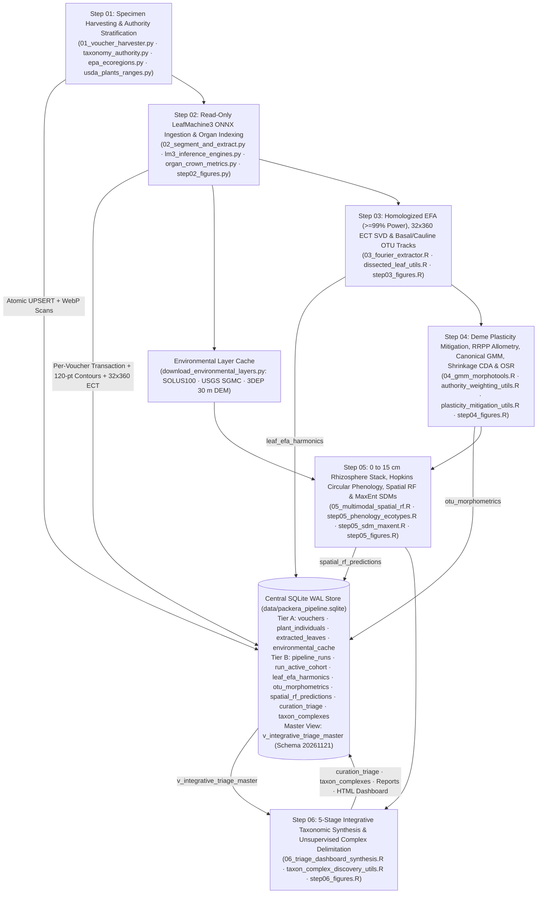

# Automated Vegetative Phenotyping and Integrative Species Delimitation Pipeline for North American *Packera*

[](LICENSE)
[](https://www.python.org/)
[](https://www.r-project.org/)
[](https://github.com/Gene-Weaver/LeafMachine3)
[](docs/DATA_DICTIONARY.md)

**Principal Investigator:** J. Brandon Fuller (Department of Biology, University of North Carolina at Chapel Hill)
**Faculty Advisor:** Dr. Alan S. Weakley (Director, University of North Carolina Herbarium [NCU])
**Documentation Suite:** [`docs/TAXONOMIC_SOP.md`](docs/TAXONOMIC_SOP.md) (`UNC-BOT-SOP-2026-04-REV5`) · [`docs/DATA_DICTIONARY.md`](docs/DATA_DICTIONARY.md) · [`docs/ENVIRONMENTAL_DATA_SOURCES.md`](docs/ENVIRONMENTAL_DATA_SOURCES.md) · [`CONTRIBUTING.md`](CONTRIBUTING.md) · [`CHANGELOG.md`](CHANGELOG.md)

## Overview and Scientific Motivation

Species boundaries in North American *Packera* Á. Löve & D. Löve (Asteraceae: Senecioneae) are notoriously difficult to resolve from herbarium labels alone. Across the ***Packera dubia* (Spreng.) Trock & Mabb. complex** and its eastern and continental congeners, individual plants undergo strong developmental heteroblasty from petiolate basal rosette leaves to sessile cauline stem leaves, whereas frequent polyploidy ($2n = 44, 46, 88$; Kowal 1975) and interspecific hybridization blur vegetative boundaries in contact zones. Many taxa also specialize on narrow edaphic islands such as granitic flatrocks and diabase glades, whereas closely related lineages inhabit serpentine barrens or deep coastal plain sands. Because public herbarium aggregators mix specialist determinations with unverified folder labels and split duplicate gatherings (exsiccatae) under conflicting names, naive statistical pooling across raw specimen labels obscures real evolutionary lineages.

I built this six-stage Python and R pipeline at the University of North Carolina Herbarium (NCU) to test species boundaries across North American *Packera* under the Unified Species Concept (de Queiroz 2007) through Integration by Congruence (Padial et al. 2010). Rather than treating every herbarium folder label as ground truth, I stratify determiners by taxonomic authority and pin verified nomenclatural type specimens as morphological and *locus classicus* ecological baselines. Unverified collections receive zero training weight and project passively into authority-anchored spaces, so label noise cannot distort reference covariances before out-of-sample screening.

At first glance, computer vision segmentation on pressed sheets and fine-grain rhizosphere niche modeling seem like separate research problems, but that difference is superficial because both workflows isolate homologous biological signal from archival noise before testing lineage divergence. Step 02 extracts calibrated leaf masks, 31-keypoint anatomical pose skeletons, $32 \times 360$ polar Euler Characteristic Transform (ECT) descriptors, and optical capitulum phenophases through a read-only [LeafMachine3](https://github.com/Gene-Weaver/LeafMachine3) ONNX adapter. Steps 03 to 06 then evaluate closed-contour Elliptic Fourier harmonics, topological sinus complexity, allometric scaling, $0\text{ to }15\text{ cm}$ rhizosphere pedology, circular Hopkins flowering phenology, and unsupervised graph modularity to produce reproducible taxonomic revision reports, 300-DPI PNG publication plates, and an offline curatorial triage dashboard.

## Six-Stage Pipeline Architecture

### Two-Tier Transactional Storage (`data/packera_pipeline.sqlite`)

All Python and R stages transact against a central SQLite Write-Ahead Logging (WAL) database (`PACKERA_SCHEMA_USER_VERSION = 20261121`; full column-level contracts in [`docs/DATA_DICTIONARY.md`](docs/DATA_DICTIONARY.md)) paired with atomic CSV snapshots:

1. **Tier A Shared Canonical Store (`data/`):** Stores invariant Step 01 and Step 02 specimen records (`vouchers` and `taxon_synonyms`), multi-plant DBSCAN individuals (`plant_individuals`), segmented leaf geometry (`extracted_leaves`), optical reproductive staging (`voucher_reproductive_phenology`), full-sheet WebP scans (`data/raw_vouchers/`), binary masks (`data/masks/`), 120-vertex tip-up contours (`data/contours/`), $32 \times 360$ ECT arrays (`data/ect/`), and spatially indexed environmental extractions (`environmental_cache` and `environmental_rtree`).
2. **Tier B Run-Scoped Analysis Store (`runs/<RUN_ID>/` and `runs/latest`):** Registers every run in `pipeline_runs`, snapshots the active specimen cohort in `run_active_cohort`, links shared Tier A imagery without duplicating gigabytes on disk, and isolates all Step 03 to 06 statistical tables (`leaf_efa_harmonics`, `otu_morphometrics`, `spatial_rf_predictions`, `curation_triage`, and `taxon_complexes`), raster suitability surfaces, reports, and 300-DPI PNG figures inside `runs/<RUN_ID>/`. The relational view `v_integrative_triage_master` exposes a composite-key join on `(run_id, catalogNumber, plant_individual_id)` across all six stages.



### Stage-by-Stage Summary

| Step | Primary Entrypoints | Core Inputs | Primary Outputs | Scientific Function |
| :---: | :--- | :--- | :--- | :--- |
| **01** | `scripts/data_prep/01_voucher_harvester.py`<br>`scripts/core/harvester.py`<br>`scripts/core/taxonomy_authority.py` | GBIF & iDigBio APIs, EPA Level III Ecoregions, USDA PLANTS county ranges | `vouchers`, `taxon_synonyms`, `curated_vouchers.csv`, `data/raw_vouchers/*.webp` | Dynamic genus-wide or targeted *Packera* harvesting, basionym resolution, exsiccatae deduplication, `identifiedBy` isolation, institutional batch demotion, type protection, and ecoregion tagging |
| **02** | `scripts/pipeline/02_segment_and_extract.py`<br>`scripts/vision/lm3_inference_engines.py`<br>`scripts/vision/step02_figures.py` | `curated_vouchers.csv`, `raw_vouchers/*.webp`, LeafMachine3 ONNX models | `plant_individuals`, `extracted_leaves`, `extracted_leaf_manifest.csv`, `fig02a`, `fig02b`, `lm3_assets/`, `ect_overlays/`, `lm3_sheet_overlays/` | Read-only LeafMachine3 ONNX detection (`yolo26x_det_1280`), UNet++ v9 paper cleanup, ruler tick-lattice calibration, `yolo26x_seg_1024` leaf/petiole/hole masks, 31-keypoint pose, DBSCAN ramet clustering, basal vs. cauline zoning, and optical anthesis staging |
| **03** | `scripts/morphometrics/03_fourier_extractor.R`<br>`scripts/morphometrics/dissected_leaf_utils.R`<br>`scripts/figures/step03_figures.R` | SQLite `contour_xy_json`, `data/ect/*_ect.npy`, `extracted_leaf_manifest.csv` | `leaf_efa_harmonics`, `leaf_efa_harmonics.csv`, `leaf_efa_harmonics_individual.csv`, `fig03a`, `fig03b` | R-side LM3 clump and boundary QC, rigid tip-up homologized `Momocs::efourier` ($H_{\text{opt}} \in [6, 24]$ at $\ge 99\%$ power), bilateral symmetrization, $32 \times 360$ ECT SVD, pure basal OTU medians, and orthogonal cauline heteroblasty metrics |
| **04** | `scripts/morphometrics/04_gmm_morphotools.R`<br>`scripts/morphometrics/authority_weighting_utils.R`<br>`scripts/morphometrics/plasticity_mitigation_utils.R`<br>`scripts/figures/step04_figures.R` | `leaf_efa_harmonics`, `curated_vouchers.csv`, `voucher_reproductive_metrics.csv` | `otu_morphometrics`, `morphometric_flags.csv`, `gmm_bayes_factors_summary.csv`, `fig04a`, `fig04b`, `fig04c` | Conspecific $10\text{ km}$ deme assignment, within-deme phenophase residualization and $Q_{ST}$ whitening, Klingenberg `RRPP` allometry, Stratified Authority Pool Cap, FastMCD + Confident Learning anchor screening, canonical GMM relabeling, deme-blocked shrinkage CDA, OSR novelty, and EPA Ecoregion MANOVA |
| **05** | `scripts/analysis/05_multimodal_spatial_rf.R`<br>`scripts/analysis/step05_phenology_ecotypes.R`<br>`scripts/analysis/step05_sdm_maxent.R`<br>`scripts/figures/step05_figures.R` | `otu_morphometrics`, WorldClim v2.1, SOLUS100, POLARIS, SSURGO, 3DEP, SGMC | `spatial_rf_predictions`, `multimodal_conflict_flags.csv`, `sdm_*.tif`, `fig05a`, `fig05b`, `fig05c` | Uncertainty-gated $0\text{ to }15\text{ cm}$ rhizosphere and bedrock extraction, *locus classicus* ecological baseline control, circular Hopkins phenology residuals, 3-block VIF pruning, Spatial Block-CV Random Forest, MaxEnt + Spatial RF ensemble SDMs, and `PCA-env` Schoener's $D$ tests |
| **06** | `scripts/analysis/06_triage_dashboard_synthesis.R`<br>`scripts/analysis/taxon_complex_discovery_utils.R`<br>`scripts/figures/step06_figures.R` | `v_integrative_triage_master` (joined SQLite view of Steps 01 to 05) | `curation_triage`, `taxon_complexes`, `triage_queue.csv`, `empirical_taxon_complexes.csv`, `Triage_Dashboard_Interactive.html`, `fig06a`, `fig06b` | Out-of-fold Cohen's $\kappa$ consensus weighting, sibling ramet coherence, 5-stage hierarchical decision matrix (Rules A, B, and C), Population-Cohesion Lineage Gate (`cryptic_cluster_cohesion_pass`), Leiden and metric Ward.D2 species-complex delimitation, Markdown revision monograph, and offline HTML triage dashboard |

## Hardware and System Requirements

| Resource | Minimum (Targeted Taxon Cohort) | Recommended (Genus-Wide or Continental Run) |
| :--- | :--- | :--- |
| **Operating System** | Ubuntu 22.04+ LTS, macOS 14+ (Apple Silicon), or Windows 10/11 via WSL 2 (`ext4`) | Ubuntu 22.04/24.04 LTS or WSL 2 on native Linux `ext4` SSD |
| **CPU & Memory** | 8 threads, 16 GB RAM | 16+ threads, 32 to 64 GB RAM |
| **GPU Acceleration** | Optional (falls back cleanly to CPU ONNX Runtime) | NVIDIA GPU with $\ge 8\text{ GB}$ VRAM (driver $\ge 528.33$ on Windows WSL 2 or $\ge 525.60$ on Linux) |
| **Disk Footprint** | ~6 GB (`1.7 GB` LeafMachine3 ONNX models + cohort scans and rasters) | 25 to 60 GB (genus-wide WebP vouchers + continental SOLUS100, SGMC, 3DEP, and WorldClim caches) |

On Windows 10 or Windows 11, store the repository inside the native WSL 2 `ext4` filesystem (`~/Packera_dubia_morphometrics`) rather than `/mnt/c/`, as SQLite WAL locking and raster tile reads run substantially faster on native Linux storage.

## Installation and Environment Setup

The repository separates Python environments into two clean boundaries so compiled geospatial and database packages never collide with pinned computer vision runtimes:
* **`.venv` (Primary Orchestration Environment):** Runs `main.py`, `run_pipeline.sh` preflight helpers, Step 01 harvesting, environmental layer downloads, and SQLite/DuckDB schema migrations.
* **`.venv_LM3` (`LeafMachine3/.venv`):** Isolated `uv`-locked environment managed by `setup_leafmachine3.sh` for Step 02 ONNX Runtime inference (`yolo26x` detection/segmentation/pose, `UNet++ v9` specimen cleanup, ruler calibration, and native `LeafMachine3` visual product rendering), communicating with SQLite purely via Python's built-in `sqlite3` module.

### 1. System Libraries and Primary Python Environment (`.venv`)

```bash
# Ubuntu / Debian / WSL 2 system dependencies for OpenCV, GDAL/PROJ/GEOS (sf & terra), and R packages
sudo apt-get update && sudo apt-get install -y \
  build-essential git curl wget libgl1 libglib2.0-0 python3-venv python3-dev \
  libgdal-dev gdal-bin libgeos-dev libproj-dev libudunits2-dev libsqlite3-dev \
  libharfbuzz-dev libfribidi-dev libfreetype6-dev libpng-dev libtiff5-dev libjpeg-dev \
  r-base r-base-dev

# Create and populate the primary orchestration environment (.venv)
python3 -m venv .venv
source .venv/bin/activate
pip install --upgrade pip
pip install -r requirements.txt
```

### 2. LeafMachine3 ONNX Environment and Checkpoints (`setup_leafmachine3.sh`)

Run the automated installer to set up `uv`, clone [LeafMachine3](https://github.com/Gene-Weaver/LeafMachine3), sync the hardware-matched `uv.lock` environment (`gpu`, `macos`, or `cpu`), download the locked Hugging Face ONNX checkpoints (~1.7 GB), link `models/lm3/`, and verify `lm3 doctor`:

```bash
bash setup_leafmachine3.sh
```

### 3. R Statistical and Visualization Packages (`R >= 4.3`)

```bash
Rscript -e 'install.packages(c("remotes", "tidyverse", "optparse", "mclust", "clustvarsel", "MorphoTools2", "RRPP", "vegan", "MASS", "cluster", "terra", "sf", "maps", "geodata", "soilDB", "spatialRF", "ranger", "maxnet", "adespatial", "blockCV", "ecospat", "ENMTools", "DBI", "RSQLite", "duckdb", "jsonlite", "igraph", "ggplot2", "patchwork", "ggrepel", "png", "ragg", "viridis"), repos="https://cloud.r-project.org"); if (!requireNamespace("Momocs", quietly=TRUE)) remotes::install_github("MomX/Momocs")'
```

### 4. Preflight Environment Diagnostic

```bash
.venv/bin/python main.py check-env
```

## Quick-Start Workflows

```bash
# 1. Default Eastern North American genus-wide run (Steps 01 to 06)
./run_pipeline.sh

# 2. Run Steps 02 to 06 from existing harvested vouchers in SQLite / curated_vouchers.csv
./run_pipeline.sh --skip-harvest

# 3. Targeted species complex cohort
./run_pipeline.sh --taxon "Packera dubia" "Packera aurea" "Packera paupercula" "Packera anonyma"

# 4. Focal taxon + cascading outgroup reference anchors (default: 30 anchors per outgroup)
./run_pipeline.sh --focal-taxon "Packera dubia" --gold-anchors 30

# 5. Focal taxon + unsupervised Step 06 complex discovery and automatic neighbor selection
./run_pipeline.sh --focal-taxon "Packera dubia" --discover-complexes --auto-neighbors

# 6. Single-species intraspecific morphotype and ecotype evaluation mode
./run_pipeline.sh --focal-taxon "Packera dubia" --intraspecific-mode

# 7. Continent-wide North American scope across the United States, Canada, and Mexico
./run_pipeline.sh --geographic-scope north_america --countries US CA MX

# 8. Custom run ID with explicit CPU worker threads, ONNX GPU batch size, and wave size
./run_pipeline.sh --run-id packera_rev1 --threads 12 --gpu-batch-size 16 --wave-size 16

# 9. Resume an existing run at Step 03 without repeating network harvest or LM3 segmentation
./run_pipeline.sh --run-id packera_rev1 --start-step 3

# 10. Iterative curation pass excluding previously flagged Misidentification_Reassign sheets
./run_pipeline.sh --skip-harvest --start-step 3 --exclude-misidentified --triage-source ALL

# 11. Reset all Step 02 to 06 segments, masks, contours, ECT arrays, and runs/ (keeps Step 01 scans & SQLite vouchers)
./run_pipeline.sh --purge-segments

# 12. Standalone Step 06 taxonomic synthesis, HTML dashboard, and 300-DPI complex network plate
Rscript scripts/analysis/06_triage_dashboard_synthesis.R \
  --vouchers runs/latest/data/tables/curated_vouchers.csv \
  --harmonics runs/latest/data/tables/leaf_efa_harmonics.csv \
  --morphometrics runs/latest/data/tables/morphometric_flags.csv \
  --multimodal-flags runs/latest/data/tables/multimodal_conflict_flags.csv \
  --min-affinity 0.03 \
  --output-queue runs/latest/data/tables/triage_queue.csv \
  --output-plot runs/latest/outputs/figures/fig06a_integrative_taxonomic_synthesis.png \
  --output-html runs/latest/outputs/reports/Triage_Dashboard_Interactive.html \
  --output-complexes runs/latest/outputs/reports/empirical_taxon_complexes.csv \
  --output-affinity runs/latest/outputs/reports/pairwise_taxon_affinity_matrix.csv \
  --output-neighbors runs/latest/outputs/reports/focal_auto_neighbors.txt \
  --output-complex-plot runs/latest/outputs/figures/fig06b_taxon_complex_delimitation_network.png \
  --focal-taxon "Packera dubia"
```

## Configuration and CLI Reference

Central defaults live in [`config/config.yaml`](config/config.yaml) and load through the typed `PipelineConfig` dataclass in `scripts/core/config.py`. When `cohort_adaptive_mode: true` is active (default), scalar thresholds in `config/config.yaml` act as physical safety floors when anchor sample sizes are small ($N_{\text{anchor}} < 5$), whereas larger cohorts calibrate harmonic order ($H_{\text{opt}} \in [6, 24]$), retained PCA subspace dimensionality ($k_{95} \in [5, 15]$), non-collinear bioclimatic/edaphic predictors, and circular phenology dispersion thresholds empirically from active reference anchors.

### Master Shell Orchestrator Flags (`./run_pipeline.sh`)

| Flag | Arguments | Default | Description |
| :--- | :--- | :--- | :--- |
| `--run-id` | `<ID>` | `run_<YYYYMMDD_HHMMSS>` | Assigns run directory `runs/<ID>/` and updates symlink `runs/latest`. |
| `--db` | `<PATH>` | `data/packera_pipeline.sqlite` | Overrides path to the central SQLite WAL database (`PACKERA_DB_PATH`). |
| `--start-step` | `<1..6>` | `1` | Starts or resumes execution at Step `1` through `6` (steps $\ge 2$ imply `--skip-harvest`). |
| `--skip-harvest` | *(flag)* | `false` | Skips Step 01 network queries and seeds the cohort from SQLite `vouchers` and `curated_vouchers.csv`. |
| `--skip-env-download` | *(flag)* | `false` | Skips automated pre-Step-05 downloads of missing SOLUS100, USGS SGMC, and cohort 3DEP 30 m DEM tiles. |
| `--force`, `--overwrite` | *(flag)* | `false` | Forces re-execution and overwrites cached Step 01 and Step 02 outputs. |
| `--resegment`, `--force-segment` | *(flag)* | `false` | Clears cached segmentation artifacts for the active cohort and re-runs Step 02 ONNX inference. |
| `--purge-segments`, `--purge-old-data` | *(flag)* | `false` | Wipes Step 02 to 06 masks, contours, ECT files, organ crops, `runs/`, and SQLite Step 02 to 06 rows (`VACUUM`) while preserving Step 01 `vouchers`, `raw_vouchers/`, and `environmental_cache`. |
| `-j`, `--threads`, `--workers` | `<INT>` | Auto-detected | Sets CPU worker thread count across Python and R stages (`PACKERA_MAX_WORKERS`). |
| `--gpu-batch-size`, `--batch-size` | `<N>` | Auto-detected | Sets Step 02 LeafMachine3 ONNX inference batch size (`PACKERA_GPU_BATCH_SIZE`). |
| `--wave-size` | `<N>` | `16` | Sets herbarium sheets processed per asynchronous 3-stage GPU wave in Step 02. |
| `--prefetch-workers` / `--prep-workers` / `--post-workers` | `<N>` | Auto-detected | Overrides Step 02 Stage A disk prefetch, Stage B crop prep, or Stage C contour/ECT worker pools. |
| `--limit` | `<N>` | None | Caps the number of vouchers segmented in Step 02 for smoke testing. |
| `--demo` | *(flag)* | `false` | Enables isolated demo mode (`PACKERA_DEMO_MODE=1`) inside `demo_ephemeral.sqlite` without modifying canonical `data/` stores. |
| `--taxon`, `--taxa` | `"<Sp1>" ...` | Genus-wide | Restricts harvesting and downstream analysis strictly to the named *Packera* taxa. |
| `--focal-taxon` | `"<Binomial>"` | None | Sets focal taxon for cascading outgroup anchor selection, complex neighbor discovery, and report naming. |
| `--exclude-taxon` | `"<Binomial>" ...` | None | Excludes specified taxa from the active run cohort during preflight. |
| `--intraspecific-mode` | *(flag)* | `false` | Evaluates unsupervised morphotypes and ecotypes within a single focal taxon (`0` outgroup anchors). |
| `--expand-synonyms` / `--no-expand-synonyms` | *(flag)* | `--expand-synonyms` | Controls dynamic GBIF Backbone *Senecio* and *Cineraria* basionym expansion in Step 01. |
| `--discover-complexes` | *(flag)* | `false` | Runs Step 06 Leiden/Ward.D2 complex discovery (auto-enables `--auto-neighbors` when `--focal-taxon` is set). |
| `--auto-neighbors` | *(flag)* | `false` | Appends high-affinity congeneric neighbors ($\ge$ `--min-affinity`) from Step 06 complex discovery. |
| `--min-affinity` | `<FLOAT>` | `0.03` | Sets minimum multimodal affinity weight $W_{ij}$ for Step 06 complex network edges and neighbor selection. |
| `--gold-only` / `--determiner-tier` | `<TIER>` | All tiers | Restricts active cohort to `Tier_1_Gold` (plus types) or a named determiner tier. |
| `--gold-anchors` | `<N>` | `30` | Target cascading reference anchors (`Type -> Gold -> Silver -> Bronze`) per outgroup taxon. |
| `--exclude-misidentified` | *(flag)* | `false` | Excludes vouchers previously called as `Misidentification_Reassign` in `--triage-source` (`ALL` or run ID). |
| `--geographic-scope` | `{eastern_na,north_america,global}` | `eastern_na` | Sets Step 01 geographic filter (`eastern_na` retains records east of $-104.05^\circ\text{W}$ with $\ge 3$ eastern occurrences and rescues un-georeferenced types). |
| `--countries` | `<ISO2> ...` | `US CA` | Sets ISO-2 country filter for GBIF occurrence queries (`US`, `CA`, `MX`). |
| `--spatial-thin-km` / `--max-per-state` / `--max-per-region` | `<NUM>` | `0` / None / None | Applies per-taxon geodesic thinning or regional/state caps while exempting Nomenclatural Types and Gold anchors. |

### Python CLI Subcommands (`python main.py <subcommand>`)

| Subcommand | Target Stage / Module | Purpose |
| :--- | :--- | :--- |
| `check-env` | `main.py` | Verifies Python ($\ge 3.10$), ONNX Runtime / CUDA, R ($\ge 4.3$) packages, writable directories, and LeafMachine3 checkpoints. |
| `download-weights` | `scripts/core/artifact_manager.py` | Verifies SHA-256 checksums and stages pinned model weights under `models/lm3/`. |
| `purge-segments` | `scripts/core/db.py` | Resets Step 02 to 06 masks, contours, ECT matrices, `runs/`, and Tier B / Step 02 SQLite tables while preserving Step 01 scans and `vouchers`. |
| `harvest` | `scripts/data_prep/01_voucher_harvester.py` | Runs Step 01 GBIF/iDigBio harvesting, synonym resolution, authority stratification, USDA county range tagging, and WebP downloads. |
| `segment` | `scripts/pipeline/02_segment_and_extract.py` | Runs Step 02 read-only LeafMachine3 ONNX segmentation, DBSCAN plant clustering, basal/cauline zoning, $32 \times 360$ ECT export, and `fig02a`/`fig02b` generation. |
| `morphometrics` | `03_fourier_extractor.R` + `04_gmm_morphotools.R` | Runs Step 03 EFA + ECT decomposition (`fig03a`, `fig03b`) followed by Step 04 allometry, GMM, shrinkage CDA, OSR, and batch/ecoregion audits (`fig04a`, `fig04b`, `fig04c`). |
| `synthesis` (`analyze`) | `05_multimodal_spatial_rf.R` + `06_triage_dashboard_synthesis.R` | Ensures cached environmental layers via `download_environmental_layers.py` (unless `--skip-env-download`), runs Step 05 Spatial RF/MaxEnt/Hopkins (`fig05a` to `fig05c`), and executes Step 06 5-stage triage + complex delimitation (`fig06a`, `fig06b`). |
| `run-all` | `main.py` | Executes `harvest` $\to$ `segment` $\to$ `morphometrics` $\to$ `synthesis` end to end inside a run-scoped directory. |

## External Data Sources and Geospatial Layers

To prevent coarse historical locality centroids from contaminating fine-scale soil models, Step 05 enforces strict coordinate-uncertainty gates before raster extraction: rhizosphere edaphic and $30\text{ m}$ topographic layers require `coordinateUncertaintyInMeters <= 2000` m, whereas macro-climatic rasters allow `<= 10000` m (with $150\text{ km}$ / shared-ecoregion Gold neighbor fallback for historical *locus classicus* type sheets). Full raster filenames, integer scalar divisors, trapezoidal $0\text{ to }15\text{ cm}$ equations, and citations appear in [`docs/ENVIRONMENTAL_DATA_SOURCES.md`](docs/ENVIRONMENTAL_DATA_SOURCES.md).

| Domain | Source / Layer | Native Resolution | Uncertainty Gate | Local Cache Path |
| :--- | :--- | :--- | :--- | :--- |
| **Occurrences & Images** | GBIF & iDigBio Preserved Specimens | Point + uncertainty (m) | Retained (flagged $> 5000\text{ m}$) | `data/raw_vouchers/*.webp` |
| **Taxonomy & County Range** | GBIF Backbone + USDA PLANTS | Taxon / US County | Audit tag by default (`50 km` buffer) | SQLite `taxon_synonyms` & `vouchers` |
| **Biogeographic Regions** | US EPA Level III Ecoregions | Vector polygons | Point-in-polygon ($\ge 95\%$ county fallback) | `data/environmental/epa_ecoregions_l3/` |
| **Pedology (Map Units)** | USDA-NRCS SSURGO (SDA) | $10\text{ to }30\text{ m}$ ($50\text{ m}$ buffer) | $\le 2000\text{ m}$ | `data/environmental/ssurgo_cache/` |
| **Probabilistic Soils** | POLARIS ($0\text{ to }15\text{ cm}$ trapezoid) | $30\text{ m}$ ($1\text{ arcsec}$) | $\le 2000\text{ m}$ | `data/environmental/polaris_30m/` |
| **Soil & Bedrock Grids** | USDA-NRCS SOLUS100 ($0\text{ to }15\text{ cm}$) | $100\text{ m}$ | $\le 2000\text{ m}$ | `data/environmental/solus_100m/` |
| **Bedrock Lithology** | USGS State Geologic Map Compilation (SGMC) | Vector `.gpkg` (6 lithic classes) | $\le 2000\text{ m}$ | `data/environmental/sgmc/` |
| **Micro-Topography** | USGS 3DEP Elevation (Slope, TPI, HLI, D8 TWI) | $\sim 30\text{ m}$ ($1^\circ \times 1^\circ$ cohort tiles) | $\le 2000\text{ m}$ | `data/environmental/dem_3dep_30m/` |
| **Macro-Climate** | WorldClim v2.1 (`bio1` to `bio19`, NA-cropped) | $30\text{ arcsec}$ ($\sim 1\text{ km}$) | $\le 10000\text{ m}$ | `data/environmental/` |

## Output Layout and 300-DPI PNG Figure Suite

Every run writes self-contained tables, reports, rasters, and **300-DPI PNG-only** figures (`0` PDF outputs) under `runs/<RUN_ID>/` (`runs/latest/`):

* **Tables (`runs/<RUN_ID>/data/tables/`):** `curated_vouchers.csv`, `extracted_leaf_manifest.csv`, `voucher_reproductive_metrics.csv`, `voucher_phenological_states.csv`, `leaf_efa_harmonics_individual.csv`, `leaf_efa_harmonics.csv`, `allometry_permanova_summary.csv`, `allometry_pairwise_slopes.csv`, `batch_variance_audit.csv`, `morphometric_flags.csv`, `ssurgo_edaphic_validation.csv`, `phenological_anomalies.csv`, `multimodal_conflict_flags.csv`, and `triage_queue.csv`.
* **Reports & Dashboard (`runs/<RUN_ID>/outputs/reports/`):** `gmm_bayes_factors_summary.csv`, `manova_group_significance.csv`, `manova_pairwise_posthoc.csv`, `ecoregion_supervised_cda_summary.csv`, `micro_edaphic_outcrop_contingency.csv`, `phenological_anomaly_summary.csv`, `multimodal_spatial_rf_summary.csv`, `sdm_model_performance.csv`, `empirical_taxon_complexes.csv`, `pairwise_taxon_affinity_matrix.csv`, `focal_auto_neighbors.txt`, `Packera_Taxonomic_Revision_Summary.md`, and the self-contained offline curatorial viewer `Triage_Dashboard_Interactive.html`.
* **Native LeafMachine3 Visual Caches (`runs/<RUN_ID>/outputs/figures/`):**
  * `lm3_assets/` and `ect_overlays/`: Unlimited taxon-indexed native `LeafMachine3` leaf cutouts (`render_leaf_products`) and polar radial ECT badges (`render_radial_ect_overlay`) across basal and cauline tracks, reused inline across Step 03, Step 06, and `Triage_Dashboard_Interactive.html`.
  * `lm3_sheet_overlays/`: Capped (`max_sheets = 24`) 300-DPI whole-sheet diagnostic overlays highlighting Nomenclatural Types, multi-plant DBSCAN ramet sheets, heteroblastic basal-plus-cauline sheets, and ruler-calibrated exemplars.

### Canonical 12-Plate 300-DPI PNG Figure Inventory

All 12 publication plates scale dynamically from $N = 1$ intraspecific runs to $60+$ taxa and infraspecific ranks (`subsp.`, `var.`, `f.`) through a combinatorial 12-hue Tol/Okabe-Ito colorblind-safe palette paired with 5 unfilled hollow marker geometries ($12 \times 5 = 60$ unique combinations), dynamic canvas height ($0.28\text{ in}$ per taxon row), repelled centroid labels above 10 groups, automatic 1D `Can1` density-plus-raincloud switching when $G = 2$, ICN rank-aware italicization, and equal-area `EPSG:5070` (`NAD83 / Conus Albers`) projections:

| Canonical PNG Filename | Step | Scientific Contents and Visual Protocol |
| :--- | :---: | :--- |
| `fig02a_lm3_organ_and_ect_exemplars.png` | **02** | Dynamic all-taxa montage of downstream-QC-verified `LeafMachine3` leaf cutouts (`20th`, `50th`, `80th` dissection quantiles, ruler scale bars, and basal/cauline tracks) paired with polar radial ECT badges |
| `fig02b_segmentation_qc_and_phenophase.png` | **02** | Horizontal multi-panel QC plate covering ruler vs. MP scale calibration, lamina solidity and aspect-ratio distributions across zones, optical capitulum anthesis staging, and failure audit counts |
| `fig03a_efa_morphospace_and_harmonics.png` | **03** | Symmetric EFA morphospace (`PC1` vs. `PC2`) over a $5 \times 3$ `Momocs` inverse-Fourier background deformation grid, paired with cumulative harmonic power ($H_{\text{opt}}$ at $\ge 99\%$) and dynamic `PC1..PC{k_95}` variance scree |
| `fig03b_topological_ect_and_heteroblasty.png` | **03** | Basal $32 \times 360$ topological ECT ordination (`ECT_PC1` vs. `ECT_PC2`), embedded native `LeafMachine3` radial ECT medoid gallery, taxon-ordered lobe complexity boxplots, and basal-to-cauline heteroblastic divergence |
| `fig04a_foliar_allometry_audit.png` | **04** | Ruler-calibrated multivariate foliar allometry regression ($\log_{10}\text{CS}$ vs. shape with `RRPP` homogeneity statistics) alongside size-free residualized morphospace or calibrated size distributions |
| `fig04b_gmm_cda_morphometrics.png` | **04** | Unsupervised GMM $2\Delta\text{BIC}$ curve, Ledoit-Wolf shrinkage CDA ordination (2D biplot with top structure vectors for $G \ge 3$, or 1D `Can1` density + hollow raincloud for $G = 2$), scale-invariant trait boxplots, and Taxon $\times$ GMM concordance matrix |
| `fig04c_ecoregion_and_batch_audit.png` | **04** | Supervised US EPA Level III Ecoregion CDA ordination (with Pillai's Trace MANOVA subtitle) paired with taxon-controlled ANCOVA partial $R^2$ institutional herbarium batch-effect audit |
| `fig05a_ecological_niche_and_rf_importance.png` | **05** | Spatial Block-CV Random Forest non-MEM variable importance across Climatic, Topographic, and Rhizosphere streams, top-2 realized niche space, rhizosphere/climatic boxplots with Kruskal-Wallis $p$, and full $N \times N$ `PCA-env` Schoener's $D$ matrix (or IBE partial RDA in $K = 1$ mode) |
| `fig05b_hopkins_circular_phenology.png` | **05** | Verified-anthesis DOY vs. latitude regression with empirical Hopkins bioclimatic slope, circular polar rose histogram of Hopkins-adjusted flowering clock, and taxon-stratified $\Delta\text{DOY}$ isolation residuals |
| `fig05c_sdm_suitability_and_distribution_map.png` | **05** | Focal MaxEnt (`cloglog`) and Spatial RF + MaxEnt ensemble suitability maps, marginal response curves, spatial-block ROC + Continuous Boyce Index calibration, and multi-taxon ensemble suitability grid (or `EPSG:5070` Albers distribution map with scale bar and north arrow when rasters are absent) |
| `fig06a_integrative_taxonomic_synthesis.png` | **06** | 5-stage decision-call morphospace, `EPSG:5070` Albers contact-zone and type-locality map, 5-stage taxonomic treatment proportions per taxon, and 5-stream OOF $\kappa$-weighted Wettstein concordance grid (also copied to `Figure_Integrative_<Focal_Taxon>_Revision.png` when `--focal-taxon` is set) |
| `fig06b_taxon_complex_delimitation_network.png` | **06** | Ward.D2 clustered multimodal pairwise affinity heatmap ($W_{ij}$) paired with Leiden/consensus community network graph encoding intra-complex vs. inter-complex topology and $\log_{10}(N)$ node sizes |

## Repository Structure

```text
Packera_dubia_morphometrics/
├── config/
│   ├── __init__.py                                  # Typed configuration package marker
│   └── config.yaml                                  # Central paths, LeafMachine3 settings, and cohort-adaptive bounds
├── docs/
│   ├── TAXONOMIC_SOP.md                             # Complete mathematical, statistical, and botanical SOP (REV5)
│   ├── DATA_DICTIONARY.md                           # SQLite Schema 20261121 table, column, unit, and CSV specifications
│   └── ENVIRONMENTAL_DATA_SOURCES.md                # Pedological, lithological, topographic, and BioClim layer specs
├── .agents/
│   └── skills/
│       ├── pipeline-contract-audit/SKILL.md         # Cross-stage SQLite/CSV contract and hygiene audit checks
│       └── write-in-my-voice/SKILL.md               # Writing DNA v5.2 prose and punctuation standard
├── AGENTS.md                                        # Workspace rules, relational schema contracts, and module map
├── CHANGELOG.md                                     # Versioned methodological, figure, and SQLite schema history
├── CITATION.cff                                     # CFF 1.2.0 software and SOP citation metadata
├── CONTRIBUTING.md                                  # Developer environment boundaries, line budgets, and QA gates
├── LICENSE                                          # MIT License + LeafMachine3 AGPL-3.0 and federal data boundary notice
├── README.md                                        # Operational architecture, installation, CLI, and output reference
├── requirements.txt                                 # Primary Python (.venv) orchestration dependencies
├── setup_leafmachine3.sh                            # Automated uv + LeafMachine3 ONNX installer and doctor check
├── run_pipeline.sh                                  # Master run-scoped shell orchestrator (Steps 01 to 06)
├── main.py                                          # Unified Python CLI runner and preflight checker
└── scripts/
    ├── core/
    │   ├── config.py                                # Typed PipelineConfig loader and thread/batch resolvers
    │   ├── db.py                                    # Transactional SQLite WAL and DuckDB operations + purge_segments_and_runs
    │   ├── db_schema.py                             # Schema 20261121 DDL, migrations, and v_integrative_triage_master view
    │   ├── db_utils.R                               # R SQLite/DuckDB batch reader, dynamic column sync, and atomic writers
    │   ├── harvester.py                             # GBIF/iDigBio harvester, synonym resolver, exsiccatae deduplicator, and WebP saver
    │   ├── taxonomy_authority.py                    # 3-layer determiner authority engine, monographer loan guard, and batch demotion
    │   ├── epa_ecoregions.py                        # US EPA Level III Ecoregion point-in-polygon and county fallback engine
    │   ├── usda_plants_ranges.py                    # USDA PLANTS symbol resolver and 50 km buffered county distribution tagger
    │   ├── artifact_manager.py                      # SHA-256 model checkpoint verifier and downloader
    │   └── logger.py                                # Standardized console and file logger
    ├── data_prep/
    │   ├── 01_voucher_harvester.py                  # Step 01 CLI parser and occurrence harvester entrypoint
    │   └── download_environmental_layers.py         # Automated SOLUS100, USGS SGMC (.gpkg), and cohort 3DEP 30 m DEM downloader
    ├── vision/
    │   ├── configure_leafmachine3.py                # Generates LM3_settings.local.yaml and resolves ONNX modelhub paths
    │   ├── lm3_compat.py                            # Lightweight LeafMachine3 compatibility and NumPy DBSCAN fallback helpers
    │   ├── lm3_data_loader.py                       # Working-frame unscaling (work_scale), ruler tick-lattice, and keypoint loaders
    │   ├── lm3_inference_engines.py                 # ONNX Runtime engines (YOLO26x Det/Seg/Pose and UNet++ v9 Specimen Segmenter)
    │   ├── leaf_geometry_utils.py                   # Native LM3 geometry delegation, 120-pt tip-up contour export, and 32x360 ECT
    │   ├── organ_crown_metrics.py                   # DBSCAN ramet clustering, caudex crown estimation, leaf_zone, and scape/petiole metrics
    │   ├── capitulum_phenology_classifier.py        # Optical bud/anthesis/fruit head staging and determinate cyme rules
    │   └── step02_figures.py                        # Step 02 300-DPI PNG plates (fig02a, fig02b) and native LM3 asset/overlay exporters
    ├── pipeline/
    │   ├── 01_voucher_harvester.py                  # Step 01 pipeline module alias
    │   └── 02_segment_and_extract.py                # Step 02 read-only LM3 adapter and 3-stage asynchronous wave engine
    ├── morphometrics/
    │   ├── 03_fourier_extractor.R                   # Step 03 LM3 EFA QC, homologized Momocs EFA, 32x360 ECT SVD, and basal/cauline medians
    │   ├── 04_gmm_morphotools.R                     # Step 04 RRPP allometry, canonical GMM, deme-blocked shrinkage CDA, OSR, and batch audit
    │   ├── authority_weighting_utils.R              # Stratified pool cap, FastMCD + Confident Learning anchors, and crossed Bayesian weights
    │   ├── dissected_leaf_utils.R                   # Harmonic power calibration, 32x360 ECT alignment/SVD, and dissection metrics
    │   ├── fourier_parallel_utils.R                 # Parallel contour alignment and harmonic extraction workers
    │   ├── plasticity_mitigation_utils.R            # 10 km spatial demes, phenophase residualization, Q_ST whitening, and ridgeline merging
    │   ├── pub_figures_utils.R                      # Taxon standardization, dynamic palettes, PC table exports, and figure dispatchers
    │   ├── pub_ecoregion_manova_utils.R             # Supervised EPA Level III Ecoregion CDA and Pillai/Hotelling MANOVA suite
    │   └── pub_synthesis_plates.R                   # Pure-R GMM EM fallback solver and Step 06 figure dispatch wrappers
    ├── figures/
    │   ├── theme_packera_pub.R                      # Shared 300-DPI PNG saver, 60-taxon hollow symbol/palette engine, ICN labeller, and EPSG:5070 basemap
    │   ├── step03_figures.R                         # Renders fig03a_efa_morphospace_and_harmonics.png and fig03b_topological_ect_and_heteroblasty.png
    │   ├── step04_figures.R                         # Renders fig04a_foliar_allometry_audit.png, fig04b_gmm_cda_morphometrics.png, and fig04c_ecoregion_and_batch_audit.png
    │   ├── step05_figures.R                         # Renders fig05a_ecological_niche_and_rf_importance.png, fig05b_hopkins_circular_phenology.png, and fig05c_sdm_suitability_and_distribution_map.png
    │   └── step06_figures.R                         # Renders fig06a_integrative_taxonomic_synthesis.png and fig06b_taxon_complex_delimitation_network.png
    ├── analysis/
    │   ├── 05_multimodal_spatial_rf.R               # Step 05 19-BioClim + 0 to 15 cm rhizosphere Spatial Block-CV RF and PCA-env niche tests
    │   ├── step05_phenology_ecotypes.R              # Circular Hopkins phenology regression, locus classicus controls, and K=1 ecotype gate
    │   ├── step05_sdm_maxent.R                      # Authority-weighted MaxEnt (cloglog) + Spatial RF ensemble SDMs and Boyce calibration
    │   ├── edaphic_fine_grain_utils.R               # SSURGO SDA, POLARIS 30 m, SOLUS100, 3DEP 30 m topography, and USGS SGMC extractors
    │   ├── 06_triage_dashboard_synthesis.R          # Step 06 OOF kappa consensus, 5-stage decision matrix, Markdown report, and offline HTML dashboard
    │   └── taxon_complex_discovery_utils.R          # Step 06 Leiden/Louvain modularity and Ward.D2 species-complex delimitation
    └── tests/                                       # 250-test Python, SQLite handshake, R integration, and code-hygiene QA suite
```

## Verification, Reproducibility, and Troubleshooting

Developer workflow conventions, R script line-count budgets, and pre-commit QA rules are documented in [`CONTRIBUTING.md`](CONTRIBUTING.md).

### Running the Automated Audit Suite (`250` Tests)

```bash
# Run the centralized 250-test Python + R integration and code-hygiene runner
.venv/bin/python scripts/tests/run_audit.py

# Or run targeted suites via pytest / unittest
.venv/bin/python -m unittest scripts/tests/test_code_hygiene.py
```

### Reproducibility Guarantees
* **Deterministic Seeding Without Global RNG Corruption:** Step 03, Step 04, Step 05, and Step 06 Complex Discovery isolate random number generator state (`on.exit` `.Random.seed` restoration around permutation and `igraph` community calls) so stochastic permutations remain reproducible under `--seed`.
* **Zero Silent Synthetic Fallbacks:** When `demo` mode is off (`--demo` omitted), empty POLARIS, SOLUS100, or 3DEP directories return honest `NA` columns rather than fabricating synthetic environmental values, and `--demo` runs isolate all SQLite writes inside `demo_ephemeral.sqlite`.

### Common Troubleshooting
* **`CUDAExecutionProvider` Missing During Step 02:** Run `LeafMachine3/.venv/bin/python -c "import onnxruntime as ort; print(ort.get_available_providers())"`. If only `CPUExecutionProvider` appears on a machine with an NVIDIA GPU, re-run `bash setup_leafmachine3.sh` after confirming `nvidia-smi` succeeds.
* **Missing GDAL / PROJ / HarfBuzz Headers During R Package Compilation:** Install `libgdal-dev`, `libgeos-dev`, `libproj-dev`, `libudunits2-dev`, `libharfbuzz-dev`, and `libfribidi-dev` via `apt-get` (or `brew install pkg-config gdal geos proj udunits` on macOS) before installing `sf`, `terra`, and `ragg`.
* **Refreshing Downstream Analyses After Re-Curation:** Use `./run_pipeline.sh --skip-harvest --start-step 3 --exclude-misidentified` to start a clean Tier B run directory from existing Step 02 contours and ECT arrays without re-downloading images or re-running ONNX segmentation.

## License and Citation

Pipeline orchestration, morphometric modeling, spatial niche analysis, and taxonomic synthesis code in this repository are released under the [MIT License](LICENSE). [LeafMachine3](https://github.com/Gene-Weaver/LeafMachine3) is distributed separately under the GNU Affero General Public License v3.0 (AGPL-3.0).

Machine-readable citation metadata is provided in [`CITATION.cff`](CITATION.cff). When citing this pipeline or its statistical protocol, cite [`docs/TAXONOMIC_SOP.md`](docs/TAXONOMIC_SOP.md) (`UNC-BOT-SOP-2026-04-REV5`) alongside Weaver (2026; `https://github.com/Gene-Weaver/LeafMachine3`) and Ayub et al. (2026; `doi: 10.64898/2026.04.13.718293`).
