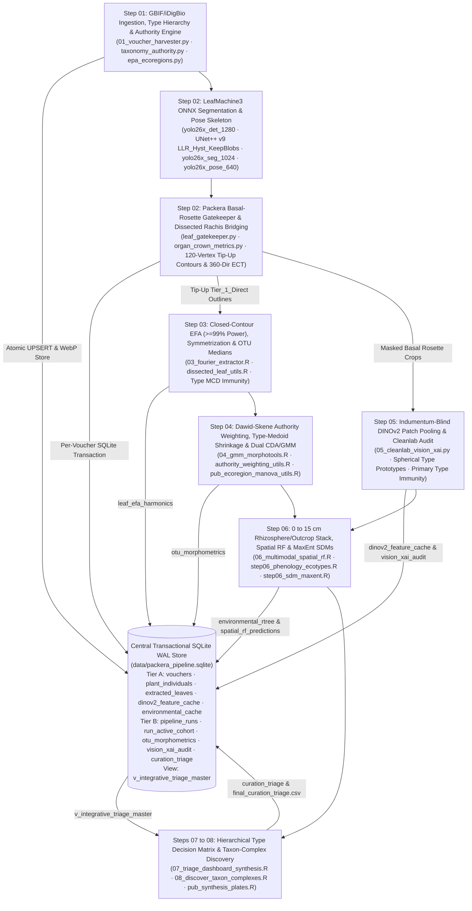

# Automated High-Throughput Vegetative Phenotyping and Herbarium Triage Pipeline for North American *Packera*

### Integrative Morphometric, Visual, and Edaphic Species Delimitation Anchored by Nomenclatural Types

[](https://opensource.org/licenses/MIT) [](https://www.python.org/downloads/) [](https://www.r-project.org/) [](https://github.com/Gene-Weaver/LeafMachine3)

## Project Overview

Species boundaries in North American *Packera* Á. Löve & D. Löve (Asteraceae: Senecioneae) are notoriously difficult to resolve from herbarium specimens alone. Across the ***Packera dubia*** **(Spreng.) Trock & Mabb. complex** (formerly *Packera tomentosa* and *Senecio tomentosus*) and its eastern North American congeners, taxa exhibit pronounced heteroblasty between basal rosette leaves and upper cauline stem leaves, frequent polyploidy ($2n = 44, 46, 88$; Kowal 1975), reticulate hybridization, and sharp edaphic specialization on granite flatrocks, diabase glades, serpentine barrens, and coastal plain sands. Because historical herbarium holdings contain high rates of misidentification and mixed duplicate gatherings (exsiccatae), pooling raw specimen measurements by their current folder label blurs real evolutionary boundaries.

I built this pipeline at the University of North Carolina at Chapel Hill and the UNC Herbarium (NCU) to evaluate morphological diagnosability under the Unified Species Concept (de Queiroz 2007) through Integration by Congruence (Padial et al. 2010). Rather than treating every herbarium label as equally reliable ground truth, I stratify specimens by determiner authority, pin verified nomenclatural type specimens (`Holotype`, `Lectotype`, `Neotype`, `Isotype`, `Syntype`, and `Paratype`) as immutable morphological, visual, and *locus classicus* ecological baselines, and isolate intact basal rosette leaves from cauline stem leaves before measuring outline shape. I then test whether vegetative leaf geometry, reproductive macro-morphology, leaf surface visual features, flowering phenology, and fine-scale rhizosphere and bedrock niches ($0\text{ to }15\text{ cm}$ soil properties and $10\text{ to }30\text{ m}$ outcrop lithology) converge on the same evolutionary lineages.

While *Packera dubia* serves as my primary focal species for eastern North American dissertation research, the pipeline contains zero hardcoded species lists (`target_species: []`). It discovers, harvests, and evaluates any user-specified *Packera* subset or the entire North American genus dynamically from GBIF and iDigBio.

### Core Empirical Capabilities

* **Taxonomic Authority Weighting and Nomenclatural Type Pinning (Step 01):** I harvest Darwin Core archives from GBIF and iDigBio, resolve *Senecio* and *Cineraria* basionyms dynamically, deduplicate exsiccatae series before downloading imagery, store sheets as lossless-calibrated WebP images, intersect coordinates with official US EPA Level III Ecoregions (Omernik & Griffith 2014), and classify determiners across a 4-tier authority hierarchy (`Tier_0_Type`, `Tier_1_Gold` monographers and protologue authors, `Tier_2_Silver` curated regional herbaria, and `Tier_3_Bronze` general collections). Historical nomenclatural types are exempted from coordinate-uncertainty and partial-date drop filters so 18th- and 19th-century type gatherings are never discarded.
* **LeafMachine3 ONNX Segmentation and Basal-Rosette Gatekeeping (Step 02):** I run [LeafMachine3](https://github.com/Gene-Weaver/LeafMachine3) (Weaver 2026) on `onnxruntime` for 9-class plant organ detection (`yolo26x_det_1280`), whole-sheet plant-versus-paper segmentation (`UNet++ v9` with `LLR_Hyst_KeepBlobs` color-likelihood paper cleanup), ensemble ruler classification and tick-lattice scale calibration anchored by a megapixel resolution prior (`lm3_mp_conversion_factor__sqrt_fit`, $R^2 = 0.905$), 3-class single-leaf instance segmentation (`yolo26x_seg_1024` separating `Leaf`, `Petiole`, and `Hole`), and 31-keypoint midvein and petiole pose tracking (`yolo26x_pose_640`). My *Packera* gatekeepers (`leaf_gatekeeper.py` and `organ_crown_metrics.py`) cluster multi-plant sheets via DBSCAN, estimate rosette crowns, reject cauline stem leaves and severed lobes, bridge dissected pinnae along paper-cleaned rachises, reflect folded leaves across the 15-point midvein trace (`Tier_2_Reflected`), and export 120-vertex tip-up lamina outlines alongside 360-direction Euler Characteristic Transforms (ECT; Ayub et al. 2026).
* **Type-Anchored Elliptic Fourier Analysis and Multivariate Morphometrics (Steps 03 to 04):** I decompose closed `Tier_1_Direct` basal leaf outlines using Elliptic Fourier Analysis (`Momocs::efourier`, calibrated to capture $\ge 99\%$ cumulative harmonic power), remove bilateral asymmetry (`Momocs::rm_asym`; Claude 2008), and aggregate leaves to Operational Taxonomic Unit (OTU) medians per plant individual. In Step 04, I estimate determiner error rates via an exogenous Dawid-Skene and Beta-Binomial Empirical Bayes model, test Klingenberg (2016) allometric slope homogeneity, shrink taxon reference centroids toward nomenclatural type medoids in proportion to effective type sample size (ICN Art. 7.2), and run both unsupervised Gaussian Mixture Modeling (`Morphotype_K1..Kn`) and supervised Canonical Discriminant Analysis and Pillai/Wilks MANOVA across EPA Level III Ecoregions.
* **Indumentum-Blind Vision XAI and Confident Learning Audit (Step 05):** I extract foreground-pooled 768-dimensional `dinov2_vitb14_reg` patch embeddings from masked basal rosette crops, compute cosine similarity against weighted spherical type prototypes, and apply Cleanlab out-of-fold Confident Learning (Northcutt et al. 2021) to distinguish genuine taxonomic misidentifications from taphonomic drying artifacts and abaxial tomentum denudation.
* **Fine-Grain Rhizosphere/Outcrop Niche Modeling and Integrative Triage (Steps 06 to 08):** I pair $1\text{ km}$ WorldClim bioclimatic variables with a cached $0\text{ to }15\text{ cm}$ rhizosphere and bedrock stack combining 50 m-buffered USDA-NRCS SSURGO map units (`ssurgo_rock_outcrop_pct`, `ssurgo_bedrock_depth_cm`), 30 m POLARIS probabilistic soil grids, 100 m SOLUS100 bedrock depth and rock fragment volume, $10\text{ to }30\text{ m}$ USGS 3DEP micro-topography, and USGS SGMC bedrock lithology, alongside circular Hopkins flowering phenology anomalies. I fit spatially blocked Random Forest and authority-weighted MaxEnt (`maxnet`) habitat suitability models, run partitioned climatic versus edaphic niche equivalency tests (Warren et al. 2008; Broennimann et al. 2012), and synthesize all modalities in a 5-stage hierarchical decision matrix (`v_integrative_triage_master`) and Leiden/Louvain graph clustering to delimit species complexes and flag candidate cryptic lineages or synonymies.

### Project Metadata

* **Principal Investigator:** J. Brandon Fuller (PhD Candidate, Department of Biology, University of North Carolina at Chapel Hill)
* **Faculty Advisor:** Dr. Alan S. Weakley (Director, UNC Herbarium [NCU])
* **Methodological Reference:** See [docs/TAXONOMIC\_SOP.md](https://www.google.com/search?q=docs/TAXONOMIC_SOP.md) (`UNC-BOT-SOP-2026-04-REV5`) for complete mathematical equations, statistical proofs, and botanical criteria.

## Eight-Stage Pipeline Architecture

The pipeline executes under a **Two-Tier Canonical Storage Architecture**:
1. **Tier A: Canonical Shared Store (`data/` and `data/packera_pipeline.sqlite`):** Houses invariant Step 01 and Step 02 specimen records, WebP imagery (`data/raw_vouchers/`), organ masks and contours (`data/masks/`, `data/contours/`, `data/cropped_patches/`), environmental caches (`environmental_cache`, `environmental_rtree`), and DINOv2 embeddings (`dinov2_feature_cache`).
2. **Tier B: Run-Scoped Analysis Directories (`runs/<RUN_ID>/` and `runs/latest`):** Registers each execution in `pipeline_runs`, populates `run_active_cohort`, symlinks shared Tier A image/mask assets without re-segmenting already completed sheets, and isolates all Step 03 to 08 tables, reports, rasters, and publication figures inside `runs/<RUN_ID>/`.

| Step | Entrypoint & Helper Modules | Primary Inputs | Primary Outputs (SQLite & CSV/Figures) | Core Scientific Function |
| :--- | :--- | :--- | :--- | :--- |
| **01** | `scripts/pipeline/01_voucher_harvester.py`<br>`scripts/core/harvester.py`<br>`scripts/core/taxonomy_authority.py`<br>`scripts/core/epa_ecoregions.py` | GBIF & iDigBio APIs, `config/config.yaml`, US EPA Level III Ecoregion polygons | `vouchers`, `taxon_synonyms`, `data/tables/curated_vouchers.csv`, `data/raw_vouchers/*.webp` | Dynamic synonym expansion, pre-download exsiccatae deduplication, 3-layer determiner authority scoring, nomenclatural type rescue, and EPA Level III ecoregion assignment |
| **02** | `scripts/pipeline/02_segment_and_extract.py`<br>`scripts/vision/lm3_inference_engines.py`<br>`scripts/vision/lm3_data_loader.py`<br>`scripts/vision/leaf_geometry_utils.py`<br>`scripts/vision/leaf_gatekeeper.py`<br>`scripts/vision/organ_crown_metrics.py`<br>`scripts/vision/step02_figures.py` | `curated_vouchers.csv`, `data/raw_vouchers/*.webp`, LeafMachine3 ONNX models | `plant_individuals`, `extracted_leaves`, `voucher_reproductive_phenology`, `extracted_leaf_manifest.csv`, `fig02a`, `fig02b` | LeafMachine3 ONNX detection (`yolo26x_det_1280`), UNet++ v9 paper cleanup, ruler lattice + MP scale calibration, 3-class `Leaf`/`Petiole`/`Hole` segmentation, 31-keypoint pose tracking, DBSCAN plant clustering, cauline/lobe rejection, rachis bridging, and 120-vertex tip-up contour + 360-direction ECT export |
| **03** | `scripts/morphometrics/03_fourier_extractor.R`<br>`scripts/morphometrics/dissected_leaf_utils.R`<br>`scripts/morphometrics/fourier_parallel_utils.R` | `extracted_leaves.contour_xy_json`, `reports/Leaf_Momocs/momocs_outlines.json`, `Coordinates/*.h5` | `leaf_efa_harmonics`, `leaf_efa_harmonics.csv`, `fourier_pcs.csv`, `fig03` plates | Batch SQLite/Momocs tip-up contour ingestion, $\ge 99\%$ harmonic power calibration, bilateral symmetrization (`rm_asym`), type-exempt MCD outlier screening, and OTU median aggregation |
| **04** | `scripts/morphometrics/04_gmm_morphotools.R`<br>`scripts/morphometrics/authority_weighting_utils.R`<br>`scripts/morphometrics/pub_figures_utils.R`<br>`scripts/morphometrics/pub_ecoregion_manova_utils.R` | `leaf_efa_harmonics`, `curated_vouchers.csv`, `voucher_reproductive_phenology` | `otu_morphometrics`, `morphometric_audit.csv`, `gmm_bayes_factors_summary.csv`, `fig04a`, `fig04b`, `fig04c` | Dawid-Skene + Beta-Binomial Empirical Bayes authority weighting, Klingenberg allometric testing, Art. 7.2 type-medoid shrinkage, Track 1 unsupervised GMM clustering, and Track 2 supervised EPA Level III Ecoregion CDA & MANOVA |
| **05** | `scripts/analysis/05_cleanlab_vision_xai.py`<br>`scripts/analysis/vision_dissection_utils.py` | `rosettes_dense/`, `basal_leaves_raw/`, `otu_morphometrics` | `dinov2_feature_cache`, `vision_xai_audit`, `misidentified_vouchers_audit.csv`, `fig05` | Foreground-masked `dinov2_vitb14_reg` patch pooling, spherical type visual prototype cosine control, and Cleanlab out-of-fold Confident Learning label-noise audit |
| **06** | `scripts/analysis/06_multimodal_spatial_rf.R`<br>`scripts/analysis/step06_phenology_ecotypes.R`<br>`scripts/analysis/step06_sdm_maxent.R`<br>`scripts/analysis/edaphic_fine_grain_utils.R` | `otu_morphometrics`, WorldClim, SSURGO, POLARIS, SOLUS100, 3DEP, SGMC | `environmental_cache`, `spatial_rf_predictions`, `multimodal_conflict_flags.csv`, `sdm_*.tif`, `fig06`, `fig06b` | $0\text{ to }15\text{ cm}$ rhizosphere and outcrop extraction, *locus classicus* ecological baseline control, Hopkins circular phenology anomalies, Spatial Block-CV Random Forest, MaxEnt (`maxnet`) ensemble SDMs, and niche equivalency tests |
| **07** | `scripts/analysis/07_triage_dashboard_synthesis.R`<br>`scripts/morphometrics/pub_synthesis_plates.R` | `v_integrative_triage_master` (pre-joined SQLite view of Steps 01 to 06) | `curation_triage`, `final_curation_triage.csv`, `Packera_Taxonomic_Revision_Summary.md`, `fig07` | Out-of-fold Cohen's $\kappa$ reliability-weighted consensus, 5-stage hierarchical nomenclatural type decision matrix (Rules A, B, and C), *sensu stricto* type locking, and herbarium curation queue generation |
| **08** | `scripts/analysis/08_discover_taxon_complexes.R`<br>`scripts/morphometrics/pub_synthesis_plates.R` | `v_integrative_triage_master`, `otu_morphometrics`, `spatial_rf_predictions` | `empirical_taxon_complexes.csv`, `taxon_complex_pairwise_affinity.csv`, `fig08` | Unsupervised graph modularity (Leiden/Louvain) and Ward.D2 hierarchical clustering across morphometric, visual, phenological, climatic, and edaphic affinity matrices to delimit species complexes |



## Repository Structure

```text
Packera_dubia_morphometrics/
├── config/
│   └── config.yaml                                  # Central paths, LeafMachine3 settings & empirical thresholds
├── docs/
│   └── TAXONOMIC_SOP.md                             # Complete mathematical, statistical & botanical protocol (SOP)
├── .agents/
│   └── skills/
│       ├── pipeline-contract-audit/SKILL.md         # Cross-stage SQLite/CSV contract & CV guardrail verification
│       └── write-in-my-voice/SKILL.md               # Writing DNA v5.2 voice & punctuation enforcement rules
├── AGENTS.md                                        # Compact non-negotiable workspace invariants & module map
├── README.md                                        # Operational guide, setup instructions & CLI reference
├── setup_leafmachine3.sh                            # Automated uv + LeafMachine3 ONNX model installer & doctor check
├── run_pipeline.sh                                  # Master run-scoped shell orchestrator (Steps 01 to 08)
├── main.py                                          # Unified Python CLI runner (check-env, harvest, segment, morphometrics, synthesis, run-all)
├── requirements.txt                                 # Primary Python environment dependencies
├── data/                                            # Tier A: Canonical Shared Store (invariant across runs)
│   ├── packera_pipeline.sqlite                      # Transactional SQLite WAL database (Tier A + Tier B tables & views)
│   ├── raw_vouchers/                                # Full-sheet herbarium imagery (.webp)
│   ├── masks/                                       # Binary leaf silhouettes (tier1_intact/, tier2_reflected/)
│   ├── contours/                                    # Tip-up 120-vertex 2D coordinate contours (.csv, mirrored in SQLite)
│   ├── cropped_patches/                             # Organ RGB cutouts (basal_leaves_raw/, capitula/, rosettes_dense/)
│   ├── environmental/                               # EPA Level III ecoregions, SSURGO, POLARIS, SOLUS100, 3DEP & SGMC cache
│   └── tables/                                      # Canonical Step 01 to 02 CSV manifests
└── scripts/
    ├── core/
    │   ├── config.py                                # Typed configuration loader & hardware thread/batch resolvers
    │   ├── db.py                                    # Transactional SQLite WAL & DuckDB persistence operations
    │   ├── db_schema.py                             # SQLite/DuckDB DDL schema & dynamic column migration builders
    │   ├── db_utils.R                               # R SQLite/DuckDB batch reader & atomic writer utilities
    │   ├── harvester.py                             # GBIF/iDigBio occurrence harvester, synonym expansion & WebP migrator
    │   ├── taxonomy_authority.py                    # 3-layer determiner authority engine, type hierarchy & exsiccatae deduplication
    │   ├── epa_ecoregions.py                        # US EPA Level III Ecoregion point-in-polygon & county fallback index
    │   ├── artifact_manager.py                      # Checksum verification & remote model artifact acquisition
    │   └── logger.py                                # Standardized console & file logging
    ├── vision/
    │   ├── configure_leafmachine3.py                # Synthesizes LM3_settings.local.yaml for all 18 LeafMachine3 modules
    │   ├── lm3_data_loader.py                       # Working-frame unscaling (work_scale), ruler lattice loader & 31-keypoint reader
    │   ├── lm3_inference_engines.py                 # ONNX Runtime engines (YOLO26x Det/Seg/Pose & UNet++ v9 Specimen Segmenter)
    │   ├── leaf_geometry_utils.py                   # Tip-up contour resampling, Tier 1/Tier 2 extraction & geometry facade
    │   ├── leaf_gatekeeper.py                       # Boundary continuity, dissected rachis bridging & 4-tier leaf routing
    │   ├── organ_crown_metrics.py                   # DBSCAN plant clustering, rosette crown estimation & petiole/scape metrics
    │   ├── capitulum_phenology_classifier.py        # 3-tier reproductive anthesis staging & capitulum macro-metrics
    │   └── step02_figures.py                        # Step 02 QC distribution & dynamic taxon silhouette montage plates
    ├── pipeline/
    │   ├── 01_voucher_harvester.py                  # Step 01 CLI entrypoint
    │   └── 02_segment_and_extract.py                # Step 02 CLI entrypoint & wave-pipelined coordinator
    ├── morphometrics/
    │   ├── 03_fourier_extractor.R                   # Step 03 closed-contour EFA, symmetrization & OTU median aggregation
    │   ├── 04_gmm_morphotools.R                     # Step 04 allometry, type-medoid shrinkage, GMM clustering & CDA/MANOVA
    │   ├── authority_weighting_utils.R              # Dawid-Skene & Beta-Binomial Empirical Bayes determiner weighting
    │   ├── dissected_leaf_utils.R                   # Dissection index, harmonic power calibration & regime-stratified MCD
    │   ├── fourier_parallel_utils.R                 # Parallel EFA harmonic extraction workers
    │   ├── pub_figures_utils.R                      # Core ordination, dynamic taxon palettes & Step 03 to 04 figure generators
    │   ├── pub_ecoregion_manova_utils.R             # Track 2 supervised EPA Level III Ecoregion CDA & MANOVA audit suite
    │   └── pub_synthesis_plates.R                   # North American basemaps, pure-R GMM EM solver & Steps 06 to 08 plates
    ├── analysis/
    │   ├── 05_cleanlab_vision_xai.py                # Step 05 foreground DINOv2 patch pooling, type cosine control & Cleanlab
    │   ├── vision_dissection_utils.py               # Vision dissection & foreground attention helpers
    │   ├── 06_multimodal_spatial_rf.R               # Step 06 rhizosphere/outcrop extraction, Spatial Block RF & niche overlap
    │   ├── step06_phenology_ecotypes.R              # Hopkins circular phenology anomalies & locus classicus ecological controls
    │   ├── step06_sdm_maxent.R                      # Authority-weighted MaxEnt + Spatial RF ensemble SDMs & Boyce Index
    │   ├── edaphic_fine_grain_utils.R               # SSURGO SDA, POLARIS, SOLUS100, 3DEP & SGMC lithology extractors
    │   ├── 07_triage_dashboard_synthesis.R          # Step 07 reliability-weighted consensus & 5-stage type decision matrix
    │   └── 08_discover_taxon_complexes.R            # Step 08 Leiden/Louvain & Ward.D2 unsupervised complex discovery
    └── tests/                                       # Comprehensive Python & R unit and contract hygiene test suites
```

## Cross-Platform Environment and Setup (Linux, macOS, and Windows WSL 2)

### 1. Windows WSL 2 Storage and GPU Prerequisites (Windows Users Only)

If you run this pipeline on Windows 10 or Windows 11, run it inside **WSL 2 (Ubuntu 22.04 LTS or newer)** and store the repository on the native Linux `ext4` filesystem (`~/Packera_dubia_morphometrics`), never inside `/mnt/c/`. SQLite WAL concurrency and high-throughput raster/image I/O are 10 to 20 times faster on native `ext4` than across the Windows-to-Linux `/mnt/c/` bridge.

Install the Windows NVIDIA driver ($\ge 528.33$ on Windows, or $\ge 525.60$ on native Linux) and verify that `nvidia-smi` prints your GPU table inside WSL 2. Do not install a separate CUDA toolkit inside Ubuntu, as [LeafMachine3](https://github.com/Gene-Weaver/LeafMachine3) installs pinned CUDA runtime wheels directly via `uv.lock`.

### 2. System Packages and Primary Python Environment (`.venv`)

```bash
# Ubuntu / WSL 2 system libraries for OpenCV, GDAL/PROJ/GEOS (sf/terra), and R compilation
sudo apt-get update && sudo apt-get install -y \
  build-essential git curl wget libgl1 libglib2.0-0 python3-venv python3-dev \
  libgdal-dev gdal-bin libgeos-dev libproj-dev libudunits2-dev libsqlite3-dev \
  r-base r-base-dev

# Create and populate the primary orchestration & DINOv2 environment (.venv)
python3 -m venv .venv
source .venv/bin/activate
pip install --upgrade pip
pip install -r requirements.txt
```

### 3. LeafMachine3 ONNX Environment and Model Setup (`setup_leafmachine3.sh`)

Run the automated setup script to install `uv` (`0.12.23`), clone [LeafMachine3](https://github.com/Gene-Weaver/LeafMachine3), sync the hardware-matched `uv.lock` environment (`--extra gpu`, `--extra macos`, or `--extra cpu`), download the locked Hugging Face ONNX models (~1.7 GB), and verify hardware binding with `lm3 doctor`:

```bash
bash setup_leafmachine3.sh
```

### 4. R Statistical Environment and Preflight Verification

```bash
# Install required CRAN packages for Steps 03 to 08
Rscript -e 'install.packages(c("Momocs", "RRPP", "vegan", "MASS", "cluster", "mclust", "ranger", "maxnet", "ecospat", "sf", "terra", "DBI", "RSQLite", "duckdb", "dplyr", "readr", "tibble", "ggplot2", "optparse", "jsonlite", "igraph"), repos="https://cloud.r-project.org")'

# Run the unified environment preflight check
python main.py check-env
```

## Quick-Start Terminal Cheat-Sheet

```bash
# 0. Bootstrap or synchronize existing CSV manifests and contours into data/packera_pipeline.sqlite
./run_pipeline.sh --ingest-db-only

# 1. Default zero-flag Eastern North American genus-wide run
#    Dynamically discovers all Packera species in Eastern NA (>= 3 georeferenced records east of -106.65 W)
#    plus un-georeferenced historical nomenclatural types, creating runs/run_<YYYYMMDD_HHMMSS>/ and runs/latest:
./run_pipeline.sh

# 2. Targeted taxon subset mode (analyzes strictly the named species with zero hardcoded defaults)
./run_pipeline.sh --taxon "Packera dubia" "Packera aurea" "Packera paupercula" "Packera glabella"

# 3. Custom named run with explicit CPU worker threads and GPU batch size
./run_pipeline.sh --run-id packera_eastern_rev1 --threads 12 --gpu-batch-size 16

# 4. Resume an existing run from any step (Steps 2 to 8 automatically skip Step 01 harvest and seed from data/)
./run_pipeline.sh --run-id packera_eastern_rev1 --start-step 3

# 5. Strategy 1: Focal Taxon + Cascading Outgroup Reference Anchors (default --gold-anchors 30)
#    Retains all focal-taxon vouchers plus up to 30 Type/Gold/Silver/Bronze anchors per outgroup congener
#    for Steps 04 to 06 calibration, then filters Step 07 triage reports strictly to the focal taxon:
./run_pipeline.sh --focal-taxon "Packera dubia" --gold-anchors 30

# 6. Strategy 2: Pure Intraspecific Delimitation Mode (single species, zero outgroups)
#    Tests for cryptic lineages, cytotypes, and granite-flatrock ecotypes within a single species
#    using label-blind GMM morphotypes (Morphotype_K1..Kn) and EPA Level III Ecoregions:
./run_pipeline.sh --focal-taxon "Packera dubia" --intraspecific-mode

# 7. Continent-wide North American expansion across the US, Canada, and Mexico
./run_pipeline.sh --geographic-scope north_america --countries "US,CA,MX"

# 8. Standalone Step 08 unsupervised taxon-complex discovery
Rscript scripts/analysis/08_discover_taxon_complexes.R \
  --triage runs/latest/data/tables/final_curation_triage.csv \
  --morph runs/latest/data/tables/morphometric_audit.csv \
  --env runs/latest/data/tables/multimodal_conflict_flags.csv \
  --out-dir runs/latest/outputs/reports \
  --figures-dir runs/latest/outputs/figures
```

## CLI Feature Flags Reference (`./run_pipeline.sh` and `python main.py`)

| Flag | Arguments | Default | Scope & Behavior |
| :--- | :--- | :--- | :--- |
| `--run-id` | `<STRING>` | `run_<TIMESTAMP>` | Creates or resumes an isolated run directory at `runs/<RUN_ID>/` and updates the `runs/latest` symlink |
| `--db` | `<PATH>` | `data/packera_pipeline.sqlite` | Path to the shared transactional SQLite WAL database |
| `--start-step` | `<1..8>` | `1` | Starts or resumes execution at Step `1` through `8` (`>= 2` skips Step 01 harvest and seeds from `data/`) |
| `--force` | *(flag)* | `false` | Forces re-execution of the active steps and overwrites cached run artifacts |
| `-j`, `--threads` | `<INT>` | Auto-detected | Caps CPU worker threads across Python and R stages (`PACKERA_MAX_WORKERS`) |
| `--gpu-batch-size` | `<INT>` | `10` (CUDA) / `8` (CPU) | Sets GPU inference batch size for Step 02 segmentation and Step 05 DINOv2 embedding extraction |
| `--limit` | `<INT>` | None (all vouchers) | Caps the maximum number of vouchers processed during Step 02 segmentation |
| `--taxon` | `"<Sp1>" "<Sp2>" ...` | `[]` (dynamic genus-wide) | Restricts harvesting and downstream analysis strictly to the specified *Packera* binomials |
| `--focal-taxon` | `"<Binomial>"` | None | Sets the primary focal species for Strategy 1 outgroup anchoring or Strategy 2 intraspecific mode |
| `--exclude-taxon` | `"<Sp1>" "<Sp2>" ...` | `[]` | Excludes specified taxa from the active run cohort and dynamically remaps Step 05 class indices to `0 to K-1` |
| `--gold-anchors` | `<INT>` | `30` | Maximum number of cascading Type/Gold/Silver/Bronze reference anchors retained per outgroup taxon |
| `--intraspecific-mode` | *(flag)* | `false` | Evaluates label-blind GMM morphotypes (`Morphotype_K1..Kn`) and ecoregional ecotypes within a single focal taxon |
| `--geographic-scope` | `eastern_na` \| `north_america` \| `global` | `eastern_na` | Controls geographic filtering (`eastern_na` enforces `[-106.65, -50.0]` longitude bounds and $\ge 3$ Eastern NA records while rescuing un-georeferenced types) |
| `--countries` | `"US,CA,MX"` | `"US"` | Comma-separated ISO country codes queried during GBIF/iDigBio harvesting |
| `--spatial-thin-km` | `<FLOAT>` | `0` (disabled) | Minimum spatial thinning distance in kilometers (`Tier_0_Type` and `Tier_1_Gold` vouchers are unconditionally exempt) |
| `--exclude-misidentified` | *(flag)* | `false` | Filters out non-type vouchers flagged as misidentified in a prior run while preserving `Confirmed_Type_Control` and `Type_Synonymy_Candidate` sheets |
| `--ingest-db-only` | *(flag)* | `false` | Synchronizes existing CSV tables and contours on disk into `data/packera_pipeline.sqlite` and exits |
| `--demo` | *(flag)* | `false` | Runs in ephemeral test isolation mode (`PACKERA_DEMO_MODE=1`) |

## Publication Figure Suite Inventory

Every figure is exported atomically in both vector `.pdf` and 300-DPI `.png` formats inside `runs/<RUN_ID>/outputs/figures/`:

| Figure Stem | Pipeline Step | Visual Contents & Statistical Annotations |
| :--- | :---: | :--- |
| `fig02a_segmentation_qc_distributions` | Step 02 | 4-panel distribution of lamina solidity, UCS contour completeness, calibrated blade area ($\text{cm}^2$), and tier routing |
| `fig02b_silhouette_montage` | Step 02 / Post-Step 04 | Downstream-QC-validated `Tier_1_Direct` binary leaf silhouettes scaled to each taxon's empirical median aspect ratio |
| `tier1_vs_tier2_density_overlay` | Step 03 | 2D EFA morphospace density overlay and PERMANOVA test comparing `Tier_1_Direct` intact vs. `Tier_2_Reflected` leaves |
| `fig03_fourier_morphospace_3panel` | Step 03 | Symmetric EFA PCA ordination, mean $\pm 1\text{ SD}$ leaf outline reconstructions along PC1 to PC3, and harmonic power decay |
| `fig04a_allometry_diagnostic` | Step 04 | Log centroid size vs. shape regression testing Klingenberg (2016) allometric slope homogeneity via weighted `RRPP` |
| `fig04b_cda_4panel_plate` | Step 04 | 4-panel integrative plate: Track 1 shrunk CDA biplot (with double-ringed diamond Type anchors), GMM $\times$ Species contingency heatmap, diagnostic trait boxplots, and STRUCTURE-style posterior assignment barplot |
| `fig04c_supervised_ecoregion_cda` | Step 04 | Track 2 supervised US EPA Level III Ecoregion CDA biplot, Pillai's Trace MANOVA subtitle, GMM $\times$ Ecoregion heatmap, and ecoregion mean leaf silhouettes |
| `fig05_vision_xai_audit` | Step 05 | DINOv2 UMAP/PCA embedding space, foreground attention ratio distribution, spherical type cosine margin, and Cleanlab label-quality scores |
| `fig06_ecological_niche_phenology` | Step 06 | 4-panel ecological niche plate: Spatial Block RF permutation importance, `PCA-env` climate/edaphic biplot with Schoener's $D$, $0\text{ to }15\text{ cm}$ rhizosphere bedrock boxplots, and circular Hopkins flowering phenology |
| `fig06b_sdm_habitat_suitability_map` | Step 06 | Multi-panel North American MaxEnt (`maxnet`) + Spatial RF ensemble habitat suitability maps with $AUC_{\text{block}}$, Continuous Boyce Index, and Nomenclatural Type locality overlays |
| `fig07_integrative_synthesis_plate` | Step 07 | Cross-modal concordance matrix, Cohen's $\kappa$ reliability weights, and 5-stage taxonomic decision breakdown across active taxa |
| `fig08_complex_discovery_plate` | Step 08 | Leiden/Louvain morpho-ecological affinity network and Ward.D2 hierarchical dendrogram delimiting empirical species complexes |

## Automated Test Suite Verification

```bash
# Run the complete unit, SQLite handshake, R morphometrics, and static code-hygiene test suite
pytest scripts/tests/ -q
```

## License and Attribution

Released under the MIT License (note that [LeafMachine3](https://github.com/Gene-Weaver/LeafMachine3) is distributed separately under the GNU Affero General Public License v3.0). When citing this pipeline or its underlying methods, please cite [docs/TAXONOMIC\_SOP.md](https://www.google.com/search?q=docs/TAXONOMIC_SOP.md), Weaver & Smith (2023), Weaver (2026), and Ayub et al. (2026).
