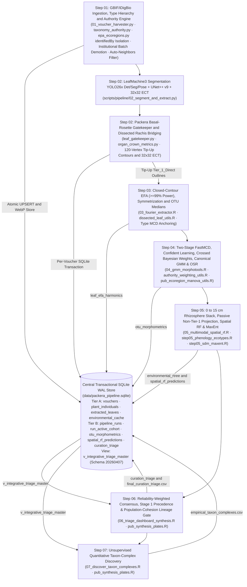

# Automated High-Throughput Vegetative Phenotyping and Herbarium Triage Pipeline for North American *Packera*

### Integrative Morphometric and Edaphic Species Delimitation Anchored by Nomenclatural Types

[](https://opensource.org/licenses/MIT) [](https://www.python.org/downloads/) [](https://www.r-project.org/) [](https://github.com/Gene-Weaver/LeafMachine3)

## Project Overview

Species boundaries in North American *Packera* Á. Löve & D. Löve (Asteraceae: Senecioneae) are difficult to resolve from herbarium sheets alone. Across the ***Packera dubia* (Spreng.) Trock & Mabb. complex** and its eastern North American congeners, taxa exhibit pronounced heteroblasty between basal rosette leaves and upper cauline stem leaves alongside frequent polyploidy ($2n = 44, 46, 88$; Kowal 1975) and reticulate hybridization. Many lineages also occupy specialized edaphic habitats on granite flatrocks and diabase glades, alongside serpentine barrens and coastal plain sands. Because herbarium collections contain misidentifications and mixed duplicate gatherings (exsiccatae), pooling raw specimen measurements by folder labels obscures evolutionary boundaries.

I built this pipeline at the University of North Carolina at Chapel Hill and the UNC Herbarium (NCU) to evaluate morphological diagnosability across North American *Packera* under the Unified Species Concept (de Queiroz 2007) through Integration by Congruence (Padial et al. 2010). To account for variation in determiner reliability across herbarium holdings, I stratify specimens by taxonomic authority and pin verified nomenclatural type specimens as morphological and *locus classicus* ecological baselines. I isolate intact basal rosette leaves from cauline stem leaves before quantifying lamina shape, then test whether vegetative leaf geometry and reproductive macro-morphology align with flowering phenology, alongside fine-scale rhizosphere and bedrock niches ($0\text{ to }15\text{ cm}$ soil properties and $10\text{ to }30\text{ m}$ outcrop lithology).

Now that I have framed the taxonomic problem, let us examine how the data move through the system. I structure the pipeline around verified nomenclatural types, as historical primary and secondary types provide immutable morphological anchors. When I evaluate an unknown specimen, I measure its divergence from these type baselines to establish authentic morphological identity.

### Core Empirical Capabilities

* **Taxonomic Authority Stratification and Nomenclatural Type Pinning (Step 01):** I harvest Darwin Core archives from GBIF and iDigBio, resolve basionyms across the genus, deduplicate exsiccatae series prior to image download, store sheets as lossless-calibrated WebP images, intersect coordinates with official US EPA Level III Ecoregions (Omernik & Griffith 2014), and classify determiners across a 4-tier authority hierarchy (`Tier_0_Type`, `Tier_1_Gold` monographers and protologue authors, `Tier_2_Silver` curated regional herbaria, and `Tier_3_Bronze` general collections). To prevent false authority promotion, my dynamic engine isolates `identifiedBy` independently of `recordedBy`, blocks non-person database adjustment strings (`"Nomenclatural Adjustment"`, `"Nomenclature update"`, `"Taxonomic update"`, `"Annotation"`), and blocks bare common surnames lacking initials. I demote undated institutional batch determinations spanning $\ge 25$ sheets across $\ge 10$ historical collectors at a single herbarium (or $> 25$ collectors overall) where `recordedBy != identifiedBy` from `Tier_1_Gold` to `Tier_2_Silver` so they undergo out-of-sample Mahalanobis and Confident Learning screening, while personal field collections (`recordedBy == identifiedBy`) and dated annotations remain `Tier_1_Gold` (Goodwin et al. 2015; Maldonado et al. 2015). During pipeline preflight, I re-apply authority scoring and filter `--auto-neighbors` candidates against `^Packera\s+[a-z]{3,}$` so outgroups retain valid congeneric binomials. The harvester retains historical nomenclatural type gatherings with county-level retro-georeferences or partial collection dates as permanent taxonomic anchors.
* **LeafMachine3 Computer Vision (`scripts/vision/`, `scripts/pipeline/02_segment_and_extract.py`):** I run [LeafMachine3](https://github.com/Gene-Weaver/LeafMachine3) (Weaver 2026) on ONNX Runtime over a `max_working_dim = 3200` working frame (`cv2.INTER_AREA`), applying dynamic rectangular stride-32 letterboxing (`auto=True, stride=32`, `cv2.INTER_LINEAR_EXACT`) across `yolo26x_det_1280`, `yolo26x_seg_1024`, and `yolo26x_pose_640`. In Stage 1 plant and organ detection (`lm3_plant_detector__yolo26x_det_1280`, `conf = 0.25`, `iou = 0.55`, `include_partial = true`), I retain both `Leaf_WHOLE` and dissected `Leaf_PARTIAL` candidates and apply parent-preserving asymmetric nested-box deduplication (`overlap = 0.95`) so full dissected leaf boxes are preserved over nested terminal-lobe boxes. I perform whole-sheet substrate segmentation with `lm3_specimen_segmenter` (`UNet++ v9` with `LLR_Hyst_KeepBlobs` paper cleanup at `max_working_dim = 3200`), and resolve millimeter scale calibration through `lm3_ruler_classifier` paired with `lm3_ruler_segmenter`. For individual leaves, I run tight Stage 2 per-leaf segmentation (`lm3_leaf_segmenter__yolo26x_seg_1024`, `crop_pad = 0.0`, native `process_mask_native` prototype decoding) and assemble masks through `build_instances` per-class unions (`_largest_component >= 64` px for `Leaf` and `Petiole` plus rachis-bridged secondary pinna `Leaf` components `>= 64` px connected by `Petiole`, `_components >= 64` px for `Hole`, and `lamina = silhouette & ~hole`). I delegate geometric, landmark, contour, petiole, and topological operations directly to native LeafMachine3 modules (`compute_ect`, `ect_product_for`, `render_leaf_products`, `measure_petiole`, `compute_measurements`, `prepare_mask`, `extract_contour`, `resample_closed`, `polygon_morphology`, and `length_width_from_box`), infer 31-keypoint anatomical pose estimation (`lm3_landmark_detector__yolo26x_pose_640` with `10%` white border padding and collision-free mapping of `midvein_1..15` to `midvein_0..14` and `petiole_1..5` to `petiole_0..4`), compute $32 \times 32$ radial-and-angular Euler Characteristic Transform (ECT) matrices (`data/ect/*.npy`), classify each leaf's anatomical zone (`classify_leaf_zone_anatomical` into `'basal'` versus `'cauline'` with `leaf_zone_confidence` and `dist_from_crown_norm`), and enforce a per-plant (`plant_individual_id`) adaptive physical blade-area floor ($\min(0.75, \max(0.15, 0.25 \times \text{median\_area}))\text{ cm}^2$) without a sheet-wide leaf count cap.
* **Type-Anchored Elliptic Fourier Analysis and Multivariate Morphometrics (Steps 03 to 04):** I decompose closed `Tier_1_Direct` leaf outlines using Elliptic Fourier Analysis (`Momocs::efourier`, calibrated to capture $\ge 99\%$ cumulative harmonic power), symmetrize bilateral leaf outlines (`Momocs::rm_asym`; Claude 2008), retain both `'basal'` and `'cauline'` leaves in `leaf_efa_harmonics`, and aggregate primary Operational Taxonomic Unit (OTU) medians per plant individual strictly over pure basal rosette outlines ($w_{\text{basal}} = 1.0$, $w_{\text{cauline}} = 0.0$ when basal leaves exist, with cauline fallback when basal leaves are absent) while exporting an orthogonal cauline and heteroblasty track (`cauline_leaf_count`, `cauline_solidity_med`, `cauline_dissection_index_med`, `basal_vs_cauline_length_ratio`, `basal_vs_cauline_solidity_delta`, `heteroblasty_efa_distance`, and `Cauline_PC1..PC3`). In Step 04, I seed reference anchors through a two-stage FastMCD workflow on Gold and Type specimens ($\chi^2_{0.95, p}$ for $n \ge \max(12, 5p)$) and screen Silver anchors at $\chi^2_{0.90, p}$ (Rousseeuw & Van Driessen 1999). Dissected-leaf sub-mode splitting requires $\ge 25\%$ `Tier_1_Gold` dissected support for entire-leaved basal species. I screen candidate anchors using out-of-fold Confident Learning shrinkage posteriors (Northcutt et al. 2021) and demote label noise (`is_confident_label_noise = TRUE`) to passive projection. I evaluate leave-one-out PC concordance unconditionally when $G \ge 2$, combining determiner reliability $\theta^{\text{det}}_d$ with herbarium curation quality $\theta^{\text{inst}}_h = \frac{4.0 \cdot 0.85 + \sum_{i \in h} c_i}{4.0 + n_h}$ in log-odds space via Raykar et al. (2010) multiplicative Bayesian updates (Gelman & Hill 2007). I test Klingenberg (2016) allometric slope homogeneity, shrink taxon reference centroids toward nomenclatural type medoids (ICN Art. 7.2), canonically relabel Gaussian Mixture Model clusters ($c^* \equiv 1$ nearest the type medoid; Scrucca et al. 2016; Cadena et al. 2018), and scale Bayes factors by Kish's effective sample size ratio $N_{\text{eff}} / N_{\text{core}}$. I augment feature pools with foliar architecture and heteroblasty metrics (`blade_length_to_width_ratio`, `petiole_to_blade_ratio`, `basal_vs_cauline_length_ratio`, `basal_vs_cauline_solidity_delta`, `heteroblasty_efa_distance`, `cauline_solidity_med`, `cauline_dissection_index_med`, `Cauline_PC1..PC3`, `dissection_index`, `solidity`), apply soft Gaussian geographic range-envelope log-priors ($3.5^\circ$ MAD floor; Ledoit & Wolf 2004), and compute Open-Set Recognition metrics (`min_congener_mahal_d2`, `min_congener_taxon`, `open_set_novelty_p`; Scheirer et al. 2013; Lee et al. 2018; Geng et al. 2020).
* **Fine-Grain Rhizosphere/Outcrop Niche Modeling and SDM Ensembles (Step 05):** I pair 19 WorldClim bioclimatic variables with a cached $0\text{ to }15\text{ cm}$ rhizosphere and bedrock stack combining 50 m-buffered USDA-NRCS SSURGO map units (`ssurgo_rock_outcrop_pct`, `ssurgo_bedrock_depth_cm`), 30 m POLARIS probabilistic soil grids, 100 m SOLUS100 bedrock depth and rock fragment volume, $10\text{ to }30\text{ m}$ USGS 3DEP micro-topography, and USGS SGMC bedrock lithology, alongside circular Hopkins flowering phenology anomalies. Non-Tier-1 specimens lacking a Step 04 GMM cluster (`is_missing_gmm_cluster`) are excluded from training anchors and predicted passively. I fit spatially blocked Random Forest and authority-weighted MaxEnt (`maxnet`) habitat suitability models, and run partitioned climatic versus edaphic niche equivalency tests (Warren et al. 2008; Broennimann et al. 2012).
* **Reliability-Weighted Consensus and Quantitative Taxon-Complex Discovery (Steps 06 to 07):** In Step 06, I synthesize all lines of evidence through an out-of-fold Cohen's $\kappa$ reliability-weighted consensus query against `v_integrative_triage_master`. I evaluate Stage 1 misidentification and Open-Set congener reassignment (`congener_osr_reassign`: `min_congener_mahal_d2 <= qchisq(0.95, df = 3)` and `min_congener_taxon != given_sp`) strictly before Stage 3 cryptic lineage routing, using calibrated CDA thresholds (`0.72` / `0.68` / `0.62`) and radial edaphic fallback. Under the 5-stage hierarchical decision matrix, Rule A protects nomenclatural types (`Confirmed_Type_Control`), Rule B reassigns misidentified vouchers, and Rule C locks typical morphotypes (*sensu stricto*). To prevent over-splitting, I enforce a Population-Cohesion Lineage Gate (`cryptic_cluster_cohesion_pass == TRUE`), requiring $\ge 5$ independent collection events across $\ge 2$ collectors or herbaria, cluster-median `min_congener_mahal_d2` $> \chi^2_{0.95, 3}$, and $\ge 50\%$ concordant ecological or phenological divergence with $\text{BF} \ge 10.0$ (Carstens et al. 2013; Sukumaran & Knowles 2017; Fišer et al. 2018). Non-cohesive secondary clusters route to `Confirmed_Species` (*sensu lato*), `Ecophenotypic_Plasticity`, or `Subspecies_Ecotype`. In Step 07, I discover species complexes through unsupervised graph modularity (Leiden and Louvain) and Ward.D2 clustering across multimodal affinity matrices to delimit species complexes and flag candidate cryptic lineages.

### Project Metadata

* **Principal Investigator:** J. Brandon Fuller (PhD Candidate, Department of Biology, University of North Carolina at Chapel Hill)
* **Faculty Advisor:** Dr. Alan S. Weakley (Director, UNC Herbarium [NCU])
* **Methodological Reference:** See [docs/TAXONOMIC_SOP.md](docs/TAXONOMIC_SOP.md) (`UNC-BOT-SOP-2026-04-REV5`) for complete mathematical equations, statistical proofs, and botanical criteria.

## Seven-Stage Pipeline Architecture

The pipeline executes under a **Two-Tier Canonical Storage Architecture**:
1. **Tier A: Canonical Shared Store (`data/` and `data/packera_pipeline.sqlite`):** Houses invariant Step 01 and Step 02 specimen records, WebP imagery (`data/raw_vouchers/`), organ masks and contours (`data/masks/`, `data/contours/`, `data/cropped_patches/`), and environmental caches (`environmental_cache`, `environmental_rtree`).
2. **Tier B: Run-Scoped Analysis Directories (`runs/<RUN_ID>/` and `runs/latest`):** Registers each execution in `pipeline_runs`, populates `run_active_cohort`, links shared Tier A image and mask assets via symbolic links, and isolates all Step 03 to 07 tables, reports, rasters, and publication figures inside `runs/<RUN_ID>/`. Master view `v_integrative_triage_master` exposes unified cross-modal joins under schema version `20260407`.

| Step | Entrypoint & Helper Modules | Primary Inputs | Primary Outputs (SQLite & CSV/Figures) | Core Scientific Function |
| :--- | :--- | :--- | :--- | :--- |
| **01** | `scripts/pipeline/01_voucher_harvester.py`<br>`scripts/core/harvester.py`<br>`scripts/core/taxonomy_authority.py`<br>`scripts/core/epa_ecoregions.py` | GBIF & iDigBio APIs, `config/config.yaml`, US EPA Level III Ecoregion polygons | `vouchers`, `taxon_synonyms`, `data/tables/curated_vouchers.csv`, `data/raw_vouchers/*.webp` | Synonym expansion, pre-download exsiccatae deduplication, identifiedBy isolation, institutional batch demotion to Tier_2_Silver, nomenclatural type retention, preflight congeneric auto-neighbors filtering, and EPA Level III ecoregion assignment |
| **02** | `scripts/pipeline/02_segment_and_extract.py`<br>`scripts/vision/lm3_inference_engines.py`<br>`scripts/vision/lm3_data_loader.py`<br>`scripts/vision/leaf_geometry_utils.py`<br>`scripts/vision/leaf_gatekeeper.py`<br>`scripts/vision/organ_crown_metrics.py`<br>`scripts/vision/step02_figures.py` | `curated_vouchers.csv`, `data/raw_vouchers/*.webp`, LeafMachine3 ONNX models | `plant_individuals`, `extracted_leaves`, `voucher_reproductive_phenology`, `extracted_leaf_manifest.csv`, `fig02a`, `fig02b` | LeafMachine3 ONNX detection (`yolo26x_det_1280`, `conf = 0.25`, `include_partial = true`), parent-preserving nested-box deduplication, UNet++ v9 paper cleanup, ruler lattice + MP scale calibration, 3-class `Leaf`/`Petiole`/`Hole` segmentation with rachis-bridged pinna retention, native LM3 core delegation (`compute_ect`, `measure_petiole`, `compute_measurements`, `polygon_morphology`), 31-keypoint pose tracking, DBSCAN plant clustering, anatomical `leaf_zone` (`'basal'` vs. `'cauline'`) classification, and 120-vertex tip-up contour + 32x32 ECT export |
| **03** | `scripts/morphometrics/03_fourier_extractor.R`<br>`scripts/morphometrics/dissected_leaf_utils.R`<br>`scripts/morphometrics/fourier_parallel_utils.R` | `extracted_leaves.contour_xy_json`, `reports/Leaf_Momocs/momocs_outlines.json`, `Coordinates/*.h5` | `leaf_efa_harmonics`, `leaf_efa_harmonics.csv`, `fourier_pcs.csv`, `fig03` plates | Batch SQLite/Momocs tip-up contour ingestion across `'basal'` and `'cauline'` leaves, $\ge 99\%$ harmonic power calibration, bilateral symmetrization (`rm_asym`), type-anchored MCD outlier screening, pure basal primary OTU median aggregation ($w_{\text{cauline}} = 0.0$), and orthogonal cauline/heteroblasty trait extraction |
| **04** | `scripts/morphometrics/04_gmm_morphotools.R`<br>`scripts/morphometrics/authority_weighting_utils.R`<br>`scripts/morphometrics/pub_figures_utils.R`<br>`scripts/morphometrics/pub_ecoregion_manova_utils.R` | `leaf_efa_harmonics`, `curated_vouchers.csv`, `voucher_reproductive_phenology` | `otu_morphometrics`, `morphometric_audit.csv`, `morphometric_flags.csv`, `gmm_bayes_factors_summary.csv`, `fig04a`, `fig04b`, `fig04c` | Two-stage FastMCD anchor seeding, out-of-fold Confident Learning pruning (is_confident_label_noise), crossed-effects Bayesian authority weights, Klingenberg allometry, Art. 7.2 type shrinkage, canonical GMM relabeling (c* = 1), foliar architecture and cauline heteroblasty traits (`Cauline_PC1..PC3`, `heteroblasty_efa_distance`), geographic range priors, Open-Set Recognition (min_congener_mahal_d2, open_set_novelty_p), and Track 2 Ecoregion CDA/MANOVA |
| **05** | `scripts/analysis/05_multimodal_spatial_rf.R`<br>`scripts/analysis/step05_phenology_ecotypes.R`<br>`scripts/analysis/step05_sdm_maxent.R`<br>`scripts/analysis/edaphic_fine_grain_utils.R` | `otu_morphometrics`, WorldClim, SSURGO, POLARIS, SOLUS100, 3DEP, SGMC | `environmental_cache`, `spatial_rf_predictions`, `multimodal_conflict_flags.csv`, `sdm_*.tif`, `fig05`, `fig05b` | 0 to 15 cm rhizosphere and outcrop extraction, locus classicus ecological baseline control, Hopkins circular phenology anomalies, passive projection of missing GMM clusters (is_missing_gmm_cluster), Spatial Block-CV Random Forest, MaxEnt (maxnet) ensemble SDMs, and niche equivalency tests |
| **06** | `scripts/analysis/06_triage_dashboard_synthesis.R`<br>`scripts/morphometrics/pub_synthesis_plates.R` | `v_integrative_triage_master` (pre-joined SQLite view of Steps 01 to 05) | `curation_triage`, `triage_queue.csv`, `final_curation_triage.csv`, `Packera_Taxonomic_Revision_Summary.md`, `fig06` | Out-of-fold Cohen's kappa reliability-weighted consensus, Stage 1 misidentification and Open-Set congener reassignment precedence over Stage 3, Population-Cohesion Lineage Gate (cryptic_cluster_cohesion_pass), 5-stage type decision matrix (Rules A, B, and C), and herbarium curation queue generation |
| **07** | `scripts/analysis/07_discover_taxon_complexes.R`<br>`scripts/morphometrics/pub_synthesis_plates.R` | `v_integrative_triage_master`, `otu_morphometrics`, `spatial_rf_predictions` | `empirical_taxon_complexes.csv`, `taxon_complex_pairwise_affinity.csv`, `fig07` | Unsupervised graph modularity (Leiden/Louvain) and Ward.D2 hierarchical clustering across morphometric, phenological, climatic, and edaphic affinity matrices to delimit species complexes |



## Repository Structure

```text
Packera_dubia_morphometrics/
├── config/
│   └── config.yaml                                  # Central paths, LeafMachine3 settings and empirical thresholds
├── docs/
│   └── TAXONOMIC_SOP.md                             # Complete mathematical, statistical and botanical protocol (SOP)
├── .agents/
│   └── skills/
│       ├── pipeline-contract-audit/SKILL.md         # Cross-stage SQLite/CSV contract and CV guardrail verification
│       └── write-in-my-voice/SKILL.md               # Writing DNA v5.2 voice and punctuation enforcement rules
├── AGENTS.md                                        # Compact workspace invariants and module map
├── README.md                                        # Operational guide, setup instructions and CLI reference
├── setup_leafmachine3.sh                            # Automated uv + LeafMachine3 ONNX model installer and doctor check
├── run_pipeline.sh                                  # Master run-scoped shell orchestrator (Steps 01 to 07)
├── main.py                                          # Unified Python CLI runner (check-env, harvest, segment, morphometrics, synthesis, run-all)
├── requirements.txt                                 # Primary Python environment dependencies
├── data/                                            # Tier A: Canonical Shared Store (invariant across runs)
│   ├── packera_pipeline.sqlite                      # Transactional SQLite WAL database (Tier A + Tier B tables and views)
│   ├── raw_vouchers/                                # Full-sheet herbarium imagery (.webp)
│   ├── masks/                                       # Binary leaf silhouettes (tier1_intact/, tier2_reflected/)
│   ├── contours/                                    # Tip-up 120-vertex 2D coordinate contours (.csv, mirrored in SQLite)
│   ├── ect/                                         # 32x32 radial-and-angular ECT matrices (*_ect.npy)
│   ├── Segmented_Leaves/                            # Individual leaf PNG cutouts and overlays
│   ├── cropped_patches/                             # Organ RGB cutouts (basal_leaves_raw/, capitula/, rosettes_dense/)
│   ├── environmental/                               # EPA Level III ecoregions, SSURGO, POLARIS, SOLUS100, 3DEP and SGMC cache
│   └── tables/                                      # Canonical Step 01 to 02 CSV manifests
└── scripts/
    ├── core/
    │   ├── config.py                                # Typed configuration loader and hardware thread/batch resolvers
    │   ├── db.py                                    # Transactional SQLite WAL and DuckDB persistence operations
    │   ├── db_schema.py                             # SQLite/DuckDB DDL schema and dynamic column migration builders
    │   ├── db_utils.R                               # R SQLite/DuckDB batch reader and atomic writer utilities
    │   ├── harvester.py                             # GBIF/iDigBio occurrence harvester, synonym expansion and WebP migrator
    │   ├── taxonomy_authority.py                    # 3-layer determiner authority engine, identifiedBy isolation, institutional batch demotion, and type hierarchy
    │   ├── epa_ecoregions.py                        # US EPA Level III Ecoregion point-in-polygon and county fallback index
    │   ├── artifact_manager.py                      # Checksum verification and remote model artifact acquisition
    │   └── logger.py                                # Standardized console and file logging
    ├── vision/
    │   ├── configure_leafmachine3.py                # Synthesizes LM3_settings.local.yaml for all 18 LeafMachine3 modules
    │   ├── lm3_data_loader.py                       # Working-frame unscaling (work_scale), ruler lattice loader and 31-keypoint reader
    │   ├── lm3_inference_engines.py                 # ONNX Runtime engines (YOLO26x Det/Seg/Pose and UNet++ v9 Specimen Segmenter)
    │   ├── leaf_geometry_utils.py                   # Tip-up contour resampling, Tier 1/Tier 2 extraction and geometry facade
    │   ├── leaf_gatekeeper.py                       # Boundary continuity, dissected rachis bridging and 4-tier leaf routing
    │   ├── organ_crown_metrics.py                   # DBSCAN plant clustering, rosette crown estimation and petiole/scape metrics
    │   ├── capitulum_phenology_classifier.py        # 3-tier reproductive anthesis staging and capitulum macro-metrics
    │   └── step02_figures.py                        # Step 02 QC distribution and taxon silhouette montage plates
    ├── pipeline/
    │   ├── 01_voucher_harvester.py                  # Step 01 CLI entrypoint
    │   └── 02_segment_and_extract.py                # Step 02 CLI entrypoint and wave-pipelined coordinator
    ├── morphometrics/
    │   ├── 03_fourier_extractor.R                   # Step 03 closed-contour EFA, symmetrization and OTU median aggregation
    │   ├── 04_gmm_morphotools.R                     # Step 04 allometry, type shrinkage, canonical GMM relabeling (c* = 1), foliar traits, range priors, and OSR
    │   ├── authority_weighting_utils.R              # Two-stage FastMCD seeding, out-of-fold Confident Learning, and crossed-effects Bayesian authority weights
    │   ├── dissected_leaf_utils.R                   # Dissection index, harmonic power calibration and regime-stratified MCD
    │   ├── fourier_parallel_utils.R                 # Parallel EFA harmonic extraction workers
    │   ├── pub_figures_utils.R                      # Core ordination, taxon palettes and Step 03 to 04 figure generators
    │   ├── pub_ecoregion_manova_utils.R             # Track 2 supervised EPA Level III Ecoregion CDA and MANOVA audit suite
    │   └── pub_synthesis_plates.R                   # North American basemaps, pure-R GMM EM solver and Steps 05 to 07 plates
    ├── analysis/
    │   ├── 05_multimodal_spatial_rf.R               # Step 05 rhizosphere/outcrop extraction, passive non-Tier-1 projection, Spatial Block RF, and niche overlap
    │   ├── step05_phenology_ecotypes.R              # Hopkins circular phenology anomalies and locus classicus ecological controls
    │   ├── step05_sdm_maxent.R                      # Authority-weighted MaxEnt and Spatial RF ensemble SDMs and Boyce Index
    │   ├── edaphic_fine_grain_utils.R               # SSURGO SDA, POLARIS, SOLUS100, 3DEP and SGMC lithology extractors
    │   ├── 06_triage_dashboard_synthesis.R          # Step 06 reliability-weighted consensus, Stage 1 precedence, Population-Cohesion Gate, and 5-stage triage
    │   └── 07_discover_taxon_complexes.R            # Step 07 Leiden/Louvain and Ward.D2 unsupervised complex discovery
    └── tests/                                       # Comprehensive Python and R unit and contract hygiene test suites
```

## Cross-Platform Environment and Setup (Linux, macOS, and Windows WSL 2)

### 1. Windows WSL 2 Storage and GPU Prerequisites (Windows Users Only)

On Windows 10 or Windows 11, run the pipeline inside **WSL 2 (Ubuntu 22.04 LTS or newer)** and store the repository on the native Linux `ext4` filesystem (`~/Packera_dubia_morphometrics`) for high-speed SQLite WAL concurrency and raster I/O.

Install the Windows NVIDIA driver ($\ge 528.33$ on Windows, or $\ge 525.60$ on native Linux) and verify that `nvidia-smi` prints your GPU table inside WSL 2. [LeafMachine3](https://github.com/Gene-Weaver/LeafMachine3) installs its own pinned CUDA runtime wheels directly through `uv.lock`, so only the host NVIDIA driver is required.

### 2. System Packages and Primary Python Environment (`.venv`)

```bash
# Ubuntu / WSL 2 system libraries for OpenCV, GDAL/PROJ/GEOS (sf/terra), and R compilation
sudo apt-get update && sudo apt-get install -y \
  build-essential git curl wget libgl1 libglib2.0-0 python3-venv python3-dev \
  libgdal-dev gdal-bin libgeos-dev libproj-dev libudunits2-dev libsqlite3-dev \
  r-base r-base-dev

# Create and populate the primary orchestration environment (.venv)
python3 -m venv .venv
source .venv/bin/activate
pip install --upgrade pip
pip install -r requirements.txt
```

### 3. LeafMachine3 ONNX Environment and Model Setup (`setup_leafmachine3.sh`)

Run the automated setup script to install `uv` (`0.12.23`), clone [LeafMachine3](https://github.com/Gene-Weaver/LeafMachine3), sync the hardware-matched `uv.lock` environment (`--extra gpu`, `--extra macos`, or `--extra cpu`), download the locked Hugging Face ONNX models (~1.7 GB), and verify hardware binding with `lm3 doctor`:

```bash
bash setup_leafmachine3.sh
```

### 4. R Statistical Environment and Preflight Verification

```bash
# Install required CRAN packages for Steps 03 to 07
Rscript -e 'install.packages(c("Momocs", "RRPP", "vegan", "MASS", "cluster", "mclust", "ranger", "maxnet", "ecospat", "sf", "terra", "DBI", "RSQLite", "duckdb", "dplyr", "readr", "tibble", "ggplot2", "optparse", "jsonlite", "igraph"), repos="https://cloud.r-project.org")'

# Run the unified environment preflight check
python main.py check-env
```

## Quick-Start Terminal Cheat-Sheet

```bash
# 0. Run pipeline skipping Step 01 network harvest (seeds from existing SQLite / CSV vouchers)
./run_pipeline.sh --skip-harvest

# 0b. Purge all old Step 02 to 07 segments, masks, contours, run directories, and SQLite segmentation tables (preserving Step 01 vouchers & raw images)
./run_pipeline.sh --purge-segments
# Or via Python CLI:
python main.py purge-segments

# 1. Default Eastern North American genus-wide run
./run_pipeline.sh

# 2. Targeted taxon subset mode (harvests and analyzes the specified Packera species)
./run_pipeline.sh --taxon "Packera dubia" "Packera aurea" "Packera paupercula" "Packera glabella"

# 3. Custom named run with explicit CPU worker threads and GPU batch size
./run_pipeline.sh --run-id packera_eastern_rev1 --threads 12 --gpu-batch-size 16

# 4. Resume an existing run from a downstream step (seeds active cohort from data/)
./run_pipeline.sh --run-id packera_eastern_rev1 --start-step 3

# 5. Strategy 1: Focal Taxon + Cascading Outgroup Reference Anchors (default --gold-anchors 30)
./run_pipeline.sh --focal-taxon "Packera dubia" --gold-anchors 30

# 6. Strategy 2: Intraspecific Delimitation Mode (single-species morphotype and ecotype evaluation)
./run_pipeline.sh --focal-taxon "Packera dubia" --intraspecific-mode

# 7. Continent-wide North American expansion across the US, Canada, and Mexico
./run_pipeline.sh --geographic-scope north_america --countries "US,CA,MX"

# 9. Execute standalone Step 07 unsupervised complex discovery
Rscript scripts/analysis/07_discover_taxon_complexes.R \
  --morphometrics runs/latest/otu_morphometrics.csv \
  --harmonics runs/latest/leaf_efa_harmonics.csv \
  --vouchers runs/latest/curated_vouchers.csv \
  --multimodal runs/latest/multimodal_rf_predictions.csv \
  --output-complexes runs/latest/discovered_taxon_complexes.csv \
  --output-affinity runs/latest/pairwise_taxon_affinity.csv \
  --output-neighbors runs/latest/recommended_complex_neighbors.txt \
  --output-figure runs/latest/figures/fig07_taxon_complex_network.png \
  --focal-taxon "Packera dubia"
```

## CLI Feature Flags Reference (`./run_pipeline.sh` and `python main.py`)

### Table 4A: Master Shell Orchestrator Flags (`./run_pipeline.sh`)

| Flag | Arguments | Default | Description |
| :--- | :--- | :--- | :--- |
| `--run-id` | `<ID>` | `<YYYYMMDD_HHMMSS>_<scope>` | Assigns a custom run identifier under `runs/<ID>/`. |
| `--taxon` | `"<Name>"` | Genus-wide | Restricts pipeline execution to a single target taxon (triggers single-taxon mode unless combined with `--taxa` or `--auto-neighbors`). |
| `--focal-taxon` | `"<Name>"` | `"Packera dubia"` | Sets the focal reference taxon for supervised anchors, morphometric projections, and complex discovery. |
| `--taxa` | `"<T1,T2,...>"` | None | Restricts pipeline execution to a comma-separated list of target taxa. |
| `--complex` | `<preset>` | None | Expands `--taxa` to a predefined taxonomic complex (`aurea`, `paupercula`, `tomentosa`, `anonyma`, `obovata`, `schweinitziana`, or `eastern-all`). |
| `--auto-neighbors` | *(flag)* | `false` | Reads `runs/latest/recommended_complex_neighbors.txt` from a prior Step 07 run and appends high-affinity neighbor taxa ($\ge 0.20$) to the focal cohort, filtering candidates against `^Packera\s+[a-z]{3,}$` to enforce valid congeneric binomials. |
| `--skip-harvest` | *(flag)* | `false` | Skips Step 01 GBIF/iDigBio network harvesting and seeds the active run from existing SQLite `vouchers` and `data/curated_vouchers.csv`. |
| `--include-western` | *(flag)* | `false` | Retains western North American occurrences west of $-106.65^\circ\text{W}$ by forwarding `--no-exclude-western` to Step 01. |
| `--resegment` | *(flag)* | `false` | Forces Step 02 to clear cached segmentation entries for the active cohort and re-run LeafMachine3 ONNX inference (`--force-reprocess`). |
| `--purge-segments`, `--purge-old-data` | *(flag)* | `false` | Purges all previous Step 02 to 07 segments, masks, contours, ECT arrays, cropped patches, `runs/`, and SQLite segmentation/run tables (`VACUUM`-compacting `data/packera_pipeline.sqlite`) while preserving Step 01 `vouchers`, `data/raw_vouchers/`, and `environmental_cache`. Can be run standalone (`./run_pipeline.sh --purge-segments`) or combined with a pipeline execution (`./run_pipeline.sh --purge-segments --start-step 2 ...`). |
| `--gold-only` | *(flag)* | `false` | Restricts the active run cohort to Nomenclatural Types (`Tier_0_Type_Anchor`) and `Tier_1_Gold` authority vouchers. |
| `--max-per-taxon` | `<N>` | None | Caps the number of harvested vouchers per taxon in Step 01 (`0` disables the per-taxon cap). |
| `--workers` | `<N>` | Auto-detected | Sets the worker thread count for Step 01 image downloads, Step 02 ONNX inference, and R `future::plan(multisession)` parallelism. |
| `--batch-size` | `<N>` | Auto-detected | Overrides the Step 02 image batch size (`0` auto-tunes from available system RAM and GPU VRAM). |
| `--strict-env-gate` | *(flag)* | `false` | Enforces the 95% complete-coverage gate across all 6 environmental layers (`WorldClim`, `3DEP`, `SSURGO`, `POLARIS`, `SOLUS100`, `SGMC`) before Step 05. |
| `--skip-step07` | *(flag)* | `false` | Skips Step 07 unsupervised taxonomic complex discovery. |
| `--verify` | *(flag)* | `false` | Runs the contract verification suite (`pytest scripts/tests/ -q`) after pipeline completion. |
| `--dry-run` | *(flag)* | `false` | Prints planned execution stages and resolved cohort parameters without executing commands. |
| `--demo` | *(flag)* | `false` | Runs synthetic demonstration mode (`PACKERA_DEMO_MODE=1`) isolated inside `demo_ephemeral.sqlite` without touching canonical `data/` tables. |
| `--help`, `-h` | *(flag)* | `false` | Displays the `run_pipeline.sh` command-line usage reference. |

### Table 4B: Python Orchestrator (`python main.py`) Subcommands and Stage-Specific Flags

| Subcommand or Stage | Target Script | Key Flags | Default | Behavioral Scope |
| :--- | :--- | :--- | :--- | :--- |
| `check-env` | `main.py` | `[--strict]` | `false` | Audits Python and R virtual environments, system libraries, and ONNX Runtime execution providers. |
| `download-weights` | `scripts/core/artifact_manager.py` | `[--force]` | `false` | Downloads and verifies SHA-256 checksums for LeafMachine3 ONNX model weights from Hugging Face (`brandonfuller/lm3-weights`). |
| `purge-segments` | `scripts/core/db.py` (`purge_segments_and_runs`) | `--purge-segments`<br>`--purge-old-data`<br>`[--db <PATH>]` | `false` | Purges all previous Step 02 to 07 segments, masks, contours, ECT matrices, cropped patches, run directories, and SQLite segmentation/run tables (`VACUUM`-compacting the database) while preserving Step 01 `vouchers`, `data/raw_vouchers/`, and `environmental_cache`. Also available as a flag on `main.py`, `segment`, `run-all`, and `02_segment_and_extract.py`. |
| `harvest` | `scripts/pipeline/01_voucher_harvester.py` | `--taxon`, `--focal-taxon`<br>`--home-herbarium`<br>`--max-records`<br>`--max-per-taxon`<br>`--max-uncertainty`<br>`--exclude-western` / `--no-exclude-western`<br>`--min-megapixels`<br>`--min-file-size-kb`<br>`--check-sharpness`<br>`--min-sharpness`<br>`--concurrency`<br>`--download-images` | `NCU`<br>`5000`<br>None<br>`5000.0` m<br>`--exclude-western`<br>`2.0` MP<br>`150.0` KB<br>`false`<br>`25.0`<br>`15`<br>`true` | Queries GBIF and iDigBio Darwin Core APIs, standardizes taxon names, resolves nomenclatural type tiers, isolates identifiedBy, demotes institutional batch determinations to Tier_2_Silver, and downloads calibrated WebP voucher images. |
| `segment` | `scripts/pipeline/02_segment_and_extract.py` | `--enable-geometric-qc`<br>`--purge-segments`<br>`--force`<br>`--regenerate-figures-only`<br><br>`--lm3-dir <PATH>`<br>`--batch-size <N>`<br>`--workers <N>`<br>`--device {cuda,cpu}`<br>`--min-solidity <F>`<br>`--min-ucs <F>`<br>`--score-thresh <F>` | `false`<br>`false`<br>`false`<br>`false`<br><br>Auto<br>Auto<br>Auto<br>`cuda`<br>`0.72`<br>`0.85`<br>`0.30` | Executes LeafMachine3 ONNX segmentation, DBSCAN plant clustering, and 31-keypoint anatomical pose tracking. `--purge-segments` (`--purge-old-data`) purges all prior Step 02 to 07 masks, contours, and SQLite segmentation tables before running. `--enable-geometric-qc` enables the *Packera* botanical gatekeeper and per-plant adaptive area floor (off by default for unconstrained LeafMachine3 extraction). `--regenerate-figures-only` rebuilds Step 02 diagnostic plates from cached Step 02 to 04 tables without re-running ONNX segmentation. |
| `morphometrics` | `scripts/morphometrics/03_fourier_extractor.R`<br>`scripts/morphometrics/04_gmm_morphotools.R` | `--harmonics <N>`<br>`--num-pcs <N>`<br>`--max-k <N>`<br>`--workers <N>`<br>`--export-figures` / `--no-export-figures` | `12`<br>`5`<br>`9`<br>Auto<br>`--export-figures` | Runs closed-contour Elliptic Fourier Analysis on Tier_1_Direct basal leaves, two-stage FastMCD anchor seeding, out-of-fold Confident Learning pruning, crossed-effects Bayesian authority weights, Klingenberg allometry, type shrinkage, canonical GMM relabeling (c* = 1), foliar traits, geographic range priors, Open-Set Recognition, and Track 2 CDA/MANOVA. |
| `synthesis` | `scripts/analysis/05_multimodal_spatial_rf.R`<br>`scripts/analysis/06_triage_dashboard_synthesis.R` | `--ssurgo-batch-size <N>`<br>`--permutations <N>`<br>`--n-trees <N>`<br>`--workers <N>`<br>`--export-figures` / `--no-export-figures` | `50`<br>`100`<br>`500`<br>Auto<br>`--export-figures` | Extracts 0 to 15 cm rhizosphere and bedrock properties, fits Spatial Block Random Forest and MaxEnt SDMs, passively projects missing GMM clusters, evaluates Stage 1 misidentification and Open-Set congener reassignment before Stage 3, enforces the Population-Cohesion Lineage Gate, and executes Cohen's kappa consensus triage across Rules A through C. |
| `run-all` | Pipeline Coordinator | Forwards flags to all pipeline stages | | Executes complete multi-stage pipeline from preflight checks to publication synthesis. |

## Publication Figure Suite Inventory

Every figure is exported atomically in both vector `.pdf` and 300-DPI `.png` formats inside `runs/<RUN_ID>/outputs/figures/`:

| Figure Stem | Pipeline Step | Visual Contents and Statistical Annotations |
| :--- | :---: | :--- |
| `fig02a_segmentation_qc_distributions` | Step 02 | 4-panel distribution of lamina solidity, UCS contour completeness, calibrated blade area ($\text{cm}^2$), and tier routing |
| `fig02b_silhouette_montage` | Step 02 / Post-Step 04 | Downstream-QC-validated `Tier_1_Direct` binary leaf silhouettes scaled to each taxon's empirical median aspect ratio |
| `tier1_vs_tier2_density_overlay` | Step 03 | 2D EFA morphospace density overlay and PERMANOVA test comparing `Tier_1_Direct` intact vs. `Tier_2_Reflected` leaves |
| `fig03_fourier_morphospace_3panel` | Step 03 | Symmetric EFA PCA ordination, mean $\pm 1\text{ SD}$ leaf outline reconstructions along PC1 to PC3, and harmonic power decay |
| `fig04a_allometry_diagnostic` | Step 04 | Log centroid size vs. shape regression testing Klingenberg (2016) allometric slope homogeneity via weighted `RRPP` |
| `fig04b_cda_4panel_plate` | Step 04 | 4-panel integrative plate: Track 1 shrunk CDA biplot (with double-ringed diamond Type anchors), GMM $\times$ Species contingency heatmap, diagnostic trait boxplots, and STRUCTURE-style posterior assignment barplot |
| `fig04c_supervised_ecoregion_cda` | Step 04 | Track 2 supervised US EPA Level III Ecoregion CDA biplot, Pillai's Trace MANOVA subtitle, GMM $\times$ Ecoregion heatmap, and ecoregion mean leaf silhouettes |
| `fig05_ecological_niche_phenology` | Step 05 | 4-panel ecological niche plate: Spatial Block RF permutation importance, `PCA-env` climate and edaphic biplot with Schoener's $D$, $0\text{ to }15\text{ cm}$ rhizosphere bedrock boxplots, and circular Hopkins flowering phenology |
| `fig05b_sdm_habitat_suitability_map` | Step 05 | Multi-panel North American MaxEnt (`maxnet`) and Spatial RF ensemble habitat suitability maps with $AUC_{\text{block}}$, Continuous Boyce Index, and Nomenclatural Type locality overlays |
| `fig06_integrative_synthesis_plate` | Step 06 | Cross-modal concordance matrix, Cohen's $\kappa$ reliability weights, and 5-stage taxonomic decision breakdown across active taxa |
| `fig07_complex_discovery_plate` | Step 07 | Leiden and Louvain morpho-ecological affinity network and Ward.D2 hierarchical dendrogram delimiting empirical species complexes |

## Automated Test Suite Verification

```bash
# Run the complete unit, SQLite handshake, R morphometrics, and static code-hygiene test suite
pytest scripts/tests/ -q
```

## License and Attribution

Released under the MIT License ([LeafMachine3](https://github.com/Gene-Weaver/LeafMachine3) is distributed under the GNU Affero General Public License v3.0). When citing this pipeline or its underlying methods, please cite [docs/TAXONOMIC_SOP.md](docs/TAXONOMIC_SOP.md), Weaver & Smith (2023), Weaver (2026), and Ayub et al. (2026).
