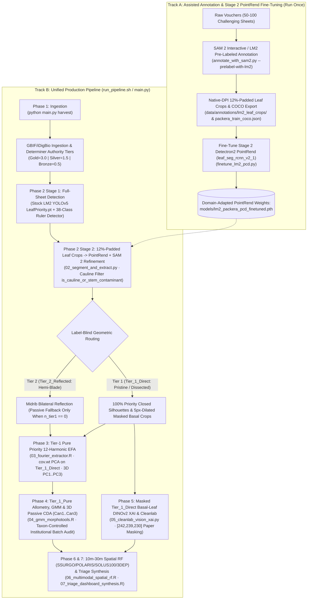

# Automated High-Throughput Vegetative Phenotyping and Herbarium Triage Pipeline for the *Packera dubia* Complex

### Operationalizing Morphological Diagnosability under the Unified Species Concept

[](https://doi.org/10.5281/zenodo.xxxxxx) [](https://opensource.org/licenses/MIT) [](https://www.python.org/downloads/) [](https://www.r-project.org/)

---

## 🌿 Project Overview

This repository houses the computational and statistical pipeline for the automated high-throughput vegetative phenotyping, morphological diagnosability assessment, and herbarium triage of the ***Packera dubia*** **(Spreng.) Trock & Mabb. complex** (Asteraceae: Senecioneae) across Eastern and Central North America.

Developed as part of doctoral research at the **University of North Carolina at Chapel Hill** in collaboration with the **UNC Herbarium (NCU)**, this project operationalizes morphological diagnosability under the **Unified Species Concept (USC; de Queiroz 2007)**. Under the USC, species are conceptualized as separately evolving metapopulation lineages. In taxonomically complex plant clades characterized by ecophenotypic plasticity and historical misidentification, vegetative morphometrics serves as a high-throughput operational screen evaluated in concert with multiple independent lines of evolutionary evidence:
- **Reproductive Macro-Morphology:** Capitulum aspect ratios, phyllary series counts, and ray/disc floret dimensions.
- **Cytotaxonomic Cytotypes:** Known chromosome numbers and ploidy races ($2n = 44, 46, 88$; Kowal 1975).
- **Reduced-Representation Phylogenomics:** High-throughput nextRAD single nucleotide polymorphism (SNP) datasets resolving reticulate evolution and lineage boundaries.
- **Fine-Grain (10 m – 30 m) Soil, Bedrock & Outcrop Validation:** A persistent 10 m – 30 m edaphic and rock-outcrop stack (`data/environmental/fine_grain_edaphic_cache.csv`) combining 50 m-buffered 1:24,000 USDA-NRCS SSURGO vector map units (`ssurgo_rock_outcrop_pct`, `ssurgo_bedrock_depth_cm`, `ssurgo_aws_0_50cm`), 30 m POLARIS probabilistic soil grids (`polaris_30m/`), 100 m SOLUS100 bedrock depth and coarse rock fragment volume (`solus_100m/`: `resdept`, `fragvol`), 10 m – 30 m USGS 3DEP micro-topography (`topo_tpi_30m`, `topo_roughness_30m`, `topo_slope_deg`, `topo_twi_30m`), and 250 m SoilGrids gap-free fallback resolving localized rock outcrop endemics.

The computational infrastructure couples two-stage automated organ detection via **LeafMachine2 (LM2)** (Stage 1 full-sheet YOLOv5 `LeafPriority.pt` + 38-class Ruler Detector, followed by Stage 2 native-DPI cropped Detectron2 PointRend `leaf_seg_rcnn_v2_1` and automated prompt-guided **SAM 2** boundary refinement), deterministic label-blind geometric gatekeeping and strengthened cauline/stem rejection (`is_cauline_or_stem_contaminant`), bilateral symmetry reconstruction with **Tier-1 Pure Priority** (`morph_tier_source = "Tier_1_Pure"`), polarity-preserving Elliptic Fourier Analysis (EFA), background-masked `Tier_1_Direct` basal-leaf deep vision (DINOv2 ViT-B/14 with patch-token saliency attribution), and confident learning (`cleanlab`) with a formal **Multi-Tiered Herbarium Misidentification Mitigation Architecture**.

- **Principal Investigator:** J. Brandon Fuller (PhD Candidate, Department of Biology, UNC-CH)  
- **Faculty Advisor:** Dr. Alan S. Weakley (Director, NCU Herbarium; UNC Biology)  
- **Standard Operating Procedure:** `UNC-BOT-SOP-2026-04-REV4`  
- **Target Taxa:** *Packera dubia* (formerly *P. tomentosa* / *Senecio tomentosus*), *Packera anonyma*, *Packera plattensis*, *Packera paupercula* (including var. *paupercula* and var. *savannarum*), and allied southeastern lineages.

---

## ⚙️ Architecture & Two-Track Workflow

The pipeline decouples the **model training / assisted-annotation track** from the **high-throughput production inference track**:

1. **Assisted Annotation & Stage 2 PointRend Fine-Tuning (Offline Track A):**  
   - Uses **Segment Anything Model 2 (SAM 2)** (`annotate_with_sam2.py`, with optional `--prelabel-with-lm2` automated pre-labeling) to interactively annotate ground-truth basal leaf masks (`basal_leaf_whole`, `basal_leaf_partial`) on a representative set of 50–100 challenging *Packera* vouchers (dense rosettes, overlapping blades, arachnoid tomentum).  
   - Exports native-DPI 12%-padded single-leaf crops (`data/annotations/lm2_leaf_crops/`) and standardized COCO JSON annotations (`data/annotations/packera_train_coco.json`) to fine-tune LeafMachine2's Stage 2 Detectron2 PointRend Leaf Segmenter (`leaf_seg_rcnn_v2_1`), producing domain-adapted weights (`models/lm2_packera_pointrend_finetuned.pth`, aliased to `models/lm2_packera_pcd_finetuned.pth`).  
2. **Production Pipeline & Taxonomic Synthesis (Inference Track B):**  
   - Orchestrated end-to-end via the run-scoped shell runner (`./run_pipeline.sh`) or unified Python CLI (`main.py`) under a **Canonical Two-Tier Storage Architecture**: **Tier A (`data/` at repository root)** houses all invariant Step 01 and Step 02 specimen, environmental (`fine_grain_edaphic_cache.csv`), and organ extraction assets (`raw_vouchers/`, `masks/{tier1_intact,tier2_reflected}/`, `contours/`, `cropped_patches/{rosettes_dense,basal_leaves_raw,capitula}/`, and the 5 Step 01–02 CSV manifests in `data/tables/`), while **Tier B (`runs/<RUN_ID>/` with `runs/latest` symlink)** automatically seeds and symlinks Step 01–02 inputs directly from canonical root `data/` without referencing previous `runs/` directories and isolates all Step 03–07 statistical tables, reports, logs, and figures inside `runs/<RUN_ID>/`. Supports complex-wide execution, dynamic taxon exclusion (`--exclude-taxon "<TAXON>"`), and **Dual-Strategy Single-Taxon CLI modes** (`--focal-taxon "<TAXON>" --gold-anchors 30` Strategy 1 vs. `--focal-taxon "<TAXON>" --intraspecific-mode` Strategy 2).  
   - **Stage 1 (Full-Sheet Detection):** Stock LeafMachine2 YOLOv5 `LeafPriority.pt` (11-class organ detector) processing both `Class 0` (`leaf_whole`) and `Class 1` (`leaf_partial`) candidate boxes to capture rosette-attached basal blades on native-DPI scans, with high-DPI upper cauline pre-filtering (`cy < 0.40 * sheet_h`) and fragment rejection (`max(bh, bw) < int(200 * scale_f)`), paired with the 38-class Ruler Detector (`scripts/vision/lm2_data_loader.py`) for physical millimeter scale calibration (`pixels_per_mm`, `is_calibrated_mm`).  
   - **Stage 2 (Cropped Leaf Segmentation, Cauline Rejection & Refinement):** Native-DPI 12%-padded single-leaf crops segmented via fine-tuned Detectron2 PointRend (`leaf_seg_rcnn_v2_1`) + optional automated prompt-guided SAM 2 boundary refinement (`--sam2-refine`), DBSCAN multi-plant spatial clustering (`plant_individual_id`), spatial rosette centroid wiring (`rosette_centroids_by_pid` passed via `rosette_centroid` into `classify_and_route_leaf()` and `compute_geometric_metrics()`), post-gatekeeper basal-leaf filtering (`cy_rel >= 0.42`, min area floors, boxy clump rejection, sheet area floor `>= 0.28 * max_sheet_area`, top-6 cap per voucher ranked by $Q = \text{solidity} \cdot \text{ucs} \cdot \sqrt{\text{area}}$ with disk cleanup), strengthened basal-vs.-cauline anatomical filtering (`is_cauline_or_stem_contaminant()` rejecting upper-stem sessile/clasping cauline bracts with `aspect_ratio > 3.8` and `solidity < 0.78`, or displaced `> 2.2 * med_rosette_radius` above the basal rosette zone even when `capitula_count == 0`), resolution-adaptive cross-sectional width profiling (`w_span = max(min(max(h, w), 350), int(0.65 * max(h, w)))`), resolution-scaled petiole junction trimming (`trim_petiole_tail` with `max_petiole_width = max(16.0, 0.105 * blade_width_est)` and `cordate_guard_w = max(..., 0.135 * blade_width_est)` when `blade_width_est > 250.0 and min(h, w) > 500`), rosette centroid polarity disambiguation (`_disambiguate_base_apex_endpoints` with `eff_max_petiole_w` when `axis_len > 450.0`), anatomical base homologization (`petiole_attachment_pt=p_base` in all `resample_normalized_contour()` calls across Tier 1, folded, and Tier 2 reflected leaves), midrib symmetry reflection, and organ patch cropping (`data/cropped_patches/basal_leaves_raw/`, `capitula/`, `rosettes_dense/`).  
   - **Downstream Morphometrics, Vision XAI, 10m–30m Edaphic ENM & Synthesis:** Propagates the canonical determiner authority weighting hierarchy (`authority_weight`: `Tier_1_Gold = 3.0`, `Tier_2_Silver = 1.5`, `Tier_3_Bronze = 0.5`) across Steps 03–06: 12-harmonic polarity-preserving EFA in R (`Momocs`) with weighted covariance eigendecomposition (`stats::cov.wt(..., wt = tier_wt * leaf_quality_weight)`) fitted **strictly on intact `Tier_1_Direct` contours** and **Tier-1 Pure Priority aggregation** (`n_tier1_leaves >= 1` $\rightarrow$ 100% `Tier_1_Direct` leaves, `morph_tier_source = "Tier_1_Pure"`; `Tier_2_Reflected` used only when `n_tier1_leaves == 0`, `morph_tier_source = "Tier_2_Fallback"`); pooled within-species allometry (`stats::lm(..., weights = authority_weight)`), `clustvarsel`/`mclust::Mclust` GMM fitting, and supervised CDA training anchors restricted strictly to **`Tier_1_Pure` vouchers (`n_tier1_leaves >= 1`)** with passive `predict()` projection for `Tier_2_Fallback` and `Tier_3_Bronze`, exporting 3D canonical axes (`can1`, `can2`, `can3`) and taxon-controlled institutional batch-effect auditing (`audit_institutional_batch_effects`); background-masked `Tier_1_Direct` basal-leaf vision XAI (`05_cleanlab_vision_xai.py` dilating `masks/tier1_intact/` by 5 px via `apply_tier1_leaf_mask_to_rgb` to replace exterior stems, bracts, and labels with `[242, 239, 230]` neutral herbarium paper RGB, never loading whole-clump `rosettes_dense/` when `extracted_leaf_manifest.csv` is present); 10 m – 30 m fine-grain soil, bedrock, and rock-outcrop ENM stack (`data/environmental/fine_grain_edaphic_cache.csv` combining 50 m-buffered USDA-NRCS SSURGO, 30 m POLARIS, 100 m SOLUS100, and 10 m – 30 m USGS 3DEP micro-topography with 250 m SoilGrids fallback) in `ranger::ranger(..., case.weights = case_wts)` under $0.5^\circ \times 0.5^\circ$ `spatial_block_cv_acc`; and Step 07 non-georeferenced voucher coalescing (`98.4%` completion) with strict multi-modal disambiguation (`both_alt_agree` evaluated BEFORE `Hybrid_Intergrade_Swarm`; `Putative_Cryptic_Species` requiring `morph_tier_source == "Tier_1_Pure"`).



---

## 📁 Streamlined Repository Structure

```text
Packera_dubia_morphometrics/
├── config/
│   └── config.yaml                    # Central paths, taxon synonyms & model hyperparameters
├── run_pipeline.sh                    # Run-scoped orchestrator CLI (--run-id, --start-step, --exclude-taxon, --focal-taxon)
├── main.py                            # Unified Python CLI runner (check-env, harvest, segment, morphometrics, synthesis, run-all)
├── LeafMachine2/                      # Immutable LeafMachine2 engine submodule
│   ├── LeafMachine2.py
│   └── leafmachine2/
├── models/
│   ├── lm2_packera_pointrend_finetuned.pth # Fine-tuned Stage 2 PointRend Leaf Segmenter weights
│   └── lm2_packera_pcd_finetuned.pth  # Backward-compatible PointRend weights alias
├── data/                              # Tier A: Canonical Shared Store (Invariant Step 01–02 & Environmental Assets)
│   ├── raw_vouchers/                  # High-resolution specimen sheet imagery (.jpg)
│   ├── raw_annotations/               # SAM 2 polygon text files & instance PNG masks
│   ├── annotations/
│   │   ├── lm2_leaf_crops/            # Native-DPI 12%-padded single-leaf training crops
│   │   └── packera_train_coco.json    # Standardized Stage 2 cropped COCO JSON dataset
│   ├── masks/                         # Canonical binary leaf silhouettes (tier1_intact/, tier2_reflected/)
│   ├── contours/                      # Canonical homologized 2D coordinate contours (.csv)
│   ├── cropped_patches/               # Canonical organ RGB crops for DINOv2 & phenology
│   │   ├── basal_leaves_raw/          # Cropped Tier_1_Direct basal leaf RGB patches (masked in Step 05)
│   │   ├── capitula/                  # Cropped reproductive head patches
│   │   └── rosettes_dense/            # DBSCAN per-individual dense rosette fallback crops
│   ├── environmental/                 # 10m–30m Fine-Grain Edaphic Stack & Regional Rasters
│   │   ├── fine_grain_edaphic_cache.csv # Persistent 10m–30m SSURGO + POLARIS + SOLUS100 + 3DEP cache
│   │   ├── polaris_30m/               # 30 m POLARIS probabilistic soil rasters (ph, sand, clay, om, bd, ksat)
│   │   ├── solus_100m/                # 100 m SOLUS100 rasters (resdept bedrock depth, fragvol rock fragments)
│   │   ├── dem_3dep_30m/              # 10 m – 30 m USGS 3DEP DEM tiles (TPI, roughness, slope, TWI)
│   │   └── ssurgo_cache/              # 50 m-buffered USDA-NRCS SSURGO SDA query cache
│   └── tables/                        # Canonical Step 01–02 CSV manifests (seeded into runs/<RUN_ID>/)
│       ├── curated_vouchers.csv       # Harvested vouchers with Determiner Authority Tiers
│       ├── extracted_leaf_manifest.csv# Stage 2 leaf routing, DBSCAN plant_individual_id & ruler calibration
│       ├── failed_qc_vouchers.csv     # Vouchers rejected by Stage 2 basal/cauline quality gatekeeper
│       ├── voucher_reproductive_metrics.csv # Capitulum counts & involucre dimensions (px & mm)
│       └── voucher_phenological_states.csv  # 3-tier optical capitulum phenology classifications
├── runs/                              # Tier B: Run-Scoped Analysis Directories (Steps 03–07)
│   ├── latest -> run_<YYYYMMDD_HHMMSS># Symlink to most recent run directory
│   └── <RUN_ID>/                      # Self-contained run directory (data/tables/, outputs/figures/, outputs/reports/, logs/)
├── scripts/
│   ├── core/                          # Consolidated shared utilities
│   │   ├── harvester.py               # Combined API queries, DwC parsing & media downloads
│   │   ├── artifact_manager.py        # Model weight download & SHA256 integrity verification
│   │   ├── config.py                  # Python-side configuration schema
│   │   └── logger.py                  # Structured console and file logger
│   ├── annotation_and_training/       # Track A: SAM 2 labeling & Stage 2 PointRend fine-tuning
│   │   ├── annotate_with_sam2.py      # Interactive SAM 2 GUI with --prelabel-with-lm2 & knife tool
│   │   ├── sam2_annotator_utils.py    # Geometry helpers & cropped COCO export utilities
│   │   └── finetune_lm2_pcd.py        # Stage 2 Detectron2 PointRend (leaf_seg_rcnn_v2_1) trainer
│   ├── data_prep/                     # Track B: Data harvesting and pruning
│   │   ├── 01_voucher_harvester.py    # Ingestion & 3-tier authority stratification
│   │   └── audit_and_prune_vouchers.py# Dataset integrity and invalid image pruner
│   ├── pipeline/                      # Track B: Production execution modules
│   │   └── 02_segment_and_extract.py  # Two-stage LM2 + PointRend + SAM 2 refinement & contour export
│   ├── vision/                        # Botanical geometry, LM2 loaders & phenology classifiers
│   │   ├── capitulum_phenology_classifier.py # Optical biomarker phenotyping (pappus, corolla)
│   │   ├── configure_leafmachine2.py  # High-throughput LM2 configuration builder
│   │   ├── lm2_data_loader.py         # Stage 1 YOLOv5 LeafPriority.pt & 38-class Ruler loader
│   │   ├── lm2_geometry_utils.py      # Label-blind gatekeeping, base-to-apex homologization & reflection
│   │   └── tune_geometry_parameters.py# Empirical threshold calibrator (calibrate-geometry)
│   ├── morphometrics/                 # Canonical R statistical morphometrics & 3D plotting utilities
│   │   ├── 03_fourier_extractor.R     # Tier-1 Pure Priority 12-harmonic EFA, cov.wt PCA & RRPP parity
│   │   ├── 04_gmm_morphotools.R       # Tier_1_Pure allometry, clustvarsel/mclust GMMs & 3D passive CDA (can1..can3)
│   │   └── pub_figures_utils.R        # Okabe-Ito palettes, plot_3d_scatter_box & unfilled marker helpers
│   ├── analysis/                      # Deep vision, 10m–30m fine-grain macroecology, and synthesis
│   │   ├── 05_cleanlab_vision_xai.py  # Masked Tier_1_Direct basal-leaf DINOv2 embeddings, Cleanlab & ViT XAI
│   │   ├── 06_multimodal_spatial_rf.R # 10m–30m Spatial RF (ranger, blockCV), ecospat PCA-env & Hopkins Law
│   │   ├── edaphic_fine_grain_utils.R # 50m-buffered SSURGO, 30m POLARIS, 100m SOLUS100 & 3DEP extractor
│   │   └── 07_triage_dashboard_synthesis.R # Non-georeferenced coalescing & multi-modal decision matrix
│   ├── tests/                         # Unit and integration test suite
│   │   ├── run_audit.py               # Central QA test suite runner (asserts 100% pass rate)
│   │   ├── test_code_hygiene.py       # Enforces strict _archive isolation & AST hygiene
│   │   ├── test_voucher_harvester.py
│   │   ├── test_segment_and_extract.py
│   │   ├── test_geometry_edge_cases.py
│   │   ├── test_geometry_tuning.py
│   │   ├── test_capitulum_phenology.py
│   │   ├── test_allometry_and_phenology.py
│   │   ├── test_symmetric_fourier_validation.py
│   │   └── test_main_pipeline_cli.py
│   └── _archive/                      # Decommissioned scripts (isolated; never imported by active code)
├── outputs/
│   ├── figures/                       # Publication plots, 3D PCA/CDA ordinations & QC panels
│   └── reports/                       # Taxonomic summaries, BIC tables & manifests
├── requirements.txt                   # Primary Python dependencies
└── README.md
```

---

## 🚀 Execution Guide

### ⚡ Quick-Start Copy-Paste Terminal Cheat-Sheet

#### A. Environment Activation & Preflight Verification
```bash
source .venv/bin/activate
python main.py check-env
python main.py download-weights
```

#### B. End-to-End Automated Pipeline & `run_pipeline.sh` CLI Reference
Every execution launched via `./run_pipeline.sh` or `python main.py` operates under the **Canonical Two-Tier Storage Architecture**: invariant Step 01–02 assets reside in canonical root `data/` and are automatically seeded/symlinked into `runs/<RUN_ID>/` (updating `runs/latest`), while all Step 03–07 statistical tables, reports, logs (`logs/pipeline.log`), and publication figures (`.pdf` + 300-DPI `.png`) are isolated inside `runs/<RUN_ID>/`.

```bash
source .venv/bin/activate

# 1. Default full complex-wide run (creates runs/run_<YYYYMMDD_HHMMSS>/ and updates runs/latest)
./run_pipeline.sh

# 2. Custom named run directory (--run-id <NAME>) reusing cached vouchers & canonical Step 02 assets (--skip-harvest)
./run_pipeline.sh --run-id packera_revision_v1 --skip-harvest

# 3. Resume or launch from any pipeline step (--start-step <1..7>, e.g., Step 03 EFA or Step 06 Spatial RF)
#    Automatically seeds Step 01–02 tables and symlinks masks/contours/cropped_patches from canonical root data/:
./run_pipeline.sh --run-id packera_revision_v1 --skip-harvest --start-step 3
./run_pipeline.sh --run-id packera_revision_v1 --skip-harvest --start-step 6

# 4. Exclude one or more taxa (--exclude-taxon "<TAXON>"):
#    Filters curated_vouchers.csv, Step 02 manifests, and cropped_patches/ while dynamically remapping
#    Step 05 DINOv2/Cleanlab class indices to contiguous 0..K-1 (active_taxa):
./run_pipeline.sh --run-id eastern_3taxa --skip-harvest --start-step 3 --exclude-taxon "Packera plattensis"

# 5. Strategy 1 (Focal Taxon + Outgroup Gold Reference Anchors, default --gold-anchors 30):
#    Processes all focal taxon vouchers plus N Tier_1_Gold anchors per outgroup species for Steps 04–06 calibration,
#    then filters Step 07's final triage queue and figures strictly to the focal taxon:
./run_pipeline.sh --run-id dubia_triage --skip-harvest --focal-taxon "Packera dubia" --gold-anchors 30

# 6. Strategy 2 (Pure Intraspecific Delimitation Mode: --focal-taxon "<TAXON>" --intraspecific-mode):
#    Runs strictly on a single species (n_unique_taxa == 1) with zero outgroup specimens, switching Steps 04–06
#    from species_standardized to label-blind GMM morphotypes (Morphotype_K1..K_n or geographic/edaphic ecotypes)
#    to test for cryptic lineages and granite-outcrop ecotypes:
./run_pipeline.sh --run-id dubia_cryptic --skip-harvest --focal-taxon "Packera dubia" --intraspecific-mode

# 7. Pilot subset execution (--limit <N>) with SAM 2 boundary refinement (--sam2-refine) and forced overwrite (--force)
./run_pipeline.sh --run-id pilot_50 --skip-harvest --limit 50 --sam2-refine --force

# 8. Equivalent end-to-end execution via unified Python CLI
python main.py run-all --run-id packera_revision_v1 --download-images
```

| `run_pipeline.sh` CLI Flag | Argument | Default | Operational Behavior |
| :--- | :--- | :--- | :--- |
| `--run-id` | `<NAME>` | `run_<YYYYMMDD_HHMMSS>` | Isolates all Step 03–07 outputs inside `runs/<NAME>/` and updates the `runs/latest` symlink. |
| `--skip-harvest` | *(flag)* | `false` | Skips Step 01 network harvesting and reuses cached `data/tables/curated_vouchers.csv` and local `data/raw_vouchers/` images. |
| `--start-step` | `<1..7>` | `1` | Starts or resumes execution from Step `1`..`7` (e.g., `--start-step 3` or `--start-step 6`), automatically seeding Step 01–02 tables and symlinks from canonical root `data/`. |
| `--exclude-taxon` | `"<TAXON>"` | *(none)* | Excludes one or more taxa (repeatable, e.g., `--exclude-taxon "Packera plattensis"`), filtering `curated_vouchers.csv`, Step 02 manifests, and `cropped_patches/` while dynamically remapping Step 05 class indices to contiguous `0..K-1` (`active_taxa`). |
| `--focal-taxon` | `"<TAXON>"` | `""` *(all taxa)* | Restricts focal evaluation to a single species (e.g., `"Packera dubia"` or `"Packera anonyma"`). |
| `--gold-anchors` | `<INT>` | `30` | **Strategy 1 (Focal Taxon + Outgroup Gold Reference Anchors):** Retains `N` `Tier_1_Gold` anchors per outgroup species for Steps 04–06 calibration, then filters Step 07's final triage queue and figures strictly to `--focal-taxon`. |
| `--intraspecific-mode` | *(flag)* | `false` | **Strategy 2 (Pure Intraspecific Delimitation Mode):** Sets `--gold-anchors 0` (`n_unique_taxa == 1` with zero outgroup specimens), switching Steps 04–06 from `species_standardized` to label-blind GMM morphotypes (`Morphotype_K1..K_n` or geographic/edaphic ecotypes). |
| `--gold-only` | *(flag)* | `false` | Filters `curated_vouchers.csv`, all Step 02 manifests, and `cropped_patches/` in the run directory strictly to rows where `determiner_tier == 'Tier_1_Gold'` prior to running Steps 02–07. |
| `--determiner-tier` | `<TIER>` | `""` *(all tiers)* | Filters `curated_vouchers.csv`, all Step 02 manifests, and `cropped_patches/` in the run directory strictly to rows matching `<TIER>` (e.g., `Tier_1_Gold`, `Tier_2_Silver`, or `Tier_3_Bronze`) prior to running Steps 02–07. |
| `--exclude-misidentified` | *(flag)* | `false` | Filters out any `catalogNumber` with `taxonomic_treatment_subtype == 'Misidentification_Reassign'` (retaining only `Confirmed_Species`, `Hybrid_Introgressant`, `Subspecies_Ecotype`, `Ecophenotypic_Plasticity`, and `Putative_Cryptic_Species`) across `curated_vouchers.csv`, Step 02 manifests, and `cropped_patches/` during preflight. |
| `--triage-source` | `<RUN_ID_OR_ALL>` | `ALL` | Specifies the triage report source(s) for `--exclude-misidentified` (defaults to `ALL` existing `runs/*/outputs/reports/final_curation_triage.csv`, or accepts a specific `<RUN_ID>` / comma-separated list of run IDs). |
| `--force` / `--overwrite` | *(flag)* | `false` | Forces re-computation and overwrites existing run artifacts. |
| `--resegment` / `--force-segment` | *(flag)* | `false` | Forces fresh Step 02 LeafMachine2 + PointRend segmentation instead of reusing canonical root `data/masks/` and `data/contours/`. |
| `--limit` | `<N>` | `0` *(all)* | Restricts execution to a pilot subset of the first `N` vouchers. |
| `--sam2-refine` | *(flag)* | `false` | Enables automated LM2-guided SAM 2 sub-pixel boundary refinement in Step 02 (`02_segment_and_extract.py`). |

#### C. Phase-by-Phase Execution via Unified `main.py` CLI
```bash
source .venv/bin/activate

# Phase 1: Harvest GBIF/iDigBio vouchers & stratify determiner authority tiers
python main.py harvest --max-records 5000 --download-images

# Phase 2: Two-stage LeafMachine2 (LeafPriority.pt + Ruler) -> Cropped PointRend + Automated SAM 2 Refinement
python main.py segment --weights models/lm2_packera_pcd_finetuned.pth --sam2-refine

# Phase 3 & 4: 12-Harmonic Polarity-Preserving EFA (Momocs), Within-Species Allometry, GMM & Passive CDA
python main.py morphometrics --harmonics 12

# Phase 5, 6 & 7: DINOv2 + Cleanlab XAI, Spatial Random Forests (SoilGrids/SSURGO/WorldClim), & Triage Queue
python main.py synthesis
```

#### D. Standalone Phase-by-Phase Script Execution (Verified Flags)
```bash
source .venv/bin/activate

# Track A.1: Interactive SAM 2 annotation with automated LM2 + SAM 2 pre-labeling
python scripts/annotation_and_training/annotate_with_sam2.py \
    --images-dir data/raw_vouchers \
    --output-dir data/raw_annotations \
    --output-coco data/annotations/packera_train_coco.json \
    --prelabel-with-lm2

# Track A.1b: Headless compilation of Stage 2 single-leaf cropped COCO dataset
python scripts/annotation_and_training/annotate_with_sam2.py \
    --export-coco \
    --masks-dir data/raw_annotations/masks \
    --images-dir data/raw_vouchers \
    --crops-dir data/annotations/lm2_leaf_crops \
    --output-coco data/annotations/packera_train_coco.json \
    --val-split 0.15

# Track A.2: Fine-tune Stage 2 Detectron2 PointRend (leaf_seg_rcnn_v2_1) on single-leaf crops
python scripts/annotation_and_training/finetune_lm2_pcd.py \
    --coco-json data/annotations/packera_train_coco.json \
    --images-dir data/annotations/lm2_leaf_crops \
    --iterations 1000 \
    --output-weights models/lm2_packera_pcd_finetuned.pth

# Phase 1: Standalone GBIF/iDigBio voucher harvester
python scripts/data_prep/01_voucher_harvester.py \
    --taxa "Packera dubia" "Packera tomentosa" "Senecio tomentosus" "Packera anonyma" "Packera plattensis" "Packera paupercula" \
    --max-uncertainty 5000 \
    --max-records-per-taxon 5000 \
    --exclude-western \
    --download-images \
    --concurrency 15 \
    --output-csv data/tables/curated_vouchers.csv \
    --log-file outputs/reports/voucher_ingestion_summary.log

# Phase 2: Standalone two-stage LM2 + Cropped PointRend + SAM 2 boundary refinement
python scripts/pipeline/02_segment_and_extract.py \
    --model-weights models/lm2_packera_pcd_finetuned.pth \
    --vouchers data/tables/curated_vouchers.csv \
    --output-dir data \
    --sam2-refine

# Phase 3: Standalone 12-harmonic polarity-preserving EFA in R (Momocs)
Rscript scripts/morphometrics/03_fourier_extractor.R \
    --contours-dir data/contours \
    --manifest data/tables/extracted_leaf_manifest.csv \
    --vouchers data/tables/curated_vouchers.csv \
    --harmonics 12 \
    --output data/tables/leaf_efa_harmonics.csv \
    --output-individual data/tables/individual_leaf_harmonics.csv

# Phase 4: Standalone within-species allometry, GMM clustering & passive CDA in R
Rscript scripts/morphometrics/04_gmm_morphotools.R \
    --vouchers data/tables/curated_vouchers.csv \
    --harmonics data/tables/leaf_efa_harmonics.csv \
    --output-flags data/tables/morphometric_flags.csv \
    --output-plot outputs/figures/cda_passive_projection.pdf \
    --output-report outputs/reports/gmm_bayes_factors_summary.csv

# Phase 5: Standalone DINOv2 embeddings, Cleanlab audit & ViT patch-token attribution (append --demo for offline testing)
python scripts/analysis/05_cleanlab_vision_xai.py \
    --rosette-dir data/cropped_patches/rosettes_dense \
    --vouchers-csv data/tables/curated_vouchers.csv \
    --output-csv data/tables/label_noise_audit.csv \
    --output-figure outputs/figures/GradCAM_audit_panel.png \
    --cleanlab-threshold 0.85

# Phase 6: Standalone Multimodal Spatial Random Forests in R (append --demo for offline testing)
Rscript scripts/analysis/06_multimodal_spatial_rf.R \
    --vouchers data/tables/curated_vouchers.csv \
    --morphometrics data/tables/morphometric_flags.csv \
    --vision-audit data/tables/label_noise_audit.csv \
    --env-dir data/environmental/ \
    --output-flags data/tables/multimodal_conflict_flags.csv \
    --output-plot outputs/figures/spatial_rf_niche_importance.pdf \
    --output-summary outputs/reports/multimodal_spatial_rf_summary.csv

# Phase 7: Standalone Multi-Evidence Decision Matrix & Triage Synthesis in R (append --demo for offline testing)
Rscript scripts/analysis/07_triage_dashboard_synthesis.R \
    --vouchers data/tables/curated_vouchers.csv \
    --morphometrics data/tables/morphometric_flags.csv \
    --vision-audit data/tables/label_noise_audit.csv \
    --multimodal-flags data/tables/multimodal_conflict_flags.csv \
    --gmm-summary outputs/reports/gmm_bayes_factors_summary.csv \
    --niche-summary outputs/reports/multimodal_spatial_rf_summary.csv \
    --output-queue data/tables/triage_queue.csv \
    --output-plot outputs/figures/Figure_Integrative_Packera_dubia_Revision.pdf \
    --output-report outputs/reports/Packera_dubia_Taxonomic_Revision_Summary.md
```

#### E. Automated QA & Test Suite Commands
```bash
source .venv/bin/activate
python scripts/tests/run_audit.py
pytest scripts/tests/ -v
```

---

### Track A: Assisted Annotation & Stage 2 PointRend Fine-Tuning (Run Once)

To fine-tune LeafMachine2's Stage 2 Detectron2 PointRend Leaf Segmenter (`leaf_seg_rcnn_v2_1`) on native-DPI single-leaf crops from dense, overlapping *Packera* basal rosettes:

```bash
# 1. Interactively annotate 50–100 vouchers with SAM 2 (with automated LM2 + SAM 2 pre-labeling)
python scripts/annotation_and_training/annotate_with_sam2.py \
    --images-dir data/raw_vouchers \
    --output-dir data/raw_annotations \
    --output-coco data/annotations/packera_train_coco.json \
    --prelabel-with-lm2

# 2. (Optional) Recompile cropped single-leaf COCO dataset headlessly from saved masks
python scripts/annotation_and_training/annotate_with_sam2.py \
    --export-coco \
    --masks-dir data/raw_annotations/masks \
    --images-dir data/raw_vouchers \
    --crops-dir data/annotations/lm2_leaf_crops \
    --output-coco data/annotations/packera_train_coco.json \
    --val-split 0.15

# 3. Fine-tune Stage 2 Detectron2 PointRend (leaf_seg_rcnn_v2_1) on native-DPI leaf crops
python scripts/annotation_and_training/finetune_lm2_pcd.py \
    --coco-json data/annotations/packera_train_coco.json \
    --images-dir data/annotations/lm2_leaf_crops \
    --iterations 1000 \
    --output-weights models/lm2_packera_pcd_finetuned.pth
```

#### SAM 2 Botanical Annotator Hotkey Cheat-Sheet
| Key / Gesture | Function & Botanical Context |
| :--- | :--- |
| **Mouse Wheel** | Cursor-centered smooth zoom in / out ($1.0\times$–$16.0\times$). |
| **Middle Drag** / `Space`+Drag | Pan viewport smoothly across high-resolution herbarium scan. |
| **`f`** | Fit viewport to window ($1.0\times$). |
| **Left / Right Click** | Positive foreground / negative exclusion prompt points. |
| **Shift + Left-Drag** | Bounding box prompt constraint. |
| **`Tab`** | Cycle 3 SAM 2 candidate granularities (sub-lobe vs. blade vs. clump). |
| **`o`** | Toggle mask fill vs. 1-px boundary contour line (inspect margin crenations). |
| **Hold `v`** | Hold-to-peek: Temporarily hide all overlays to inspect bare pixels. |
| **`[` / `]`** | Adjust mask overlay alpha transparency ($0.10$ to $0.90$). |
| **`k`** | Two-click knife tool to sever petiole bases from caudex tissue. |
| **`+` / `-`** | 1-pixel binary dilation / erosion for tomentum margin tuning. |
| **`0`–`1` (`NumPad 0–1`)** | Instant basal leaf class commit (`0`: `basal_leaf_whole`, `1`: `basal_leaf_partial`). |
| **`Ctrl+Z` / `z` / `u` / `c`** | Undo last prompt point (`Ctrl+Z`/`z`), undo last committed instance (`u`), or clear active prompts (`c`). |
| **`s` / `Enter` / `n` / `b`** | Save current voucher sheet (`s`/`Enter`), or navigate next/previous sheet without saving (`n`/`b`). |

> Detailed protocols, class ontologies, and boundary best practices for dense rosettes are documented in [`docs/SAM2_Precision_Botanical_Annotation_Guide.txt`](docs/SAM2_Precision_Botanical_Annotation_Guide.txt) and [`docs/WORKFLOW_GUIDE.md`](docs/WORKFLOW_GUIDE.md).

---

### Track B: Unified Production Pipeline (`main.py`)

All production pipeline phases are orchestrated through the unified entry point `main.py`. Execution parameters and file paths default to the centralized settings in `config/config.yaml` and can be overridden via CLI arguments:

```bash
# Preflight Environment & Dependency Diagnostic:
python main.py check-env

# Pre-cache / Download Fine-Tuned Model Weights (Automatic on First Run):
python main.py download-weights

# Empirical Geometric Threshold Calibration (from SAM 2 COCO annotations):
python main.py calibrate-geometry --annotations data/annotations/packera_train_coco.json --update-config

# Phase 1: Voucher Harvesting & Determiner Authority Stratification
python main.py harvest --max-records 5000 --download-images

# Phase 2: Two-Stage LM2 Detection, Cropped PointRend + SAM 2 Refinement & Contour Extraction
python main.py segment --weights models/lm2_packera_pcd_finetuned.pth --sam2-refine

# Phase 3 & 4: Morphometrics (12-Harmonic Polarity-Preserving EFA, Within-Species Allometry, GMM, Passive CDA)
python main.py morphometrics --harmonics 12

# Phase 5, 6 & 7: Multi-Evidence Synthesis (Vision XAI, Spatial RF, & Triage Dashboard)
python main.py synthesis

# Run the entire pipeline end-to-end:
python main.py run-all --download-images
```

#### Model Weights & Automated Artifact Acquisition
- **Automatic Retrieval:** Fine-tuned LeafMachine2 Stage 2 PointRend weights (`models/lm2_packera_pcd_finetuned.pth` / `models/lm2_packera_pointrend_finetuned.pth`, ~425 MB) are automatically fetched on the first run of `python main.py segment` (or `main.py run-all`) if not locally present.
- **Manual Pre-Caching:** Weights can be pre-cached or force-refreshed ahead of batch execution using the dedicated CLI command:
  ```bash
  python main.py download-weights [--force]
  ```
- **Persistent Archival:** Model weights are permanently deposited under the release / Zenodo archive (`https://github.com/Plantatsrophe/Packera_dubia_morphometrics/releases/download/v1.0-weights/lm2_packera_pcd_finetuned.pth` / Zenodo DOI: `10.5281/zenodo.xxxxxx`).
- **Integrity Verification:** Downloads stream atomically to temporary files and undergo automated SHA256 checksum verification (`config.models.pcd_weights_sha256`) to guarantee artifact integrity and prevent partial corrupted checkpoints.

#### Preflight Sanity Checks & Defensive Gating
`main.py` incorporates automated preflight sanity checks and a dedicated environment diagnostic subcommand:
- **`check-env` Subcommand**: Instantaneous (<5s) validation across Python version ($\ge 3.10$), active CUDA device & VRAM (without tensor allocation), core Python dependencies (`cv2`, `torch`, `cleanlab`, `pygbif`, `yaml`), `Rscript` availability, required R packages (`Momocs`, `mclust`, `MorphoTools2`, `spatialRF`, `terra`, `tidyverse`, `optparse`), and optional high-performance R packages (`RRPP`, `clustvarsel`, `geodata`, `ranger`, `adespatial`, `blockCV`, `ecospat`), printing the exact `remotes::install_github("MomX/Momocs")` remediation command when `Momocs` is missing, plus directory write permissions, `.venv_LM2`, and fine-tuned model checkpoint.
- **GPU Availability**: Inspects CUDA availability before Phase 2 segmentation, warning if running on CPU or failing early if CUDA was explicitly required.
- **Input Gating**: Verifies existence and non-emptiness of upstream prerequisite files (`curated_vouchers.csv`, model checkpoints, `data/contours/`), failing early with informative diagnostic hints if an upstream step was skipped.
- **Automated Multi-Environment Orchestration**: `main.py` dynamically resolves the dedicated LeafMachine2 Python interpreter (`.venv_LM2/bin/python` on Linux/macOS or `.venv_LM2/Scripts/python.exe` on Windows) for Phase 2 segmentation tasks. Users run `main.py` from the primary pipeline environment without manual virtualenv activation/deactivation; `main.py` seamlessly invokes `02_segment_and_extract.py` under `.venv_LM2` via subprocess, providing real-time diagnostics (`[INFO] Executing LeafMachine2 segmentation via: .venv_LM2/bin/python`) and strict exit-code propagation.
- **Environment Tools**: Checks for system dependencies (such as `Rscript` for Phase 3 morphometrics) before starting processing.

---

## 🔬 Methodological Highlights

1. **Determiner Authority Stratification & Canonical Weighting Hierarchy (`3.0 / 1.5 / 0.5`):** Partitions specimens into three confidence tiers with canonical authority weights (`authority_weight`) propagated across Steps 03–06:  
   - 🥇 **Tier 1 (`Tier_1_Gold`, `authority_weight = 3.0`):** Specialist determinations (Barkley, Trock, Kowal, Weakley, Bain, Mahoney, Fuller) and verified type specimens.  
   - 🥈 **Tier 2 (`Tier_2_Silver`, `authority_weight = 1.5`):** Vouchers determined at major herbaria (NCU, GA, US, NY, BRIT, MO, WIS, VDB, FLAS) with complete locality data.  
   - 🥉 **Tier 3 (`Tier_3_Bronze`, `authority_weight = 0.5`):** General floristic collections and unverified aggregator determinations.  
2. **Bilateral Symmetry Reconstruction, Weighted Symmetric EFA & `RRPP` Reflection Parity:** Asteraceae basal leaves frequently overlap in herbarium presses. When a leaf has an unobstructed half-blade from base to apex, the algorithm detects the primary midrib axis and symmetrically reflects the clean half across the midrib in OpenCV, synthesizing a complete, unoccluded bilateral silhouette for closed EFA. In `03_fourier_extractor.R`, voucher metadata merge occurs **prior to PCA** so both `Sym_PC1`–`Sym_PC5` (fit on continuous bilateral-symmetric harmonics $A_n, D_n$ from `Momocs::rm_asym(ef)`) and primary `PC1`–`PC5` use authority- and quality-weighted covariance eigendecomposition (`stats::cov.wt(..., wt = tier_wt * leaf_quality_weight)`). Segment-level quality defenses compute bilateral asymmetry ratio (`pct_asymmetry`), high-frequency harmonic roughness (`harmonic_roughness`, harmonics $n \ge 6$ vs. $n=1..3$), and gate outliers (`is_contour_outlier`: `pct_asymmetry > 0.22 | harmonic_roughness > 0.15`) before fitting PCA axes, exporting `leaf_quality_weight` in `fourier_pcs.csv` and `leaf_efa_harmonics.csv`. High-speed C-level randomized residual permutation testing (`RRPP::lm.rrpp()`, Collyer & Adams 2018; fallback `vegan::adonis2()`) verifies reflection parity between Tier 1 pristine and Tier 2 reflected leaves.  
3. **Decoupled Metric Scaling & Polarity-Preserving EFA (`norm = FALSE, start = FALSE`):** Rather than delegating normalization to `Momocs::efourier(..., norm = TRUE)` (which aligns the first harmonic ellipse major axis and induces $180^\circ$ polarity inversions between obovate *P. anonyma* and ovate *P. dubia* leaves), contours are pre-homologized with `petiole_attachment_pt=p_base` across all `resample_normalized_contour()` calls (Tier 1, folded, and Tier 2 reflected leaves), scaled **isotropically** by $\max(\text{span}_x, \text{span}_y)$ to preserve true blade aspect ratio (`Momocs::coo_lw`), centered and scaled in `Momocs` (`coo_center %>% coo_scale`), and decomposed via **`Momocs::efourier(..., norm = FALSE, start = FALSE)`**. Physical ruler calibration (`pixels_per_mm`, `is_calibrated_mm`) is decoupled via LeafMachine2's 38-class Ruler Detector (`lm2_data_loader.py`) to compute calibrated millimeter Centroid Size ($\text{CS}_{\text{mm}}$) and involucre dimensions without discarding uncalibrated sheets from scale-invariant shape analysis.  
4. **Within-Plant Quality-Weighted Aggregation, Anchor-Fitted GMM & Passive LOOCV CDA (`04_gmm_morphotools.R`):** Leaf-level harmonics are aggregated to `(catalogNumber, plant_individual_id)` using within-plant quality-weighted (`leaf_quality_weight`) medoid filtering. Label-blind GMM (`run_gmm_cluster_analysis()`) fits `clustvarsel` and `mclust::Mclust` exclusively on high-reliability `Tier_1_Gold` + `Tier_2_Silver` anchors (`!mahal_outliers` from `MASS::cov.rob`) with parsimonious covariance restriction (`EII, VII, EEI, VEI, EVI, VVI` when `n_samples / n_pcs < 5`), then projects `Tier_3_Bronze` vouchers onto `gmm_fit` via `predict(gmm_fit, newdata = X_pcs)` so noisy sheets do not bloat cluster covariances or inflate `gmm_uncertainty`. Passive CDA (`run_canonical_discriminant_analysis()`) trains on `Tier_1_Gold` ($w = 3.0$) and `Tier_2_Silver` ($w = 1.5$) anchors with per-taxon 95% chi-square Mahalanobis outlier trimming (`qchisq(0.95, df = p)`), uniform class priors (`rep(1/g, g)`), and honest Leave-One-Out Cross-Validation (`loocv_accuracy`), exporting `cda_predicted_taxon`, `cda_posterior_prob`, `cda_second_posterior_prob`, and `cda_posterior_margin`.  
5. **Automated Raster Acquisition (`geodata`), Resilient Batched SSURGO (`soilDB`), Authority-Weighted Spatial RF (`ranger`, `blockCV`), & 2D `PCA-env` Niche Overlap (`ecospat`):** When local `.tif` layers are not pre-staged in `data/environmental/`, `06_multimodal_spatial_rf.R` automatically fetches and caches WorldClim v2.1 bioclimatic rasters (`geodata::worldclim_global`) and SoilGrids 250m pedological rasters (`geodata::soil_world`). High-resolution USDA NRCS SSURGO queries (`soilDB::SDA_spatialQuery()`) run in resilient batches with per-batch schema normalization (`dplyr::bind_rows`) and SoilGrids 250m fallback so HTML/HTTP error frames never crash execution. `06_multimodal_spatial_rf.R` uses authority-weighted circular phenology and edaphic envelopes in `evaluate_multimodal_concordance()`, computes Moran's Eigenvector Maps (`adespatial::dbmem()`), passes `case.weights = case_wts` (`3.0 / 1.5 / 0.5`) into `ranger::ranger()`, partitions variance via `vegan::varpart()`, and evaluates spatially blocked 5-fold cross-validation accuracy via `blockCV::cv_spatial()` ($0.5^\circ \times 0.5^\circ$ grid blocks, exporting `spatial_block_cv_acc` alongside `OOB_Accuracy`). Pairwise Schoener's $D$ and Warren's $I$ niche overlap and permutation equivalency tests are evaluated in 2D kernel-smoothed environmental PCA space (`PCA-env`) via `ecospat`.  
6. **Batch-Effect Controls, L2 Cosine Normalization, Authority-Weighted Cleanlab & DINOv2 ViT Patch-Token Attribution (`05_cleanlab_vision_xai.py`):** Rosette crops undergo Otsu mounting paper background neutralization to `RGB(128, 128, 128)` to eliminate herbarium sheet aging and color artifacts. 768-d DINOv2 embeddings are L2-normalized prior to fold-internal `StandardScaler`, authority weights (`3.0 / 1.5 / 0.5`) are combined with `class_weight="balanced"` in out-of-fold `LogisticRegression`, and `tomentum_taxon_discordance` is exported alongside `is_label_corrupted` to flag vision divergences driven by abaxial/adaxial vestiture and arachnoid tomentum variation. Final-layer patch-token saliency attribution (`forward_features()["x_norm_patchtokens"]` projected onto classifier weights $w_c$) provides genuine explainability.  
7. **Calibrated Millimeter Centroid Size, `RRPP` Allometric Trajectory Testing & Authority-Weighted Pooled Within-Species Allometry:** Multivariate shape coordinates are tested against log-transformed calibrated physical millimeter Centroid Size ($\text{CS}_{\text{mm}} = \text{CS}_{\text{px}} / \text{pixels\_per\_mm}$, filtered strictly to calibrated specimens with `is_calibrated_mm == TRUE`). In `04_gmm_morphotools.R`, `test_and_correct_allometry()` uses `RRPP::lm.rrpp()` and `RRPP::pairwise()` (Collyer & Adams 2018) for C-level randomized residual permutation testing of `Y ~ log_centsize * scientificName` on calibrated Tier 1 Gold anchors, exporting pairwise allometric trajectory angle ($\theta$) and magnitude comparisons to `outputs/reports/allometry_pairwise_trajectories.csv` (with automatic fallback to `vegan::adonis2()`). Pooled within-species allometric regression uses `authority_weight` in `stats::lm(..., weights = authority_weight)` to project specimens onto the common within-group slope $\hat{\beta}_{\text{within}}$ (Klingenberg 2016) without erasing interspecific size differences.  
8. **Centered Hopkins' Bioclimatic Law Baseline & Latitude-Adjusted Flowering Anomalies:** In `06_multimodal_spatial_rf.R`, Hopkins' Bioclimatic Law baseline ($+4.0\text{ days}/^\circ\text{N}$) is centered at the southern collection margin via `pred_at_min_lat + 4.0 * (decimalLatitude - min_lat)`. Calculating phenological anomalies ($\Delta\text{DOY} = \text{DOY}_{\text{obs}} - \text{DOY}_{\text{expected}}$) eliminates latitudinal gradients, enabling unconfounded testing of allochronic speciation and prezygotic isolation across the species complex (Davis et al. 2015).  
9. **Resolution-Adaptive Geometry, Petiole Junction Trimming & Rosette-Centroid Polarity:** In `scripts/vision/lm2_geometry_utils.py` and `scripts/pipeline/02_segment_and_extract.py`, cross-sectional width profiling uses resolution-adaptive spans (`w_span = max(min(max(h, w), 350), int(0.65 * max(h, w)))`) in `_sample_cross_sectional_widths()` and `trim_petiole_tail()` so native-DPI basal blades ($>700\text{ px}$ wide) are never truncated. Petiole width thresholds scale with resolution (`eff_max_petiole_w` when `axis_len > 450.0` in `_disambiguate_base_apex_endpoints()`, and `max_petiole_width = max(16.0, 0.105 * blade_width_est)` / `cordate_guard_w = max(..., 0.135 * blade_width_est)` when `blade_width_est > 250.0 and min(h, w) > 500` in `trim_petiole_tail()`), preserving exact backward compatibility on $400 \times 400$ synthetic unit-test fixtures. Spatial rosette centroids (`rosette_centroids_by_pid` in `02_segment_and_extract.py`) are wired via `rosette_centroid` into `classify_and_route_leaf()` and `compute_geometric_metrics()`, and all `resample_normalized_contour()` calls pass `petiole_attachment_pt=p_base`.  
10. **Automated Capitulum Phenology & 3-Tier Anthesis Verification:** High-throughput optical biomarker extraction (`scripts/vision/capitulum_phenology_classifier.py`) quantifies pappus plume luminance and corolla yellow saturation from reproductive heads, establishing a strict 3-tier anthesis verification filter (`anthesis`, `bud`, `fruit`/`sterile`) prior to calculating $\Delta\text{DOY}$.  
11. **Label-Blind Dissection Gatekeeping & Empirical Threshold Calibration:** Low-solidity ($0.50 \le \text{Solidity} < 0.72$) routing for pinnatifid/lyrate leaves is **100% label-blind** (`is_botanical_dissection()` evaluates paired bilateral convexity-defect sinuses without inspecting species labels). Empirical fold-detection chord ratios and sinus depth cutoffs are calibrated directly from SAM 2 expert annotations via `python main.py calibrate-geometry`.  
12. **Non-Georeferenced Voucher Coalescing (`98.4%` Completion) & Misidentification vs. Hybrid vs. Cryptic Disambiguation (`06`–`07`):** Step 07 (`07_triage_dashboard_synthesis.R`) joins `multimodal_conflict_flags.csv` (georeferenced subset) and coalesces non-georeferenced vouchers directly from `morphometric_flags.csv` (Step 04) and `label_noise_audit.csv` (Step 05) using `unique(c("catalogNumber", ...))`, achieving **98.4% voucher completion (`5,117 / 5,201` vouchers in full production)** rather than dropping non-georeferenced herbarium sheets. When both Morphology (`cda_predicted_taxon`) and Vision (`vision_predicted_label`) agree on the same alternate species (`both_alt_agree`), or when either stream shows high-confidence conflict (`is_severe_misid`), Step 06 classifies the voucher as `"Severe_Triple_Stream_Conflict"` and Step 07 routes it to `Misidentification_Severe` $\rightarrow$ `Misidentification_Reassign` **before** evaluating `Hybrid_Intergrade_Swarm`. Within `Misidentification_Severe`, ordinary misidentifications where both streams agree on a known alternate species or where either stream assigns high confidence to a known congener (`cda_posterior_prob >= 0.70` or `vision_c_error >= 0.85`) are classified as `Misidentification_Reassign`, whereas `Putative_Cryptic_Species` is reserved strictly for true morphometric outliers (`morphometric_outlier_flag == TRUE`) lacking high-confidence known-taxon assignment that occupy peripheral GMM clusters (`gmm_cluster > 4` with $|\Delta\text{DOY}| \ge 14.0\text{ d}$) or exhibit extreme allochronic flowering divergence ($|\Delta\text{DOY}| \ge 21.0\text{ d}$ with `cda_posterior_prob < 0.55`).

---

## 📋 Canonical Cross-Language CSV Contracts

All Python (`scripts/pipeline/`, `scripts/vision/`, `scripts/analysis/`) and R (`scripts/morphometrics/`, `scripts/analysis/`) stages must adhere to the exact primary keys and shared column schemas below:

| Stage Script | Primary Inputs | Primary Outputs | Required Keys & Shared Columns | Critical Handshake Invariants |
| :--- | :--- | :--- | :--- | :--- |
| **`scripts/pipeline/02_segment_and_extract.py`** | `data/tables/curated_vouchers.csv` | `data/tables/extracted_leaf_manifest.csv`, `data/tables/voucher_reproductive_metrics.csv`, `data/contours/*.csv` | `catalogNumber`, `plant_individual_id`, `leaf_id`, `assigned_tier`, `pixels_per_mm`, `is_calibrated_mm`, `contour_path`, `mask_path` | Stage 1 YOLOv5 processes `Class 0` and `Class 1` candidate boxes with high-DPI upper cauline/tiny fragment pre-filtering; resolution-adaptive `w_span` and scaled petiole width thresholds; spatial `rosette_centroids_by_pid` wired via `rosette_centroid`; `petiole_attachment_pt=p_base` in all `resample_normalized_contour()` calls; post-gatekeeper basal filtering (`cy_rel >= 0.42`, min area floors, boxy clump rejection, sheet area floor `>= 0.28 * max_area`, top-6 cap with disk cleanup); preserves multi-plant `plant_individual_id` clusters via DBSCAN; `assigned_tier` exports `"Tier_1_Direct"` / `"Tier_2_Reflected"`. |
| **`scripts/morphometrics/03_fourier_extractor.R`** | `data/tables/extracted_leaf_manifest.csv`, `data/contours/*.csv`, `data/tables/curated_vouchers.csv` | `data/tables/fourier_pcs.csv`, `data/tables/leaf_efa_harmonics.csv`, `data/tables/leaf_efa_harmonics_individual.csv` | `(catalogNumber, plant_individual_id)`, `assigned_tier`, `reconstruction_tier`, `pixels_per_mm`, `is_calibrated_mm`, `centroid_size`, `log_centsize`, `PC1`–`PC5`, `Sym_PC1`–`Sym_PC5`, `sym_var`, `asym_var`, `pct_asymmetry`, `harmonic_roughness`, `is_contour_outlier`, `leaf_quality_weight`, `A1`–`D12` | Merges voucher metadata prior to PCA; computes weighted covariance eigendecomposition (`stats::cov.wt(..., wt = tier_wt * leaf_quality_weight)`) using authority weights (`3.0 / 1.5 / 0.5`) for both `Sym_PC1`–`Sym_PC5` (`Momocs::rm_asym(ef)`) and `PC1`–`PC5`; segment-level quality defenses (`pct_asymmetry`, `harmonic_roughness`, `is_contour_outlier`: `pct_asymmetry > 0.22 | harmonic_roughness > 0.15`); exports `leaf_quality_weight`; matches tier case-insensitively via `grepl("^tier_?[12]", assigned_tier, ignore.case = TRUE)`; aggregates specimen medians by `(catalogNumber, plant_individual_id)`. |
| **`scripts/morphometrics/04_gmm_morphotools.R`** | `data/tables/leaf_efa_harmonics.csv` (or `data/tables/fourier_pcs.csv`), `data/tables/voucher_reproductive_metrics.csv` | `data/tables/morphometric_flags.csv` (and `morphometrics_misidentification_flags.csv`), `outputs/reports/gmm_bayes_factors_summary.csv` | `(catalogNumber, plant_individual_id)`, `determiner_tier`, `authority_weight`, `species_standardized`, `cda_predicted_taxon`, `cda_posterior_prob`, `cda_second_posterior_prob`, `cda_posterior_margin`, `can1`, `can2`, `gmm_cluster`, `gmm_uncertainty`, `morphometric_outlier_flag`, `loocv_accuracy` | Within-plant quality-weighted (`leaf_quality_weight`) medoid aggregation to `(catalogNumber, plant_individual_id)`; `authority_weight` (`3.0 / 1.5 / 0.5`) in pooled within-species allometry (`stats::lm(..., weights = authority_weight)`); fits `clustvarsel` & `mclust::Mclust` on `Tier_1_Gold` + `Tier_2_Silver` anchors (`!mahal_outliers`) with parsimonious covariance restriction (`EII..VVI` when $N/P < 5$) and projects `Tier_3_Bronze` via `predict(gmm_fit, newdata = X_pcs)`; passive CDA trained on Gold ($3.0$) & Silver ($1.5$) with 95% $\chi^2$ Mahalanobis outlier trimming (`qchisq(0.95, df = p)`), uniform priors (`rep(1/g, g)`), and `loocv_accuracy`; supports Strategy 2 `--intraspecific-mode` morphotype discovery. |
| **`scripts/analysis/05_cleanlab_vision_xai.py`** | `data/tables/curated_vouchers.csv`, `data/cropped_patches/` | `data/tables/label_noise_audit.csv` | `catalogNumber`, `plant_individual_id`, `predicted_label` (`vision_predicted_label`), `confidence_predicted_class`, `c_error`, `is_label_corrupted`, `surface_orientation`, `tomentum_taxon_discordance` | L2 cosine normalization of 768-d DINOv2 embeddings prior to fold-internal `StandardScaler`, authority weights (`3.0 / 1.5 / 0.5`) combined with `class_weight="balanced"` in `LogisticRegression`, diagnostic `tomentum_taxon_discordance` flagging alongside `is_label_corrupted`; neutralizes mounting paper (`RGB(128,128,128)`) and controls for `surface_orientation` (`"abaxial"` vs. `"adaxial"`). Never synthesize random embeddings unless `--demo` is passed. |
| **`scripts/analysis/06_multimodal_spatial_rf.R`** | `data/tables/curated_vouchers.csv`, `data/tables/morphometric_flags.csv`, `data/tables/label_noise_audit.csv`, `data/tables/voucher_phenological_states.csv` (optional) | `data/tables/multimodal_conflict_flags.csv`, `outputs/reports/multimodal_spatial_rf_summary.csv`, `data/tables/ssurgo_edaphic_validation.csv` | `catalogNumber`, `plant_individual_id`, `misidentification_flag` (resolved from `morphometric_outlier_flag`), `cda_predicted_taxon`, `cda_posterior_prob`, `cda_second_posterior_prob`, `cda_posterior_margin`, `vision_predicted_label`, `c_error`, `edaphic_best_fit_taxon`, `multimodal_concordance`, `triage_category`, `spatial_block_cv_acc` | Authority-weighted circular phenology & edaphic envelopes; centered Hopkins' Law baseline (`pred_at_min_lat + 4.0 * (decimalLatitude - min_lat)`); passes `case.weights = case_wts` (`3.0 / 1.5 / 0.5`) into `ranger::ranger()`; $0.5^\circ \times 0.5^\circ$ `spatial_block_cv_acc`; classifies dual-stream alternate agreement (`both_alt_agree`) or high-confidence single-stream conflict (`is_severe_misid`) as `"Severe_Triple_Stream_Conflict"` before hybrid swarm; resilient batched `soilDB::SDA_spatialQuery()` with SoilGrids 250m fallback; uses **`dplyr::left_join`**. |
| **`scripts/analysis/07_triage_dashboard_synthesis.R`** | `data/tables/curated_vouchers.csv`, `data/tables/morphometric_flags.csv`, `data/tables/label_noise_audit.csv`, `data/tables/multimodal_conflict_flags.csv`, `outputs/reports/gmm_bayes_factors_summary.csv` | `data/tables/triage_queue.csv`, `outputs/reports/final_curation_triage.csv`, `outputs/figures/Figure_Integrative_Packera_dubia_Revision.pdf`, `outputs/figures/fig07_multimodal_discordance_summary.pdf`, `outputs/reports/Packera_dubia_Taxonomic_Revision_Summary.md` | `(catalogNumber, plant_individual_id)`, `morphometric_outlier_flag` / `misidentification_flag`, `cda_predicted_taxon`, `cda_posterior_prob`, `cda_second_posterior_prob`, `cda_posterior_margin`, `vision_predicted_label`, `taxonomic_status_call`, `recommended_determination`, `taxonomic_treatment_broad`, `taxonomic_treatment_subtype`, `is_completed_voucher`, `synthesis_triage_priority` | Enforces `validate_upstream_contracts()`; joins `multimodal_conflict_flags.csv` and coalesces non-georeferenced vouchers from `morphometric_flags.csv` (Step 04) and `label_noise_audit.csv` (Step 05) via `unique(c("catalogNumber", ...))` for 98.4% completion (`5,117 / 5,201` vouchers); routes `both_alt_agree` / `is_severe_misid` to `Misidentification_Severe` $\rightarrow$ `Misidentification_Reassign` before `Hybrid_Intergrade_Swarm`, and reserves `Putative_Cryptic_Species` (`is_crypt`) strictly for true morphometric outliers lacking high-confidence known-taxon assignment in peripheral GMM clusters (`gmm_cluster > 4`, $|\Delta\text{DOY}| \ge 14\text{ d}$) or extreme allochrony ($|\Delta\text{DOY}| \ge 21\text{ d}$, `cda_posterior_prob < 0.55`). |

---

## 🗂️ Run-Scoped Directory Structure (`runs/run_<YYYYMMDD_HHMMSS>/`)

Every pipeline execution launched via `./run_pipeline.sh` or `python main.py --run-id <name>` (or `PACKERA_RUN_DIR`) writes all generated artifacts into a self-contained, run-specific directory (`runs/run_<YYYYMMDD_HHMMSS>/` or `runs/<run_id>/`), preventing separate runs from overwriting or mixing outputs in a single shared folder while keeping heavy read-only caches at the repository root:

```text
Packera_dubia_morphometrics/
├── data/
│   ├── raw_vouchers/                          # Shared read-only cache: downloaded herbarium sheets (never duplicated)
│   └── environmental/                         # Shared read-only cache: WorldClim 2.1 & SoilGrids 250m GeoTIFFs
├── runs/
│   ├── latest -> run_20260419_120000          # Symlink pointing to the most recent pipeline run
│   └── run_20260419_120000/                   # Self-contained run directory (${RUN_DIR})
│       ├── data/
│       │   ├── masks/
│       │   │   ├── tier1_intact/              # Binary masks for pristine Tier 1 basal blades
│       │   │   └── tier2_reflected/           # Bilaterally reflected Tier 2 binary masks
│       │   ├── contours/                      # Standardized 200-pt base-to-apex CSV outlines
│       │   ├── cropped_patches/
│       │   │   ├── basal_leaves_raw/          # Native-DPI single-leaf RGB crops
│       │   │   ├── capitula/                  # Flowering head crops for optical phenology
│       │   │   └── rosettes_dense/            # Whole-rosette crops for DINOv2 ViT-B/14
│       │   └── tables/
│       │       ├── curated_vouchers.csv
│       │       ├── extracted_leaf_manifest.csv
│       │       ├── failed_qc_vouchers.csv
│       │       ├── voucher_reproductive_metrics.csv
│       │       ├── voucher_phenological_states.csv
│       │       ├── fourier_pcs.csv
│       │       ├── symmetric_fourier_pcs.csv
│       │       ├── morphometric_flags.csv
│       │       ├── label_noise_audit.csv
│       │       └── multimodal_conflict_flags.csv
│       ├── outputs/
│       │   ├── figures/                       # Publication-ready vector (.pdf) & 300-DPI (.png) figures
│       │   └── reports/
│       │       ├── final_curation_triage.csv
│       │       ├── multimodal_spatial_rf_summary.csv
│       │       └── run_metadata.json          # Provenance: run_id, timestamps, git SHA, CLI args, table row counts
│       └── logs/
│           └── pipeline.log                   # Complete timestamped execution log for this run
```

### Launching & Resuming Run-Scoped Executions

```bash
# Launch a new timestamped run (creates runs/run_<YYYYMMDD_HHMMSS>/ and updates runs/latest)
./run_pipeline.sh

# Launch or resume a named run with cached vouchers (--skip-harvest) and SAM 2 refinement (--sam2-refine)
./run_pipeline.sh --run-id packera_spring_audit --skip-harvest --sam2-refine

# Resume from a specific pipeline step (--start-step <1..7>) or run a pilot subset (--limit <N> --force)
./run_pipeline.sh --run-id packera_spring_audit --start-step 4
./run_pipeline.sh --run-id pilot_audit --skip-harvest --limit 25 --force

# Strategy 1: Focal Taxon + Outgroup Gold Reference Anchors (default --gold-anchors 30)
./run_pipeline.sh --run-id dubia_triage --skip-harvest --focal-taxon "Packera dubia" --gold-anchors 30

# Strategy 2: Pure Intraspecific Delimitation Mode (--focal-taxon "<TAXON>" --intraspecific-mode)
./run_pipeline.sh --run-id dubia_cryptic --skip-harvest --focal-taxon "Packera dubia" --intraspecific-mode

# Resume a specific phase inside an existing run directory via python main.py
python main.py segment --run-id packera_spring_audit
python main.py morphometrics --run-id packera_spring_audit
python main.py synthesis --run-id packera_spring_audit
```

* **Backward Compatibility Guard:** When any phase script (`01`–`07`) or `main.py` subcommand is invoked directly by unit tests without `--run-id` or `PACKERA_RUN_DIR`, explicit CLI paths (or default `data/` and `outputs/` paths) are honored unchanged.

---

## 📊 Publication Figure Catalog

Every pipeline run automatically exports publication-ready figures in both vector **`.pdf`** and **300-DPI `.png`** formats inside `${RUN_DIR}/outputs/figures/`, styled with colorblind-safe **Okabe-Ito** palettes (`#0072B2`, `#D55E00`, `#009E73`, `#CC79A7`) and italicized *Packera* taxon labels:

| Figure Filename (`.pdf` & `.png`) | Producing Script | Biological & Statistical Hypothesis Visualized |
| :--- | :--- | :--- |
| **`fig02a_segmentation_qc_distributions`** | `scripts/pipeline/02_segment_and_extract.py` | **(A)** Leaf Solidity vs. Unoccluded Completeness Score (UCS) scatter by routing tier (`Tier_1_Direct`, `Tier_2_Reflected`) with dashed gatekeeper thresholds ($\text{Solidity} = 0.72$, $\text{UCS} = 0.85$); **(B)** Retained basal leaf count per voucher and QC rejection reason breakdown. |
| **`fig02b_silhouette_montage`** | `scripts/pipeline/02_segment_and_extract.py` | 4x4 grid montage of up to 16 representative extracted binary basal leaf silhouettes across `Tier_1_Direct` and `Tier_2_Reflected` with homologized petiole insertion anchor (`p_base`) and directed midrib axis overlaid. |
| **`fig03a_efa_morphospace_pca`** | `scripts/morphometrics/03_fourier_extractor.R` | 2-panel Elliptic Fourier PCA morphospace biplot comparing **(A)** Full harmonic morphospace (`PC1` vs. `PC2`) and **(B)** Bilateral-symmetric harmonic morphospace (`Sym_PC1` vs. `Sym_PC2`) with 95% confidence ellipses and variance explained across italicized *Packera* taxa. |
| **`fig03b_harmonic_power_and_asymmetry`** | `scripts/morphometrics/03_fourier_extractor.R` | **(A)** Cumulative Fourier harmonic power spectrum ($n = 1..12$) demonstrating contour convergence; **(B)** Bilateral asymmetry (`pct_asymmetry`) vs. high-frequency roughness (`harmonic_roughness`) highlighting contours gated by `is_contour_outlier`. |
| **`fig04a_gmm_bic_and_uncertainty`** | `scripts/morphometrics/04_gmm_morphotools.R` | **(A)** Unsupervised Gaussian Mixture Model (`mclust`) BIC selection curves across $G = 1..9$ and parsimonious covariance families; **(B)** Morphospace scatter colored by posterior GMM cluster with point size scaled by taxonomic uncertainty $U_i = 1 - \max(P_{ik})$ (`Cryptic_Candidate` highlighted at $U_i \ge 0.30$). |
| **`fig04b_cda_biplot_and_allometry`** | `scripts/morphometrics/04_gmm_morphotools.R` | **(A)** Canonical Discriminant Analysis (`CV1` vs. `CV2`) biplot with honest Leave-One-Out Cross-Validation (`loocv_accuracy`) subtitle and 95% taxon ellipses; **(B)** Vegetative-to-reproductive allometric scaling ($\log_{10}$ leaf size vs. $\log_{10}$ involucre aspect ratio) by taxon. |
| **`GradCAM_audit_panel`** | `scripts/analysis/05_cleanlab_vision_xai.py` | Multi-specimen DINOv2 ViT-B/14 final-layer patch-token attribution heatmaps overlaid on background-neutralized rosette crops for top Cleanlab label-noise candidates. |
| **`fig05b_cleanlab_quality_and_tomentum`** | `scripts/analysis/05_cleanlab_vision_xai.py` | **(A)** Cleanlab confident learning label quality distribution ($1 - C_{\text{error}}$) stratified by taxon and determiner authority tier (`Gold`, `Silver`, `Bronze`); **(B)** Foliar CIE $L^*$ luminance vs. HSV saturation separating `adaxial` vs. `abaxial` arachnoid-tomentose surfaces and highlighting `tomentum_taxon_discordance`. |
| **`spatial_rf_niche_importance`** | `scripts/analysis/06_multimodal_spatial_rf.R` | Multi-panel macroecological niche importance (edaphic SoilGrids/SSURGO vs. WorldClim bioclimatic + Moran's Eigenvector Maps) and 2D kernel-smoothed `PCA-env` niche equivalency summary. |
| **`fig06b_geographic_map_and_hopkins_phenology`** | `scripts/analysis/06_multimodal_spatial_rf.R` | **(A)** Geographic distribution of georeferenced vouchers across eastern/central North America colored by taxon and shaped by `consensus_conflict_flag`; **(B)** Collection Day-of-Year (`DOY`) vs. Latitude with centered Hopkins' Bioclimatic Law baseline ($+4\text{ days}/^\circ\text{N}$) and phenological anomaly residuals ($\Delta\text{DOY}$). |
| **`fig07_multimodal_discordance_summary`** | `scripts/analysis/07_triage_dashboard_synthesis.R` | **(A)** Modality-specific taxonomic conflict rates across EFA Morphology, DINOv2 Vision, and Ecological Niche; **(B)** Consensus curation triage action breakdown across *Packera* taxa. |
| **`Figure_Integrative_Packera_dubia_Revision`** | `scripts/analysis/07_triage_dashboard_synthesis.R` | 4-panel integrative revision master figure synthesizing EFA morphospace, unsupervised GMM clustering, Cleanlab DINOv2 label quality, and phenological/edaphic divergence. |

---

## 💾 Data & Model Availability

### Academic Citation & Replication Statement
For dissertation methods and publication reproduction:
> *"Model weights, extracted 2D contour coordinate matrices, and environmental rasters are persistently deposited on Zenodo under DOI: 10.5281/zenodo.xxxxxx."*

- **Fine-Tuned Model Weights (`models/`):** LeafMachine2 Stage 2 PointRend weights (`lm2_packera_pointrend_finetuned.pth` / `lm2_packera_pcd_finetuned.pth`) are deposited on Zenodo (DOI: `10.5281/zenodo.xxxxxx`) and mirrored via GitHub Releases (`v1.0-weights`).
- **Extracted 2D Contour Matrices (`data/contours/`):** Homologized 2D coordinate matrices and 12-harmonic Fourier coefficients (`data/tables/leaf_efa_harmonics.csv`) are persistently archived on Zenodo.
- **Environmental Rasters (`data/environmental/`):** Pre-computed WorldClim 2.1 (30s bioclimatic variables) and SoilGrids 250m GeoTIFF layers are packaged in the Zenodo archive for headless execution of spatial random forests and niche identity tests. When local `.tif` files are not pre-staged in `data/environmental/`, `06_multimodal_spatial_rf.R` automatically fetches and caches WorldClim v2.1 bioclimatic rasters (`geodata::worldclim_global`) and SoilGrids 250m pedological rasters (`geodata::soil_world`) into `data/environmental/`.

---

## 📦 System Requirements & Dependencies

- **Python $\ge$ 3.10 (`.venv`):** `torch`, `torchvision`, `opencv-python`, `scikit-learn`, `scipy`, `pandas`, `numpy`, `cleanlab`, `pygbif`, `requests`, `pyyaml`.  
- **LeafMachine2 Sub-Environment (`.venv_LM2`):** Isolated virtual environment for YOLOv5 (`LeafPriority.pt`, 38-class Ruler Detector) and compiled Detectron2 PointRend (`leaf_seg_rcnn_v2_1`) with strict ABI pins (`numpy<2.0`, `opencv-contrib-python<=4.10.0.84`).  
- **R $\ge$ 4.3:** CRAN statistical and spatial macroecological packages (`remotes`, `tidyverse`, `optparse`, `mclust`, `clustvarsel`, `MorphoTools2`, `RRPP`, `vegan`, `terra`, `sf`, `geodata`, `soilDB`, `spatialRF`, `ranger`, `adespatial`, `blockCV`, `ecospat`, `ENMTools`, `patchwork`, `viridis`) and `Momocs` (installed via `remotes::install_github("MomX/Momocs")` following its March 2026 CRAN archival):
  ```bash
  Rscript -e 'install.packages(c("remotes", "tidyverse", "optparse", "mclust", "clustvarsel", "MorphoTools2", "RRPP", "vegan", "terra", "sf", "geodata", "soilDB", "spatialRF", "ranger", "adespatial", "blockCV", "ecospat", "ENMTools", "patchwork", "viridis"), repos="https://cloud.r-project.org"); if (!requireNamespace("Momocs", quietly=TRUE)) remotes::install_github("MomX/Momocs")'
  ```

> [!TIP]
> **Windows Users**: The recommended and fully supported way to run this pipeline on Windows is via **WSL 2 (Ubuntu)**. See [`docs/WINDOWS_WSL2_SETUP.md`](docs/WINDOWS_WSL2_SETUP.md) for a 10-minute setup guide with full GPU and GUI support.

---

## 📚 Key Methodological References

1. Barkley, T. M. 1988. Variation among the Senecioneae (Asteraceae) in North America. *Brittonia* 40(2): 211–221. doi: 10.2307/2807005  
2. Broennimann, O., et al. 2012. Measuring ecological niche overlap from occurrence and spatial environmental data. *Global Ecology and Biogeography* 21(4): 481–497.  
3. Collyer, M. L., and D. C. Adams. 2018. RRPP: An R package for fitting linear models to high-dimensional data using residual randomization. *Methods in Ecology and Evolution* 9(7): 1772–1779.  
4. Davis, C. C., C. G. Willis, B. Connolly, C. Kelly, and A. M. Ellison. 2015. Herbarium records are a viable alternative to traditional phenological data for testing responses to climate change. *Journal of Ecology* 103(5): 1126–1134. doi: 10.1111/1365-2745.12457  
5. de Queiroz, K. 2007. Species concepts and species delimitation. *Systematic Biology* 56(6): 879–886. doi: 10.1080/10635150701701083  
6. Klingenberg, C. P. 2016. Size, shape, and form: concepts of allometry in geometric morphometrics. *Development Genes and Evolution* 226(3): 113–137. doi: 10.1007/s00427-016-0539-8  
7. Kowal, R. R. 1975. Systematics of *Senecio aureus* and allied species on the Gaspé Peninsula, Quebec. *Memoirs of the Torrey Botanical Club* 23(2): 1–113.  
8. Kuhl, F. P., and C. R. Giardina. 1982. Elliptic Fourier features of a closed contour. *Computer Graphics and Image Processing* 18(3): 236–258. doi: 10.1016/0146-664X(82)90034-X  
9. Mabberley, D. J., D. K. Trock, and A. S. Weakley. 2020. The nomenclature of *Packera dubia* (Asteraceae: Senecioneae). *Taxon* 69(6): 1334–1337. doi: 10.1002/tax.12351  
10. Northcutt, C. G., L. Jiang, and I. L. Chuang. 2021. Confident Learning: Estimating Uncertainty in Dataset Labels. *Journal of Artificial Intelligence Research* 70: 1373–1411. doi: 10.1613/jair.1.12125  
11. Scrucca, L., and A. E. Raftery. 2018. clustvarsel: A package implementing variable selection for Gaussian model-based clustering in R. *Journal of Statistical Software* 84(1): 1–28.  
12. Šlenker, M., P. Koutecký, and P. Marhold. 2022. MorphoTools2: an R package for multivariate morphometric analysis. *Bioinformatics* 38(10): 2954–2955. doi: 10.1093/bioinformatics/btac173  
13. Trock, D. K. 2006. *Packera*. In Flora of North America Editorial Committee (eds.), *Flora of North America North of Mexico*, Vol. 20, 570–602. Oxford University Press, New York.  
14. Valavi, R., J. Elith, J. J. Lahoz-Monfort, and G. Guillera-Arroita. 2019. blockCV: An R package for generating spatially or environmentally separated folds for k-fold cross-validation of species distribution models. *Methods in Ecology and Evolution* 10(2): 225–232.  
15. Weakley, A. S. 2026. *Flora of the Southeastern United States*. University of North Carolina Herbarium (NCU), North Carolina Botanical Garden, Chapel Hill.  
16. Weaver, W. N., P. S. Ng, and R. LaFrance. 2024. LeafMachine2: Using machine learning to rapidly measure plant traits captured in herbarium specimens. *Applications in Plant Sciences* 12(1): e11545. doi: 10.1002/aps3.11545  
17. Wright, M. N., and A. Ziegler. 2017. ranger: A fast implementation of random forests for high dimensional data in C++ and R. *Journal of Statistical Software* 77(1): 1–17.

---

## 📄 License & Attribution

This project is licensed under the **MIT License**. Herbarium specimen images harvested through the pipeline remain subject to the individual institutional data and copyright policies of the contributing herbaria.
