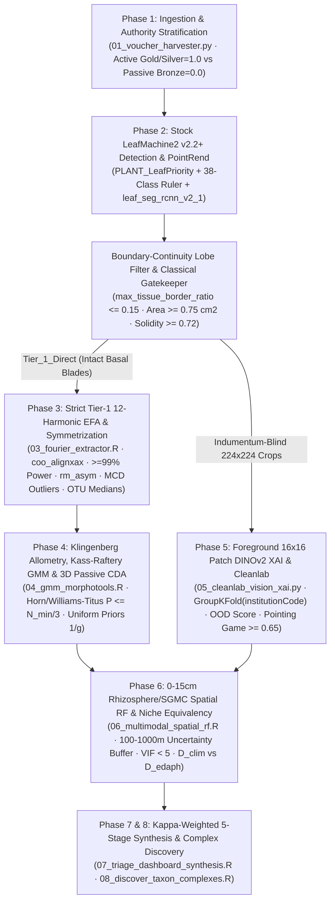

# Automated High-Throughput Vegetative Phenotyping and Herbarium Triage Pipeline for the *Packera dubia* Complex

### Operationalizing Morphological Diagnosability under the Unified Species Concept

[](https://doi.org/10.5281/zenodo.xxxxxx) [](https://opensource.org/licenses/MIT) [](https://www.python.org/downloads/) [](https://www.r-project.org/)

---

## 🌿 Project Overview

This repository houses the computational and statistical pipeline for the automated high-throughput vegetative phenotyping, morphological diagnosability assessment, and herbarium triage of the ***Packera dubia*** **(Spreng.) Trock & Mabb. complex** (Asteraceae: Senecioneae) and allied Eastern North American *Packera* species.

Developed as part of doctoral research at the **University of North Carolina at Chapel Hill** in collaboration with the **UNC Herbarium (NCU)**, this project operationalizes morphological diagnosability under the **Unified Species Concept (USC; de Queiroz 2007)**. Under the USC, species are conceptualized as separately evolving metapopulation lineages. In taxonomically complex plant clades characterized by ecophenotypic plasticity, polyploidy, and historical misidentification, vegetative morphometrics serves as a high-throughput operational screen evaluated via **Integration by Congruence (Padial et al. 2010)** in concert with multiple independent lines of evolutionary evidence:
- **Reproductive Macro-Morphology:** Capitulum aspect ratios, phyllary series counts, ray/disc floret dimensions, and 3-tier optical anthesis staging.
- **Cytotaxonomic Cytotypes:** Known chromosome numbers and ploidy races ($2n = 44, 46, 88$; Kowal 1975).
- **Reduced-Representation Phylogenomics:** High-throughput nextRAD single nucleotide polymorphism (SNP) datasets resolving reticulate evolution and lineage boundaries.
- **Fine-Grain ($0\text{–}15\text{ cm}$ Rhizosphere, 10 m – 30 m Outcrop & Geologic) Niche Validation:** A persistent edaphic and bedrock stack (`data/environmental/fine_grain_edaphic_cache.csv`) combining $0\text{–}15\text{ cm}$ trapezoidal rhizosphere depth-weighted soil properties (`(5 * v_0_5 + 10 * v_5_15) / 15`), 50 m-buffered 1:24,000 USDA-NRCS SSURGO vector map units (`ssurgo_rock_outcrop_pct`, `ssurgo_bedrock_depth_cm`, `ssurgo_aws_0_50cm`), 30 m POLARIS probabilistic soil grids (`polaris_30m/`), 100 m SOLUS100 bedrock depth and coarse rock fragment volume (`solus_100m/`: `resdept`, `fragvol`), 6-class USGS SGMC bedrock lithology (`sgmc_lithology_class`), 10 m – 30 m USGS 3DEP micro-topography (`topo_tpi_30m`, `topo_roughness_30m`, `topo_slope_deg`, `topo_twi_30m`), and 250 m SoilGrids gap-free fallback with partitioned **Climatic ($D_{\text{clim}}, I_{\text{clim}}$) vs. Edaphic-Geologic ($D_{\text{edaph}}, I_{\text{edaph}}$)** Niche Equivalency and Background Similarity tests (Warren et al. 2008; Broennimann et al. 2012).

The computational infrastructure runs end-to-end using **stock LeafMachine2 v2.2+** (`PLANT_LeafPriority` + 38-class Ruler Detector + `leaf_seg_rcnn_v2_1` PointRend) out of the box without requiring manual annotation or custom PCD retraining, coupled with Otsu boundary-continuity lobe rejection (`max_tissue_border_ratio: 0.15`), ruler-calibrated physical area filtering (`min_blade_area_cm2: 0.75`), classical dimensionless shape gatekeeping (`Solidity >= 0.72`, `Circularity >= 0.25`, `Extent >= 0.35`, plus pinnatifid and bipinnatisect dissection gates), strict `Tier_1_Direct` closed-contour Elliptic Fourier Analysis (`Momocs`), uniform bilateral symmetrization (Claude 2008), unweighted Operational Taxonomic Unit (OTU) median aggregation, a **strict active/passive determiner authority split** (`Tier_1_Gold` & `Tier_2_Silver` active anchors vs. `Tier_3_Bronze = 0.0` passive projection; Šlenker et al. 2022; Dawid & Skene 1979), Klingenberg (2016) allometric slope homogeneity testing, taphonomic indumentum-blind `dinov2_vitb14_reg` foreground patch-token pooling with Cleanlab confident learning, and out-of-fold Cohen's $\kappa$ reliability-weighted multi-modal synthesis.

- **Principal Investigator:** J. Brandon Fuller (PhD Candidate, Department of Biology, UNC-CH)  
- **Faculty Advisor:** Dr. Alan S. Weakley (Director, NCU Herbarium; UNC Biology)  
- **Standard Operating Procedure:** `UNC-BOT-SOP-2026-04-REV5`  
- **Target Taxa:** *Packera dubia* (formerly *P. tomentosa* / *Senecio tomentosus*), *Packera anonyma*, *Packera plattensis*, *Packera paupercula* (including var. *paupercula* and var. *savannarum*), and allied Eastern North American lineages (*P. aurea*, *P. obovata*, *P. glabella*, *P. schweinitziana*, *P. millefolium*, *P. crawfordii*, *P. serpenticola*).

---

## ⚙️ Architecture & Fully Automated Production Workflow

The pipeline operates out of the box as a **fully automated, zero-manual-annotation production workflow** orchestrated via `./run_pipeline.sh` or `python main.py` under a **Canonical Two-Tier Storage Architecture**:

* **Tier A — Canonical Shared Store (`data/` at repository root):** Houses all invariant Step 01 and Step 02 specimen, environmental (`fine_grain_edaphic_cache.csv`), and organ extraction assets (`raw_vouchers/`, `masks/{tier1_intact,tier2_reflected}/`, `contours/`, `cropped_patches/{rosettes_dense,basal_leaves_raw,capitula}/`, and the 5 Step 01–02 CSV manifests in `data/tables/`).
* **Tier B — Run-Scoped Analysis Directories (`runs/<RUN_ID>/` with `runs/latest` symlink):** Automatically seeds and symlinks Step 01–02 inputs directly from canonical root `data/` without referencing previous `runs/` directories and isolates all Step 03–08 statistical tables, reports, logs, and figures inside `runs/<RUN_ID>/`.

### Empirical Phase-by-Phase Protocol Summary (Steps 01–08)

1. **Phase 1 — Taxonomic Ingestion & Strict Active/Passive Authority Stratification (`01_voucher_harvester.py`):**
   - Harvests GBIF and iDigBio DarwinCore archives across Eastern and Central North America, standardizing synonymy and partitioning specimens into three determiner authority tiers:
     - **Active Reference Anchors (`Tier_1_Gold` & `Tier_2_Silver`, `authority_weight = 1.0` or empirical Dawid-Skene precision $w_k = 1 - \text{error\_rate}_k$ after $\chi^2_{0.95}$ Mahalanobis pruning):** Monographic/type-verified determinations (Barkley, Trock, Kowal, Weakley, Bain, Mahoney, Fuller) and curated regional specialist determinations (NCU, GA, US, NY, BRIT, MO, WIS, VDB, FLAS).
     - **Passively Projected Vouchers (`Tier_3_Bronze`, `authority_weight = 0.0`):** General floristic collections and unverified aggregator records. `Tier_3_Bronze` vouchers receive zero weight during supervised model training (Steps 04–06) and are projected passively (`predict()` / `predict_proba()`) into the fitted morphospace, CDA canonical space, Cleanlab classifier, and Spatial Random Forests.
2. **Phase 2 — Stock LeafMachine2 v2.2+ Segmentation, Boundary-Continuity Lobe Rejection & Classical Gatekeeping (`02_segment_and_extract.py`):**
   - **Stock LeafMachine2 v2.2+ Configuration (`configure_leafmachine2.py`):** Uses stock `PLANT_LeafPriority` (`minimum_confidence_threshold: 0.65`) and `leaf_seg_rcnn_v2_1` PointRend checkpoints with `treat_leaflet_as_leaf_whole: False`, `use_efds_for_png_masks: False`, and `do_apply_landmarks: False`.
   - **Otsu Boundary-Continuity Lobe Rejection & Calibrated Area Floor:** Rejects severed lobes or unattached fragments where non-paper plant tissue occupies $> 15\%$ of the bounding-box perimeter (`max_tissue_border_ratio: 0.15`), and enforces a ruler-calibrated physical area floor of `min_blade_area_cm2: 0.75` when `is_calibrated_mm == True`.
   - **Classical Dimensionless Descriptors (`Tier_1_Direct`):** Intact basal blades require $\text{Solidity} \ge 0.72$, $\text{Circularity} \ge 0.25$, $\text{Extent} \ge 0.35$, and $\text{UCS} \ge 0.85$, with label-blind bilateral sinus topology (`is_botanical_dissection()`) routing pinnatifid ($0.48 \le \text{Solidity} < 0.72$) and bipinnatisect ($0.18 \le \text{Solidity} < 0.48$, $\ge 4$ deep sinuses) blades into `Tier_1_Direct`.
3. **Phase 3 — Strict `Tier_1_Direct` Closed-Contour EFA, Symmetrization & Unweighted OTU Medians (`03_fourier_extractor.R`):**
   - **Strict Tier 1 Closed-Contour Scope:** Only intact `Tier_1_Direct` contours enter `Momocs::efourier` (folded/reflected `Tier_2_Reflected` leaves and open-curve approximations are never pooled into EFA).
   - **Inertial Axis Pre-Alignment & $\ge 99\%$ Harmonic Power Calibration:** Contours are centered and aligned along their major inertial axis (`Momocs::coo_alignxax` with circularity $> 0.75$ suborbicular guard), verified via `Momocs::calibrate_harmonicpower_efourier` to capture $\ge 99\%$ cumulative harmonic power at $H = 12$, and decomposed with `Momocs::efourier(..., nb.h = 12, norm = FALSE, start = FALSE)`.
   - **Uniform Symmetrization, MCD Outlier Gating & Unweighted OTU Medians:** Applies `Momocs::rm_asym(ef)` uniformly (Claude 2008), removes anomalous contours via Minimum Covariance Determinant (MCD) Mahalanobis distance (`MASS::cov.rob`, $p < 0.001$) and `pct_asymmetry > 0.22 | harmonic_roughness > 0.15`, and aggregates multi-leaf vouchers to the Specimen / Operational Taxonomic Unit (`(catalogNumber, plant_individual_id)`) via **unweighted coordinate-wise median** harmonics and PCs (`morph_tier_source = "Tier_1_Pure"`).
4. **Phase 4 — Klingenberg Allometry, Horn/Williams-Titus Subspace, Kass-Raftery GMM & 3D Passive CDA (`04_gmm_morphotools.R`):**
   - **Klingenberg (2016) Allometric Slope Homogeneity Testing:** Tests `PC ~ log_centsize * species_standardized` ($\alpha = 0.01$) on ruler-calibrated (`is_calibrated_mm == TRUE`) active anchors before applying common-slope within-group allometric correction (`allometry_homogeneity_test.csv`).
   - **Subspace Selection, GMM & Passive CDA:** Selects informative PCs via Horn's Parallel Analysis / Broken-Stick capped by Williams & Titus (1988) $P \le \lfloor N_{\min} / 3 \rfloor$; evaluates discrete GMM morphotypes via Kass & Raftery (1995) $2\Delta\text{BIC}$ thresholds ($> 6$ strong, $> 10$ very strong); trains passive CDA on Gold/Silver `Tier_1_Pure` anchors ($\chi^2_{0.95}$ trimmed) with uniform priors (`1/g`) and honest LOOCV; and audits institutional mounting bias via taxon-adjusted marginal models (`lm(PC1 ~ species_standardized + institutionCode)` and `lm(PC2 ~ species_standardized + institutionCode)`).
5. **Phase 5 — Taphonomic Indumentum-Blind Vision XAI, Foreground Patch Pooling & OOD Scoring (`05_cleanlab_vision_xai.py`):**
   - Applies a $\sigma = 1.0\text{ px}$ Gaussian low-pass filter on $224 \times 224$ crops (`apply_indumentum_blind_lowpass`) to prevent taphonomic trichome abrasion bias, pools `dinov2_vitb14_reg` features strictly over foreground $16 \times 16$ spatial patch tokens (`compute_foreground_patch_mask`), trains on Gold/Silver anchors under `institutionCode`-grouped `StratifiedGroupKFold` with Platt/temperature calibration, prunes label noise via class-conditional `prune_by_noise_rate`, computes feature-space Mahalanobis + cosine $k$-NN OOD scores (`vision_ood_score`), and enforces Pointing Game `foreground_attention_ratio >= 0.65`.
6. **Phase 6 — $0\text{–}15\text{ cm}$ Rhizosphere/Outcrop ENM Stack, Collinearity Pruning & Partitioned Niche Equivalency (`06_multimodal_spatial_rf.R`):**
   - Combines $0\text{–}15\text{ cm}$ trapezoidal rhizosphere depth-weighting (`(5 * v_0_5 + 10 * v_5_15) / 15`), 30m POLARIS/gSSURGO with SoilGrids 250m fallback, depth-to-bedrock/CFVO/AWC/clr-texture, 6-class USGS SGMC bedrock lithology, coordinate-uncertainty buffered focal extraction (`100–1000 m`), and $|r| < 0.70$ / $\text{VIF} < 5.0$ collinearity pruning (`prune_collinear_predictors`), running partitioned Climatic ($D_{\text{clim}}, I_{\text{clim}}$) vs. Edaphic-Geologic ($D_{\text{edaph}}, I_{\text{edaph}}$) Niche Equivalency & Background Similarity tests and $0.5^\circ \times 0.5^\circ$ Spatial Block CV.
7. **Phase 7 & 8 — Reliability-Weighted Consensus, 5-Stage Decision Matrix & Complex Discovery (`07_triage_dashboard_synthesis.R`, `08_discover_taxon_complexes.R`):**
   - Weights each modality by out-of-fold Cohen's $\kappa_m$ dynamically renormalized over observed modalities (`98.4%` voucher completion), computes Hopkins-adjusted circular anthesis phenology (`atan2` residuals controlling for latitude, elevation, and MAT gated on active anthesis), runs taxon-adjusted `institutionCode` ANCOVA, applies the 5-stage hierarchical decision matrix (`Misidentification_Reassign` evaluated before `Hybrid_Introgressant`; multi-modal Integration by Congruence for `Putative_Cryptic_Species`), and discovers Eastern North American species complexes via unsupervised Leiden/Louvain graph modularity and Ward.D2 clustering (`08_discover_taxon_complexes.R`).



---

## 📁 Streamlined Repository Structure

```text
Packera_dubia_morphometrics/
├── config/
│   └── config.yaml                    # Central paths, taxon synonyms & empirical thresholds
├── run_pipeline.sh                    # Run-scoped orchestrator CLI (--run-id, --start-step, --exclude-taxon, --focal-taxon)
├── main.py                            # Unified Python CLI runner (check-env, harvest, segment, morphometrics, synthesis, run-all)
├── LeafMachine2/                      # Immutable stock LeafMachine2 v2.2+ engine submodule
│   ├── LeafMachine2.py
│   └── leafmachine2/
├── data/                              # Tier A: Canonical Shared Store (Invariant Step 01–02 & Environmental Assets)
│   ├── raw_vouchers/                  # High-resolution specimen sheet imagery (.jpg)
│   ├── masks/                         # Canonical binary leaf silhouettes (tier1_intact/, tier2_reflected/)
│   ├── contours/                      # Canonical homologized 120-vertex 2D coordinate contours (.csv)
│   ├── cropped_patches/               # Canonical organ RGB crops for DINOv2 & phenology
│   │   ├── basal_leaves_raw/          # Cropped Tier_1_Direct basal leaf RGB patches
│   │   ├── capitula/                  # Cropped reproductive head patches (3-tier anthesis staging)
│   │   └── rosettes_dense/            # DBSCAN per-individual whole-rosette RGB crops
│   ├── environmental/                 # 0–15cm Rhizosphere, 10m–30m Outcrop & USGS SGMC Bedrock Stack
│   │   ├── fine_grain_edaphic_cache.csv # Persistent SSURGO + POLARIS + SOLUS100 + 3DEP + SGMC cache
│   │   ├── polaris_30m/               # 30 m POLARIS probabilistic soil rasters (0–5 & 5–15 cm)
│   │   ├── solus_100m/                # 100 m SOLUS100 rasters (resdept bedrock depth, fragvol rock fragments)
│   │   ├── dem_3dep_30m/              # 10 m – 30 m USGS 3DEP DEM tiles (TPI, roughness, slope, TWI)
│   │   └── ssurgo_cache/              # 50 m-buffered USDA-NRCS SSURGO SDA query cache
│   └── tables/                        # Canonical Step 01–02 CSV manifests (seeded into runs/<RUN_ID>/)
│       ├── curated_vouchers.csv       # Harvested vouchers with Determiner Authority Tiers
│       ├── extracted_leaf_manifest.csv# Stage 2 leaf routing, DBSCAN plant_individual_id & ruler calibration
│       ├── failed_qc_vouchers.csv     # Vouchers rejected by Stage 2 basal/cauline/boundary quality gatekeeper
│       ├── voucher_reproductive_metrics.csv # Capitulum counts & involucre dimensions (px & mm)
│       └── voucher_phenological_states.csv  # 3-tier optical capitulum phenology classifications
├── runs/                              # Tier B: Run-Scoped Analysis Directories (Steps 03–08)
│   ├── latest -> run_<YYYYMMDD_HHMMSS># Symlink to most recent run directory
│   └── <RUN_ID>/                      # Self-contained run directory (data/tables/, outputs/figures/, outputs/reports/, logs/)
├── scripts/
│   ├── core/                          # Consolidated shared utilities
│   │   ├── harvester.py               # Combined API queries, DwC parsing & media downloads
│   │   ├── artifact_manager.py        # Model weight verification & SHA256 integrity checks
│   │   ├── config.py                  # Python-side configuration schema
│   │   └── logger.py                  # Structured console and file logger
│   ├── data_prep/                     # Phase 1: Data harvesting and pruning
│   │   ├── 01_voucher_harvester.py    # Ingestion & active/passive authority stratification
│   │   └── audit_and_prune_vouchers.py# Dataset integrity and invalid image pruner
│   ├── pipeline/                      # Phase 2: Production segmentation & extraction
│   │   └── 02_segment_and_extract.py  # Stock LM2 v2.2+ + PointRend + classical gatekeeping & contour export
│   ├── vision/                        # Botanical geometry, LM2 loaders & phenology classifiers
│   │   ├── capitulum_phenology_classifier.py # Optical biomarker phenotyping (pappus, corolla)
│   │   ├── configure_leafmachine2.py  # Stock LM2 v2.2+ configuration builder
│   │   ├── lm2_data_loader.py         # Stage 1 YOLOv5 PLANT_LeafPriority & 38-class Ruler loader
│   │   ├── lm2_geometry_utils.py      # Boundary-continuity filter, classical descriptors & base homologization
│   │   └── tune_geometry_parameters.py# Empirical threshold calibrator
│   ├── morphometrics/                 # Canonical R statistical morphometrics, complex discovery & 3D plotting
│   │   ├── 03_fourier_extractor.R     # Strict Tier-1 12-harmonic EFA, coo_alignxax, rm_asym, MCD & OTU medians
│   │   ├── 04_gmm_morphotools.R       # Klingenberg allometry, Horn/Williams-Titus PCA, Kass-Raftery GMM & 3D CDA
│   │   ├── 08_discover_taxon_complexes.R # Unsupervised Leiden/Louvain & Ward.D2 taxon-complex discovery
│   │   └── pub_figures_utils.R        # Okabe-Ito palettes, plot_3d_scatter_box & unfilled marker helpers
│   ├── analysis/                      # Deep vision, 0–15cm rhizosphere macroecology, and synthesis
│   │   ├── 05_cleanlab_vision_xai.py  # Indumentum-blind dinov2_vitb14_reg foreground patch pooling, Cleanlab & OOD
│   │   ├── 06_multimodal_spatial_rf.R # 0–15cm Spatial RF, uncertainty buffers, VIF pruning & niche equivalency
│   │   ├── edaphic_fine_grain_utils.R # SSURGO, POLARIS, SOLUS100, 3DEP & USGS SGMC lithology extractor
│   │   └── 07_triage_dashboard_synthesis.R # Kappa-weighted consensus, Hopkins circular phenology & 5-stage matrix
│   ├── annotation_and_training/       # Optional standalone utilities (not required by automated pipeline)
│   │   ├── annotate_with_sam2.py
│   │   ├── sam2_annotator_utils.py
│   │   └── finetune_lm2_pcd.py
│   ├── tests/                         # Unit and integration test suite
│   └── _archive/                      # Decommissioned scripts (isolated; never imported by active code)
├── outputs/
│   ├── figures/                       # Publication plots, 3D PCA/CDA ordinations & QC panels
│   └── reports/                       # Taxonomic summaries, BIC tables & manifests
├── requirements.txt                   # Primary Python dependencies
└── README.md
```

---

## 🚀 Execution Guide

### ⚡ Quick-Start Copy-Paste Terminal Cheat-Sheet

#### A. Environment Activation & Preflight Verification
```bash
source .venv/bin/activate
python main.py check-env
```

#### B. End-to-End Automated Pipeline & `run_pipeline.sh` CLI Reference
Every execution launched via `./run_pipeline.sh` or `python main.py` operates under the **Canonical Two-Tier Storage Architecture**: invariant Step 01–02 assets reside in canonical root `data/` and are automatically seeded/symlinked into `runs/<RUN_ID>/` (updating `runs/latest`), while all Step 03–08 statistical tables, reports, logs (`logs/pipeline.log`), and publication figures (`.pdf` + 300-DPI `.png`) are isolated inside `runs/<RUN_ID>/`.

```bash
source .venv/bin/activate

# 1. Default full complex-wide run (creates runs/run_<YYYYMMDD_HHMMSS>/ and updates runs/latest)
./run_pipeline.sh

# 2. Custom named run directory (--run-id <NAME>) reusing cached vouchers & canonical Step 02 assets (--skip-harvest)
./run_pipeline.sh --run-id packera_revision_v1 --skip-harvest

# 3. Resume or launch from any pipeline step (--start-step <1..7>, e.g., Step 03 EFA or Step 06 Spatial RF)
#    Automatically seeds Step 01–02 tables and symlinks masks/contours/cropped_patches from canonical root data/:
./run_pipeline.sh --run-id packera_revision_v1 --skip-harvest --start-step 3
./run_pipeline.sh --run-id packera_revision_v1 --skip-harvest --start-step 6

# 4. Exclude one or more taxa (--exclude-taxon "<TAXON>"):
#    Filters curated_vouchers.csv, Step 02 manifests, and cropped_patches/ while dynamically remapping
#    Step 05 DINOv2/Cleanlab class indices to contiguous 0..K-1 (active_taxa):
./run_pipeline.sh --run-id eastern_3taxa --skip-harvest --start-step 3 --exclude-taxon "Packera plattensis"

# 5. Strategy 1 (Focal Taxon + Outgroup Gold Reference Anchors, default --gold-anchors 30):
#    Processes all focal taxon vouchers plus N Tier_1_Gold anchors per outgroup species for Steps 04–06 calibration,
#    then filters Step 07's final triage queue and figures strictly to the focal taxon:
./run_pipeline.sh --run-id dubia_triage --skip-harvest --focal-taxon "Packera dubia" --gold-anchors 30

# 6. Strategy 2 (Pure Intraspecific Delimitation Mode: --focal-taxon "<TAXON>" --intraspecific-mode):
#    Runs strictly on a single species (n_unique_taxa == 1) with zero outgroup specimens, switching Steps 04–06
#    from species_standardized to label-blind GMM morphotypes (Morphotype_K1..K_n or geographic/edaphic ecotypes)
#    to test for cryptic lineages and granite-outcrop ecotypes:
./run_pipeline.sh --run-id dubia_cryptic --skip-harvest --focal-taxon "Packera dubia" --intraspecific-mode

# 7. Step 08: Unsupervised Eastern North American Taxon-Complex Discovery (Leiden/Louvain + Ward.D2)
Rscript scripts/morphometrics/08_discover_taxon_complexes.R \
    --harmonics data/tables/leaf_efa_harmonics.csv \
    --vouchers data/tables/curated_vouchers.csv \
    --multimodal data/tables/multimodal_conflict_flags.csv \
    --vision data/tables/label_noise_audit.csv \
    --output-dir outputs/reports
```

| `run_pipeline.sh` CLI Flag | Argument | Default | Operational Behavior |
| :--- | :--- | :--- | :--- |
| `--run-id` | `<NAME>` | `run_<YYYYMMDD_HHMMSS>` | Isolates all Step 03–08 outputs inside `runs/<NAME>/` and updates the `runs/latest` symlink. |
| `--skip-harvest` | *(flag)* | `false` | Skips Step 01 network harvesting and reuses cached `data/tables/curated_vouchers.csv` and local `data/raw_vouchers/` images. |
| `--start-step` | `<1..7>` | `1` | Starts or resumes execution from Step `1`..`7` (e.g., `--start-step 3` or `--start-step 6`), automatically seeding Step 01–02 tables and symlinks from canonical root `data/`. |
| `--exclude-taxon` | `"<TAXON>"` | *(none)* | Excludes one or more taxa (repeatable, e.g., `--exclude-taxon "Packera plattensis"`), filtering `curated_vouchers.csv`, Step 02 manifests, and `cropped_patches/` while dynamically remapping Step 05 class indices to contiguous `0..K-1` (`active_taxa`). |
| `--focal-taxon` | `"<TAXON>"` | `""` *(all taxa)* | Restricts focal evaluation to a single species (e.g., `"Packera dubia"` or `"Packera anonyma"`). |
| `--gold-anchors` | `<INT>` | `30` | **Strategy 1 (Focal Taxon + Outgroup Gold Reference Anchors):** Retains `N` `Tier_1_Gold` anchors per outgroup species for Steps 04–06 calibration, then filters Step 07's final triage queue and figures strictly to `--focal-taxon`. |
| `--intraspecific-mode` | *(flag)* | `false` | **Strategy 2 (Pure Intraspecific Delimitation Mode):** Sets `--gold-anchors 0` (`n_unique_taxa == 1` with zero outgroup specimens), switching Steps 04–06 from `species_standardized` to label-blind GMM morphotypes (`Morphotype_K1..K_n` or geographic/edaphic ecotypes). |
| `--gold-only` | *(flag)* | `false` | Filters `curated_vouchers.csv`, all Step 02 manifests, and `cropped_patches/` in the run directory strictly to rows where `determiner_tier == 'Tier_1_Gold'` prior to running Steps 02–07. |
| `--determiner-tier` | `<TIER>` | `""` *(all tiers)* | Filters `curated_vouchers.csv`, all Step 02 manifests, and `cropped_patches/` in the run directory strictly to rows matching `<TIER>` (e.g., `Tier_1_Gold`, `Tier_2_Silver`, or `Tier_3_Bronze`) prior to running Steps 02–07. |
| `--exclude-misidentified` | *(flag)* | `false` | Filters out any `catalogNumber` with `taxonomic_treatment_subtype == 'Misidentification_Reassign'` (retaining only `Confirmed_Species`, `Hybrid_Introgressant`, `Subspecies_Ecotype`, `Ecophenotypic_Plasticity`, and `Putative_Cryptic_Species`) across `curated_vouchers.csv`, Step 02 manifests, and `cropped_patches/` during preflight. |
| `--triage-source` | `<RUN_ID_OR_ALL>` | `ALL` | Specifies the triage report source(s) for `--exclude-misidentified` (defaults to `ALL` existing `runs/*/outputs/reports/final_curation_triage.csv`, or accepts a specific `<RUN_ID>` / comma-separated list of run IDs). |
| `--force` / `--overwrite` | *(flag)* | `false` | Forces re-computation and overwrites existing run artifacts. |
| `--resegment` / `--force-segment` | *(flag)* | `false` | Forces fresh Step 02 LeafMachine2 + PointRend segmentation instead of reusing canonical root `data/masks/` and `data/contours/`. |
| `--limit` | `<N>` | `0` *(all)* | Restricts execution to a pilot subset of the first `N` vouchers. |
| `--sam2-refine` | *(flag)* | `false` | Optional automated LM2-guided SAM 2 sub-pixel boundary refinement in Step 02 (`02_segment_and_extract.py`). |

#### C. Phase-by-Phase Execution via Unified `main.py` CLI
```bash
source .venv/bin/activate

# Phase 1: Harvest GBIF/iDigBio vouchers & stratify active/passive determiner authority tiers
python main.py harvest --max-records 5000 --download-images

# Phase 2: Two-stage stock LeafMachine2 v2.2+ (PLANT_LeafPriority + Ruler + leaf_seg_rcnn_v2_1 PointRend)
python main.py segment

# Phase 3 & 4: Strict Tier-1 12-Harmonic EFA (Momocs), Klingenberg Allometry, Kass-Raftery GMM & Passive CDA
python main.py morphometrics --harmonics 12

# Phase 5, 6 & 7: Indumentum-Blind DINOv2 + Cleanlab XAI, 0–15cm Spatial RF, & 5-Stage Triage Synthesis
python main.py synthesis
```

#### D. Automated QA & Test Suite Commands
```bash
source .venv/bin/activate
python3 -m unittest discover -s scripts/tests -p "test_*.py" -v
```

---

## 🔬 Methodological Highlights

1. **Strict Active/Passive Determiner Authority Split & Dawid-Skene Precision Weighting (`Tier_3_Bronze = 0.0`):** Rather than arbitrary heuristic multipliers that allow large volumes of unverified herbarium records to swamp specialist determinations, the pipeline enforces a strict active/passive authority split (Šlenker et al. 2022; Dawid & Skene 1979):
   - 🥇 **Active Reference Anchors (`Tier_1_Gold` & `Tier_2_Silver`, `authority_weight = 1.0` or $w_k = 1 - \text{error\_rate}_k$):** Monographic/type-verified determinations (`Tier_1_Gold`) and curated regional specialist determinations (`Tier_2_Silver`) after per-taxon $\chi^2_{0.95}$ Mahalanobis outlier pruning form the exclusive training anchor set for supervised CDA, allometric regression, Cleanlab cross-validation, and Spatial Random Forests.
   - 🥉 **Passively Projected Vouchers (`Tier_3_Bronze`, `authority_weight = 0.0`):** General floristic collections and unverified aggregator records receive zero weight (`0.0`) during model fitting and are projected passively (`predict()` / `predict_proba()`) into the fitted morphospace, CDA canonical space, and GMM clusters.
2. **Stock LeafMachine2 v2.2+ Segmentation, Boundary-Continuity Lobe Rejection & Classical Descriptors:** Stage 1 runs stock LeafMachine2 v2.2+ `PLANT_LeafPriority` (`minimum_confidence_threshold: 0.65`, `treat_leaflet_as_leaf_whole: False`, `use_efds_for_png_masks: False`, `do_apply_landmarks: False`) and the 38-class Ruler Detector, followed by Stage 2 native-DPI PointRend (`leaf_seg_rcnn_v2_1`). Otsu boundary-continuity lobe filtering (`is_truncated_lobe_or_leaflet`, `max_tissue_border_ratio: 0.15`) rejects severed terminal lobes, ruler-calibrated sheets enforce `min_blade_area_cm2: 0.75`, and classical dimensionless descriptors (`Solidity >= 0.72`, `Circularity >= 0.25`, `Extent >= 0.35`, plus pinnatifid $0.48\text{–}0.72$ and bipinnatisect $0.18\text{–}0.48$ dissection gates) route intact basal blades into `Tier_1_Direct`.
3. **Strict `Tier_1_Direct` Closed-Contour EFA, Inertial Pre-Alignment, Symmetrization & Unweighted OTU Medians (`03_fourier_extractor.R`):** Only intact `Tier_1_Direct` basal leaf contours enter `Momocs::efourier` (never pooling mirrored hemi-blades or open-curve approximations into EFA). Contours undergo inertial axis pre-alignment (`Momocs::coo_alignxax` with circularity $> 0.75$ suborbicular guard), empirical $\ge 99\%$ cumulative harmonic power verification at $H = 12$ (`calibrate_harmonicpower_efourier`), uniform bilateral symmetrization (`Momocs::rm_asym(ef)`, Claude 2008), and Minimum Covariance Determinant (MCD) Mahalanobis outlier filtering (`MASS::cov.rob`, $p < 0.001$), followed by **unweighted coordinate-wise median** aggregation to the Specimen / Operational Taxonomic Unit (`(catalogNumber, plant_individual_id)`).
4. **Klingenberg (2016) Allometric Slope Homogeneity, Horn/Williams-Titus Subspace, Kass-Raftery GMM & Taxon-Adjusted Institutional Batch Audit (`04_gmm_morphotools.R`):** Tests homogeneity of allometric slopes (`PC ~ log_centsize * species_standardized` at $\alpha = 0.01$, Klingenberg 2016) on ruler-calibrated (`is_calibrated_mm == TRUE`) active anchors before applying pooled within-group size correction. Selects informative PCs via Horn's Parallel Analysis / Broken-Stick capped by Williams & Titus (1988) $P \le \lfloor N_{\min} / 3 \rfloor$, fits `mclust::Mclust` evaluated by Kass & Raftery (1995) $2\Delta\text{BIC}$ thresholds ($> 6$ strong, $> 10$ very strong), runs passive CDA with uniform priors (`1/g`) and honest LOOCV, and audits institutional mounting bias via taxon-adjusted marginal models (`lm(PC1 ~ species_standardized + institutionCode)` and `lm(PC2 ~ species_standardized + institutionCode)`).
5. **Taphonomic Indumentum-Blind Vision XAI, Foreground $16 \times 16$ Patch Pooling, `institutionCode` GroupKFold & OOD Scoring (`05_cleanlab_vision_xai.py`):** Applies a $\sigma = 1.0\text{ px}$ Gaussian low-pass filter on $224 \times 224$ crops (`apply_indumentum_blind_lowpass`) to attenuate taphonomically abraded trichome/tomentum textures while preserving macro-architectural venation and lobing. Extracts `dinov2_vitb14_reg` features via foreground-masked $16 \times 16$ spatial patch token average pooling (`compute_foreground_patch_mask`), trains on Gold/Silver anchors using `institutionCode`-grouped `StratifiedGroupKFold` with Platt/temperature calibration, runs class-conditional Cleanlab `prune_by_noise_rate`, computes feature-space OOD scores (`vision_ood_score`), and verifies Pointing Game `foreground_attention_ratio >= 0.65`.
6. **$0\text{–}15\text{ cm}$ Rhizosphere Depth-Weighting, USGS SGMC Bedrock Lithology, Uncertainty Buffers & Partitioned Niche Equivalency (`06_multimodal_spatial_rf.R`):** Integrates $0\text{–}15\text{ cm}$ trapezoidal rhizosphere depth-weighting (`(5 * v_0_5 + 10 * v_5_15) / 15`), 30m POLARIS/gSSURGO with SoilGrids 250m fallback, depth-to-bedrock/CFVO/AWC/clr-texture (`clr_sand_silt`, `clr_clay_geom`), 6-class USGS SGMC bedrock lithology, coordinate-uncertainty buffered focal extraction (`100–1000 m`), $|r| < 0.70$ and $\text{VIF} < 5.0$ collinearity pruning (`prune_collinear_predictors`), partitioned Climatic ($D_{\text{clim}}, I_{\text{clim}}$) vs. Edaphic-Geologic ($D_{\text{edaph}}, I_{\text{edaph}}$) Niche Equivalency & Background Similarity tests, and $0.5^\circ \times 0.5^\circ$ Spatial Block CV.
7. **Out-of-Fold Cohen's $\kappa$ Reliability Weighting, Hopkins Circular Anthesis Phenology, 5-Stage Decision Matrix & Unsupervised Complex Discovery (`07`–`08`):** Step 07 weights each diagnostic modality by out-of-fold Cohen's $\kappa_m$ dynamically renormalized over observed modalities $\mathcal{O}_i$ (`98.4%` voucher completion), computes Hopkins-adjusted circular anthesis phenology (`atan2` residuals controlling for latitude, elevation, and MAT gated on active anthesis), and evaluates the 5-stage hierarchical decision matrix (`Misidentification_Reassign` evaluated before `Hybrid_Introgressant`; multi-modal Integration by Congruence for `Putative_Cryptic_Species`). Step 08 (`08_discover_taxon_complexes.R`) performs unsupervised Leiden/Louvain graph modularity and Ward.D2 clustering to discover Eastern North American *Packera* species complexes.

---

## 📋 Canonical Cross-Language CSV Contracts

All Python (`scripts/pipeline/`, `scripts/vision/`, `scripts/analysis/`) and R (`scripts/morphometrics/`, `scripts/analysis/`) stages adhere to the exact primary keys and shared column schemas documented in [`AGENTS.md`](AGENTS.md) and verified by [`.agents/skills/pipeline-contract-audit/SKILL.md`](.agents/skills/pipeline-contract-audit/SKILL.md).

---

## 📦 System Requirements & Dependencies

- **Python $\ge$ 3.10 (`.venv`):** `torch`, `torchvision`, `opencv-python`, `scikit-learn`, `scipy`, `pandas`, `numpy`, `cleanlab`, `pygbif`, `requests`, `pyyaml`.  
- **LeafMachine2 Sub-Environment (`.venv_LM2`):** Isolated virtual environment for stock LeafMachine2 v2.2+, YOLOv5 (`PLANT_LeafPriority`, 38-class Ruler Detector), and compiled Detectron2 PointRend (`leaf_seg_rcnn_v2_1`) with strict ABI pins (`numpy<2.0`, `opencv-contrib-python<=4.10.0.84`).  
- **R $\ge$ 4.3:** CRAN statistical and spatial macroecological packages (`remotes`, `tidyverse`, `optparse`, `mclust`, `clustvarsel`, `MorphoTools2`, `RRPP`, `vegan`, `terra`, `sf`, `geodata`, `soilDB`, `spatialRF`, `ranger`, `adespatial`, `blockCV`, `ecospat`, `ENMTools`, `igraph`, `patchwork`, `viridis`) and `Momocs` (`remotes::install_github("MomX/Momocs")`).

> [!TIP]
> **Windows Users**: The recommended and fully supported way to run this pipeline on Windows is via **WSL 2 (Ubuntu)**. See [`docs/WINDOWS_WSL2_SETUP.md`](docs/WINDOWS_WSL2_SETUP.md) for a 10-minute setup guide.

---

## 📚 Key Methodological References

1. Barkley, T. M. 1988. Variation among the Senecioneae (Asteraceae) in North America. *Brittonia* 40(2): 211–221. doi: 10.2307/2807005  
2. Broennimann, O., et al. 2012. Measuring ecological niche overlap from occurrence and spatial environmental data. *Global Ecology and Biogeography* 21(4): 481–497.  
3. Claude, J. 2008. *Morphometrics with R*. Springer, New York.  
4. Collyer, M. L., and D. C. Adams. 2018. RRPP: An R package for fitting linear models to high-dimensional data using residual randomization. *Methods in Ecology and Evolution* 9(7): 1772–1779.  
5. Darcet, T., M. Oquab, J. Mairal, and P. Bojanowski. 2024. Vision transformers need registers. *International Conference on Learning Representations (ICLR)*.  
6. Davis, C. C., C. G. Willis, B. Connolly, C. Kelly, and A. M. Ellison. 2015. Herbarium records are a viable alternative to traditional phenological data for testing responses to climate change. *Journal of Ecology* 103(5): 1126–1134.  
7. Dawid, A. P., and A. M. Skene. 1979. Maximum likelihood estimation of observer error-rates using the EM algorithm. *Journal of the Royal Statistical Society: Series C* 28(1): 20–28.  
8. de Queiroz, K. 2007. Species concepts and species delimitation. *Systematic Biology* 56(6): 879–886.  
9. Kass, R. E., and A. E. Raftery. 1995. Bayes Factors. *Journal of the American Statistical Association* 90(430): 773–795.  
10. Klingenberg, C. P. 2016. Size, shape, and form: concepts of allometry in geometric morphometrics. *Development Genes and Evolution* 226(3): 113–137.  
11. Kowal, R. R. 1975. Systematics of *Senecio aureus* and allied species on the Gaspé Peninsula, Quebec. *Memoirs of the Torrey Botanical Club* 23(2): 1–113.  
12. Kuhl, F. P., and C. R. Giardina. 1982. Elliptic Fourier features of a closed contour. *Computer Graphics and Image Processing* 18(3): 236–258.  
13. Mabberley, D. J., D. K. Trock, and A. S. Weakley. 2020. The nomenclature of *Packera dubia* (Asteraceae: Senecioneae). *Taxon* 69(6): 1334–1337.  
14. Northcutt, C. G., L. Jiang, and I. L. Chuang. 2021. Confident Learning: Estimating Uncertainty in Dataset Labels. *Journal of Artificial Intelligence Research* 70: 1373–1411.  
15. Padial, J. M., A. Miralles, I. De la Riva, and M. Vences. 2010. The integrative future of taxonomy. *Frontiers in Zoology* 7: 16.  
16. Scrucca, L., and A. E. Raftery. 2018. clustvarsel: A package implementing variable selection for Gaussian model-based clustering in R. *Journal of Statistical Software* 84(1): 1–28.  
17. Šlenker, M., P. Koutecký, and P. Marhold. 2022. MorphoTools2: an R package for multivariate morphometric analysis. *Bioinformatics* 38(10): 2954–2955.  
18. Trock, D. K. 2006. *Packera*. In Flora of North America Editorial Committee (eds.), *Flora of North America North of Mexico*, Vol. 20, 570–602. Oxford University Press, New York.  
19. Valavi, R., J. Elith, J. J. Lahoz-Monfort, and G. Guillera-Arroita. 2019. blockCV: An R package for generating spatially or environmentally separated folds for k-fold cross-validation of species distribution models. *Methods in Ecology and Evolution* 10(2): 225–232.  
20. Warren, D. L., R. E. Glor, and M. Turelli. 2008. Environmental niche equivalency versus conservatism: quantitative approaches to niche evolution. *Evolution* 62(11): 2868–2883.  
21. Weakley, A. S. 2026. *Flora of the Southeastern United States*. University of North Carolina Herbarium (NCU), North Carolina Botanical Garden, Chapel Hill.  
22. Weaver, W. N., P. S. Ng, and R. LaFrance. 2024. LeafMachine2: Using machine learning to rapidly measure plant traits captured in herbarium specimens. *Applications in Plant Sciences* 12(1): e11545.  
23. Williams, B. K., and K. Titus. 1988. Assessment of sampling stability in ecological applications of discriminant analysis. *Ecology* 69(4): 1275–1285.  
24. Wright, M. N., and A. Ziegler. 2017. ranger: A fast implementation of random forests for high dimensional data in C++ and R. *Journal of Statistical Software* 77(1): 1–17.

---

## 📄 License & Attribution

This project is licensed under the **MIT License**. Herbarium specimen images harvested through the pipeline remain subject to the individual institutional data and copyright policies of the contributing herbaria.
