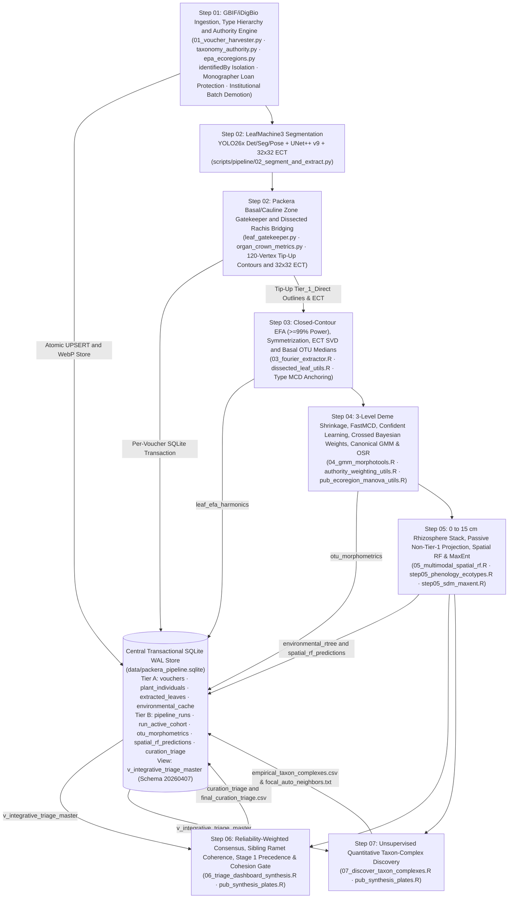

# Automated High-Throughput Vegetative Phenotyping and Herbarium Triage Pipeline for North American *Packera*

### Integrative Morphometric and Edaphic Species Delimitation Anchored by Nomenclatural Types

[](https://opensource.org/licenses/MIT) [](https://www.python.org/downloads/) [](https://www.r-project.org/) [](https://github.com/Gene-Weaver/LeafMachine3)

## Project Overview

Species boundaries in North American *Packera* Á. Löve & D. Löve (Asteraceae: Senecioneae) are difficult to resolve from herbarium sheets alone. Across the ***Packera dubia* (Spreng.) Trock & Mabb. complex** and its eastern North American congeners, taxa exhibit pronounced heteroblasty between basal rosette leaves and upper cauline stem leaves alongside frequent polyploidy ($2n = 44, 46, 88$; Kowal 1975) and reticulate hybridization. Many lineages also occupy specialized edaphic habitats on granite flatrocks and diabase glades, whereas coastal and piedmont relatives occur on serpentine barrens and deep coastal plain sands. Because herbarium collections contain misidentifications and mixed duplicate gatherings (exsiccatae), raw specimen measurements pooled by folder labels obscure evolutionary boundaries.

I built this pipeline at the University of North Carolina at Chapel Hill and the UNC Herbarium (NCU) to evaluate morphological diagnosability across North American *Packera* under the Unified Species Concept (de Queiroz 2007) through Integration by Congruence (Padial et al. 2010). To account for variation in determiner reliability across herbarium holdings, I stratify specimens by taxonomic authority and pin verified nomenclatural type specimens as morphological and *locus classicus* ecological baselines. I isolate intact basal rosette leaves from cauline stem leaves before I quantify lamina shape, so I can test whether vegetative leaf geometry and reproductive macro-morphology align with flowering phenology alongside fine-scale rhizosphere and bedrock niches ($0\text{ to }15\text{ cm}$ soil properties and $10\text{ to }30\text{ m}$ outcrop lithology).

Now that I have framed the taxonomic problem, let us examine how the data move through the system. I structure the pipeline around verified nomenclatural types, as historical primary and secondary types provide immutable morphological anchors. When I evaluate an unknown specimen, I measure its divergence from these type baselines to establish authentic morphological identity.

### Core Empirical Capabilities

* **Taxonomic Authority Stratification and Nomenclatural Type Pinning (Step 01):** I harvest Darwin Core archives from GBIF and iDigBio, resolve basionyms across the genus, and deduplicate exsiccatae series prior to image download. I store sheets as lossless-calibrated WebP images and intersect coordinates with official US EPA Level III Ecoregions (Omernik & Griffith 2014). My authority engine classifies determiners across four tiers: `Tier_0_Type` nomenclatural types and `Tier_1_Gold` monographers alongside `Tier_2_Silver` curated regional herbaria and `Tier_3_Bronze` general collections.
* **Determiner Isolation and Institutional Batch Demotion (Step 01):** To prevent false authority promotion, my dynamic engine isolates `identifiedBy` independently of `recordedBy`. It blocks non-person database adjustment strings (`"Nomenclatural Adjustment"` and `"Nomenclature update"` alongside `"Taxonomic update"` and `"Annotation"`) and rejects bare common surnames that lack initials. I demote undated institutional batch determinations spanning $\ge 25$ sheets across $\ge 10$ historical collectors at a single herbarium (or $> 25$ collectors overall) where `recordedBy != identifiedBy` from `Tier_1_Gold` to `Tier_2_Silver`, so those sheets undergo out-of-sample Mahalanobis and Confident Learning screening. Personal field collections (`recordedBy == identifiedBy`) and dated specialist annotations remain `Tier_1_Gold` (Goodwin et al. 2015; Maldonado et al. 2015), whereas historical nomenclatural type gatherings with county-level retro-georeferences or partial dates remain permanent taxonomic anchors.
* **LeafMachine3 Computer Vision and Focal Instance Disentanglement (Step 02):** I run [LeafMachine3](https://github.com/Gene-Weaver/LeafMachine3) (Weaver 2026) on ONNX Runtime over a `max_working_dim = 3200` working frame (`cv2.INTER_AREA`) with dynamic rectangular stride-32 letterboxing (`auto=True, stride=32`, `cv2.INTER_LINEAR_EXACT`) across `yolo26x_det_1280` and `yolo26x_seg_1024` alongside `yolo26x_pose_640`. In Stage 1 organ detection (`lm3_plant_detector__yolo26x_det_1280`, `conf = 0.25`, `iou = 0.55`, `include_partial = true`), I retain both `Leaf_WHOLE` and dissected `Leaf_PARTIAL` candidates and apply parent-preserving asymmetric nested-box deduplication (`overlap = 0.95`), so full dissected leaf boxes survive over nested terminal-lobe boxes. I perform whole-sheet substrate segmentation with `lm3_specimen_segmenter` (`UNet++ v9` with `LLR_Hyst_KeepBlobs` paper cleanup at `max_working_dim = 3200`) and resolve millimeter scale calibration through `lm3_ruler_classifier` paired with `lm3_ruler_segmenter`.
* **Anatomical Pose Tracking and Dual Foliar Zone Classification (Step 02):** For individual leaves, I run tight Stage 2 per-leaf segmentation (`lm3_leaf_segmenter__yolo26x_seg_1024`, `crop_pad = 0.0`, native `process_mask_native` prototype decoding) and isolate the primary focal `Leaf` (`cls == 0`) instance (`_largest_component >= 64` px) alongside rachis-bridged secondary pinna components (`>= 64` px connected strictly through `Petiole`). I subtract enclosed sinus perforations (`lamina = silhouette & ~hole`) and enforce LeafMachine3's midvein Voronoi bilateral symmetry gate (`bilateral_dice >= 0.70`, `|si_a| < 0.35`) to veto merged multi-leaf or leaf-stem blobs. I delegate geometric and landmark operations directly to native LeafMachine3 modules (`compute_ect` and `measure_petiole` alongside `compute_measurements` and `polygon_morphology`), infer 31-keypoint anatomical pose (`lm3_landmark_detector__yolo26x_pose_640` with `10%` white border padding), compute $32 \times 32$ radial-and-angular Euler Characteristic Transform (ECT) matrices (`data/ect/*.npy`), classify each leaf's anatomical zone (`classify_leaf_zone_anatomical` into `'basal'` versus `'cauline'`), and enforce a per-plant (`plant_individual_id`) adaptive physical blade-area floor ($\min(0.75, \max(0.15, 0.25 \times \text{median\_area}))\text{ cm}^2$) without a sheet-wide leaf count cap.
* **Type-Anchored Elliptic Fourier and Topological ECT Morphometrics (Step 03):** I decompose closed `Tier_1_Direct` leaf outlines through Elliptic Fourier Analysis (`Momocs::efourier`, calibrated to capture $\ge 99\%$ cumulative harmonic power) and symmetrize bilateral leaf outlines (`Momocs::rm_asym`; Claude 2008). Simultaneously, `compute_leaf_ect_features()` aligns and symmetrizes the $32 \times 32$ Euler Characteristic Transform matrices across basal and cauline tracks, which yields topological principal components (`ECT_PC1..PC3` and `Cauline_ECT_PC1..PC2`) alongside lobe complexity (`ect_lobe_complexity` and `cauline_ect_lobe_complexity`) and bilateral ECT asymmetry (`ect_bilateral_asym`). I aggregate primary Operational Taxonomic Unit (OTU) medians per plant individual strictly over pure basal rosette outlines ($w_{\text{basal}} = 1.0$, $w_{\text{cauline}} = 0.0$ when basal leaves exist, with cauline fallback when basal leaves are absent), whereas cauline leaves populate an orthogonal heteroblasty track (`cauline_leaf_count` and `cauline_solidity_med` alongside `cauline_dissection_index_med`, `basal_vs_cauline_length_ratio`, `basal_vs_cauline_solidity_delta`, `heteroblasty_efa_distance`, `heteroblasty_ect_distance`, `Cauline_PC1..PC3`, and `Cauline_ECT_PC1..PC2`).
* **Hierarchical Variance Decomposition and Confident Learning with Open-Set Recognition (Step 04):** I decompose morphological variance across three nested levels through Empirical Bayes shrinkage at the same-sheet gathering level ($\kappa_{\text{sheet}} = 1.5$) and the conspecific $10\text{ km}$ population-deme level ($\kappa_{\text{deme}} = 1.25$). I seed reference anchors through a two-stage FastMCD workflow on Gold and Type specimens ($\chi^2_{0.95, p}$ for $n \ge \max(12, 5p)$) and screen Silver anchors at $\chi^2_{0.90, p}$ (Rousseeuw & Van Driessen 1999), whereas dissected-leaf sub-mode splitting requires $\ge 25\%$ `Tier_1_Gold` dissected support for entire-leaved basal species. I screen candidate anchors with out-of-fold Confident Learning shrinkage posteriors (Northcutt et al. 2021) and demote label noise (`is_confident_label_noise = TRUE`) to passive projection. I combine determiner reliability $\theta^{\text{det}}_d$ with herbarium curation quality $\theta^{\text{inst}}_h = \frac{4.0 \cdot 0.85 + \sum_{i \in h} c_i}{4.0 + n_h}$ in log-odds space via Raykar et al. (2010) multiplicative Bayesian updates (Gelman & Hill 2007). I test Klingenberg (2016) allometric slope homogeneity, shrink taxon reference centroids toward nomenclatural type medoids (ICN Art. 7.2), canonically relabel Gaussian Mixture Model clusters ($c^* \equiv 1$ nearest the type medoid; Scrucca et al. 2016; Cadena et al. 2018), scale Bayes factors by Kish's effective sample size ratio $N_{\text{eff}} / N_{\text{core}}$, apply soft Gaussian geographic range-envelope log-priors ($3.5^\circ$ MAD floor; Ledoit & Wolf 2004), and compute Open-Set Recognition metrics (`min_congener_mahal_d2`, `min_congener_taxon`, `open_set_novelty_p`; Scheirer et al. 2013; Lee et al. 2018; Geng et al. 2020).
* **Fine-Grain Rhizosphere/Outcrop Niche Modeling and SDM Ensembles (Step 05):** I pair 19 WorldClim bioclimatic variables with a cached $0\text{ to }15\text{ cm}$ rhizosphere and bedrock stack that integrates 50 m-buffered USDA-NRCS SSURGO map units (`ssurgo_rock_outcrop_pct` and `ssurgo_bedrock_depth_cm`), 30 m POLARIS probabilistic soil grids, 100 m SOLUS100 bedrock depth and rock fragment volume, $10\text{ to }30\text{ m}$ USGS 3DEP micro-topography, and USGS SGMC bedrock lithology alongside circular Hopkins flowering phenology anomalies. Non-Tier-1 specimens that lack a Step 04 GMM cluster (`is_missing_gmm_cluster`) are excluded from training anchors and predicted passively. I fit spatially blocked Random Forest and authority-weighted MaxEnt (`maxnet`) habitat suitability models, and I run partitioned climatic versus edaphic niche equivalency tests (Warren et al. 2008; Broennimann et al. 2012).
* **Reliability-Weighted Consensus and Quantitative Taxon-Complex Discovery (Steps 06 to 07):** In Step 06, I synthesize all lines of evidence through an out-of-fold Cohen's $\kappa$ reliability-weighted consensus query against `v_integrative_triage_master`, and I propagate sibling ramet leaf morphology across multi-plant sheets (`catalogNumber`) so ramets from a single gathering receive coherent calls. I evaluate Stage 1 misidentification and relative Open-Set congener reassignment (`congener_osr_reassign`: $D^2_{\text{Mahal}}(k') \le \chi^2_{0.90, p}$ and $D^2_{\text{Mahal}}(k') < 0.70 \cdot D^2_{\text{Mahal}}(y_i)$ with $D^2_{\text{Mahal}}(y_i) > \chi^2_{0.95, p}$) strictly before Stage 3 cryptic lineage routing, with calibrated CDA thresholds (`0.72` / `0.68` / `0.62`) and radial edaphic fallback alongside orthogonal 1-vote-per-modality consensus (`vote_morph` + `vote_edaph`). Under the 5-stage hierarchical decision matrix, Rule A protects nomenclatural types (`Confirmed_Type_Control`), Rule B reassigns misidentified vouchers while protecting concordant leaf morphology (`cda_prob >= 0.65`), and Rule C locks per-species typical morphotypes (*sensu stricto*, $c^*_k$). To prevent over-splitting, I enforce a Population-Cohesion Lineage Gate (`cryptic_cluster_cohesion_pass == TRUE`) that requires $\ge 5$ independent collection events across $\ge 2$ collectors or herbaria, cluster-median `min_congener_mahal_d2` $> \chi^2_{0.95, 3}$, and $\ge 50\%$ concordant ecological or phenological divergence with $\text{BF} \ge 10.0$ (Carstens et al. 2013; Sukumaran & Knowles 2017; Fišer et al. 2018). Non-cohesive secondary clusters route to `Confirmed_Species` (*sensu lato*) or `Ecophenotypic_Plasticity` alongside `Subspecies_Ecotype`. In Step 07, I discover species complexes through unsupervised graph modularity (Leiden and Louvain) and Ward.D2 clustering across multimodal affinity matrices.

### Project Metadata

* **Principal Investigator:** J. Brandon Fuller (PhD Candidate, Department of Biology, University of North Carolina at Chapel Hill)
* **Faculty Advisor:** Dr. Alan S. Weakley (Director, UNC Herbarium [NCU])
* **Methodological Reference:** See [docs/TAXONOMIC\_SOP.md](https://www.google.com/search?q=docs/TAXONOMIC_SOP.md) (`UNC-BOT-SOP-2026-04-REV5`) for complete mathematical equations and statistical proofs alongside botanical criteria.

## Seven-Stage Pipeline Architecture

The pipeline executes under a **Two-Tier Canonical Storage Architecture**:
1. **Tier A: Canonical Shared Store (`data/` and `data/packera_pipeline.sqlite`):** Houses invariant Step 01 and Step 02 specimen records, WebP imagery (`data/raw_vouchers/`), organ masks and contours (`data/masks/`, `data/contours/`, `data/ect/`, `data/cropped_patches/`), and environmental caches (`environmental_cache`, `environmental_rtree`).
2. **Tier B: Run-Scoped Analysis Directories (`runs/<RUN_ID>/` and `runs/latest`):** Registers each execution in `pipeline_runs`, populates `run_active_cohort`, links shared Tier A image and mask assets via symbolic links, and isolates all Step 03 to 07 tables and reports alongside rasters and publication figures inside `runs/<RUN_ID>/`. Master view `v_integrative_triage_master` exposes unified cross-modal joins under schema version `20260407`.

| Step | Entrypoint & Helper Modules | Primary Inputs | Primary Outputs (SQLite & CSV/Figures) | Core Scientific Function |
| :--- | :--- | :--- | :--- | :--- |
| **01** | `scripts/data_prep/01_voucher_harvester.py`<br>`scripts/pipeline/01_voucher_harvester.py`<br>`scripts/core/harvester.py`<br>`scripts/core/taxonomy_authority.py`<br>`scripts/core/epa_ecoregions.py` | GBIF & iDigBio APIs, `config/config.yaml`, US EPA Level III Ecoregion polygons | `vouchers`, `taxon_synonyms`, `data/tables/curated_vouchers.csv`, `data/raw_vouchers/*.webp` | Synonym expansion, pre-download exsiccatae deduplication, `identifiedBy` isolation, monographer loan protection, institutional batch demotion to `Tier_2_Silver`, nomenclatural type retention, preflight congeneric neighbor filtering, and EPA Level III ecoregion assignment |
| **02** | `scripts/pipeline/02_segment_and_extract.py`<br>`scripts/vision/lm3_inference_engines.py`<br>`scripts/vision/lm3_data_loader.py`<br>`scripts/vision/leaf_geometry_utils.py`<br>`scripts/vision/leaf_gatekeeper.py`<br>`scripts/vision/organ_crown_metrics.py`<br>`scripts/vision/capitulum_phenology_classifier.py`<br>`scripts/vision/step02_figures.py` | `curated_vouchers.csv`, `data/raw_vouchers/*.webp`, LeafMachine3 ONNX models | `plant_individuals`, `extracted_leaves`, `voucher_reproductive_phenology`, `extracted_leaf_manifest.csv`, `fig02a` to `fig02e` | LeafMachine3 ONNX detection (`yolo26x_det_1280`, `conf = 0.25`, `include_partial = true`), parent-preserving nested-box deduplication, UNet++ v9 paper cleanup, ruler lattice + MP scale calibration, 3-class `Leaf`/`Petiole`/`Hole` segmentation with focal blade isolation and rachis-bridged pinna retention, Voronoi bilateral symmetry gate, native LM3 core delegation (`compute_ect`, `measure_petiole`, `compute_measurements`, `polygon_morphology`), 31-keypoint pose tracking, DBSCAN plant clustering, anatomical `leaf_zone` (`'basal'` vs. `'cauline'`) classification, and 120-vertex tip-up contour + 32x32 ECT export |
| **03** | `scripts/morphometrics/03_fourier_extractor.R`<br>`scripts/morphometrics/dissected_leaf_utils.R`<br>`scripts/morphometrics/fourier_parallel_utils.R` | `extracted_leaves.contour_xy_json`, `data/ect/*_ect.npy`, `extracted_leaf_manifest.csv` | `leaf_efa_harmonics`, `leaf_efa_harmonics.csv`, `leaf_efa_harmonics_individual.csv`, `tier_symmetry_validation.csv`, `fig03`, `fig03a` to `fig03e` | Batch SQLite/Momocs tip-up contour ingestion across `'basal'` and `'cauline'` leaves, $\ge 99\%$ harmonic power calibration, bilateral symmetrization (`rm_asym`), 32x32 ECT alignment and SVD (`ECT_PC1..PC3`, `Cauline_ECT_PC1..PC2`, `ect_lobe_complexity`, `ect_bilateral_asym`), type-anchored MCD outlier screening, pure basal primary OTU median aggregation ($w_{\text{cauline}} = 0.0$), and orthogonal cauline/heteroblasty trait extraction |
| **04** | `scripts/morphometrics/04_gmm_morphotools.R`<br>`scripts/morphometrics/authority_weighting_utils.R`<br>`scripts/morphometrics/pub_figures_utils.R`<br>`scripts/morphometrics/pub_ecoregion_manova_utils.R` | `leaf_efa_harmonics`, `curated_vouchers.csv`, `voucher_reproductive_phenology` | `otu_morphometrics`, `morphometric_flags.csv`, `gmm_bayes_factors_summary.csv`, `allometry_significance_audit.csv`, `institutional_batch_effect_audit.csv`, `fig04`, `fig04a` to `fig04c` | 3-level Empirical Bayes deme shrinkage ($\kappa_{\text{sheet}} = 1.5$, $\kappa_{\text{deme}} = 1.25$), two-stage FastMCD anchor seeding, out-of-fold Confident Learning pruning (`is_confident_label_noise`), crossed-effects Bayesian authority weights, Klingenberg allometry, Art. 7.2 type shrinkage, canonical GMM relabeling ($c^* \equiv 1$) and per-species typical morphotype ($c^*_k$), foliar architecture and cauline/ECT traits (`Cauline_PC1..PC3`, `ECT_PC1..PC3`, `heteroblasty_efa_distance`, `heteroblasty_ect_distance`), geographic range priors, Open-Set Recognition (`min_congener_mahal_d2`, `open_set_novelty_p`), and Track 2 Ecoregion CDA/MANOVA |
| **05** | `scripts/analysis/05_multimodal_spatial_rf.R`<br>`scripts/analysis/step05_phenology_ecotypes.R`<br>`scripts/analysis/step05_sdm_maxent.R`<br>`scripts/analysis/edaphic_fine_grain_utils.R` | `otu_morphometrics`, WorldClim, SSURGO, POLARIS, SOLUS100, 3DEP, SGMC | `environmental_cache`, `spatial_rf_predictions`, `multimodal_conflict_flags.csv`, `multimodal_spatial_rf_summary.csv`, `sdm_*.tif`, `fig05`, `fig05b`, `fig05c`, `fig05d` | 0 to 15 cm rhizosphere and outcrop extraction, *locus classicus* ecological baseline control, Hopkins circular phenology anomalies, passive projection of missing GMM clusters (`is_missing_gmm_cluster`), Spatial Block-CV Random Forest, MaxEnt (`maxnet`) ensemble SDMs, and niche equivalency tests |
| **06** | `scripts/analysis/06_triage_dashboard_synthesis.R`<br>`scripts/morphometrics/pub_synthesis_plates.R` | `v_integrative_triage_master` (pre-joined SQLite view of Steps 01 to 05) | `curation_triage`, `triage_queue.csv`, `final_curation_triage.csv`, `Packera_Taxonomic_Revision_Summary.md`, `Triage_Dashboard_Interactive.html`, `Figure_Integrative_Packera_Revision`, `fig07`, `fig07b` | Out-of-fold Cohen's $\kappa$ reliability-weighted consensus, sibling ramet morphology propagation and same-sheet gathering coherence, Stage 1 misidentification and relative Open-Set congener reassignment precedence over Stage 3, 1-vote-per-modality Rule B with `cda_prob >= 0.65` concordance protection, Population-Cohesion Lineage Gate (`cryptic_cluster_cohesion_pass`), 5-stage type decision matrix (Rules A, B, and C), and herbarium curation queue generation |
| **07** | `scripts/analysis/07_discover_taxon_complexes.R`<br>`scripts/morphometrics/pub_synthesis_plates.R` | `v_integrative_triage_master`, `otu_morphometrics`, `spatial_rf_predictions` | `empirical_taxon_complexes.csv`, `pairwise_taxon_affinity_matrix.csv`, `focal_auto_neighbors.txt`, `fig_empirical_taxon_complex_network` | Unsupervised graph modularity (Leiden/Louvain) and Ward.D2 hierarchical clustering across morphometric, phenological, climatic, and edaphic affinity matrices to delimit species complexes |



## Repository Structure

```text
Packera_dubia_morphometrics/
├── config/
│   ├── __init__.py                                  # Package marker for typed config imports
│   └── config.yaml                                  # Central paths, LeafMachine3 settings and empirical thresholds
├── docs/
│   └── TAXONOMIC_SOP.md                             # Complete mathematical, statistical and botanical protocol (SOP)
├── .agents/
│   └── skills/
│       ├── pipeline-contract-audit/SKILL.md         # Cross-stage SQLite/CSV contract and CV guardrail verification
│       └── write-in-my-voice/SKILL.md               # Writing DNA v5.2 voice and punctuation enforcement rules
├── AGENTS.md                                        # Compact workspace invariants and module map
├── README.md                                        # Operational guide, setup instructions and CLI reference
├── setup_leafmachine3.sh                            # Automated uv + LeafMachine3 ONNX model installer and doctor check
├── run_pipeline.sh                                  # Master run-scoped shell orchestrator (Steps 01 to 07)
├── main.py                                          # Unified Python CLI runner (check-env, download-weights, purge-segments, harvest, segment, morphometrics, synthesis, run-all)
├── requirements.txt                                 # Primary Python environment dependencies
├── models/
│   └── lm3/                                         # Symlinked LeafMachine3 ONNX model checkpoints
├── data/                                            # Tier A: Canonical Shared Store (invariant across runs)
│   ├── packera_pipeline.sqlite                      # Transactional SQLite WAL database (Tier A + Tier B tables and views)
│   ├── raw_vouchers/                                # Full-sheet herbarium imagery (.webp)
│   ├── masks/                                       # Binary leaf silhouettes (tier1_intact/, tier2_reflected/)
│   ├── contours/                                    # Tip-up 120-vertex 2D coordinate contours (.csv, mirrored in SQLite)
│   ├── ect/                                         # 32x32 radial-and-angular ECT matrices (*_ect.npy)
│   ├── Segmented_Leaves/                            # Individual leaf PNG cutouts and overlays
│   ├── cropped_patches/                             # Organ RGB cutouts (basal_leaves_raw/, capitula/, rosettes_dense/)
│   ├── environmental/                               # EPA Level III ecoregions, SSURGO, POLARIS, SOLUS100, 3DEP and SGMC cache
│   └── tables/                                      # Canonical Step 01 to 02 CSV manifests
└── scripts/
    ├── core/
    │   ├── config.py                                # Typed configuration loader and hardware thread/batch resolvers
    │   ├── db.py                                    # Transactional SQLite WAL and DuckDB persistence operations
    │   ├── db_schema.py                             # SQLite/DuckDB DDL schema and dynamic column migration builders
    │   ├── db_utils.R                               # R SQLite/DuckDB batch reader and atomic writer utilities
    │   ├── harvester.py                             # GBIF/iDigBio occurrence harvester, synonym expansion and WebP migrator
    │   ├── taxonomy_authority.py                    # 3-layer determiner authority engine, identifiedBy isolation, loan protection, batch demotion and type hierarchy
    │   ├── epa_ecoregions.py                        # US EPA Level III Ecoregion point-in-polygon and county fallback index
    │   ├── artifact_manager.py                      # Checksum verification and remote model artifact acquisition
    │   └── logger.py                                # Standardized console and file logging
    ├── data_prep/
    │   └── 01_voucher_harvester.py                  # Primary Step 01 CLI parser and harvester entrypoint
    ├── vision/
    │   ├── configure_leafmachine3.py                # Synthesizes LM3_settings.local.yaml for all 18 LeafMachine3 modules
    │   ├── lm3_data_loader.py                       # Working-frame unscaling (work_scale), ruler lattice loader and 31-keypoint reader
    │   ├── lm3_inference_engines.py                 # ONNX Runtime engines (YOLO26x Det/Seg/Pose and UNet++ v9 Specimen Segmenter)
    │   ├── leaf_geometry_utils.py                   # Tip-up contour resampling, Tier 1/Tier 2 extraction and geometry facade
    │   ├── leaf_gatekeeper.py                       # Boundary continuity, dissected rachis bridging and 4-tier leaf routing
    │   ├── organ_crown_metrics.py                   # DBSCAN plant clustering, rosette crown estimation, anatomical leaf_zone and petiole/scape metrics
    │   ├── capitulum_phenology_classifier.py        # 3-tier reproductive anthesis staging and capitulum macro-metrics
    │   └── step02_figures.py                        # Step 02 QC distribution, basal/cauline silhouette and ECT montage plates
    ├── pipeline/
    │   ├── 01_voucher_harvester.py                  # Step 01 pipeline module alias
    │   └── 02_segment_and_extract.py                # Step 02 CLI entrypoint and wave-pipelined coordinator
    ├── morphometrics/
    │   ├── 03_fourier_extractor.R                   # Step 03 closed-contour EFA, symmetrization, ECT SVD and basal/cauline OTU median aggregation
    │   ├── 04_gmm_morphotools.R                     # Step 04 3-level deme shrinkage, allometry, type shrinkage, canonical GMM relabeling, foliar/ECT traits, range priors and OSR
    │   ├── authority_weighting_utils.R              # Two-stage FastMCD seeding, out-of-fold Confident Learning, crossed-effects Bayesian authority weights and deme shrinkage
    │   ├── dissected_leaf_utils.R                   # Dissection index, harmonic power calibration, 32x32 ECT SVD/complexity and regime-stratified MCD
    │   ├── fourier_parallel_utils.R                 # Parallel EFA harmonic extraction workers
    │   ├── pub_figures_utils.R                      # Core ordination, taxon palettes and Step 03 to 04 figure generators
    │   ├── pub_ecoregion_manova_utils.R             # Track 2 supervised EPA Level III Ecoregion CDA and MANOVA audit suite
    │   └── pub_synthesis_plates.R                   # North American basemaps, pure-R GMM EM solver and Steps 05 to 07 plates
    ├── analysis/
    │   ├── 05_multimodal_spatial_rf.R               # Step 05 rhizosphere/outcrop extraction, passive non-Tier-1 projection, Spatial Block RF and niche overlap
    │   ├── step05_phenology_ecotypes.R              # Hopkins circular phenology anomalies and locus classicus ecological controls
    │   ├── step05_sdm_maxent.R                      # Authority-weighted MaxEnt and Spatial RF ensemble SDMs and Boyce Index
    │   ├── edaphic_fine_grain_utils.R               # SSURGO SDA, POLARIS, SOLUS100, 3DEP and SGMC lithology extractors
    │   ├── 06_triage_dashboard_synthesis.R          # Step 06 reliability-weighted consensus, sibling ramet coherence, Stage 1 precedence, Population-Cohesion Gate and 5-stage triage
    │   └── 07_discover_taxon_complexes.R            # Step 07 Leiden/Louvain and Ward.D2 unsupervised complex discovery
    └── tests/                                       # Comprehensive Python and R unit and contract hygiene test suites
```

## Cross-Platform Environment and Setup (Linux and macOS alongside Windows WSL 2)

### 1. Windows WSL 2 Storage and GPU Prerequisites (Windows Users Only)

On Windows 10 or Windows 11, I run the pipeline inside **WSL 2 (Ubuntu 22.04 LTS or newer)** and store the repository on the native Linux `ext4` filesystem (`~/Packera_dubia_morphometrics`) for high-speed SQLite WAL concurrency and raster I/O.

Install the Windows NVIDIA driver ($\ge 528.33$ on Windows, or $\ge 525.60$ on native Linux) and verify that `nvidia-smi` prints your GPU table inside WSL 2. [LeafMachine3](https://github.com/Gene-Weaver/LeafMachine3) installs its own pinned CUDA runtime wheels directly through `uv.lock`, so only the host NVIDIA driver is required.

### 2. System Packages and Primary Python Environment (`.venv`)

```bash
# Ubuntu / WSL 2 system libraries for OpenCV, GDAL/PROJ/GEOS (sf/terra), and R compilation
sudo apt-get update && sudo apt-get install -y \
  build-essential git curl wget libgl1 libglib2.0-0 python3-venv python3-dev \
  libgdal-dev gdal-bin libgeos-dev libproj-dev libudunits2-dev libsqlite3-dev \
  r-base r-base-dev

# Create and populate the primary orchestration environment (.venv)
python3 -m venv .venv
source .venv/bin/activate
pip install --upgrade pip
pip install -r requirements.txt
```

### 3. LeafMachine3 ONNX Environment and Model Setup (`setup_leafmachine3.sh`)

Run the automated setup script to install `uv` (`0.12.23`) and clone [LeafMachine3](https://github.com/Gene-Weaver/LeafMachine3), which syncs the hardware-matched `uv.lock` environment (`gpu` or `macos` alongside `cpu`), downloads the locked Hugging Face ONNX models (~1.7 GB), links `models/lm3/`, and verifies hardware binding with `lm3 doctor`:

```bash
bash setup_leafmachine3.sh
```

### 4. R Statistical Environment and Preflight Verification

```bash
# Install required CRAN packages and Momocs for Steps 03 to 07
Rscript -e 'install.packages(c("remotes", "tidyverse", "optparse", "mclust", "clustvarsel", "MorphoTools2", "RRPP", "vegan", "MASS", "cluster", "terra", "sf", "geodata", "soilDB", "spatialRF", "ranger", "maxnet", "adespatial", "blockCV", "ecospat", "ENMTools", "DBI", "RSQLite", "duckdb", "jsonlite", "igraph", "patchwork", "viridis"), repos="https://cloud.r-project.org"); if (!requireNamespace("Momocs", quietly=TRUE)) remotes::install_github("MomX/Momocs")'

# Run the unified environment preflight check
python main.py check-env
```

## Quick-Start Terminal Cheat-Sheet

```bash
# 0. Run pipeline skipping Step 01 network harvest (seeds from existing SQLite / CSV vouchers)
./run_pipeline.sh --skip-harvest

# 0b. Purge all old Step 02 to 07 segments, masks, contours, run directories, and SQLite segmentation tables (preserving Step 01 vouchers & raw images)
./run_pipeline.sh --purge-segments
# Or via Python CLI:
python main.py purge-segments

# 1. Default Eastern North American genus-wide run
./run_pipeline.sh

# 2. Targeted taxon subset mode (harvests and analyzes the specified Packera species)
./run_pipeline.sh --taxon "Packera dubia" "Packera aurea" "Packera paupercula" "Packera glabella"

# 3. Custom named run with explicit CPU worker threads, GPU batch size, and wave size
./run_pipeline.sh --run-id packera_eastern_rev1 --threads 12 --gpu-batch-size 16 --wave-size 16

# 4. Resume an existing run from a downstream step (seeds active cohort from data/)
./run_pipeline.sh --run-id packera_eastern_rev1 --start-step 3

# 5. Strategy 1: Focal Taxon + Cascading Outgroup Reference Anchors (default --gold-anchors 30)
./run_pipeline.sh --focal-taxon "Packera dubia" --gold-anchors 30

# 6. Strategy 1b: Focal Taxon + Unsupervised Step 07 Complex Discovery and Auto-Neighbors
./run_pipeline.sh --focal-taxon "Packera dubia" --discover-complexes --auto-neighbors

# 7. Strategy 2: Intraspecific Delimitation Mode (single-species morphotype and ecotype evaluation)
./run_pipeline.sh --focal-taxon "Packera dubia" --intraspecific-mode

# 8. Continent-wide North American expansion across the US, Canada, and Mexico
./run_pipeline.sh --geographic-scope north_america --countries US CA MX

# 9. Re-run synthesis excluding previously flagged Misidentification_Reassign vouchers
./run_pipeline.sh --skip-harvest --start-step 3 --exclude-misidentified --triage-source ALL

# 10. Execute standalone Step 07 unsupervised complex discovery against the latest run
Rscript scripts/analysis/07_discover_taxon_complexes.R \
  --morphometrics runs/latest/data/tables/morphometric_flags.csv \
  --harmonics runs/latest/data/tables/leaf_efa_harmonics.csv \
  --vouchers runs/latest/data/tables/curated_vouchers.csv \
  --multimodal runs/latest/data/tables/multimodal_conflict_flags.csv \
  --min-affinity 0.03 \
  --output-complexes runs/latest/outputs/reports/empirical_taxon_complexes.csv \
  --output-affinity runs/latest/outputs/reports/pairwise_taxon_affinity_matrix.csv \
  --output-neighbors runs/latest/outputs/reports/focal_auto_neighbors.txt \
  --output-figure runs/latest/outputs/figures/fig_empirical_taxon_complex_network.pdf \
  --focal-taxon "Packera dubia"
```

## CLI Feature Flags Reference (`./run_pipeline.sh` and `python main.py`)

### Table 4A: Master Shell Orchestrator Flags (`./run_pipeline.sh`)

| Flag | Arguments | Default | Description |
| :--- | :--- | :--- | :--- |
| `--run-id` | `<ID>` | `run_<YYYYMMDD_HHMMSS>` | Assigns a custom run identifier under `runs/<ID>/` and updates symlink `runs/latest`. |
| `--db` | `<PATH>` | `data/packera_pipeline.sqlite` | Overrides path to the central transactional SQLite WAL database (`PACKERA_DB_PATH`). |
| `--start-step` | `<1..7>` | `1` | Starts or resumes execution at step `1..7` (steps $\ge 2$ automatically enable `--skip-harvest`). |
| `--skip-harvest` | *(flag)* | `false` | Skips Step 01 network harvesting and seeds the active cohort from SQLite `vouchers` and `data/tables/curated_vouchers.csv`. |
| `--force`, `--overwrite` | *(flag)* | `false` | Forces re-execution and overwrites cached Step 01 and Step 02 artifacts. |
| `--resegment`, `--force-segment` | *(flag)* | `false` | Forces Step 02 to clear cached run segmentation assets and re-run LeafMachine3 ONNX inference. |
| `--purge-segments`, `--purge-old-data`, `--purge-runs` | *(flag)* | `false` | Purges all previous Step 02 to 07 segments, masks, contours, ECT matrices, cropped patches, `runs/`, and SQLite segmentation/run tables (`VACUUM`) while preserving Step 01 `vouchers`, `data/raw_vouchers/`, and `environmental_cache`. |
| `-j`, `--threads`, `--workers` | `<INT>` | Auto-detected | Sets CPU worker thread count across Python and R stages (`PACKERA_MAX_WORKERS`). |
| `--gpu-batch-size`, `--batch-size` | `<N>` | Auto-detected | Overrides Step 02 LeafMachine3 ONNX GPU inference batch size (`PACKERA_GPU_BATCH_SIZE`). |
| `--wave-size` | `<N>` | `16` or batch size | Sets number of herbarium sheets processed per cross-voucher GPU wave in Step 02 (`PACKERA_WAVE_SIZE`). |
| `--prefetch-workers` | `<N>` | Auto-detected | Overrides Stage A disk image prefetch worker thread count in Step 02 (`PACKERA_PREFETCH_WORKERS`). |
| `--prep-workers` | `<N>` | Auto-detected | Overrides Stage B2/B3 CPU crop prep and prototype mask decode worker count in Step 02 (`PACKERA_PREP_WORKERS`). |
| `--post-workers` | `<N>` | Auto-detected | Overrides Stage C contour, ECT, and rosette post-processing worker count in Step 02 (`PACKERA_POST_WORKERS`). |
| `--limit` | `<N>` | None | Caps the maximum number of vouchers processed during Step 02 segmentation. |
| `--demo` | *(flag)* | `false` | Runs ephemeral test isolation mode (`PACKERA_DEMO_MODE=1`) inside `demo_ephemeral.sqlite` without touching canonical `data/` tables. |
| `--taxon`, `--taxa` | `"<Sp1>" "<Sp2>" ...` | Genus-wide | Restricts pipeline harvesting and analysis strictly to one or more specified *Packera* binomials. |
| `--focal-taxon` | `"<Binomial>"` | None | Sets the focal reference taxon for supervised anchors, morphometric projections, complex discovery, and revision report naming. |
| `--exclude-taxon` | `"<Binomial>"` | None | Excludes one or more specified taxa from the active run cohort during preflight. |
| `--intraspecific-mode` | *(flag)* | `false` | Runs single-taxon intraspecific morphotype and ecotype delimitation mode (`0` outgroup anchors). |
| `--expand-synonyms` / `--no-expand-synonyms` | *(flag)* | `--expand-synonyms` | Toggles dynamic GBIF Backbone synonym and basionym expansion during Step 01 harvesting. |
| `--discover-complexes` | *(flag)* | `false` | Executes Step 07 unsupervised quantitative taxon-complex discovery (auto-enables `--auto-neighbors` when `--focal-taxon` is set). |
| `--auto-neighbors` | *(flag)* | `false` | Reads `empirical_taxon_complexes.csv`, `pairwise_taxon_affinity_matrix.csv`, and `focal_auto_neighbors.txt` from Step 07 and appends high-affinity neighbor taxa ($\ge$ `--min-affinity`) to the focal cohort, filtered against `^Packera\s+[a-z]{3,}$`. |
| `--min-affinity` | `<FLOAT>` | `0.03` | Sets the minimum multimodal affinity weight threshold for Step 07 network neighbor selection. |
| `--gold-only` | *(flag)* | `false` | Restricts the active run cohort to Nomenclatural Types and `Tier_1_Gold` authority vouchers. |
| `--determiner-tier` | `<TIER>` | All tiers | Restricts active cohort to a specific determiner authority tier (`gold`, `silver`, `bronze`, or `Tier_1_Gold`). |
| `--gold-anchors` | `<N>` | `30` | Sets target cascading reference anchors (`Gold -> Silver -> Bronze`) per outgroup taxon when `--focal-taxon` is active. |
| `--exclude-misidentified` | *(flag)* | `false` | Prunes vouchers flagged as `Misidentification_Reassign` in prior SQLite `curation_triage` runs or `final_curation_triage.csv` reports. |
| `--triage-source` | `<SOURCE>` | `ALL` | Specifies source run ID(s) or report paths for `--exclude-misidentified` filtering. |
| `--geographic-scope` | `<SCOPE>` | `eastern_na` | Sets geographic scope for Step 01 harvesting (`eastern_na`, `north_america`, or `global`). |
| `--include-western`, `--no-exclude-western` | *(flag)* | `false` | Retains western North American occurrences west of $-106.65^\circ\text{W}$ during Step 01 harvesting. |
| `--countries` | `"<ISO2>" ...` | `US` | Sets ISO-2 country codes for GBIF occurrence queries (`US`, `CA`, `MX`). |
| `--spatial-thin-km` | `<FLOAT>` | `0` | Applies minimum spatial grid thinning distance in kilometers per species during preflight and Step 01 (exempting types and Gold anchors). |
| `--max-per-state` | `<INT>` | None | Caps maximum vouchers retained per `(species, stateProvince)` during preflight spatial balancing. |
| `--max-per-region` | `<INT>` | None | Caps maximum vouchers retained per `(species, regional_group)` US EPA Level III Ecoregion. |
| `--no-spatial-weights` | *(flag)* | `false` | Disables inverse spatial-density weighting (`spatial_balance_weight = 1.0`) during reference model fitting. |
| `-h`, `--help` | *(flag)* | `false` | Displays the `run_pipeline.sh` command-line usage reference. |

### Table 4B: Python Orchestrator (`python main.py`) Subcommands and Stage-Specific Flags

| Subcommand or Stage | Target Script | Key Flags | Default | Behavioral Scope |
| :--- | :--- | :--- | :--- | :--- |
| `check-env` | `main.py` | `[--strict]`<br>`[-c/--config <PATH>]` | `false`<br>`config/config.yaml` | Audits Python ($\ge 3.10$) and CUDA, R ($\ge 4.3$) and required CRAN/GitHub packages, config directories, and LeafMachine3 ONNX checkpoints. |
| `download-weights` | `scripts/core/artifact_manager.py` | `[--force]` | `false` | Verifies SHA-256 checksums and ensures pinned LeafMachine3 ONNX model weights are present under `models/lm3/` or `LeafMachine3/`. |
| `purge-segments` | `scripts/core/db.py` (`purge_segments_and_runs`) | `--purge-segments`<br>`--purge-old-data`<br>`[--no-purge-runs]`<br>`[--db <PATH>]` | `false`<br>`false`<br>`purge_runs=true`<br>`data/packera_pipeline.sqlite` | Purges all previous Step 02 to 07 segments, masks, contours, ECT matrices, cropped patches, run directories, and SQLite segmentation/run tables (`VACUUM`) while preserving Step 01 `vouchers`, `data/raw_vouchers/`, and `environmental_cache`. |
| `harvest` | `scripts/data_prep/01_voucher_harvester.py`<br>`scripts/pipeline/01_voucher_harvester.py` | `--taxon <Sp1> ...`<br>`--geographic-scope {eastern_na,north_america,global}`<br>`--countries <ISO2> ...`<br>`--expand-synonyms` / `--no-expand-synonyms`<br>`--out-dir <DIR>`<br>`--output-csv <PATH>`<br>`--max-records <N>`<br>`--max-uncertainty <M>`<br>`--min-megapixels <MP>`<br>`--min-file-size-kb <KB>`<br>`--concurrency <N>`<br>`--download-images`<br>`--force` | Genus-wide<br>`eastern_na`<br>`US`<br>`true`<br>`data/raw_vouchers`<br>`data/tables/curated_vouchers.csv`<br>`5000`<br>`5000.0` m<br>`8.0` MP<br>`500.0` KB<br>`15`<br>`false`<br>`false` | Queries GBIF and iDigBio Darwin Core APIs, standardizes taxon names, resolves nomenclatural type tiers, isolates `identifiedBy`, protects multi-herbarium monographer loans, demotes institutional batch determinations to `Tier_2_Silver`, and downloads calibrated WebP voucher images. Direct calls to `01_voucher_harvester.py` also accept `--home-herbarium` (`NCU`), `--check-sharpness`, `--min-sharpness` (`80.0`), `--spatial-thin-km`, `--max-per-state`, and `--max-per-region`. |
| `segment` | `scripts/pipeline/02_segment_and_extract.py` | `--vouchers <CSV>`<br>`--weights <PATH>`<br>`--output-dir <DIR>`<br>`--device {cuda,cpu}`<br>`--min-solidity <F>`<br>`--min-ucs <F>`<br>`--score-thresh <F>`<br>`--limit <N>`<br>`--enable-geometric-qc`<br>`--purge-segments`<br>`--force`<br>`-j/--threads <N>`<br>`--gpu-batch-size <N>`<br>`--wave-size <N>`<br>`--prefetch-workers <N>`<br>`--prep-workers <N>`<br>`--post-workers <N>` | `curated_vouchers.csv`<br>Auto<br>`data/`<br>`cuda`<br>`0.72`<br>`0.85`<br>`0.25`<br>None<br>`false`<br>`false`<br>`false`<br>Auto<br>Auto<br>`16`<br>Auto<br>Auto<br>Auto | Executes LeafMachine3 ONNX segmentation, DBSCAN plant clustering, anatomical `leaf_zone` (`'basal'` vs. `'cauline'`) classification, 31-keypoint pose tracking, and $32 \times 32$ ECT export. `--enable-geometric-qc` activates the *Packera* botanical gatekeeper and per-plant adaptive area floor. Direct calls to `02_segment_and_extract.py` also support `--lm3-dir <PATH>` and `--regenerate-figures-only`. |
| `morphometrics` | `scripts/morphometrics/03_fourier_extractor.R`<br>`scripts/morphometrics/04_gmm_morphotools.R` | `--contours-dir <DIR>`<br>`--manifest <CSV>`<br>`--vouchers <CSV>`<br>`--reproductive <CSV>`<br>`--harmonics <N>`<br>`--num-pcs <N>`<br>`--max-k <N>`<br>`--focal-taxon "<Name>"`<br>`--intraspecific-mode`<br>`-j/--threads <N>` | `data/contours`<br>`extracted_leaf_manifest.csv`<br>`curated_vouchers.csv`<br>`voucher_reproductive_metrics.csv`<br>`12`<br>`5`<br>`8`<br>None<br>`false`<br>Auto | Runs closed-contour Elliptic Fourier Analysis on `Tier_1_Direct` basal and cauline leaves, $32 \times 32$ ECT SVD (`ECT_PC1..PC3`, `Cauline_ECT_PC1..PC2`, `ect_lobe_complexity`), 3-level Empirical Bayes deme shrinkage, two-stage FastMCD anchor seeding, out-of-fold Confident Learning pruning, crossed-effects Bayesian authority weights, Klingenberg allometry, type shrinkage, canonical GMM relabeling ($c^* \equiv 1$), foliar/heteroblasty traits, geographic range priors, Open-Set Recognition, and Track 2 Ecoregion CDA/MANOVA. |
| `synthesis` (`analyze`) | `scripts/analysis/05_multimodal_spatial_rf.R`<br>`scripts/analysis/06_triage_dashboard_synthesis.R` | `--vouchers <CSV>`<br>`--morphometrics <CSV>`<br>`--env-dir <DIR>`<br>`--ssurgo-batch-size <N>`<br>`--permutations <N>`<br>`--n-trees <N>`<br>`--export-figures` / `--no-export-figures`<br>`--focal-taxon "<Name>"`<br>`--intraspecific-mode`<br>`-j/--threads <N>` | `curated_vouchers.csv`<br>`morphometric_flags.csv`<br>`data/environmental`<br>`50`<br>`100`<br>`500`<br>`--export-figures`<br>None<br>`false`<br>Auto | Extracts 0 to 15 cm rhizosphere and bedrock properties, fits Spatial Block Random Forest and MaxEnt SDMs, passively projects missing GMM clusters, propagates sibling ramet morphology across multi-plant sheets, evaluates Stage 1 misidentification and relative Open-Set congener reassignment before Stage 3, enforces the Population-Cohesion Lineage Gate, and executes Cohen's $\kappa$ consensus triage across Rules A through C. |
| `run-all` | Pipeline Coordinator | Forwards flags across `harvest` $\to$ `segment` $\to$ `morphometrics` $\to$ `synthesis` | | Executes the complete multi-stage workflow inside an isolated run directory (`runs/<RUN_ID>/`). |

## Publication Figure Suite Inventory

Every figure is exported atomically in both vector `.pdf` and 300-DPI `.png` formats inside `runs/<RUN_ID>/outputs/figures/`:

| Figure Stem | Pipeline Step | Visual Contents and Statistical Annotations |
| :--- | :---: | :--- |
| `fig02a_segmentation_qc_distributions` | Step 02 | Multi-panel distribution of lamina solidity, UCS contour completeness, calibrated blade area ($\text{cm}^2$) across basal and cauline zones, reproductive head staging, and tier routing |
| `fig02b_silhouette_montage` | Step 02 / Post-Step 04 | Downstream-QC-validated `Tier_1_Direct` basal rosette binary leaf silhouettes scaled to each taxon's empirical median aspect ratio (with `_supplement` plate for $> 4$ taxa) |
| `fig02c_cauline_silhouette_montage` | Step 02 / Post-Step 04 | Downstream-QC-validated `Tier_1_Direct` cauline stem leaf silhouettes across active taxa (with `_supplement` plate for $> 4$ taxa) |
| `fig02d_basal_ect_radial_montage` | Step 02 / Post-Step 04 | $32 \times 32$ radial-and-angular Euler Characteristic Transform (ECT) topological heatmaps paired with basal rosette leaf silhouettes |
| `fig02e_cauline_ect_radial_montage` | Step 02 / Post-Step 04 | $32 \times 32$ radial-and-angular Euler Characteristic Transform (ECT) topological heatmaps paired with cauline stem leaf silhouettes |
| `tier1_vs_tier2_density_overlay` | Step 03 | 2D EFA morphospace density overlay and PERMANOVA test comparing `Tier_1_Direct` intact vs. `Tier_2_Reflected` leaves |
| `fig03_efa_morphospace_reconstruction` | Step 03 | Symmetric EFA PCA ordination, mean $\pm 1.5\text{ SD}$ leaf outline reconstructions along PC1 to PC3, and harmonic power decay |
| `fig03a_efa_morphospace_pca` | Step 03 | Basal rosette symmetric EFA PCA morphospace with taxon confidence ellipses and double-ringed diamond Type anchors |
| `fig03b_harmonic_power_and_asymmetry` | Step 03 | Cumulative Fourier harmonic power decay ($\ge 99\%$ threshold) and bilateral asymmetry distributions across basal and cauline tracks |
| `fig03c_cauline_efa_morphospace` | Step 03 | Orthogonal cauline stem leaf EFA PCA morphospace and mean outline reconstructions |
| `fig03d_basal_ect_morphospace` | Step 03 | Basal rosette $32 \times 32$ Euler Characteristic Transform SVD morphospace (`ECT_PC1` vs. `ECT_PC2`) and lobe complexity gradients |
| `fig03e_cauline_ect_morphospace` | Step 03 | Cauline stem leaf $32 \times 32$ Euler Characteristic Transform SVD morphospace (`Cauline_ECT_PC1` vs. `Cauline_ECT_PC2`) |
| `shape_allometry_regression` | Step 04 | Log centroid size vs. shape regression testing Klingenberg (2016) allometric slope homogeneity via weighted `RRPP` |
| `fig04a_gmm_bic_and_uncertainty` | Step 04 | Gaussian Mixture Model $2\Delta\text{BIC}$ model selection trajectories ($N_{\text{eff}}$-scaled) and posterior cluster uncertainty |
| `fig04b_cda_biplot_and_allometry` | Step 04 | Shrinkage Canonical Discriminant Analysis biplot with double-ringed diamond Type anchors paired with allometric trajectories |
| `fig04_gmm_cda_clustering` (`cda_passive_projection`) | Step 04 | 4-panel integrative morphometric plate: Track 1 shrunk CDA biplot, GMM $\times$ Species contingency heatmap, diagnostic trait boxplots, and STRUCTURE-style posterior assignment barplot |
| `fig04c_supervised_ecoregion_cda` | Step 04 | Track 2 supervised US EPA Level III Ecoregion CDA biplot, Pillai's Trace MANOVA subtitle, GMM $\times$ Ecoregion heatmap, and ecoregion mean leaf silhouettes |
| `spatial_rf_niche_importance` | Step 05 | Spatial Block-CV Random Forest variable importance and partitioned climatic vs. edaphic predictor rankings |
| `phenological_latitudinal_anomaly` | Step 05 | Circular Hopkins bioclimatic flowering phenology regression and residual DOY anomalies across latitude and elevation |
| `fig05_ecological_niche_phenology` | Step 05 | 4-panel ecological niche plate: Spatial Block RF permutation importance, `PCA-env` climate and edaphic biplot with Schoener's $D$, $0\text{ to }15\text{ cm}$ rhizosphere bedrock boxplots, and circular Hopkins flowering phenology |
| `fig05b_sdm_habitat_suitability_map` | Step 05 | Multi-panel North American MaxEnt (`maxnet`) and Spatial RF ensemble habitat suitability maps with $AUC_{\text{block}}$, Continuous Boyce Index, and Nomenclatural Type locality overlays |
| `fig05c_multispecies_maxent_sdm_grid` | Step 05 | Comparative multi-species MaxEnt habitat suitability grid across active *Packera* congeners |
| `fig05d_geographic_map_and_hopkins_phenology` | Step 05 | Geographic voucher distribution map across US EPA Level III Ecoregions paired with Hopkins flowering phenology curves |
| `Figure_Integrative_Packera_Revision` | Step 06 | 4-panel integrative taxonomic revision synthesis plate (or `Figure_Integrative_<FOCAL_TAXON>_Revision` when `--focal-taxon` is set) |
| `fig07_multimodal_discordance_summary` | Step 06 | Cross-modal concordance matrix and Cohen's $\kappa$ reliability-weighted disagreement breakdown |
| `fig07b_taxonomic_treatment_summary` | Step 06 | 5-stage taxonomic decision matrix breakdown and curatorial triage priority distribution across active taxa |
| `fig_empirical_taxon_complex_network` | Step 07 | Leiden and Louvain morpho-ecological affinity network and Ward.D2 hierarchical dendrogram delimiting empirical species complexes |

## Automated Test Suite Verification

```bash
# Run the complete unit, SQLite handshake, R morphometrics, and static code-hygiene test suite
pytest scripts/tests/ -q

# Or execute the centralized QA audit runner asserting 100% pass rate
python scripts/tests/run_audit.py
```

## License and Attribution

Released under the MIT License ([LeafMachine3](https://github.com/Gene-Weaver/LeafMachine3) is distributed under the GNU Affero General Public License v3.0). When you cite this pipeline or its underlying methods, please cite [docs/TAXONOMIC\_SOP.md](https://www.google.com/search?q=docs/TAXONOMIC_SOP.md) alongside Weaver & Smith (2023), Weaver (2026), and Ayub et al. (2026).
