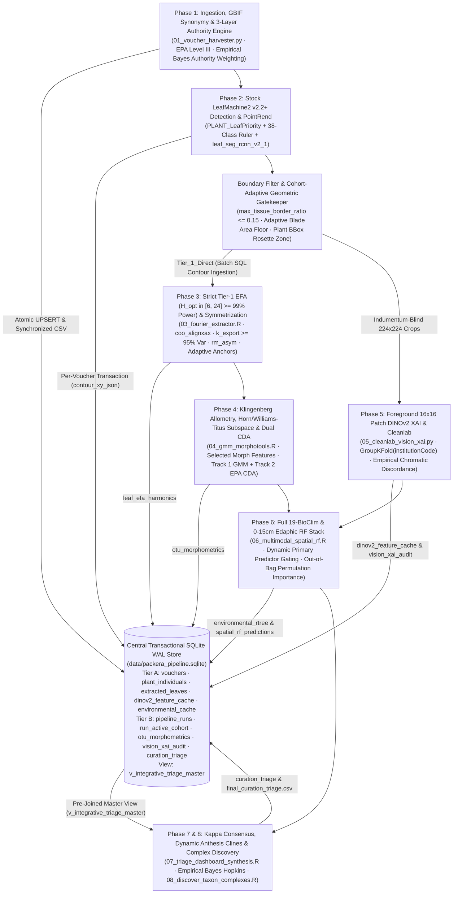

# Automated High-Throughput Vegetative Phenotyping and Herbarium Triage Pipeline for North American *Packera*

### Operationalizing Morphological Diagnosability under the Unified Species Concept

[](https://doi.org/10.5281/zenodo.xxxxxx) [](https://opensource.org/licenses/MIT) [](https://www.python.org/downloads/) [](https://www.r-project.org/)

---

## 🌿 Project Overview

This repository houses the computational and statistical pipeline for the automated high-throughput vegetative phenotyping, morphological diagnosability assessment, and herbarium triage of **North American *Packera* Á. Löve & D. Löve** (Asteraceae: Senecioneae), built around the ***Packera dubia*** **(Spreng.) Trock & Mabb. complex** as the primary Eastern North American dissertation baseline while supporting seamless, taxon-agnostic expansion to all western, boreal, and Mexican *Packera* congeners.

Developed as part of doctoral research at the **University of North Carolina at Chapel Hill** in collaboration with the **UNC Herbarium (NCU)**, this project operationalizes morphological diagnosability under the **Unified Species Concept (USC; de Queiroz 2007)**. Under the USC, species are conceptualized as separately evolving metapopulation lineages. In taxonomically complex plant clades characterized by ecophenotypic plasticity, polyploidy, reticulate hybridization, and historical misidentification, vegetative morphometrics serves as a high-throughput operational screen evaluated via **Integration by Congruence (Padial et al. 2010)** in concert with multiple independent lines of evolutionary evidence:
- **Reproductive Macro-Morphology:** Capitulum aspect ratios, phyllary series counts, ray/disc floret dimensions, and 3-tier optical anthesis staging.
- **Cytotaxonomic Cytotypes:** Known chromosome numbers and ploidy races ($2n = 44, 46, 88$; Kowal 1975).
- **Reduced-Representation Phylogenomics:** High-throughput nextRAD single nucleotide polymorphism (SNP) datasets resolving reticulate evolution and lineage boundaries.
- **Fine-Grain ($0\text{–}15\text{ cm}$ Rhizosphere, 10 m – 30 m Outcrop & Geologic) Niche Validation:** A persistent edaphic and bedrock stack (`data/environmental/fine_grain_edaphic_cache.csv`) combining $0\text{–}15\text{ cm}$ trapezoidal rhizosphere depth-weighted soil properties (`(5 * v_0_5 + 10 * v_5_15) / 15`), 50 m-buffered 1:24,000 USDA-NRCS SSURGO vector map units (`ssurgo_rock_outcrop_pct`, `ssurgo_bedrock_depth_cm`, `ssurgo_aws_0_50cm`), 30 m POLARIS probabilistic soil grids (`polaris_30m/`), 100 m SOLUS100 bedrock depth and coarse rock fragment volume (`solus_100m/`: `resdept`, `fragvol`), 6-class USGS SGMC bedrock lithology (`sgmc_lithology_class`), 10 m – 30 m USGS 3DEP micro-topography (`topo_tpi_30m`, `topo_roughness_30m`, `topo_slope_deg`, `topo_twi_30m`), and 250 m SoilGrids gap-free fallback with partitioned **Climatic ($D_{\text{clim}}, I_{\text{clim}}$) vs. Edaphic-Geologic ($D_{\text{edaph}}, I_{\text{edaph}}$)** Niche Equivalency and Background Similarity tests (Warren et al. 2008; Broennimann et al. 2012).

The computational infrastructure runs end-to-end using **stock LeafMachine2 v2.2+** (`PLANT_LeafPriority` + 38-class Ruler Detector + `leaf_seg_rcnn_v2_1` PointRend) out of the box without requiring manual annotation or custom PCD retraining, coupled with Otsu boundary-continuity lobe rejection (`max_tissue_border_ratio: 0.15`), ruler-calibrated physical area filtering (`min_blade_area_cm2: 0.75`), 100% label-blind classical dimensionless shape gatekeeping (`Solidity >= 0.72`, `Circularity >= 0.25`, `Extent >= 0.35`, plus pinnatifid and bipinnatisect dissection gates via `is_botanical_dissection()`), strict `Tier_1_Direct` closed-contour Elliptic Fourier Analysis (`Momocs`), uniform bilateral symmetrization (Claude 2008), unweighted Operational Taxonomic Unit (OTU) median aggregation, a **hierarchical Beta-Binomial Empirical Bayes authority weighting engine** (`scripts/morphometrics/authority_weighting_utils.R`) with adaptive Bronze anchor promotion for Gold-poor taxa, Klingenberg (2016) allometric slope homogeneity testing, taphonomic indumentum-blind `dinov2_vitb14_reg` foreground patch-token pooling with Cleanlab confident learning, and out-of-fold Cohen's $\kappa$ reliability-weighted multi-modal synthesis.

- **Principal Investigator:** J. Brandon Fuller (PhD Candidate, Department of Biology, UNC-CH)  
- **Faculty Advisor:** Dr. Alan S. Weakley (Director, NCU Herbarium; UNC Biology)  
- **Standard Operating Procedure:** `UNC-BOT-SOP-2026-04-REV5`  
- **Dissertation Baseline Taxa:** *Packera dubia* (formerly *P. tomentosa* / *Senecio tomentosus*), *Packera anonyma*, *Packera plattensis*, *Packera paupercula* (including var. *paupercula* and var. *savannarum*), and allied Eastern North American lineages (*P. aurea*, *P. obovata*, *P. glabella*, *P. schweinitziana*, *P. millefolium*, *P. crawfordii*, *P. serpenticola*), seamlessly expandable to all 50+ North American *Packera* taxa.

---

## ⚙️ Architecture & Fully Automated Production Workflow

The pipeline operates out of the box as a **fully automated, zero-manual-annotation production workflow** orchestrated via `./run_pipeline.sh` or `python main.py` under a **Canonical Two-Tier Storage Architecture**:

* **Tier A — Canonical Shared Store (`data/` at repository root):** Houses all invariant Step 01 and Step 02 specimen, environmental (`fine_grain_edaphic_cache.csv`), relational database (`data/packera_pipeline.sqlite`), and organ extraction assets (`raw_vouchers/`, `masks/{tier1_intact,tier2_reflected}/`, `contours/`, `cropped_patches/{rosettes_dense,basal_leaves_raw,capitula}/`, and the 5 Step 01–02 CSV manifests in `data/tables/`).
* **Tier B — Run-Scoped Analysis Directories (`runs/<RUN_ID>/` with `runs/latest` symlink):** Automatically registers `pipeline_runs` and populates `run_active_cohort` in `data/packera_pipeline.sqlite`, seeds Step 01–02 CSV inputs directly from canonical root `data/`, symlinks masks/contours/cropped_patches without referencing previous `runs/` directories, and isolates all Step 03–08 statistical tables, reports, logs, and figures inside `runs/<RUN_ID>/`.

### Empirical Phase-by-Phase Protocol Summary (Steps 01–08)

1. **Phase 1 — Taxonomic Ingestion, 3-Layer Authority Engine & EPA Level III Ecoregions (`01_voucher_harvester.py` & `scripts/core/harvester.py`):**
   - Harvests GBIF and iDigBio Darwin Core archives across North America, standardizing synonymy and historical *Senecio* / *Cineraria* basionyms dynamically across all North American *Packera* species via `expand_taxon_synonyms_gbif()`, caching synonyms in `taxon_synonyms` and performing atomic UPSERT transactions into `vouchers` in `data/packera_pipeline.sqlite` alongside the canonical 26-column CSV export (`data/tables/curated_vouchers.csv`).
   - **Geographic Scope Controls:** Governed by `--geographic-scope {eastern_na,north_america,global}` (default: `eastern_na`, excluding longitudes $< -106.65$ for Eastern NA dissertation runs; setting `north_america` or `global` disables the western filter), `--include-western` (retains occurrences west of $-106.65$ across western US, Canada, and Mexico), and `--countries` (default `["US"]`, expandable to `["US", "CA", "MX"]`).
   - **3-Layer Dynamic Expert & Herbarium Authority Engine (`parse_determiner_tier()`):**
     - *Collector vs. Determiner Isolation:* `parse_determiner_tier()` restricts `SPECIALIST_PATTERNS` matching strictly to `identifiedBy` and `identificationHistory` (only falling back to `recordedBy` when `identifiedBy` is unrecorded or explicitly references the collector via `_should_fallback_to_collector()`), preventing collector-as-determiner false Gold promotions.
     - *Layer 1 (Genus-Wide Monographer Heuristics):* Expanded `SPECIALIST_PATTERNS` covering North American *Packera* and *Senecioneae* monographers and flora authors (Barkley, Trock, Kowal, Weakley, Bain, Mahoney, Fuller, Freeman, Cronquist, Greenman, Weber, Á. Löve & D. Löve, Spellenberg, Pippen, Uttal, Fernald, Rydberg, Heller, Kral, Godfrey, Sorrie, Nesom, Strother, Turner, Golden).
     - *Layer 2 (Automatic Protologue Author Extraction):* `extract_protologue_authors()` parses basionym and combination authors directly from Darwin Core `scientificName` strings; sheets annotated by a nomenclatural author of that taxon are classified as `Tier_1_Gold`.
     - *Layer 3 (Corpus-Derived Multi-Herbarium Determiner & Regional Herbarium Scoring):* `discover_corpus_authorities()` promotes determiners identifying $\ge 5$ specimens of a *Packera* taxon across $\ge 3$ distinct herbaria (`institutionCode`s)—or annotating $\ge 1$ verified type specimen—to `dynamic_specialists` (`Tier_1_Gold`), guarded by a cross-duplicate concordance check that discards candidates with $> 25\%$ conflicting duplicate determinations (`det_conflicted_groups / det_dup_groups > 0.25`). Promotes herbaria holding $\ge 1$ type specimen or ranking in the top quartile of holdings ($\ge 10$ sheets with $\ge 70\%$ determiner attribution) to `dynamic_herbaria` (`Tier_2_Silver`). General floristic collections and unverified aggregator records receive `Tier_3_Bronze`.
     - *Cross-Duplicate Exsiccatae Conflict Auditing:* `stratify_duplicates()` audits distributed exsiccatae series, identifying conflicting taxon determinations across duplicate sheets (`exsiccatae_taxonomic_conflict`) and elevating conflicting Bronze primary duplicates to Gold when verified by a specialist on duplicate sets (`exsiccatae_gold_taxon`).
   - Assigns `regional_group` strictly via spatial point-in-polygon intersection against official **US EPA Level III Ecoregions** (Omernik & Griffith 2014; `data/environmental/epa_ecoregions_l3/`), with county-centroid fallback strictly for counties $\ge 95\%$ contained within a single ecoregion.
2. **Phase 2 — Stock LeafMachine2 v2.2+ Segmentation, Label-Blind Gatekeeper & Botanical Geometry (`02_segment_and_extract.py`):**
   - **Stock LeafMachine2 v2.2+ Configuration (`configure_leafmachine2.py`):** Uses stock `PLANT_LeafPriority` (`minimum_confidence_threshold: 0.65`) and `leaf_seg_rcnn_v2_1` PointRend checkpoints with `treat_leaflet_as_leaf_whole: False`, `use_efds_for_png_masks: False`, and `do_apply_landmarks: False`.
   - **Per-Voucher Atomic SQLite Transactions & Resumption:** Executes per-voucher atomic SQLite transactions committing decomposing multi-plant vouchers to `plant_individuals`, foliar organs (with embedded 120-vertex `contour_xy_json`) into `extracted_leaves`, and reproductive structures into `voucher_reproductive_phenology`, enabling $O(1)$ SQL resumption checks (`qc_status IN ('PASS', 'FAILED_QC')`) that bypass already processed sheets.
   - **Otsu Boundary-Continuity Lobe Rejection & Calibrated Area Floor:** Rejects severed lobes or unattached fragments where non-paper plant tissue occupies $> 15\%$ of the bounding-box perimeter (`max_tissue_border_ratio: 0.15`), and enforces a ruler-calibrated physical area floor of `min_blade_area_cm2: 0.75` when `is_calibrated_mm == True`.
   - **100% Label-Blind Classical Dissection Gatekeeper (`Tier_1_Direct`):** Evaluates dimensionless morphological descriptors ($\text{Solidity} \ge 0.72$, $\text{Circularity} \ge 0.25$, $\text{Extent} \ge 0.35$, $\text{UCS} \ge 0.85$) with 100% label-blind bilateral sinus topology via `is_botanical_dissection()`, routing pinnatifid ($0.48 \le \text{Solidity} < 0.72$) and bipinnatisect ($0.18 \le \text{Solidity} < 0.48$, $\ge 4$ deep sinuses) blades into `Tier_1_Direct`. Step 02 figures use empirical per-taxon median aspect ratios, dynamic species lists (`present_sp`), and dynamic complex titles.
   - **Post-QC Basal-Leaf-Only Masking (`crop_dense_rosette_tier4`):** Executes after cauline/stem contaminant rejection (`is_cauline_or_stem_contaminant()`) and the `Tier_1_Direct` gatekeeper. Replaces non-basal-leaf tissue (roots, caudex, flowering stems, cauline bracts, rulers, labels, mounting tape) outside the 5-pixel dilated union of verified basal leaf masks with neutral herbarium mounting paper RGB `[242, 239, 230]`, saving crops and companion binary masks (`<catalogNumber>_p<pid>_rosette_mask.png`) in `data/cropped_patches/rosettes_dense/`.
   - **Anatomical Petiole & Flowering Height Approximations:** Approximates basal petiole length ($L_{\text{petiole}} = \max(d_{\text{geodesic}}(p_{\text{base}}, p_{\text{crown}}), \|p_{\text{base}} - p_{\text{crown}}\|_2)$, aggregated at the 75th percentile $P_{75}$ of outer-rosette leaves) and flowering plant scape height ($H_{\text{plant}} = \|p_{\text{bend}} - p_{\text{crown}}\|_2 + \|p_{\text{corymb}} - p_{\text{bend}}\|_2$).
   - **Post-QC Montage Regeneration (`--regenerate-figures-only`):** Invoked automatically after Step 04 in `run_pipeline.sh`, ensuring `fig02a_segmentation_qc_distributions.{pdf,png}` and `fig02b_silhouette_montage.{pdf,png}` display only downstream-QC-validated `Tier_1_Direct` segments dynamically scaled to active taxa.
3. **Phase 3 — Pure `Tier_1_Direct` Closed-Contour EFA, Symmetrization & OTU Medians (`03_fourier_extractor.R`):**
   - **Single-Query Batch Contour Ingestion & Tier 1 Closed Scope:** Ingests 120-vertex normalized contours directly from `extracted_leaves.contour_xy_json` via a single batch SQL query in `03_fourier_extractor.R` (eliminating 14,000+ separate `.csv` file reads on disk). Only intact `Tier_1_Direct` contours enter `Momocs::efourier` (folded/reflected `Tier_2_Reflected` leaves and open-curve approximations are never pooled into EFA).
   - **Inertial Axis Pre-Alignment & $\ge 99\%$ Harmonic Power Calibration:** Contours are centered and aligned along their major inertial axis (`Momocs::coo_alignxax` with circularity $> 0.75$ suborbicular guard), verified via `Momocs::calibrate_harmonicpower_efourier` to capture $\ge 99\%$ cumulative harmonic power at $H = 12$, and decomposed with `Momocs::efourier(..., nb.h = 12, norm = FALSE, start = FALSE)`.
   - **Uniform Symmetrization, MCD Outlier Gating & Persistence:** Applies `Momocs::rm_asym(ef)` uniformly (Claude 2008), removes anomalous contours via Minimum Covariance Determinant (MCD) Mahalanobis distance (`MASS::cov.rob`, $p < 0.001$) and `pct_asymmetry > 0.22 | harmonic_roughness > 0.15`, aggregates multi-leaf vouchers to the Specimen / Operational Taxonomic Unit (`(catalogNumber, plant_individual_id)`) via **unweighted coordinate-wise median** harmonics and PCs (`morph_tier_source = "Tier_1_Pure"`), and persists results into `leaf_efa_harmonics` in SQLite alongside `leaf_efa_harmonics.csv` and `fourier_pcs.csv`.
4. **Phase 4 — Klingenberg Allometry, Adaptive Anchor Promotion, Dual Track GMM/CDA & MANOVA (`04_gmm_morphotools.R`):**
   - **Adaptive Reference Anchor Selection (`authority_weighting_utils.R`):** `select_adaptive_reference_anchors()` starts with `Tier_1_Gold` and `Tier_2_Silver` `Tier_1_Pure` vouchers pruned once at Mahalanobis $\chi^2_{0.95, p}$ (avoiding double truncation of reference tails in downstream steps). When an under-annotated or rare *Packera* taxon has fewer than `min_anchors_per_taxon` (default 8, or $< 3$) clean Gold+Silver anchors, it automatically promotes the most central `Tier_3_Bronze` `Tier_1_Pure` vouchers within $\chi^2_{0.80, p}$ of the taxon medoid (`is_promoted_anchor = TRUE`) so PCA, allometry, GMM, and CDA never fail on Gold-poor species.
   - **2-Step Dawid-Skene / Empirical Bayes Authority Weighting:** `compute_empirical_bayes_authority_weights()` unifies authority weights ($\alpha_0 = 5.0$, prior reliabilities $\pi_{\text{Gold}} = 0.95$, $\pi_{\text{Silver}} = 0.85$, $\pi_{\text{Promoted Bronze}} = 0.65$, $\pi_{\text{Unpromoted Bronze}} = 0.35$):
     $$\theta^{(c)}_t = \frac{\alpha_0 \pi_t + s_c}{\alpha_0 + n_c},\quad \theta^{(d)} = \frac{\alpha_0 \bar{\pi}_d + s_d}{\alpha_0 + n_d}$$
     blending cell-level tier shrinkage with individual determiner logit offsets. In `"active_passive"` mode, unpromoted `Tier_3_Bronze` receive $0.0$ (passive projection), while active anchors receive precision weights rescaled to mean $1.0$.
   - **Klingenberg (2016) Allometric Slope Homogeneity Testing:** Tests `PC ~ log_centsize * species_standardized` ($\alpha = 0.01$) on ruler-calibrated (`is_calibrated_mm == TRUE`) active anchors before applying common-slope within-group allometric correction.
   - **Full-Rank CDA & Dual Clustering Architecture:** Evaluates CDA posterior probabilities (`cda_posterior_prob`, `cda_second_posterior_prob`, `cda_posterior_margin`) across all $k_{\text{full}} = \min(P, g - 1)$ canonical discriminant axes, while exporting `can1`, `can2`, and `can3` for 3D visualization.
     - *Track 1 (Unsupervised Morphological Clustering):* Fits `mclust::Mclust` across $G = 1 \dots K_{\max}$ (`gmm_bayes_factors_summary.csv`), extracting the optimal mixture (`Morphotype_K1..Kn`) for unsupervised CDA and `fig04_gmm_cda_clustering.{pdf,png}`. Exports `cda_second_taxon` (secondary morphological parent), `cda_second_posterior_prob`, and `cda_posterior_margin`.
     - *Track 2 (Supervised EPA Level III Ecoregion CDA):* Supervised CDA across polygon-verified EPA Level III Ecoregions (`ecoregion_supervised_cda_summary.csv`, `fig04c_supervised_ecoregion_cda.{pdf,png}`).
     - *Relational Persistence:* Persists complete OTU morphometrics, GMM clusters, canonical scores (`can1`, `can2`, `can3`), and misidentification flags into `otu_morphometrics` in SQLite and synchronizes `morphometric_flags.csv`.
     - *Parametric Omnibus & Pairwise MANOVA:* Exports `manova_group_significance.csv` (Pillai's Trace, Wilks' $\Lambda$, approx $F$, partial $\eta^2$, BH-adjusted $q$) and `manova_pairwise_posthoc.csv` (pairwise Hotelling's $T^2$ contrasts).
5. **Phase 5 — Taphonomic Indumentum-Blind Vision XAI, Dilated Masking & Cleanlab (`05_cleanlab_vision_xai.py`):**
   - **`Tier_1_Direct` Basal Leaf Linking & Masking (`load_and_link_rosette_patches`):** Links each specimen `(catalogNumber, plant_individual_id)` to verified `Tier_1_Direct` basal leaf crops (`data/cropped_patches/basal_leaves_raw/`) and binary masks (`data/masks/tier1_intact/` via `--manifest-csv data/tables/extracted_leaf_manifest.csv`), falling back to masked `rosettes_dense` crops with companion masks (`<cat>_p<pid>_rosette_mask.png`).
   - Applies a $\sigma = 1.0\text{ px}$ Gaussian low-pass filter on $224 \times 224$ crops (`apply_indumentum_blind_lowpass`) composited onto neutral herbarium paper (`[242, 239, 230]`) to attenuate taphonomic trichome abrasion and paper-edge bias. Foliar surface orientation (`classify_foliar_surface_orientation()`), CIE $L^*$ luminance, and HSV saturation are computed strictly inside the verified leaf lamina mask.
   - **Foreground Energy Attention Ratio & DINOv2 Feature Caching:** Extracts `dinov2_vitb14_reg` features via foreground-masked $16 \times 16$ spatial patch token average pooling (`compute_foreground_patch_mask`). Computes empirical `foreground_attention_ratio` for **every** specimen, flagging `foreground_attention_ratio < 0.65` as `is_artifact_driven = TRUE`. Caches 768-d float32 embeddings and attention ratios in `dinov2_feature_cache` in `data/packera_pipeline.sqlite`, completely bypassing redundant model loading and GPU forward passes in subsequent runs.
   - **Cross-Stage Anchor Parity & Cleanlab Confident Learning:** `compute_out_of_fold_probabilities()` and `compute_feature_space_ood_scores()` incorporate `is_promoted_bronze` anchors for Gold/Silver-poor taxa (< 8 anchors) to maintain cross-stage parity with Step 04. Trains balanced L2 linear probes on Gold/Silver/promoted anchors using `institutionCode`-grouped `StratifiedGroupKFold` with Platt/temperature calibration, prunes label noise via class-conditional `prune_by_noise_rate`, computes feature-space Mahalanobis + cosine $k$-NN OOD scores (`vision_ood_score`, `vision_is_ood`), generates `GradCAM_audit_panel.pdf`, and persists out-of-fold predictions into `vision_xai_audit` and `label_noise_audit.csv`.
   - **Conditional Abaxial Artifact Gate & Chromatic Discordance Rule:** `filter_abaxial_artifacts` in `run_confident_learning_audit()` suppresses abaxial label-noise flags conditionally when `tomentum_taxon_discordance == True` (or confidence $< 0.85$), preventing false noise calls caused by arachnoid tomentum while preserving high-confidence structural misidentifications mounted abaxially ($\text{confidence} \ge 0.85$, $c_{\text{error}} > 0.88$, $\text{FG} \ge 0.65$). Evaluates empirical chromatic vestiture discordance against taxon CIE $L^*$ and HSV $S$ distributions.
6. **Phase 6 — Multi-Class Substrate Contingency, Organic `PCA-env` Ecotypes & Spatial RF (`06_multimodal_spatial_rf.R`):**
   - **Multi-Scale Pedological/Lithological Caching & R*Tree Spatial Index:** Caches 0–15 cm rhizosphere SSURGO, 30m POLARIS, 100m SOLUS100, 30m 3DEP, and USGS SGMC bedrock lithology in `environmental_cache` with an SQLite R*Tree spatial index (`environmental_rtree`), enabling sub-millisecond bounding box and coordinate spatial queries.
   - **Strict Non-Blended Coalesce Hierarchy:** Integrates $0\text{–}15\text{ cm}$ trapezoidal rhizosphere depth-weighting (`(5 * v_0_5 + 10 * v_5_15) / 15`), 50m-buffered 1:24,000 USDA SSURGO, 30m POLARIS/gSSURGO, 100m SOLUS100 (`bdricm`/`resdept_r`, `cfvo`, `awc`, compositional log-ratio texture `alr_sand_clay`, `alr_silt_clay`), 6-class USGS SGMC bedrock lithology (`sgmc_lithology_class`), and 10m–30m USGS 3DEP micro-topography (`topo_tpi_30m`, `topo_roughness_30m`, `topo_slope_deg`, `topo_twi_30m`). 100% SSURGO / 30m POLARIS / 100m SOLUS100 in CONUS; 250m SoilGrids strictly non-CONUS fallback when both are `NA`.
   - **Spatial RF Posterior Pooling & Physiological Envelope Screening:** `edaphic_best_fit_taxon` pools Spatial Block-CV out-of-fold Random Forest posteriors ($w_{\text{rf\_pool}} \cdot \log(p_{\text{rf}}) + (1 - w_{\text{rf\_pool}}) \cdot \log(p_{\text{maha}})$) alongside `PCA-env` Mahalanobis likelihoods, while `edaphic_z_score` screens physiological envelope violations ($z > 3.0$).
   - **Exhaustive Multi-Class Substrate Contingency (`micro_edaphic_outcrop_contingency.csv`):** Exhaustive $2 \times 2$ Fisher's Exact Tests with Benjamini-Hochberg FDR correction across all 6 USGS SGMC lithological classes and SSURGO outcrop/drainage classes, reporting `Dominant_Lithology_Class`, `Top_Substrate_Odds_Ratio`, and omnibus $p$-values. Sets `substrate_specialist_flag` dynamically when empirical outcrop/azonal frequency $> 0.30$ or odds ratio $> 2.0$.
   - **Organic `PCA-env` Intraspecific Ecotypes:** In single-taxon intraspecific mode (`--intraspecific-mode`), partitions vouchers in standardized `PCA-env` space into $K = 2..3$ clusters via $k$-means, naming clusters dynamically after the top-loading environmental predictor (`Ecotype_1_<TopVar>_Low` and `Ecotype_2_<TopVar>_High`).
   - **Dynamic Top-Importance RF Plotting & Relational Persistence:** Panels B and C of `fig06_ecological_niche_phenology.{pdf,png}` dynamically plot top environmental predictors. Persists spatial Random Forest out-of-fold probabilities and Hopkins phenology metrics into `spatial_rf_predictions` in SQLite and synchronizes `multimodal_conflict_flags.csv`.
7. **Phase 7 & 8 — Taxon-Agnostic Decision Matrix, Master View Synthesis & Complex Discovery (`07_triage_dashboard_synthesis.R`, `08_discover_taxon_complexes.R`):**
   - **Unified Relational Master View (`v_integrative_triage_master`):** Step 07 queries the pre-joined SQL view `v_integrative_triage_master` in `data/packera_pipeline.sqlite`, seamlessly joining vouchers, plant individuals, reproductive traits, OTU morphometrics, vision XAI, spatial RF, and edaphic caches across active cohorts while guaranteeing 100% retention of non-georeferenced historical sheets.
   - **Reliability & Class-Conditional Precision Weighted Consensus:** `compute_probabilistic_consensus_scores()` combines global out-of-fold modality $\kappa_m$ with class-conditional out-of-fold precision from the anchor confusion matrix $C^{(m)}_{k,j}$ ($w_{i,m} = w_m \cdot (0.5 + 0.5 \cdot \text{Precision}_m(\hat{y}_{i,m}))$), dynamically renormalized over observed modalities (`98.4%` voucher completion).
   - **Taxon-Agnostic 5-Stage Decision Matrix with Cross-Modal Non-Contradiction:** Evaluates modalities weighted by out-of-fold Cohen's $\kappa_m$, class-conditional precision, and Hopkins circular anthesis phenology (`atan2` residuals). Stage 1 (`Misidentification_Reassign`) enforces cross-modal non-contradiction in `morph_or_vis_corrupt_reassign` (preventing a single-modality outlier or `Tier_2_Fallback` contour from overriding high-confidence agreement in the other primary modality), gated on `!is_artifact_driven` (`foreground_attention_ratio >= 0.65`). Stage 2 (`Candidate_Taxonomic_Boundary_Zone`) resolves secondary morphological parents via `cda_second_taxon`. Stage 3 (`Putative_Cryptic_Species`) incorporates `vision_is_ood` / `vision_ood_score >= 0.65` as corroborating deep visual divergence. Stage 4/5 evaluate `Ecophenotypic_Plasticity` and `Subspecies_Ecotype`. Persists consensus calls into `curation_triage` and exports `final_curation_triage.csv`.
   - **Dynamic Map Bounding Boxes:** Computes `xlim_map` and `ylim_map` dynamically from observed North American voucher coordinates (`lon in [-170, -50]`, `lat in [14, 72]`) padded by 12% of the spatial span (minimum $8^\circ \text{ lon} \times 6^\circ \text{ lat}$).
   - **Dynamic Taxonomic Revision Summaries:** Step 07 dynamically generates per-species empirical treatments for every taxon in `active_taxa`, exporting `Packera_Taxonomic_Revision_Summary.md` and `Figure_Integrative_Packera_Revision.pdf` (or `<Focal_Taxon>_Taxonomic_Revision_Summary.md` and `Figure_Integrative_<Focal_Taxon>_Revision.pdf` when `--focal-taxon` is set).
   - **Step 08 Complex Discovery (`scripts/analysis/08_discover_taxon_complexes.R`):** Executed after Step 06 with `--multimodal "${RUN_DIR}/data/tables/multimodal_conflict_flags.csv"`, joining fine-scale SSURGO/SoilGrids edaphic and climatic distances (`edaphic_schoener_d`, `schoener_d`). Automatically resolves Taxon x GMM Morphotype subclusters when $N_{\text{taxa}} \le 2$, discovering species complexes via unsupervised Leiden/Louvain graph modularity and Ward.D2 clustering.



---

## 📁 Streamlined Repository Structure

```text
Packera_dubia_morphometrics/
├── config/
│   └── config.yaml                    # Central paths, taxon synonyms & empirical thresholds
├── run_pipeline.sh                    # Run-scoped orchestrator CLI (--run-id, --db, --start-step, --exclude-taxon, --focal-taxon)
├── main.py                            # Unified Python CLI runner (check-env, harvest, segment, morphometrics, synthesis, run-all)
├── LeafMachine2/                      # Immutable stock LeafMachine2 v2.2+ engine submodule
│   ├── LeafMachine2.py
│   └── leafmachine2/
├── data/                              # Tier A: Canonical Shared Store (Invariant Step 01–02 & Environmental Assets)
│   ├── packera_pipeline.sqlite        # Central transactional SQLite WAL relational store (Tier A + Tier B tables & views)
│   ├── raw_vouchers/                  # High-resolution specimen sheet imagery (.jpg)
│   ├── masks/                         # Canonical binary leaf silhouettes (tier1_intact/, tier2_reflected/)
│   ├── contours/                      # Canonical homologized 120-vertex 2D coordinate contours (.csv, mirrored in SQLite)
│   ├── cropped_patches/               # Canonical organ RGB crops for DINOv2 & phenology
│   │   ├── basal_leaves_raw/          # Cropped Tier_1_Direct basal leaf RGB patches
│   │   ├── capitula/                  # Cropped reproductive head patches (3-tier anthesis staging)
│   │   └── rosettes_dense/            # DBSCAN per-individual whole-rosette RGB crops
│   ├── environmental/                 # 0–15cm Rhizosphere, 10m–30m Outcrop, EPA Level III Ecoregions & SGMC Stack
│   │   ├── epa_ecoregions_l3/         # Official US EPA Level III Ecoregion spatial polygons (Omernik & Griffith 2014)
│   │   ├── fine_grain_edaphic_cache.csv # Persistent SSURGO + POLARIS + SOLUS100 + 3DEP + SGMC cache
│   │   ├── polaris_30m/               # 30 m POLARIS probabilistic soil rasters (0–5 & 5–15 cm)
│   │   ├── solus_100m/                # 100 m SOLUS100 rasters (resdept bedrock depth, fragvol rock fragments)
│   │   ├── dem_3dep_30m/              # 10 m – 30 m USGS 3DEP DEM tiles (TPI, roughness, slope, TWI)
│   │   └── ssurgo_cache/              # 50 m-buffered USDA-NRCS SSURGO SDA query cache
│   └── tables/                        # Canonical Step 01–02 CSV manifests (seeded into runs/<RUN_ID>/)
│       ├── curated_vouchers.csv       # Harvested vouchers with Determiner Authority Tiers & EPA Ecoregions (26 cols)
│       ├── extracted_leaf_manifest.csv# Stage 2 leaf routing, DBSCAN plant_individual_id, petiole metrics & ruler calibration
│       ├── failed_qc_vouchers.csv     # Vouchers rejected by Stage 2 basal/cauline/boundary quality gatekeeper
│       ├── voucher_reproductive_metrics.csv # Capitulum counts, involucre dimensions (px & mm) & flowering plant height
│       └── voucher_phenological_states.csv  # 3-tier optical capitulum phenology classifications
├── runs/                              # Tier B: Run-Scoped Analysis Directories (Steps 03–08)
│   ├── latest -> run_<YYYYMMDD_HHMMSS># Symlink to most recent run directory
│   └── <RUN_ID>/                      # Self-contained run directory (data/tables/, outputs/figures/, outputs/reports/, logs/)
├── scripts/
│   ├── core/                          # Consolidated shared utilities
│   │   ├── db.py                      # Central SQLite WAL + DuckDB relational engine & atomic export bridge
│   │   ├── db_utils.R                 # Cross-language DBI/RSQLite interface for R pipeline stages (03–08)
│   │   ├── harvester.py               # Combined API queries, DwC 26-col parsing, EPA L3 intersection & media downloads
│   │   ├── artifact_manager.py        # Model weight verification & SHA256 integrity checks
│   │   ├── config.py                  # Python-side configuration schema
│   │   └── logger.py                  # Structured console and file logger
│   ├── data_prep/                     # Phase 1: Data harvesting and pruning
│   │   ├── 01_voucher_harvester.py    # Ingestion, dynamic taxon standardization & EPA Level III ecoregion assignment
│   │   └── audit_and_prune_vouchers.py# Dataset integrity and invalid image pruner
│   ├── pipeline/                      # Phase 2: Production segmentation & extraction
│   │   └── 02_segment_and_extract.py  # Stock LM2 v2.2+ + PointRend + gatekeeper, petiole/height metrics & montage regeneration
│   ├── vision/                        # Botanical geometry, LM2 loaders & phenology classifiers
│   │   ├── capitulum_phenology_classifier.py # Optical biomarker phenotyping (pappus, corolla)
│   │   ├── configure_leafmachine2.py  # Stock LM2 v2.2+ configuration builder
│   │   ├── lm2_data_loader.py         # Stage 1 YOLOv5 PLANT_LeafPriority & 38-class Ruler loader
│   │   ├── lm2_geometry_utils.py      # Boundary-continuity filter, classical descriptors & base homologization
│   │   └── tune_geometry_parameters.py# Empirical threshold calibrator
│   ├── morphometrics/                 # Canonical R statistical morphometrics, allometry & 3D plotting
│   │   ├── 03_fourier_extractor.R     # Strict Tier-1 12-harmonic EFA, coo_alignxax, rm_asym, MCD & OTU medians
│   │   ├── 04_gmm_morphotools.R       # Klingenberg allometry, Horn/Williams-Titus PCA, Kass-Raftery GMM, Track 1/2 CDA & MANOVA
│   │   ├── authority_weighting_utils.R# Empirical Bayes Beta-Binomial shrinkage & adaptive Bronze anchor promotion
│   │   └── pub_figures_utils.R        # Okabe-Ito palettes, plot_3d_scatter_box & unfilled marker helpers
│   ├── analysis/                      # Deep vision, 0–15cm rhizosphere macroecology, complex discovery & synthesis
│   │   ├── 05_cleanlab_vision_xai.py  # Indumentum-blind dinov2_vitb14_reg foreground patch pooling, Cleanlab & OOD
│   │   ├── 06_multimodal_spatial_rf.R # 0–15cm Spatial RF, uncertainty buffers, VIF pruning & niche equivalency
│   │   ├── 07_triage_dashboard_synthesis.R # Kappa-weighted consensus, Hopkins circular phenology & 5-stage matrix
│   │   ├── 08_discover_taxon_complexes.R # Unsupervised Leiden/Louvain & Ward.D2 taxon-complex discovery
│   │   └── edaphic_fine_grain_utils.R # SSURGO, POLARIS, SOLUS100, 3DEP & USGS SGMC lithology extractor
│   ├── annotation_and_training/       # Optional standalone utilities (not required by automated pipeline)
│   │   ├── annotate_with_sam2.py
│   │   ├── sam2_annotator_utils.py
│   │   └── finetune_lm2_pcd.py
│   ├── tests/                         # Unit and integration test suite
│   │   ├── test_sql_pipeline_handshake.py # Relational schema, WAL mode, FK cascade, & cross-stage test suite
│   │   └── ...
│   └── _archive/                      # Decommissioned scripts (isolated; never imported by active code)
├── outputs/
│   ├── figures/                       # Publication plots, 3D PCA/CDA ordinations & QC panels
│   └── reports/                       # Taxonomic summaries, BIC tables & manifests
├── requirements.txt                   # Primary Python dependencies
└── README.md
```

---

## 🚀 Execution Guide

### ⚡ Quick-Start Copy-Paste Terminal Cheat-Sheet

#### A. Environment Activation & Preflight Verification
```bash
source .venv/bin/activate
python main.py check-env
```

#### B. End-to-End Automated Pipeline & `run_pipeline.sh` CLI Reference
Every execution launched via `./run_pipeline.sh` or `python main.py` operates under the **Canonical Two-Tier Storage Architecture**: invariant Step 01–02 assets reside in canonical root `data/` and are automatically seeded/symlinked into `runs/<RUN_ID>/` (updating `runs/latest`), while all Step 03–08 statistical tables, reports, logs (`logs/pipeline.log`), and publication figures (`.pdf` + 300-DPI `.png`) are isolated inside `runs/<RUN_ID>/`.

```bash
source .venv/bin/activate

# 0. One-line CSV-to-SQLite Bootstrap & Synchronization:
#    Ingests existing CSV manifests and 120-vertex contours into data/packera_pipeline.sqlite:
python3 -c "from scripts.core.db import ingest_existing_csvs_to_db; print(ingest_existing_csvs_to_db())"

# 1. Default zero-flag genus-wide run (creates runs/run_<YYYYMMDD_HHMMSS>/ and updates runs/latest)
#    Running with NO taxon flags dynamically queries and harvests ALL Packera species across the entire
#    genus from GBIF (discover_genus_packera_species_gbif(), target_species: []):
./run_pipeline.sh

# 2. User-specified taxon subset mode (--taxon "Packera <sp1>" "Packera <sp2>" ...):
#    Analyzes strictly the species specified by the user with zero hardcoded default species or injected outgroups:
./run_pipeline.sh --run-id packera_subset --taxon "Packera dubia" "Packera anonyma" "Packera paupercula"

# 3. Custom named run directory (--run-id <NAME>) reusing cached vouchers & canonical Step 02 assets (--skip-harvest)
./run_pipeline.sh --run-id packera_revision_v1 --skip-harvest

# 4. Resume or launch from any pipeline step (--start-step <1..7>, e.g., Step 03 EFA or Step 06 Spatial RF)
#    Automatically seeds Step 01–02 tables and symlinks masks/contours/cropped_patches from canonical root data/:
./run_pipeline.sh --run-id packera_revision_v1 --skip-harvest --start-step 3
./run_pipeline.sh --run-id packera_revision_v1 --skip-harvest --start-step 6

# 5. Exclude one or more taxa (--exclude-taxon "<TAXON>"):
#    Filters curated_vouchers.csv, Step 02 manifests, and run_active_cohort while dynamically remapping
#    Step 05 DINOv2/Cleanlab class indices to contiguous 0..K-1 (active_taxa):
./run_pipeline.sh --run-id eastern_3taxa --skip-harvest --start-step 3 --exclude-taxon "Packera plattensis"

# 6. Strategy 1 (Focal Taxon + Outgroup Gold Reference Anchors, default --gold-anchors 30):
#    Processes all focal taxon vouchers plus N Tier_1_Gold anchors per outgroup species for Steps 04–06 calibration,
#    then filters Step 07's final triage queue and figures strictly to the focal taxon:
./run_pipeline.sh --run-id dubia_triage --skip-harvest --focal-taxon "Packera dubia" --gold-anchors 30

# 7. Strategy 2 (Pure Intraspecific Delimitation Mode: --focal-taxon "<TAXON>" --intraspecific-mode):
#    Runs strictly on a single species (n_unique_taxa == 1) with zero outgroup specimens, switching Steps 04–06
#    from species_standardized to label-blind GMM morphotypes (Morphotype_K1..K_n or geographic/edaphic ecotypes)
#    to test for cryptic lineages and granite-outcrop ecotypes:
./run_pipeline.sh --run-id dubia_cryptic --skip-harvest --focal-taxon "Packera dubia" --intraspecific-mode

# 8. Step 08: Unsupervised North American Taxon-Complex Discovery (Leiden/Louvain + Ward.D2)
Rscript scripts/analysis/08_discover_taxon_complexes.R \
    --harmonics data/tables/leaf_efa_harmonics.csv \
    --vouchers data/tables/curated_vouchers.csv \
    --multimodal data/tables/multimodal_conflict_flags.csv \
    --vision data/tables/label_noise_audit.csv \
    --output-dir outputs/reports
```

## CLI Feature Flags & Execution Reference

The pipeline provides three unified tiers of command-line execution:
1. **Tier 1 (`./run_pipeline.sh`)**: Master run-scoped shell orchestrator managing database isolation, directory symlinks, environment switching (`.venv` vs. `.venv_LM2`), preflight cohort filtering, and cross-stage execution.
2. **Tier 2 (`python main.py <subcommand>`)**: Unified Python CLI exposing modular phase-by-phase execution, environment preflight, model weight management, and diagnostic calibration.
3. **Tier 3 (Standalone Per-Step Scripts)**: Direct CLI invocation of individual Python (`01`, `02`, `05`, SAM 2) and R (`03`, `04`, `06`, `07`, `08`) statistical modules.

---

### Tier 1: Master Run-Scoped Shell Orchestrator (`./run_pipeline.sh`)

#### Run & Database Isolation Flags
| Flag | Arguments | Default | Description |
| :--- | :--- | :--- | :--- |
| `--run-id` | `<ID>` | `run_<YYYYMMDD_HHMMSS>` | Custom identifier for isolated run directory under `runs/<ID>/`; atomically updates the `runs/latest` symlink. |
| `--db` | `<PATH>` | `data/packera_pipeline.sqlite` | Override path to transactional WAL SQLite database (exports `PACKERA_DB_PATH` to all child processes). |
| `--demo` | *(none)* | `false` | Run in ephemeral test isolation mode (`PACKERA_DEMO_MODE=1`), writing to `runs/<ID>/data/demo_ephemeral.sqlite`. |
| `--start-step` | `<1..8>` | `1` | Start or resume execution at a specific phase (1=Harvest, 2=Segment, 3=EFA, 4=GMM/CDA, 5=Vision XAI, 6=Spatial RF, 7=Triage Synthesis, 8=Taxon Complex Discovery), automatically seeding upstream assets. |
| `--skip-harvest` | *(none)* | `false` | Reuse existing `curated_vouchers.csv` and local raw images without re-querying GBIF. |
| `--force`, `--overwrite` | *(none)* | `false` | Force re-execution and overwrite cached artifacts across phases. |
| `--resegment`, `--force-segment` | *(none)* | `false` | Force fresh Step 02 LeafMachine2 + PointRend segmentation even if contour files already exist. |
| `--limit` | `<N>` | `0` *(unlimited)* | Cap the maximum number of vouchers processed in Step 02 segmentation. |
| `--sam2-refine` | *(none)* | `false` | Enable automated LM2-guided SAM 2.1 sub-pixel boundary refinement on Stage 2 leaf crops. |
| `--regenerate-figures-only` | *(none)* | `false` | Re-render Step 02 diagnostic figures (`fig02a`, `fig02b`) using post-QC validated silhouettes without re-running segmentation. |

#### Taxonomic Scope & Complex Discovery Flags
| Flag | Arguments | Default | Description |
| :--- | :--- | :--- | :--- |
| `--focal-taxon` | `"<Binomial>"` | *(none)* | Target a focal *Packera* species (e.g., `"Packera anonyma"`) for targeted CDA, spatial niche modeling, and revision synthesis. |
| `--taxon`, `--taxa` | `"<Sp1>" "<Sp2>" ...` | *(all / genus-wide)* | Explicitly specify one or more target *Packera* binomials to harvest and analyze (omit to harvest the entire genus dynamically from GBIF). |
| `--exclude-taxon` | `"<Binomial>"` | *(none)* | Exclude one or more specified taxa from the active run (repeatable; e.g., `--exclude-taxon "Packera plattensis"`). |
| `--intraspecific-mode` | *(none)* | `false` | Run single-taxon intraspecific morphotype/ecotype delimitation mode across Steps 04–07 (`n_unique_taxa == 1`), gating on GMM morphotypes and `PCA-env` ecotypes. |
| `--expand-synonyms` / `--no-expand-synonyms` | *(none)* | `--expand-synonyms` | Toggle automatic expansion of *Packera* binomials to historical *Senecio* and *Cineraria* basionyms/synonyms via the GBIF Taxonomic Backbone. |
| `--discover-complexes` | *(none)* | `false` | Trigger Step 08 unsupervised Leiden/Louvain and Ward.D2 taxon-complex discovery (`scripts/analysis/08_discover_taxon_complexes.R`). |
| `--auto-neighbors` | *(none)* | `false` | Run Step 08 first to automatically discover high-affinity neighbor taxa ($W_{ij} \ge \text{min\_affinity}$) around `--focal-taxon` and scope downstream focal synthesis to that empirical complex. |
| `--min-affinity` | `<FLOAT>` | `0.03` | Minimum multi-modal affinity weight $W_{ij}$ threshold for connecting species nodes in the Step 08 complex graph. |

#### Authority Tiering, Reference Anchors & Misidentification Filtering Flags
| Flag | Arguments | Default | Description |
| :--- | :--- | :--- | :--- |
| `--gold-anchors` | `<N>` | `30` | Target number of Tier 1 Gold reference anchors per outgroup taxon in Strategy 1 focal runs (cascades Gold $\rightarrow$ Silver $\rightarrow$ Bronze). |
| `--gold-only` | *(none)* | `false` | Restrict cohort strictly to `Tier_1_Gold` monograph-authority vouchers prior to model fitting. |
| `--determiner-tier` | `<TIER>` | *(all)* | Filter vouchers strictly to a specified determiner authority tier (e.g., `Tier_1_Gold`, `Tier_2_Silver`, `Tier_3_Bronze`). |
| `--exclude-misidentified` | *(none)* | `false` | Prune vouchers flagged as misidentified (`Misidentification_Reassign`) in prior runs before fitting downstream models. |
| `--triage-source` | `<SOURCE>` | `ALL` | Source of triage reports for misidentification pruning (`ALL` existing runs, or comma-separated run IDs). |

#### Geographic Scope & Spatial Sampling Flags
| Flag | Arguments | Default | Description |
| :--- | :--- | :--- | :--- |
| `--geographic-scope` | `{eastern_na,north_america,global}` | `eastern_na` | Set GBIF harvesting and longitudinal filtering envelope (`eastern_na` enforces $\ge -106.65^\circ\text{W}$; `north_america` and `global` disable the western cutoff). |
| `--include-western`, `--no-exclude-western` | *(none)* | `false` | Retain occurrences west of $-106.65^\circ\text{W}$ across western US, Canada, and Mexico. |
| `--countries` | `"<ISO2 ...>"` | `US` | Space-separated ISO-2 country codes for GBIF harvesting (e.g., `--countries "US CA MX"`). |
| `--spatial-thin-km` | `<FLOAT>` | `0.0` *(disabled)* | Minimum spatial grid thinning distance in km per species to attenuate herbarium collection clustering. |
| `--max-per-state` | `<INT>` | *(unlimited)* | Cap maximum vouchers retained per `(species, stateProvince)`. |
| `--max-per-region` | `<INT>` | *(unlimited)* | Cap maximum vouchers retained per EPA Level III Ecoregion. |
| `--no-spatial-weights` | *(none)* | `false` | Disable inverse spatial-density weighting during reference model fitting. |

---

### Tier 2: Unified Python CLI (`python main.py <subcommand>`)

#### Global Flags
All `python main.py` subcommands accept the following global options:
- `-c`, `--config <PATH>`: Path to YAML pipeline configuration file (default: `config/config.yaml`).
- `-v`, `--verbose`: Enable detailed debug logging.
- `--run-id <ID>`: Specify an explicit run identifier under `runs/<ID>/`.
- `--db <PATH>`: Path to SQLite WAL relational database (default: `data/packera_pipeline.sqlite`).

#### Subcommands Reference
| Subcommand | Syntax & Primary Options | Operational Scope |
| :--- | :--- | :--- |
| **`check-env`** | `python main.py check-env [--strict]` | Verifies Python $\ge 3.10$, PyTorch CUDA acceleration, R installation, core packages, and LeafMachine2 submodule. |
| **`download-weights`** | `python main.py download-weights [--force]` | Verifies or downloads YOLOv5 (`LeafPriority.pt`), PointRend (`leaf_seg_rcnn_v2_1`), and SAM 2 model checkpoints with SHA-256 integrity checks. |
| **`harvest`** | `python main.py harvest [--run-id ID] [--db PATH] [--taxa ...] [--out-dir DIR] [--output-csv PATH] [--max-records N] [--max-uncertainty M] [--min-megapixels MP] [--min-file-size-kb KB] [--concurrency N] [--download-images] [--force]` | Queries GBIF/iDigBio, standardizes taxon synonyms, assigns EPA Level III Ecoregions, stratifies 3-layer determiner authority, and downloads voucher imagery. |
| **`segment`** | `python main.py segment [--run-id ID] [--db PATH] [--vouchers PATH] [--weights PATH] [--output-dir DIR] [--device cuda\|cpu] [--min-solidity FLOAT] [--min-ucs FLOAT] [--score-thresh FLOAT] [--limit N] [--sam2-refine] [--sam2-checkpoint PATH] [--sam2-config PATH] [--force]` | Runs two-stage LeafMachine2 v2.2+ detection and PointRend segmentation with cohort-adaptive organ scaling, dimensionless gatekeeping, and per-voucher SQLite transactions. |
| **`morphometrics`** | `python main.py morphometrics [--run-id ID] [--db PATH] [--input DIR] [--manifest PATH] [--contours-dir DIR] [--vouchers PATH] [--reproductive PATH] [--harmonics-out PATH] [--flags-out PATH] [--plot-out PATH] [--report-out PATH] [--allometry-report PATH] [--allometry-pairwise PATH] [--allometry-plot PATH] [--output-batch-audit PATH] [--harmonics K] [--num-pcs P] [--max-k K] [--focal-taxon TAXON] [--intraspecific-mode]` | Executes Step 03 EFA with dynamic harmonic power calibration ($H_{\text{opt}} \in [6, 24]$) and Step 04 Klingenberg allometry, Kass-Raftery GMM, and dual-track CDA. |
| **`synthesis`** *(alias: `analyze`)* | `python main.py synthesis [--run-id ID] [--db PATH] [--vouchers PATH] [--manifest-csv PATH] [--rosette-dir DIR] [--morphometrics-csv PATH] [--pheno-states PATH] [--vision-audit PATH] [--cleanlab-threshold FLOAT] [--export-figures / --no-export-figures] [--env-dir DIR] [--ssurgo-table PATH] [--contingency-table PATH] [--pheno-anomalies PATH] [--pheno-summary PATH] [--pheno-plot PATH] [--conflict-flags PATH] [--spatial-plot PATH] [--spatial-summary PATH] [--permutations N] [--n-trees N] [--gmm-summary PATH] [--output-queue PATH] [--synthesis-plot PATH] [--synthesis-report PATH] [--xai-plot PATH] [--focal-taxon TAXON] [--intraspecific-mode]` | Orchestrates Step 05 DINOv2 foreground patch XAI, Step 06 19-bioclimatic edaphic spatial RF with dynamic primary predictor gating, and Step 07 consensus triage synthesis. |
| **`run-all`** | `python main.py run-all [all combined flags from harvest, segment, morphometrics, synthesis]` | Full end-to-end automated pipeline execution from GBIF harvest through final 5-stage taxonomic revision synthesis. |
| **`calibrate-geometry`** | `python main.py calibrate-geometry [--annotations PATH] [--output-plot PATH] [--config-path PATH] [--min-area FLOAT] [--category-id INT]` | Optimizes classical dimensionless gatekeeper thresholds on ground-truth annotations via ROC curves and Youden's $J$ statistic. |

---

### Tier 3: Standalone Per-Step & Utility Script Flags

For advanced experimentation or isolated execution, individual scripts can be invoked directly:

- **Step 01 (`scripts/data_prep/01_voucher_harvester.py`)**:
  `--taxon/--taxa <NAMES>`, `--expand-synonyms/--no-expand-synonyms`, `--geographic-scope <eastern_na|north_america|global>`, `--include-western`, `--exclude-western/--no-exclude-western`, `--countries <CODES>`, `--home-herbarium <CODE>`, `--max-records <N>`, `--max-uncertainty <METERS>`, `--download-images`, `--concurrency <N>`, `--min-megapixels <MP>`, `--min-file-size-kb <KB>`, `--check-sharpness`, `--min-sharpness <FLOAT>`, `--spatial-thin-km <KM>`, `--max-per-state <N>`, `--max-per-region <N>`, `--force`, `--db <PATH>`, `-v/--verbose`.
- **Step 02 (`scripts/pipeline/02_segment_and_extract.py`)**:
  `--vouchers <PATH>`, `--model-weights <PATH>`, `--output-dir <DIR>`, `--device <cuda|cpu>`, `--min-solidity <FLOAT>`, `--min-ucs <FLOAT>`, `--score-thresh <FLOAT>`, `--sam2-refine`, `--sam2-checkpoint <PATH>`, `--sam2-config <PATH>`, `--force`, `--limit <N>`, `--db <PATH>`, `--regenerate-figures-only`.
- **Step 03 (`scripts/morphometrics/03_fourier_extractor.R`)**:
  `-i/--input <DIR>`, `-c/--contours-dir <DIR>`, `-f/--manifest <PATH>`, `-m/--masks-dir <DIR>`, `-v/--vouchers <PATH>`, `-o/--output <PATH>`, `--output-individual <PATH>`, `-k/--harmonics <N>`, `-p/--num-pcs <N>`, `-r/--report-out <PATH>`, `-g/--plot-out <PATH>`, `--figures-dir <DIR>`, `--symmetrize-efa-harmonics`, `--permutations <N>`, `--seed <INT>`.
- **Step 04 (`scripts/morphometrics/04_gmm_morphotools.R`)**:
  `-v/--vouchers <PATH>`, `-e/--harmonics <PATH>`, `-m/--reproductive <PATH>`, `--outline-only`, `--correct-allometry <auto|true|false>`, `--allometry-report <PATH>`, `--allometry-pairwise <PATH>`, `--allometry-plot <PATH>`, `--use-clustvarsel`, `-f/--output-flags <PATH>`, `-p/--output-plot <PATH>`, `-r/--output-report <PATH>`, `-b/--output-batch-audit <PATH>`, `-k/--max-k <INT>`, `-d/--num-pcs <INT>`, `--permutations <N>`, `--seed <INT>`, `--intraspecific-mode`, `--focal-taxon <NAME>`.
- **Step 05 (`scripts/analysis/05_cleanlab_vision_xai.py`)**:
  `--rosette-dir <DIR>`, `--vouchers-csv <PATH>`, `--output-csv <PATH>`, `--output-figure <PATH>`, `--cleanlab-threshold <FLOAT>`, `--neutralize-background/--no-neutralize-background`, `--export-figures/--no-export-figures`, `--filter-abaxial-artifacts/--no-filter-abaxial-artifacts`, `--stratify-by-orientation`, `--intraspecific-mode`, `--morphometrics-csv <PATH>`, `--manifest-csv <PATH>`, `--focal-taxon <NAME>`, `--demo`, `--db <PATH>`.
- **Step 06 (`scripts/analysis/06_multimodal_spatial_rf.R`)**:
  `-v/--vouchers <PATH>`, `-m/--morphometrics <PATH>`, `-n/--vision-audit <PATH>`, `--pheno-states <PATH>`, `-e/--env-dir <DIR>`, `-f/--output-flags <PATH>`, `-p/--output-plot <PATH>`, `-s/--output-summary <PATH>`, `--pheno-anomalies <PATH>`, `--pheno-summary <PATH>`, `--pheno-plot <PATH>`, `--ssurgo-cache <DIR>`, `--ssurgo-table <PATH>`, `--contingency-table <PATH>`, `--batch-size <INT>`, `-k/--permutations <N>`, `-t/--n-trees <INT>`, `--intraspecific-mode`, `--focal-taxon <NAME>`, `--demo`.
- **Step 07 (`scripts/analysis/07_triage_dashboard_synthesis.R`)**:
  `-v/--vouchers <PATH>`, `-m/--morphometrics <PATH>`, `--linear-traits <PATH>`, `-n/--vision-audit <PATH>`, `-c/--multimodal-flags <PATH>`, `--spatial-flags <PATH>`, `-g/--gmm-summary <PATH>`, `--gmm-bic <PATH>`, `--cda-summary <PATH>`, `-s/--niche-summary <PATH>`, `-q/--output-queue <PATH>`, `--output-triage <PATH>`, `-p/--output-plot <PATH>`, `--output-figure <PATH>`, `-r/--output-report <PATH>`, `--output-html <PATH>`, `--focal-taxon <NAME>`, `--intraspecific-mode`, `--demo`.
- **Step 08 (`scripts/analysis/08_discover_taxon_complexes.R`)**:
  `-m/--morphometrics <PATH>`, `-e/--harmonics <PATH>`, `-n/--vision-audit <PATH>`, `-v/--vouchers <PATH>`, `-c/--multimodal <PATH>`, `--focal-taxon <NAME>`, `--min-affinity <FLOAT>`, `--output-complexes <PATH>`, `--output-affinity <PATH>`, `--output-neighbors <PATH>`, `--output-figure <PATH>`.
- **SAM 2 Interactive Annotator & PointRend Fine-Tuning**:
  - `annotate_with_sam2.py`: `--images-dir <DIR>`, `--output-dir <DIR>`, `--output-coco <PATH>`, `--single-image <PATH>`, `--checkpoint <PATH>`, `--config <PATH>`, `--export-coco`, `--masks-dir <DIR>`, `--crops-dir <DIR>`, `--full-sheet`, `--val-split <FLOAT>`, `--resume-last`, `--resume-unannotated`, `--voucher <NAME>`, `--index <INT>`, `--tier <1|2|3|all>`, `--vouchers-csv <PATH>`.
  - `finetune_lm2_pcd.py`: `--iterations <N>`, `--lr <FLOAT>`, `--batch-size <N>`, `--freeze-stages <INT>`, `--device <cuda|cpu>`, `--dry-run`.

---

## 🔬 Methodological Highlights

1. **Strict Active/Passive Determiner Authority Split & Dawid-Skene Precision Weighting (`Tier_3_Bronze = 0.0`):** Rather than arbitrary heuristic multipliers that allow large volumes of unverified herbarium records to swamp specialist determinations, the pipeline enforces a strict active/passive authority split (Šlenker et al. 2022; Dawid & Skene 1979):
   - 🥇 **Active Reference Anchors (`Tier_1_Gold` & `Tier_2_Silver`, `authority_weight = 1.0` or $w_k = 1 - \text{error\_rate}_k$):** Monographic/type-verified determinations (`Tier_1_Gold`) and curated regional specialist determinations (`Tier_2_Silver`) after per-taxon $\chi^2_{0.95}$ Mahalanobis outlier pruning form the exclusive training anchor set for supervised CDA, allometric regression, Cleanlab cross-validation, and Spatial Random Forests.
   - 🥉 **Passively Projected Vouchers (`Tier_3_Bronze`, `authority_weight = 0.0`):** General floristic collections and unverified aggregator records receive zero weight (`0.0`) during model fitting and are projected passively (`predict()` / `predict_proba()`) into the fitted morphospace, CDA canonical space, and GMM clusters.
2. **Stock LeafMachine2 v2.2+ Segmentation, Boundary-Continuity Lobe Rejection & Cohort-Adaptive Organ Scaling:** Stage 1 runs stock LeafMachine2 v2.2+ `PLANT_LeafPriority` (`minimum_confidence_threshold: 0.65`, `treat_leaflet_as_leaf_whole: False`, `use_efds_for_png_masks: False`, `do_apply_landmarks: False`) and the 38-class Ruler Detector, followed by Stage 2 native-DPI PointRend (`leaf_seg_rcnn_v2_1`). Otsu boundary-continuity lobe filtering (`is_truncated_lobe_or_leaflet`, `max_tissue_border_ratio: 0.15`) rejects severed terminal lobes. Crucially, the minimum physical basal blade area floor is **cohort-adaptive**: `compute_sheet_adaptive_min_blade_area_cm2()` scales `effective_min_area_cm2 = min(0.75, max(0.15, 0.25 * median_sheet_leaf_area_cm2))` so dwarf/alpine or compact-rosette specimens are never arbitrarily dropped by static $0.75\text{ cm}^2$ cutoffs. Vertical rosette zone filtering automatically relaxes from sheet coordinates (`cy_rel >= 0.42` for Tier 1 or `0.48` for Tier 2) to plant bounding box coordinates (`cy_rel_p_m = (cy_sheet_m - ymin_plant) / plant_bbox_span >= 0.40`) whenever a specimen is mounted higher on the sheet. Classical dimensionless shape descriptors (`Solidity >= 0.72`, `Circularity >= 0.25`, `Extent >= 0.35`, plus 100% label-blind pinnatifid $0.48\text{–}0.72$ and bipinnatisect $0.18\text{–}0.48$ dissection gates via `is_botanical_dissection()`) route intact basal blades into `Tier_1_Direct`.
3. **Strict `Tier_1_Direct` Closed-Contour EFA, Dynamic Harmonic Power Calibration & Symmetrization (`03_fourier_extractor.R`):** Only intact `Tier_1_Direct` basal leaf contours enter `Momocs::efourier` (mirrored hemi-blades or open-curve approximations are strictly excluded). Contours undergo anatomical petiole anchoring ($p_{\text{base}}$), inertial axis pre-alignment (`Momocs::coo_alignxax` with circularity $> 0.75$ suborbicular guard), dynamic harmonic power calibration via `Momocs::calibrate_harmonicpower_efourier()` determining the minimum harmonic count $H_{\text{opt}} \in [6, 24]$ capturing $\ge 99\%$ cumulative harmonic power across the studied cohort (persisting `efd_harmonic_opt`), uniform bilateral symmetrization (`Momocs::rm_asym(ef)`, Claude 2008), and robust Minimum Covariance Determinant (MCD) Mahalanobis outlier filtering (`MASS::cov.rob`, $p < 0.001$ combined with `pct_asymmetry > 0.22 | harmonic_roughness > 0.15`). Step 03 dynamically exports all PCs necessary to account for $\ge 95\%$ cumulative variance (`k_export = max(5, k_95)`, persisted in `efd_k95_pcs`), followed by **unweighted coordinate-wise median** aggregation to the Specimen / Operational Taxonomic Unit (`(catalogNumber, plant_individual_id)`).
4. **Klingenberg (2016) Allometric Slope Homogeneity, Dynamic Morphometric Subspace Selection & Dual-Track CDA (`04_gmm_morphotools.R`):** Tests homogeneity of allometric slopes (`PC ~ log_centsize * species_standardized` at $\alpha = 0.01$, Klingenberg 2016) on ruler-calibrated (`is_calibrated_mm == TRUE`) active anchors before applying pooled within-group size correction (`allometry_significance_audit.csv`, `allometry_pairwise_trajectories.csv`, `allometry_homogeneity_test.csv`). Discovers all exported `PC*` and `Sym_PC*` columns dynamically and selects the optimal morphometric subspace via Horn's Parallel Analysis / Broken-Stick stopping rule capped by Williams & Titus (1988) $P_{\max} = \lfloor (N_{\min,\text{anchor}} - 1) / 3 \rfloor$, forwarding `selected_morph_features` to `audit_misidentifications()`, multi-PC institutional batch-effect ANCOVA (`audit_institutional_batch_effects()`), Step 07, and Step 08. Executes a **Dual Clustering Architecture**: Track 1 evaluates discrete unsupervised morphotypes via `mclust::Mclust` and Kass & Raftery (1995) $2\Delta\text{BIC}$ thresholds ($> 6$ strong, $> 10$ very strong), running unsupervised CDA on `Morphotype_K1..Kn` (`fig04_gmm_cda_clustering.{pdf,png}`); Track 2 runs supervised CDA across polygon-verified EPA Level III Ecoregions (`ecoregion_supervised_cda_summary.csv`, `fig04c_supervised_ecoregion_cda.{pdf,png}`). Evaluates parametric omnibus and pairwise post-hoc MANOVAs (`manova_group_significance.csv`, `manova_pairwise_posthoc.csv`) reporting Pillai's Trace, Wilks' $\Lambda$, approx $F$, partial $\eta^2$, and Hotelling's $T^2$ contrasts. Institutional batch audit confirms partial $R^2 < 0.05$ across all selected morphological axes.
5. **Taphonomic Indumentum-Blind Vision XAI, Foreground $16 \times 16$ Patch Pooling, `institutionCode` GroupKFold & OOD Scoring (`05_cleanlab_vision_xai.py`):** `load_and_link_rosette_patches()` links each specimen `(catalogNumber, plant_individual_id)` to verified `Tier_1_Direct` basal leaf crops (`data/cropped_patches/basal_leaves_raw/`) and binary masks (`data/masks/tier1_intact/` via `--manifest-csv data/tables/extracted_leaf_manifest.csv`), falling back to masked `rosettes_dense` crops with companion masks (`<cat>_p<pid>_rosette_mask.png`). Applies a $\sigma = 1.0\text{ px}$ Gaussian low-pass filter on $224 \times 224$ crops (`apply_indumentum_blind_lowpass`) with non-leaf pixels composited onto neutral mounting paper (`[242, 239, 230]`) to attenuate taphonomically abraded trichome/tomentum textures while preserving macro-architectural venation and lobing. Foliar surface orientation, CIE $L^*$ luminance, and HSV saturation are computed strictly inside the verified leaf lamina mask. Extracts `dinov2_vitb14_reg` features via foreground-masked $16 \times 16$ spatial patch token average pooling (`compute_foreground_patch_mask`), computes empirical `foreground_attention_ratio` for **every** specimen in `label_noise_audit.csv`, flagging `foreground_attention_ratio < 0.65` as `is_artifact_driven = TRUE`, trains on Gold/Silver anchors using `institutionCode`-grouped `StratifiedGroupKFold` with Platt/temperature calibration, runs class-conditional Cleanlab `prune_by_noise_rate`, computes feature-space OOD scores (`vision_ood_score`, `vision_is_ood`), generates 3-panel `GradCAM_audit_panel.pdf`, and evaluates visual discriminability across unsupervised morphometric clusters (`Morphotype_K1..Kn`) in single-species / intraspecific mode (`--intraspecific-mode`).
6. **Full 19-Bioclimatic Extraction, $0\text{–}15\text{ cm}$ Rhizosphere Depth-Weighting & Dynamic Primary Predictor Gating (`06_multimodal_spatial_rf.R`):** Extracts **all 19 WorldClim v2.1 bioclimatic variables (`bio1` through `bio19`)** alongside fine-scale SSURGO/SGMC lithology, 30m POLARIS, 100m SOLUS100, 10m–30m 3DEP micro-topography, and SoilGrids 250m. Non-demo runs are strictly coordinate-decoupled, querying actual spatial rasters and USDA SDA endpoints without hardcoded Southeastern US bounding boxes. Enforces **Dynamic Primary Predictor Gating**:
   1. *Block-Stratified Collinearity & VIF Pruning:* Partitions predictors into Climatic (`bio1..bio19`), Edaphic (`fine_*`, `ssurgo_*`, `soil_*`), and Topographic (`topo_*`) blocks, pruning collinear variables at $|r| < 0.70$ and $\text{VIF} < 5.0$. Within each block, ties are broken objectively by ranking variables according to their empirical ANOVA $F$ or Kruskal-Wallis statistic on the active reference anchor taxa (zero hardcoded variable preference).
   2. *Spatial RF Permutation Importance Gating:* A spatial random forest under $0.5^\circ \times 0.5^\circ$ spatial block cross-validation evaluates out-of-bag permutation importance (`MeanDecreaseAccuracy > 0`), isolating variables that constitute the top 85% cumulative positive importance as run-specific `primary_env_predictors`, `primary_clim_predictors`, and `primary_edaph_predictors`.
   3. *Weighted Downstream Handoff:* Only these empirically validated primary predictors (weighted by their RF permutation importance) are passed into `resolve_analysis_group()`, `compute_edaphic_schoener_d()`, `compute_specimen_edaphic_z()`, and downstream consensus synthesis.
   Retains all Step 02 linear/reproductive/phenology traits, Step 04 morphometrics, and Step 05 vision traits in `multimodal_conflict_flags.csv`.
7. **Empirical Bayes Hopkins Phenology, Dispersion-Scaled Barriers & Complex Discovery (`07`–`08`):** Step 07 weights each diagnostic modality by out-of-fold Cohen's $\kappa_m$ dynamically renormalized over observed modalities $\mathcal{O}_i$ (`98.4%` voucher completion). `evaluate_circular_phenology()` derives calendar DOY coverage arcs ($\pm 21\text{ days}$ around circular mean) and latitude gates ($[\min(\text{lat})-3.0^\circ, \max(\text{lat})+3.0^\circ]$) dynamically from the active cohort's verified optical/DwC anthesis distribution rather than static regional assumptions. Circular Hopkins phenological adjustments weight the empirical circular regression ($\sin\theta, \cos\theta \sim \text{latitude} + \text{elevation} + \text{bio1}$) by $\alpha = \min(1.0, \max(0.0, (N_{\text{anthesis}} - 5)/15))$, reaching 100% empirical cline reliance when $N_{\text{anthesis}} \ge 20$. Stage 3 and Stage 4 phenological divergence cutoffs scale dynamically with each taxon's empirical flowering dispersion ($\tau_{\text{ecotype}} = \min(28, \max(10, 2.0\,\sigma_{\text{DOY}}))$, $\tau_{\text{cryptic}} = \min(35, \max(14, 2.5\,\sigma_{\text{DOY}}))$). Evaluates the 5-stage hierarchical decision matrix: Stage 1 vision-supported reassignments are gated on `!is_artifact_driven` (`foreground_attention_ratio >= 0.65`); Stage 2 resolves secondary parents via `cda_second_taxon`; Stage 3 incorporates `vision_is_ood` / `vision_ood_score >= 0.65` as corroborating visual divergence; Stages 4 and 5 evaluate `Ecophenotypic_Plasticity` and `Subspecies_Ecotype`. Step 08 (`08_discover_taxon_complexes.R`) executes after Step 06 with `--multimodal "${RUN_DIR}/data/tables/multimodal_conflict_flags.csv"`, incorporating fine-scale edaphic distances (`edaphic_schoener_d`), automatically resolving Taxon x GMM Morphotype subclusters when $N_{\text{taxa}} \le 2$ and discovering species complexes via unsupervised Leiden/Louvain graph modularity and Ward.D2 clustering.

---

## 🧬 Recommended Multi-Stage Execution Sequence

To execute rigorous species delimitation across Eastern North American *Packera*, the pipeline is structured around a progressive 5-stage execution sequence:

1. **Stage 1 — Phylogeny-Matched Baseline Execution:**
   - Execute a full complex-wide run across all target taxa using cached voucher records:
     ```bash
     ./run_pipeline.sh --run-id run1_phylogeny_baseline --skip-harvest
     ```
   - Calibrates baseline 12-harmonic EFA morphospace, extracts DINOv2 foreground patch features, builds the $0\text{–}15\text{ cm}$ edaphic cache, and produces preliminary multi-modal conflict flags across all available specimens.
2. **Stage 2 — Promote Step 02 Segmentation Manifests to Canonical Shared Store:**
   - Review segmentation QC panels (`fig02a_segmentation_qc_distributions.pdf`, `fig02b_silhouette_montage.pdf`). Ensure all 5 canonical CSV tables in `${RUN_DIR}/data/tables/` (`curated_vouchers.csv`, `extracted_leaf_manifest.csv`, `failed_qc_vouchers.csv`, `voucher_reproductive_metrics.csv`, `voucher_phenological_states.csv`) and canonical silhouettes/contours in `data/` serve as the frozen benchmark for all subsequent run-scoped iterations (`REUSE_CANONICAL_DATA=true`).
3. **Stage 3 — Pure Intraspecific Subclade & Ecoregion Delimitation (`--intraspecific-mode`):**
   - Isolate the focal species with zero outgroup specimens to uncover cryptic structure without polarity bias:
     ```bash
     ./run_pipeline.sh --run-id run2_dubia_intraspecific --skip-harvest --focal-taxon "Packera dubia" --intraspecific-mode
     ```
   - Triggers Track 1 label-blind GMM morphotype extraction (`Morphotype_K1..Kn`) and Track 2 Supervised EPA Level III Ecoregion CDA (`fig04c_supervised_ecoregion_cda.pdf`) to test for edaphic ecotypes (Piedmont granite flatrocks vs. Coastal Plain fall-line sandhills) and discrete cryptic taxa.
4. **Stage 4 — Outgroup Gold-Anchor Contaminant & Hybrid Screening (`--gold-anchors 30`):**
   - Evaluate the focal taxon against verified type and monographic reference specimens of all congeners:
     ```bash
     ./run_pipeline.sh --run-id run3_dubia_gold_anchors --skip-harvest --focal-taxon "Packera dubia" --gold-anchors 30
     ```
   - Steps 04–06 train strictly on `Tier_1_Gold` outgroup anchors and focal anchors, unmasking historical herbarium misidentifications and hybrid introgressants before filtering Step 07 curatorial queues strictly to the focal taxon.
5. **Stage 5 — Full Genus Macro-Evolutionary Synthesis & Unsupervised Complex Discovery (`--discover-complexes`):**
   - Launch macro-evolutionary synthesis across the entire harvested genus or active taxon set:
     ```bash
     ./run_pipeline.sh --run-id run4_complex_discovery --skip-harvest --discover-complexes --auto-neighbors
     ```
   - Builds pairwise multi-modal distance matrices across vegetative morphology, DINOv2 vision embeddings, $0\text{–}15\text{ cm}$ edaphics, and circular phenology, partitioning species into objective complexes and resolving fine-scale Taxon x GMM Morphotype subclusters.

---

## 📊 Publication Figure Suite Inventory

Every pipeline run exports publication-ready figures in both vector `.pdf` and 300-DPI `.png` formats inside `${RUN_DIR}/outputs/figures/` using dynamically derived Okabe-Ito colorblind-safe palettes (`get_dynamic_packera_palette()`, with colors and hollow point markers assigned dynamically from the active species in the run), dynamic complex titles (`format_active_complex_title()`, e.g., *Packera Taxon Complex (N Taxa)*), and italicized taxon labels, enforcing universal unfilled hollow markers (`facecolors='none'` / `fill=NA`) and 3D ordinations with vertical drop-lines:

| Figure Stem (`.pdf` & `.png`) | Script Source | Biological / Statistical Hypothesis Visualized |
| :--- | :--- | :--- |
| `fig02a_segmentation_qc_distributions` | `scripts/pipeline/02_segment_and_extract.py` | Lamina solidity vs. UCS with unfilled markers by routing tier against gatekeeper thresholds; basal leaf yield per voucher & QC failure breakdown. |
| `fig02b_silhouette_montage` | `scripts/pipeline/02_segment_and_extract.py` | 16-tile montage of representative extracted binary basal leaf silhouettes across `Tier_1_Direct` and `Tier_2_Reflected` with $p_{\text{base}}$ anchor and midrib overlaid (post-QC regenerated). |
| `fig03_efa_morphospace_reconstruction` | `scripts/morphometrics/03_fourier_extractor.R` | Inverse Fourier contour reconstructions across calibrated $H_{\text{opt}} \in [6, 24]$ harmonics and eigenshape deformation vectors across PC1–PC3 for active taxa and morphotypes. |
| `fig03a_efa_morphospace_pca` | `scripts/morphometrics/03_fourier_extractor.R` | (A) 3D Full Elliptic Fourier PCA (`PC1 x PC2 x PC3`, retaining $k_{\text{export}} \ge 95\%$ variance) and (B) 3D bilateral-symmetric (`Momocs::rm_asym`) morphospace (`Sym_PC1 x Sym_PC2 x Sym_PC3`) fitted strictly on `Tier_1_Direct` leaves. |
| `fig03b_harmonic_power_and_asymmetry` | `scripts/morphometrics/03_fourier_extractor.R` | (A) Cumulative Fourier harmonic power spectrum ($H_{\text{opt}} \in [6, 24]$ achieving $\ge 99\%$ power) and (B) bilateral asymmetry (`pct_asymmetry`) vs. high-frequency perimeter roughness (`harmonic_roughness`). |
| `fig04a_gmm_bic_and_uncertainty` | `scripts/morphometrics/04_gmm_morphotools.R` | (A) Unsupervised `mclust` BIC model selection curves ($2\Delta\text{BIC}$ Kass-Raftery thresholds) across $G = 1\dots 9$; (B) 3D morphospace (`Sym_PC1 x Sym_PC2 x Sym_PC3`) colored by cluster with point size scaled by uncertainty. |
| `fig04b_cda_biplot_and_allometry` | `scripts/morphometrics/04_gmm_morphotools.R` | (A) 3D Canonical Discriminant Analysis (`Can1 x Can2 x Can3`) ordination across the Horn/Williams-Titus subspace with honest LOOCV accuracy; (B) Klingenberg (2016) allometric scaling ($\log_{10}$ centroid size vs. shape PCs / involucre scale). |
| `fig04_gmm_cda_clustering` | `scripts/morphometrics/04_gmm_morphotools.R` | Track 1 Unsupervised GMM Morphotype CDA ordination biplot displaying discrete morphotypes (`Morphotype_K1..Kn`) with 95% confidence ellipses. |
| `fig04c_supervised_ecoregion_cda` | `scripts/morphometrics/04_gmm_morphotools.R` | Track 2 Supervised US EPA Level III Ecoregion CDA biplot displaying ecoregional canonical ordination and omnibus MANOVA test statistics. |
| `shape_allometry_regression` | `scripts/morphometrics/04_gmm_morphotools.R` | Bivariate shape PC vs. $\log_{10}(\text{Centroid Size})$ allometric trajectory regressions testing slope homogeneity across taxa. |
| `GradCAM_audit_panel` | `scripts/analysis/05_cleanlab_vision_xai.py` | 3-panel XAI audit: [1] Indumentum-blind `Tier_1_Direct` crop with non-leaf pixels masked to `[242, 239, 230]`; [2] `dinov2_vitb14_reg` $16 \times 16$ spatial patch-token attention saliency overlay restricted strictly to verified leaf mask (`fg_mask`); [3] Calibrated out-of-fold probability vector (`oof_probs`) across all active classes for label noise candidates. |
| `fig05b_cleanlab_quality_and_tomentum` | `scripts/analysis/05_cleanlab_vision_xai.py` | (A) Cleanlab label quality ($1 - c_{\text{error}}$) distributions across taxa and authority tiers; (B) CIE $L^*$ luminance vs. HSV saturation separating adaxial/abaxial tomentum and discordance. |
| `spatial_rf_niche_importance` | `scripts/analysis/06_multimodal_spatial_rf.R` | Spatial Random Forest out-of-bag permutation variable importance (`MeanDecreaseAccuracy`) identifying primary environmental, 19-bioclimatic, and edaphic predictors under Spatial Block CV. |
| `fig06_ecological_niche_phenology` | `scripts/analysis/06_multimodal_spatial_rf.R` | 4-panel ecological niche plate displaying partitioned climatic vs. edaphic niche overlap ($D_{\text{clim}}$ vs. $D_{\text{edaph}}$), SGMC lithology affinity, and anthesis phenology. |
| `fig06b_geographic_map_and_hopkins_phenology` | `scripts/analysis/06_multimodal_spatial_rf.R` | (A) Eastern North America geographic voucher distribution colored by taxon and shaped by conflict flag; (B) Anthesis collection DOY vs. Latitude against Hopkins Bioclimatic Law. |
| `fig07_multimodal_discordance_summary` | `scripts/analysis/07_triage_dashboard_synthesis.R` | (A) Modality-specific conflict rates weighted by out-of-fold Cohen's $\kappa$; (B) Consensus curatorial triage priority breakdown across active *Packera* taxa. |
| `Figure_Integrative_Packera_Revision` (or `Figure_Integrative_<Focal_Taxon>_Revision`) | `scripts/analysis/07_triage_dashboard_synthesis.R` | 4-panel synthesis dashboard combining (A) 3D CDA morphospace, (B) DINOv2 confidence vs. morphological distance, (C) Hopkins circular anthesis residuals, and (D) 5-stage taxonomic treatment summary. Paired with `Packera_Taxonomic_Revision_Summary.md` (or `<Focal_Taxon>_Taxonomic_Revision_Summary.md`). |
| `fig_empirical_taxon_complex_network` | `scripts/analysis/08_discover_taxon_complexes.R` | Unsupervised multi-modal affinity network graph depicting species complexes, Taxon x GMM Morphotype subclusters, and inter-species affinities. |

---

## 📋 Canonical Cross-Language CSV Contracts

All Python (`scripts/pipeline/`, `scripts/vision/`, `scripts/analysis/`) and R (`scripts/morphometrics/`, `scripts/analysis/`) stages strictly preserve the composite primary key `(catalogNumber, plant_individual_id)` to prevent collapsing multi-plant herbarium sheets:

- **Composite Key Invariant:** Every leaf- and specimen-level join across Steps 02–08 preserves `(catalogNumber, plant_individual_id)` (never grouping by `catalogNumber` alone).
- **Orchestrator CLI Handoffs:** `main.py` passes `--reproductive` (plus allometry/batch-audit outputs, `--focal-taxon`, `--intraspecific-mode`) to Step 04; `--manifest-csv` and `--morphometrics-csv` to Step 05; and `--pheno-states` (plus SSURGO, lithology contingency, and phenology outputs) to Step 06. `run_pipeline.sh` passes `--manifest-csv "${RUN_DIR}/data/tables/extracted_leaf_manifest.csv"` to Step 05 and executes Step 08 after Step 06 with `--multimodal "${RUN_DIR}/data/tables/multimodal_conflict_flags.csv"`.
- **Step 03 (`leaf_efa_harmonics.csv` / `fourier_pcs.csv`):** Carries forward Step 02 linear petiole/blade traits (`petiole_length_mm`, `blade_length_mm`, `petiole_to_blade_ratio`, `is_dissected`) and Step 01 DwC metadata (`institutionCode`, `stateProvince`, `county`, `locality`, `decimalLatitude`, `decimalLongitude`, `coordinateUncertainty`, `year`, `month`, `day`, `eventDate`, `authority_tier`, `type_status`).
- **Step 04 (`morphometric_flags.csv`):** Aggregates petiole traits by `(catalogNumber, plant_individual_id)` and exports `cda_second_taxon` (secondary morphological parent identity) alongside `cda_second_posterior_prob` and `cda_posterior_margin`.
- **Step 05 (`label_noise_audit.csv`):** Exports `plant_individual_id`, `vision_ood_score`, boolean `vision_is_ood` (`vision_ood_score >= 0.65`), empirical `foreground_attention_ratio`, `is_artifact_driven` (`foreground_attention_ratio < 0.65`), `surface_orientation`, `mean_luminance`, `mean_saturation`, `vision_second_prob`, `vision_margin`, and `tomentum_taxon_discordance`.
- **Steps 06 & 07 (`multimodal_conflict_flags.csv`, `final_curation_triage.csv`):** Retain all Step 02 linear/petiole/reproductive/phenology columns (`petiole_length_mm`, `blade_length_mm`, `petiole_to_blade_ratio`, `plant_height_cm`, `scape_to_basal_leaf_ratio`, `is_bent_stem`, `capitula_count`, `involucre_height_mm`, `involucre_width_mm`, `AR_inv`, `voucher_phenological_state`, `is_verified_anthesis`, `n_anthesis`), Step 04 morphometric columns (`cda_second_taxon`, `cda_second_posterior_prob`, `cda_posterior_margin`, `Sym_PC1`, `Sym_PC2`, `ecoregion_cda_predicted`, `ecoregion_cda_posterior_prob`), Step 05 vision XAI/OOD columns (`vision_ood_score`, `vision_is_ood`, `foreground_attention_ratio`, `is_artifact_driven`, `surface_orientation`, `tomentum_taxon_discordance`), and Step 06 fine-scale SSURGO edaphic columns (`fine_soil_ph`, `fine_soil_sand`, `fine_bedrock_depth_cm`, `ssurgo_rock_outcrop_pct`, `edaphic_z_score`, `rf_predicted_taxon`, `rf_predicted_prob`).
- **Step 07 Decision Matrix:** Evaluates 5 stages: Stage 1 vision reassignments are gated on `!is_artifact_driven` (`foreground_attention_ratio >= 0.65`); Stage 2 resolves hybrid parentage via `cda_second_taxon`; Stage 3 flags `Putative_Cryptic_Species` with `vision_is_ood` / `vision_ood_score >= 0.65` corroboration.
- **Step 08 Complex Discovery:** Accepts `--multimodal data/tables/multimodal_conflict_flags.csv` joining fine-scale edaphic (`edaphic_schoener_d`) and climatic (`schoener_d`) niche distances into unsupervised network clustering.

See [`AGENTS.md`](AGENTS.md) and [`.agents/skills/pipeline-contract-audit/SKILL.md`](.agents/skills/pipeline-contract-audit/SKILL.md) for complete mathematical schemas and verification commands.

---

## 📦 System Requirements & Dependencies

- **Python $\ge$ 3.10 (`.venv`):** Built-in `sqlite3`, `torch`, `torchvision`, `opencv-python`, `scikit-learn`, `scipy`, `pandas`, `numpy`, `cleanlab`, `pygbif`, `requests`, `pyyaml`, `duckdb` (optional).  
- **LeafMachine2 Sub-Environment (`.venv_LM2`):** Isolated virtual environment for stock LeafMachine2 v2.2+, YOLOv5 (`PLANT_LeafPriority`, 38-class Ruler Detector), and compiled Detectron2 PointRend (`leaf_seg_rcnn_v2_1`) with strict ABI pins (`numpy<2.0`, `opencv-contrib-python<=4.10.0.84`), relying strictly on Python standard library `sqlite3` without compiled database dependencies.  
- **R $\ge$ 4.3:** Relational database packages (`DBI`, `RSQLite`), CRAN statistical and spatial macroecological packages (`remotes`, `tidyverse`, `optparse`, `mclust`, `clustvarsel`, `MorphoTools2`, `RRPP`, `vegan`, `terra`, `sf`, `geodata`, `soilDB`, `spatialRF`, `ranger`, `adespatial`, `blockCV`, `ecospat`, `ENMTools`, `igraph`, `patchwork`, `viridis`) and `Momocs` (`remotes::install_github("MomX/Momocs")`).

> [!TIP]
> **Windows Users**: The recommended and fully supported way to run this pipeline on Windows is via **WSL 2 (Ubuntu)**. See [`docs/WINDOWS_WSL2_SETUP.md`](docs/WINDOWS_WSL2_SETUP.md) for a 10-minute setup guide.

---

## 📚 Key Methodological References

1. Barkley, T. M. 1988. Variation among the Senecioneae (Asteraceae) in North America. *Brittonia* 40(2): 211–221. doi: 10.2307/2807005  
2. Broennimann, O., et al. 2012. Measuring ecological niche overlap from occurrence and spatial environmental data. *Global Ecology and Biogeography* 21(4): 481–497.  
3. Claude, J. 2008. *Morphometrics with R*. Springer, New York.  
4. Collyer, M. L., and D. C. Adams. 2018. RRPP: An R package for fitting linear models to high-dimensional data using residual randomization. *Methods in Ecology and Evolution* 9(7): 1772–1779.  
5. Darcet, T., M. Oquab, J. Mairal, and P. Bojanowski. 2024. Vision transformers need registers. *International Conference on Learning Representations (ICLR)*.  
6. Davis, C. C., C. G. Willis, B. Connolly, C. Kelly, and A. M. Ellison. 2015. Herbarium records are a viable alternative to traditional phenological data for testing responses to climate change. *Journal of Ecology* 103(5): 1126–1134.  
7. Dawid, A. P., and A. M. Skene. 1979. Maximum likelihood estimation of observer error-rates using the EM algorithm. *Journal of the Royal Statistical Society: Series C* 28(1): 20–28.  
8. de Queiroz, K. 2007. Species concepts and species delimitation. *Systematic Biology* 56(6): 879–886.  
9. Kass, R. E., and A. E. Raftery. 1995. Bayes Factors. *Journal of the American Statistical Association* 90(430): 773–795.  
10. Klingenberg, C. P. 2016. Size, shape, and form: concepts of allometry in geometric morphometrics. *Development Genes and Evolution* 226(3): 113–137.  
11. Kowal, R. R. 1975. Systematics of *Senecio aureus* and allied species on the Gaspé Peninsula, Quebec. *Memoirs of the Torrey Botanical Club* 23(2): 1–113.  
12. Kuhl, F. P., and C. R. Giardina. 1982. Elliptic Fourier features of a closed contour. *Computer Graphics and Image Processing* 18(3): 236–258.  
13. Mabberley, D. J., D. K. Trock, and A. S. Weakley. 2020. The nomenclature of *Packera dubia* (Asteraceae: Senecioneae). *Taxon* 69(6): 1334–1337.  
14. Northcutt, C. G., L. Jiang, and I. L. Chuang. 2021. Confident Learning: Estimating Uncertainty in Dataset Labels. *Journal of Artificial Intelligence Research* 70: 1373–1411.  
15. Padial, J. M., A. Miralles, I. De la Riva, and M. Vences. 2010. The integrative future of taxonomy. *Frontiers in Zoology* 7: 16.  
16. Scrucca, L., and A. E. Raftery. 2018. clustvarsel: A package implementing variable selection for Gaussian model-based clustering in R. *Journal of Statistical Software* 84(1): 1–28.  
17. Šlenker, M., P. Koutecký, and P. Marhold. 2022. MorphoTools2: an R package for multivariate morphometric analysis. *Bioinformatics* 38(10): 2954–2955.  
18. Trock, D. K. 2006. *Packera*. In Flora of North America Editorial Committee (eds.), *Flora of North America North of Mexico*, Vol. 20, 570–602. Oxford University Press, New York.  
19. Valavi, R., J. Elith, J. J. Lahoz-Monfort, and G. Guillera-Arroita. 2019. blockCV: An R package for generating spatially or environmentally separated folds for k-fold cross-validation of species distribution models. *Methods in Ecology and Evolution* 10(2): 225–232.  
20. Warren, D. L., R. E. Glor, and M. Turelli. 2008. Environmental niche equivalency versus conservatism: quantitative approaches to niche evolution. *Evolution* 62(11): 2868–2883.  
21. Weakley, A. S. 2026. *Flora of the Southeastern United States*. University of North Carolina Herbarium (NCU), North Carolina Botanical Garden, Chapel Hill.  
22. Weaver, W. N., P. S. Ng, and R. LaFrance. 2024. LeafMachine2: Using machine learning to rapidly measure plant traits captured in herbarium specimens. *Applications in Plant Sciences* 12(1): e11545.  
23. Williams, B. K., and K. Titus. 1988. Assessment of sampling stability in ecological applications of discriminant analysis. *Ecology* 69(4): 1275–1285.  
24. Wright, M. N., and A. Ziegler. 2017. ranger: A fast implementation of random forests for high dimensional data in C++ and R. *Journal of Statistical Software* 77(1): 1–17.

---

## 📄 License & Attribution

This project is licensed under the **MIT License**. Herbarium specimen images harvested through the pipeline remain subject to the individual institutional data and copyright policies of the contributing herbaria.
