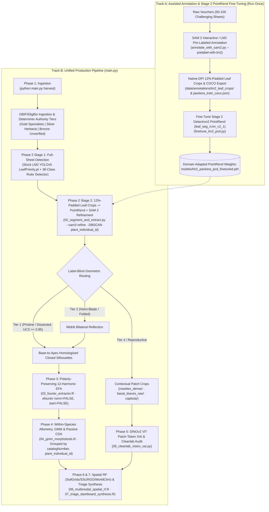

# Automated High-Throughput Vegetative Phenotyping and Herbarium Triage Pipeline for the *Packera dubia* Complex

### Operationalizing Morphological Diagnosability under the Unified Species Concept

[](https://doi.org/10.5281/zenodo.xxxxxx) [](https://opensource.org/licenses/MIT) [](https://www.python.org/downloads/) [](https://www.r-project.org/)

---

## 🌿 Project Overview

This repository houses the computational and statistical pipeline for the automated high-throughput vegetative phenotyping, morphological diagnosability assessment, and herbarium triage of the ***Packera dubia*** **(Spreng.) Trock & Mabb. complex** (Asteraceae: Senecioneae) across Eastern and Central North America.

Developed as part of doctoral research at the **University of North Carolina at Chapel Hill** in collaboration with the **UNC Herbarium (NCU)**, this project operationalizes morphological diagnosability under the **Unified Species Concept (USC; de Queiroz 2007)**. Under the USC, species are conceptualized as separately evolving metapopulation lineages. In taxonomically complex plant clades characterized by ecophenotypic plasticity and historical misidentification, vegetative morphometrics serves as a high-throughput operational screen evaluated in concert with multiple independent lines of evolutionary evidence:
- **Reproductive Macro-Morphology:** Capitulum aspect ratios, phyllary series counts, and ray/disc floret dimensions.
- **Cytotaxonomic Cytotypes:** Known chromosome numbers and ploidy races ($2n = 44, 46, 88$; Kowal 1975).
- **Reduced-Representation Phylogenomics:** High-throughput nextRAD single nucleotide polymorphism (SNP) datasets resolving reticulate evolution and lineage boundaries.
- **Micro-Edaphic Validation:** Regional 250m SoilGrids pedological rasters complemented by fine-scale 1:24,000 USDA NRCS SSURGO vector map units resolving localized rock outcrop endemics.

The computational infrastructure couples two-stage automated organ detection via **LeafMachine2 (LM2)** (Stage 1 full-sheet YOLOv5 `LeafPriority.pt` + 38-class Ruler Detector, followed by Stage 2 native-DPI cropped Detectron2 PointRend `leaf_seg_rcnn_v2_1` and automated prompt-guided **SAM 2** boundary refinement), deterministic label-blind geometric gatekeeping, bilateral symmetry reconstruction, polarity-preserving Elliptic Fourier Analysis (EFA), self-supervised deep vision (DINOv2 ViT-B/14 with patch-token saliency attribution), and confident learning (`cleanlab`) with a formal **Multi-Tiered Herbarium Misidentification Mitigation Architecture**.

- **Principal Investigator:** J. Brandon Fuller (PhD Candidate, Department of Biology, UNC-CH)  
- **Faculty Advisor:** Dr. Alan S. Weakley (Director, NCU Herbarium; UNC Biology)  
- **Standard Operating Procedure:** `UNC-BOT-SOP-2026-04-REV4`  
- **Target Taxa:** *Packera dubia* (formerly *P. tomentosa* / *Senecio tomentosus*), *Packera anonyma*, *Packera plattensis*, *Packera paupercula* (including var. *paupercula* and var. *savannarum*), and allied southeastern lineages.

---

## ⚙️ Architecture & Two-Track Workflow

The pipeline decouples the **model training / assisted-annotation track** from the **high-throughput production inference track**:

1. **Assisted Annotation & Stage 2 PointRend Fine-Tuning (Offline Track A):**  
   - Uses **Segment Anything Model 2 (SAM 2)** (`annotate_with_sam2.py`, with optional `--prelabel-with-lm2` automated pre-labeling) to interactively annotate ground-truth basal leaf masks (`basal_leaf_whole`, `basal_leaf_partial`) on a representative set of 50–100 challenging *Packera* vouchers (dense rosettes, overlapping blades, arachnoid tomentum).  
   - Exports native-DPI 12%-padded single-leaf crops (`data/annotations/lm2_leaf_crops/`) and standardized COCO JSON annotations (`data/annotations/packera_train_coco.json`) to fine-tune LeafMachine2's Stage 2 Detectron2 PointRend Leaf Segmenter (`leaf_seg_rcnn_v2_1`), producing domain-adapted weights (`models/lm2_packera_pointrend_finetuned.pth`, aliased to `models/lm2_packera_pcd_finetuned.pth`).  
2. **Production Pipeline & Taxonomic Synthesis (Inference Track B):**  
   - Orchestrated end-to-end via the unified CLI (`main.py`).  
   - **Stage 1 (Full-Sheet Detection):** Stock LeafMachine2 YOLOv5 `LeafPriority.pt` (11-class organ detector) + 38-class Ruler Detector (`scripts/vision/lm2_data_loader.py`) for physical millimeter scale calibration (`pixels_per_mm`, `is_calibrated_mm`).  
   - **Stage 2 (Cropped Leaf Segmentation & Refinement):** Native-DPI 12%-padded single-leaf crops segmented via fine-tuned Detectron2 PointRend (`leaf_seg_rcnn_v2_1`) + optional automated prompt-guided SAM 2 boundary refinement (`--sam2-refine`), DBSCAN multi-plant spatial clustering (`plant_individual_id`), midrib symmetry reflection, and Tier 4 contextual cropping (`data/cropped_patches/rosettes_dense/`, `basal_leaves_raw/`, `capitula/`).  
   - **Downstream Morphometrics & Synthesis:** Runs 12-harmonic polarity-preserving EFA in R (`Momocs`), pooled within-species allometric regression on calibrated millimeter Centroid Size ($\text{CS}_{\text{mm}}$), unsupervised GMM clustering (`mclust`), passive sample CDA (`MorphoTools2`), DINOv2 ViT patch-token attribution & Cleanlab noise auditing, spatial random forests (SoilGrids 250m, USDA SSURGO, WorldClim 2.1), and digital triage synthesis.



---

## 📁 Streamlined Repository Structure

```text
Packera_dubia_morphometrics/
├── config/
│   └── config.yaml                    # Central paths, taxon synonyms & model hyperparameters
├── main.py                            # Unified CLI runner (check-env, harvest, segment, morphometrics, synthesis, run-all)
├── LeafMachine2/                      # Immutable LeafMachine2 engine submodule
│   ├── LeafMachine2.py
│   └── leafmachine2/
├── models/
│   ├── lm2_packera_pointrend_finetuned.pth # Fine-tuned Stage 2 PointRend Leaf Segmenter weights
│   └── lm2_packera_pcd_finetuned.pth  # Backward-compatible PointRend weights alias
├── data/
│   ├── raw_vouchers/                  # High-resolution specimen sheet imagery (.jpg)
│   ├── raw_annotations/               # SAM 2 polygon text files & instance PNG masks
│   ├── annotations/
│   │   ├── lm2_leaf_crops/            # Native-DPI 12%-padded single-leaf training crops
│   │   └── packera_train_coco.json    # Standardized Stage 2 cropped COCO JSON dataset
│   ├── masks/                         # Binary leaf silhouette masks (tier1_pristine/, tier2_reflected/)
│   ├── contours/                      # Homologized 2D coordinate contours (.csv)
│   ├── cropped_patches/               # Tier 4 & organ RGB crops for DINOv2 & phenology
│   │   ├── rosettes_dense/            # DBSCAN per-individual dense rosette crops
│   │   ├── basal_leaves_raw/          # Cropped basal leaf RGB patches
│   │   └── capitula/                  # Cropped reproductive head patches
│   ├── environmental/                 # SoilGrids 250m, WorldClim 2.1 rasters & SSURGO cache
│   └── tables/
│       ├── curated_vouchers.csv       # Harvested vouchers with Determiner Authority Tiers
│       ├── extracted_leaf_manifest.csv# Stage 2 leaf routing, DBSCAN plant_individual_id & ruler calibration
│       ├── voucher_reproductive_metrics.csv # Capitulum counts & involucre dimensions (px & mm)
│       ├── voucher_phenological_states.csv  # 3-tier optical capitulum phenology classifications
│       ├── leaf_efa_harmonics.csv     # Specimen-level (catalogNumber, plant_individual_id) EFA medians
│       ├── leaf_efa_harmonics_individual.csv # Individual leaf-level EFA harmonics & calibrated CS_mm
│       ├── morphometric_flags.csv     # CDA predictions, GMM cluster assignments & outlier flags
│       ├── label_noise_audit.csv      # DINOv2 + Cleanlab confident learning audit & surface orientation
│       ├── multimodal_conflict_flags.csv # Cross-modal ecological & morphological concordance flags
│       ├── ssurgo_edaphic_validation.csv # 1:24,000 USDA NRCS SSURGO lithic & outcrop validation
│       └── triage_queue.csv           # Final ranked expert verification queue
├── scripts/
│   ├── core/                          # Consolidated shared utilities
│   │   ├── harvester.py               # Combined API queries, DwC parsing & media downloads
│   │   ├── artifact_manager.py        # Model weight download & SHA256 integrity verification
│   │   ├── config.py                  # Python-side configuration schema
│   │   └── logger.py                  # Structured console and file logger
│   ├── annotation_and_training/       # Track A: SAM 2 labeling & Stage 2 PointRend fine-tuning
│   │   ├── annotate_with_sam2.py      # Interactive SAM 2 GUI with --prelabel-with-lm2 & knife tool
│   │   ├── sam2_annotator_utils.py    # Geometry helpers & cropped COCO export utilities
│   │   └── finetune_lm2_pcd.py        # Stage 2 Detectron2 PointRend (leaf_seg_rcnn_v2_1) trainer
│   ├── data_prep/                     # Track B: Data harvesting and pruning
│   │   ├── 01_voucher_harvester.py    # Ingestion & 3-tier authority stratification
│   │   └── audit_and_prune_vouchers.py# Dataset integrity and invalid image pruner
│   ├── pipeline/                      # Track B: Production execution modules
│   │   └── 02_segment_and_extract.py  # Two-stage LM2 + PointRend + SAM 2 refinement & contour export
│   ├── vision/                        # Botanical geometry, LM2 loaders & phenology classifiers
│   │   ├── capitulum_phenology_classifier.py # Optical biomarker phenotyping (pappus, corolla)
│   │   ├── configure_leafmachine2.py  # High-throughput LM2 configuration builder
│   │   ├── lm2_data_loader.py         # Stage 1 YOLOv5 LeafPriority.pt & 38-class Ruler loader
│   │   ├── lm2_geometry_utils.py      # Label-blind gatekeeping, base-to-apex homologization & reflection
│   │   └── tune_geometry_parameters.py# Empirical threshold calibrator (calibrate-geometry)
│   ├── morphometrics/                 # Canonical R statistical morphometrics
│   │   ├── 03_fourier_extractor.R     # 12-harmonic polarity-preserving EFA & PCA (Momocs)
│   │   └── 04_gmm_morphotools.R       # Within-species allometry, mclust GMMs & passive CDA (MorphoTools2)
│   ├── analysis/                      # Macroecology, phenology, and synthesis
│   │   ├── 05_cleanlab_vision_xai.py  # DINOv2 embeddings, Cleanlab & ViT patch-token saliency XAI
│   │   ├── 06_multimodal_spatial_rf.R # Spatial Random Forests & latitudinal phenology (SoilGrids, SSURGO, WorldClim)
│   │   └── 07_triage_dashboard_synthesis.R # Decision matrix & triage queue generation
│   ├── tests/                         # Unit and integration test suite (253 tests across 19 modules)
│   │   ├── run_audit.py               # Central QA test suite runner (asserts 100% pass rate)
│   │   ├── test_code_hygiene.py       # Enforces strict _archive isolation & AST hygiene
│   │   ├── test_voucher_harvester.py
│   │   ├── test_segment_and_extract.py
│   │   ├── test_geometry_edge_cases.py
│   │   ├── test_geometry_tuning.py
│   │   ├── test_capitulum_phenology.py
│   │   ├── test_allometry_and_phenology.py
│   │   ├── test_symmetric_fourier_validation.py
│   │   └── test_main_pipeline_cli.py
│   └── _archive/                      # Decommissioned scripts (isolated; never imported by active code)
├── outputs/
│   ├── figures/                       # Publication plots, CDA biplots & QC panels
│   └── reports/                       # Taxonomic summaries, BIC tables & manifests
├── requirements.txt                   # Primary Python dependencies
└── README.md
```

---

## 🚀 Execution Guide

### ⚡ Quick-Start Copy-Paste Terminal Cheat-Sheet

#### A. Environment Activation & Preflight Verification
```bash
source .venv/bin/activate
python main.py check-env
python main.py download-weights
```

#### B. End-to-End Automated Pipeline (Single Copy-Paste Command)
```bash
source .venv/bin/activate
python main.py run-all --download-images
```

#### C. Phase-by-Phase Execution via Unified `main.py` CLI
```bash
source .venv/bin/activate

# Phase 1: Harvest GBIF/iDigBio vouchers & stratify determiner authority tiers
python main.py harvest --max-records 5000 --download-images

# Phase 2: Two-stage LeafMachine2 (LeafPriority.pt + Ruler) -> Cropped PointRend + Automated SAM 2 Refinement
python main.py segment --weights models/lm2_packera_pcd_finetuned.pth --sam2-refine

# Phase 3 & 4: 12-Harmonic Polarity-Preserving EFA (Momocs), Within-Species Allometry, GMM & Passive CDA
python main.py morphometrics --harmonics 12

# Phase 5, 6 & 7: DINOv2 + Cleanlab XAI, Spatial Random Forests (SoilGrids/SSURGO/WorldClim), & Triage Queue
python main.py synthesis
```

#### D. Standalone Phase-by-Phase Script Execution (Verified Flags)
```bash
source .venv/bin/activate

# Track A.1: Interactive SAM 2 annotation with automated LM2 + SAM 2 pre-labeling
python scripts/annotation_and_training/annotate_with_sam2.py \
    --images-dir data/raw_vouchers \
    --output-dir data/raw_annotations \
    --output-coco data/annotations/packera_train_coco.json \
    --prelabel-with-lm2

# Track A.1b: Headless compilation of Stage 2 single-leaf cropped COCO dataset
python scripts/annotation_and_training/annotate_with_sam2.py \
    --export-coco \
    --masks-dir data/raw_annotations/masks \
    --images-dir data/raw_vouchers \
    --crops-dir data/annotations/lm2_leaf_crops \
    --output-coco data/annotations/packera_train_coco.json \
    --val-split 0.15

# Track A.2: Fine-tune Stage 2 Detectron2 PointRend (leaf_seg_rcnn_v2_1) on single-leaf crops
python scripts/annotation_and_training/finetune_lm2_pcd.py \
    --coco-json data/annotations/packera_train_coco.json \
    --images-dir data/annotations/lm2_leaf_crops \
    --iterations 1000 \
    --output-weights models/lm2_packera_pcd_finetuned.pth

# Phase 1: Standalone GBIF/iDigBio voucher harvester
python scripts/data_prep/01_voucher_harvester.py \
    --taxa "Packera dubia" "Packera tomentosa" "Senecio tomentosus" "Packera anonyma" "Packera plattensis" "Packera paupercula" \
    --max-uncertainty 5000 \
    --max-records-per-taxon 5000 \
    --exclude-western \
    --download-images \
    --concurrency 15 \
    --output-csv data/tables/curated_vouchers.csv \
    --log-file outputs/reports/voucher_ingestion_summary.log

# Phase 2: Standalone two-stage LM2 + Cropped PointRend + SAM 2 boundary refinement
python scripts/pipeline/02_segment_and_extract.py \
    --model-weights models/lm2_packera_pcd_finetuned.pth \
    --vouchers data/tables/curated_vouchers.csv \
    --output-dir data \
    --sam2-refine

# Phase 3: Standalone 12-harmonic polarity-preserving EFA in R (Momocs)
Rscript scripts/morphometrics/03_fourier_extractor.R \
    --contours-dir data/contours \
    --manifest data/tables/extracted_leaf_manifest.csv \
    --vouchers data/tables/curated_vouchers.csv \
    --harmonics 12 \
    --output data/tables/leaf_efa_harmonics.csv \
    --output-individual data/tables/individual_leaf_harmonics.csv

# Phase 4: Standalone within-species allometry, GMM clustering & passive CDA in R
Rscript scripts/morphometrics/04_gmm_morphotools.R \
    --vouchers data/tables/curated_vouchers.csv \
    --harmonics data/tables/leaf_efa_harmonics.csv \
    --output-flags data/tables/morphometric_flags.csv \
    --output-plot outputs/figures/cda_passive_projection.pdf \
    --output-report outputs/reports/gmm_bayes_factors_summary.csv

# Phase 5: Standalone DINOv2 embeddings, Cleanlab audit & ViT patch-token attribution (append --demo for offline testing)
python scripts/analysis/05_cleanlab_vision_xai.py \
    --rosette-dir data/cropped_patches/rosettes_dense \
    --vouchers-csv data/tables/curated_vouchers.csv \
    --output-csv data/tables/label_noise_audit.csv \
    --output-figure outputs/figures/GradCAM_audit_panel.png \
    --cleanlab-threshold 0.85

# Phase 6: Standalone Multimodal Spatial Random Forests in R (append --demo for offline testing)
Rscript scripts/analysis/06_multimodal_spatial_rf.R \
    --vouchers data/tables/curated_vouchers.csv \
    --morphometrics data/tables/morphometric_flags.csv \
    --vision-audit data/tables/label_noise_audit.csv \
    --env-dir data/environmental/ \
    --output-flags data/tables/multimodal_conflict_flags.csv \
    --output-plot outputs/figures/spatial_rf_niche_importance.pdf \
    --output-summary outputs/reports/multimodal_spatial_rf_summary.csv

# Phase 7: Standalone Multi-Evidence Decision Matrix & Triage Synthesis in R (append --demo for offline testing)
Rscript scripts/analysis/07_triage_dashboard_synthesis.R \
    --vouchers data/tables/curated_vouchers.csv \
    --morphometrics data/tables/morphometric_flags.csv \
    --vision-audit data/tables/label_noise_audit.csv \
    --multimodal-flags data/tables/multimodal_conflict_flags.csv \
    --gmm-summary outputs/reports/gmm_bayes_factors_summary.csv \
    --niche-summary outputs/reports/multimodal_spatial_rf_summary.csv \
    --output-queue data/tables/triage_queue.csv \
    --output-plot outputs/figures/Figure_Integrative_Packera_dubia_Revision.pdf \
    --output-report outputs/reports/Packera_dubia_Taxonomic_Revision_Summary.md
```

#### E. Automated QA & Test Suite Commands
```bash
source .venv/bin/activate
python scripts/tests/run_audit.py
pytest scripts/tests/ -v
```

---

### Track A: Assisted Annotation & Stage 2 PointRend Fine-Tuning (Run Once)

To fine-tune LeafMachine2's Stage 2 Detectron2 PointRend Leaf Segmenter (`leaf_seg_rcnn_v2_1`) on native-DPI single-leaf crops from dense, overlapping *Packera* basal rosettes:

```bash
# 1. Interactively annotate 50–100 vouchers with SAM 2 (with automated LM2 + SAM 2 pre-labeling)
python scripts/annotation_and_training/annotate_with_sam2.py \
    --images-dir data/raw_vouchers \
    --output-dir data/raw_annotations \
    --output-coco data/annotations/packera_train_coco.json \
    --prelabel-with-lm2

# 2. (Optional) Recompile cropped single-leaf COCO dataset headlessly from saved masks
python scripts/annotation_and_training/annotate_with_sam2.py \
    --export-coco \
    --masks-dir data/raw_annotations/masks \
    --images-dir data/raw_vouchers \
    --crops-dir data/annotations/lm2_leaf_crops \
    --output-coco data/annotations/packera_train_coco.json \
    --val-split 0.15

# 3. Fine-tune Stage 2 Detectron2 PointRend (leaf_seg_rcnn_v2_1) on native-DPI leaf crops
python scripts/annotation_and_training/finetune_lm2_pcd.py \
    --coco-json data/annotations/packera_train_coco.json \
    --images-dir data/annotations/lm2_leaf_crops \
    --iterations 1000 \
    --output-weights models/lm2_packera_pcd_finetuned.pth
```

#### SAM 2 Botanical Annotator Hotkey Cheat-Sheet
| Key / Gesture | Function & Botanical Context |
| :--- | :--- |
| **Mouse Wheel** | Cursor-centered smooth zoom in / out ($1.0\times$–$16.0\times$). |
| **Middle Drag** / `Space`+Drag | Pan viewport smoothly across high-resolution herbarium scan. |
| **`f`** | Fit viewport to window ($1.0\times$). |
| **Left / Right Click** | Positive foreground / negative exclusion prompt points. |
| **Shift + Left-Drag** | Bounding box prompt constraint. |
| **`Tab`** | Cycle 3 SAM 2 candidate granularities (sub-lobe vs. blade vs. clump). |
| **`o`** | Toggle mask fill vs. 1-px boundary contour line (inspect margin crenations). |
| **Hold `v`** | Hold-to-peek: Temporarily hide all overlays to inspect bare pixels. |
| **`[` / `]`** | Adjust mask overlay alpha transparency ($0.10$ to $0.90$). |
| **`k`** | Two-click knife tool to sever petiole bases from caudex tissue. |
| **`+` / `-`** | 1-pixel binary dilation / erosion for tomentum margin tuning. |
| **`0`–`1` (`NumPad 0–1`)** | Instant basal leaf class commit (`0`: `basal_leaf_whole`, `1`: `basal_leaf_partial`). |
| **`Ctrl+Z` / `z` / `u` / `c`** | Undo last prompt point (`Ctrl+Z`/`z`), undo last committed instance (`u`), or clear active prompts (`c`). |
| **`s` / `Enter` / `n` / `b`** | Save current voucher sheet (`s`/`Enter`), or navigate next/previous sheet without saving (`n`/`b`). |

> Detailed protocols, class ontologies, and boundary best practices for dense rosettes are documented in [`docs/SAM2_Precision_Botanical_Annotation_Guide.txt`](docs/SAM2_Precision_Botanical_Annotation_Guide.txt) and [`docs/WORKFLOW_GUIDE.md`](docs/WORKFLOW_GUIDE.md).

---

### Track B: Unified Production Pipeline (`main.py`)

All production pipeline phases are orchestrated through the unified entry point `main.py`. Execution parameters and file paths default to the centralized settings in `config/config.yaml` and can be overridden via CLI arguments:

```bash
# Preflight Environment & Dependency Diagnostic:
python main.py check-env

# Pre-cache / Download Fine-Tuned Model Weights (Automatic on First Run):
python main.py download-weights

# Empirical Geometric Threshold Calibration (from SAM 2 COCO annotations):
python main.py calibrate-geometry --annotations data/annotations/packera_train_coco.json --update-config

# Phase 1: Voucher Harvesting & Determiner Authority Stratification
python main.py harvest --max-records 5000 --download-images

# Phase 2: Two-Stage LM2 Detection, Cropped PointRend + SAM 2 Refinement & Contour Extraction
python main.py segment --weights models/lm2_packera_pcd_finetuned.pth --sam2-refine

# Phase 3 & 4: Morphometrics (12-Harmonic Polarity-Preserving EFA, Within-Species Allometry, GMM, Passive CDA)
python main.py morphometrics --harmonics 12

# Phase 5, 6 & 7: Multi-Evidence Synthesis (Vision XAI, Spatial RF, & Triage Dashboard)
python main.py synthesis

# Run the entire pipeline end-to-end:
python main.py run-all --download-images
```

#### Model Weights & Automated Artifact Acquisition
- **Automatic Retrieval:** Fine-tuned LeafMachine2 Stage 2 PointRend weights (`models/lm2_packera_pcd_finetuned.pth` / `models/lm2_packera_pointrend_finetuned.pth`, ~425 MB) are automatically fetched on the first run of `python main.py segment` (or `main.py run-all`) if not locally present.
- **Manual Pre-Caching:** Weights can be pre-cached or force-refreshed ahead of batch execution using the dedicated CLI command:
  ```bash
  python main.py download-weights [--force]
  ```
- **Persistent Archival:** Model weights are permanently deposited under the release / Zenodo archive (`https://github.com/Plantatsrophe/Packera_dubia_morphometrics/releases/download/v1.0-weights/lm2_packera_pcd_finetuned.pth` / Zenodo DOI: `10.5281/zenodo.xxxxxx`).
- **Integrity Verification:** Downloads stream atomically to temporary files and undergo automated SHA256 checksum verification (`config.models.pcd_weights_sha256`) to guarantee artifact integrity and prevent partial corrupted checkpoints.

#### Preflight Sanity Checks & Defensive Gating
`main.py` incorporates automated preflight sanity checks and a dedicated environment diagnostic subcommand:
- **`check-env` Subcommand**: Instantaneous (<5s) validation across Python version ($\ge 3.10$), active CUDA device & VRAM (without tensor allocation), core Python dependencies (`cv2`, `torch`, `cleanlab`, `pygbif`, `yaml`), `Rscript` availability and R package probe (`Momocs`, `mclust`, `MorphoTools2`, `spatialRF`, `terra`, `tidyverse`, `optparse`), directory write permissions, `.venv_LM2`, and fine-tuned model checkpoint.
- **GPU Availability**: Inspects CUDA availability before Phase 2 segmentation, warning if running on CPU or failing early if CUDA was explicitly required.
- **Input Gating**: Verifies existence and non-emptiness of upstream prerequisite files (`curated_vouchers.csv`, model checkpoints, `data/contours/`), failing early with informative diagnostic hints if an upstream step was skipped.
- **Automated Multi-Environment Orchestration**: `main.py` dynamically resolves the dedicated LeafMachine2 Python interpreter (`.venv_LM2/bin/python` on Linux/macOS or `.venv_LM2/Scripts/python.exe` on Windows) for Phase 2 segmentation tasks. Users run `main.py` from the primary pipeline environment without manual virtualenv activation/deactivation; `main.py` seamlessly invokes `02_segment_and_extract.py` under `.venv_LM2` via subprocess, providing real-time diagnostics (`[INFO] Executing LeafMachine2 segmentation via: .venv_LM2/bin/python`) and strict exit-code propagation.
- **Environment Tools**: Checks for system dependencies (such as `Rscript` for Phase 3 morphometrics) before starting processing.

---

## 🔬 Methodological Highlights

1. **Determiner Authority Stratification:** Partitions specimens into three confidence tiers:  
   - 🥇 **Tier 1 (Gold Standard):** Specialist determinations (Barkley, Trock, Kowal, Weakley, Bain, Mahoney, Fuller) and verified type specimens.  
   - 🥈 **Tier 2 (Silver Standard):** Vouchers determined at major herbaria (NCU, GA, US, NY, BRIT, MO, WIS, VDB, FLAS) with complete locality data.  
   - 🥉 **Tier 3 (Bronze Standard):** General floristic collections and unverified aggregator determinations.  
2. **Bilateral Symmetry Reconstruction & Symmetric EFA:** Asteraceae basal leaves frequently overlap in herbarium presses. When a leaf has an unobstructed half-blade from base to apex, the algorithm detects the primary midrib axis and symmetrically reflects the clean half across the midrib in OpenCV, synthesizing a complete, unoccluded bilateral silhouette for closed EFA. Downstream Fourier analysis isolates the **symmetric harmonic component** ($A_n, D_n$), eliminating fluctuating asymmetry artifacts and reflection bias between Tier 1 pristine and Tier 2 reflected leaves.  
3. **Decoupled Metric Scaling & Polarity-Preserving EFA (`norm = FALSE, start = FALSE`):** Rather than delegating normalization to `Momocs::efourier(..., norm = TRUE)` (which aligns the first harmonic ellipse major axis and induces $180^\circ$ polarity inversions between obovate *P. anonyma* and ovate *P. dubia* leaves), contours are pre-homologized from `p_base` to `p_apex`, scaled **isotropically** by $\max(\text{span}_x, \text{span}_y)$ to preserve true blade aspect ratio (`Momocs::coo_lw`), centered and scaled in `Momocs` (`coo_center %>% coo_scale`), and decomposed via **`Momocs::efourier(..., norm = FALSE, start = FALSE)`**. Physical ruler calibration (`pixels_per_mm`, `is_calibrated_mm`) is decoupled via LeafMachine2's 38-class Ruler Detector (`lm2_data_loader.py`) to compute calibrated millimeter Centroid Size ($\text{CS}_{\text{mm}}$) and involucre dimensions without discarding uncalibrated sheets from scale-invariant shape analysis.  
4. **Passive Sample Canonical Discriminant Analysis:** Canonical axes in `MorphoTools2` are trained strictly on verified Tier 1 Gold specimens. Tier 3 Bronze vouchers and conflicting specimens are projected passively, preventing aggregator label noise from distorting morphological taxon boundaries.  
5. **Micro-Edaphic Validation:** Regional 250m SoilGrids pedological rasters (pH, CEC, sand fraction, bulk density) are complemented by fine-scale 1:24,000 USDA NRCS SSURGO vector map units, resolving localized edaphic specialization for rock outcrop endemics (granite flatrocks, sandstone glades, and ultramafic barrens).  
6. **Batch-Effect Controls & DINOv2 ViT Patch-Token Attribution:** Rosette crops undergo Otsu mounting paper background neutralization to `RGB(128, 128, 128)` to eliminate herbarium sheet aging and color artifacts in DINOv2 self-supervised embeddings, alongside foliar surface orientation (`abaxial` vs. `adaxial`) controls. Phase 5 computes genuine **DINOv2 ViT final-layer patch-token saliency attribution** (`forward_features()["x_norm_patchtokens"]` projected onto classifier weights $w_c$) rather than synthetic Gaussian blobs. Institutional ANOVA audits across contributing herbaria verify that morphometric and latent vision clusters represent genuine biological lineages rather than digitization artifacts.  
7. **Calibrated Millimeter Centroid Size & Pooled Within-Species Allometry:** Multivariate shape coordinates (EFA PCs) are tested against log-transformed calibrated physical millimeter Centroid Size ($\text{CS}_{\text{mm}} = \text{CS}_{\text{px}} / \text{pixels\_per\_mm}$, filtered strictly to calibrated specimens with `is_calibrated_mm == TRUE`). To prevent interspecific size differences from being erased alongside ontogenetic scaling, `04_gmm_morphotools.R` fits a **pooled within-species allometric regression** (`lm(Y ~ log_centsize + scientificName)`) exclusively on calibrated Tier 1 Gold anchors after verifying slope homogeneity (`lm(Y ~ log_centsize * scientificName)`), projecting all Tier 1 and Tier 2 specimens onto the common within-group slope $\hat{\beta}_{\text{within}}$ (Klingenberg 2016).  
8. **Latitude-Adjusted Flowering Anomalies:** Testing temporal reproductive isolation independent of continental latitudinal clines. Clinal spring progression advances northward at ~4.0 days per degree of latitude (Hopkins' Bioclimatic Law). Calculating phenological anomalies ($\Delta\text{DOY} = \text{DOY}_{\text{obs}} - \text{DOY}_{\text{expected}}$) eliminates latitudinal gradients, enabling unconfounded testing of allochronic speciation and prezygotic isolation across the species complex (Davis et al. 2015).  
9. **Base-to-Apex Contour Homologization & Multi-Plant Specimen Aggregation:** In `compute_geometric_metrics()`, anatomical polarity (`p_base` petiole attachment vs. `p_apex` lamina tip) is disambiguated via terminal stalk width tapering. Extracted contours are standardized to counter-clockwise winding, circularly shifted so **Index 0 is anchored at `p_base`**, and rotated so $\overrightarrow{p_{\text{base}} p_{\text{apex}}}$ aligns with the $+X$ axis. Multiple leaves on a sheet are spatially clustered into distinct individuals via DBSCAN (`plant_individual_id`) and aggregated into median centroid profiles grouped by **`(catalogNumber, plant_individual_id)`**, preventing multi-plant sheets from being collapsed while maintaining a $1.0\times$ voucher-level voting weight per collection event in CDA/GMM.  
10. **Automated Capitulum Phenology & 3-Tier Anthesis Verification:** High-throughput optical biomarker extraction (`scripts/vision/capitulum_phenology_classifier.py`) quantifies pappus plume luminance and corolla yellow saturation from reproductive heads. This establishes a strict 3-tier anthesis verification filter, ensuring that latitudinal cline regressions and phenological anomalies ($\Delta\text{DOY}$) are calculated exclusively on vouchers with confirmed blooming inflorescences.  
11. **Label-Blind Dissection Gatekeeping & Empirical Threshold Calibration:** Low-solidity ($0.50 \le \text{Solidity} < 0.72$) routing for pinnatifid/lyrate leaves is **100% label-blind** (`is_botanical_dissection()` evaluates paired bilateral convexity-defect sinuses without inspecting species labels, with legacy `taxon_has_lyrate_tendency` completely removed). Empirical fold-detection chord ratios and sinus depth cutoffs are calibrated directly from SAM 2 expert annotations via `python main.py calibrate-geometry`.

---

## 💾 Data & Model Availability

### Academic Citation & Replication Statement
For dissertation methods and publication reproduction:
> *"Model weights, extracted 2D contour coordinate matrices, and environmental rasters are persistently deposited on Zenodo under DOI: 10.5281/zenodo.xxxxxx."*

- **Fine-Tuned Model Weights (`models/`):** LeafMachine2 Stage 2 PointRend weights (`lm2_packera_pointrend_finetuned.pth` / `lm2_packera_pcd_finetuned.pth`) are deposited on Zenodo (DOI: `10.5281/zenodo.xxxxxx`) and mirrored via GitHub Releases (`v1.0-weights`).
- **Extracted 2D Contour Matrices (`data/contours/`):** Homologized 2D coordinate matrices and 12-harmonic Fourier coefficients (`data/tables/leaf_efa_harmonics.csv`) are persistently archived on Zenodo.
- **Environmental Rasters (`data/environmental/`):** Pre-computed WorldClim 2.1 (30s bioclimatic variables) and SoilGrids 250m GeoTIFF layers are packaged in the Zenodo archive for headless execution of spatial random forests and niche identity tests.

---

## 📦 System Requirements & Dependencies

- **Python $\ge$ 3.10 (`.venv`):** `torch`, `torchvision`, `opencv-python`, `scikit-learn`, `scipy`, `pandas`, `numpy`, `cleanlab`, `pygbif`, `requests`, `pyyaml`.  
- **LeafMachine2 Sub-Environment (`.venv_LM2`):** Isolated virtual environment for YOLOv5 (`LeafPriority.pt`, 38-class Ruler Detector) and compiled Detectron2 PointRend (`leaf_seg_rcnn_v2_1`) with strict ABI pins (`numpy<2.0`, `opencv-contrib-python<=4.10.0.84`).  
- **R $\ge$ 4.3:** `Momocs`, `MorphoTools2`, `mclust`, `spatialRF`, `terra`, `tidyverse`, `optparse`.

> [!TIP]
> **Windows Users**: The recommended and fully supported way to run this pipeline on Windows is via **WSL 2 (Ubuntu)**. See [`docs/WINDOWS_WSL2_SETUP.md`](docs/WINDOWS_WSL2_SETUP.md) for a 10-minute setup guide with full GPU and GUI support.

---

## 📚 Key Literature & Citations

1. Barkley, T. M. 1988. Variation among the Senecioneae (Asteraceae) in North America. *Brittonia* 40(2): 211–221. doi: 10.2307/2807005  
2. Davis, C. C., C. G. Willis, B. Connolly, C. Kelly, and A. M. Ellison. 2015. Herbarium records are a viable alternative to traditional phenological data for testing responses to climate change. *Journal of Ecology* 103(5): 1126–1134. doi: 10.1111/1365-2745.12457  
3. de Queiroz, K. 2007. Species concepts and species delimitation. *Systematic Biology* 56(6): 879–886. doi: 10.1080/10635150701701083  
4. Klingenberg, C. P. 2016. Size, shape, and form: concepts of allometry in geometric morphometrics. *Development Genes and Evolution* 226(3): 113–137. doi: 10.1007/s00427-016-0539-8  
5. Kowal, R. R. 1975. Systematics of *Senecio aureus* and allied species on the Gaspé Peninsula, Quebec. *Memoirs of the Torrey Botanical Club* 23(2): 1–113.  
6. Kuhl, F. P., and C. R. Giardina. 1982. Elliptic Fourier features of a closed contour. *Computer Graphics and Image Processing* 18(3): 236–258. doi: 10.1016/0146-664X(82)90034-X  
7. Mabberley, D. J., D. K. Trock, and A. S. Weakley. 2020. The nomenclature of *Packera dubia* (Asteraceae: Senecioneae). *Taxon* 69(6): 1334–1337. doi: 10.1002/tax.12351  
8. Northcutt, C. G., L. Jiang, and I. L. Chuang. 2021. Confident Learning: Estimating Uncertainty in Dataset Labels. *Journal of Artificial Intelligence Research* 70: 1373–1411. doi: 10.1613/jair.1.12125  
9. Šlenker, M., P. Koutecký, and P. Marhold. 2022. MorphoTools2: an R package for multivariate morphometric analysis. *Bioinformatics* 38(10): 2954–2955. doi: 10.1093/bioinformatics/btac173  
10. Trock, D. K. 2006. *Packera*. In Flora of North America Editorial Committee (eds.), *Flora of North America North of Mexico*, Vol. 20, 570–602. Oxford University Press, New York.  
11. Weakley, A. S. 2026. *Flora of the Southeastern United States*. University of North Carolina Herbarium (NCU), North Carolina Botanical Garden, Chapel Hill.  
12. Weaver, W. N., P. S. Ng, and R. LaFrance. 2024. LeafMachine2: Using machine learning to rapidly measure plant traits captured in herbarium specimens. *Applications in Plant Sciences* 12(1): e11545. doi: 10.1002/aps3.11545

---

## 📄 License & Attribution

This project is licensed under the **MIT License**. Herbarium specimen images harvested through the pipeline remain subject to the individual institutional data and copyright policies of the contributing herbaria.
