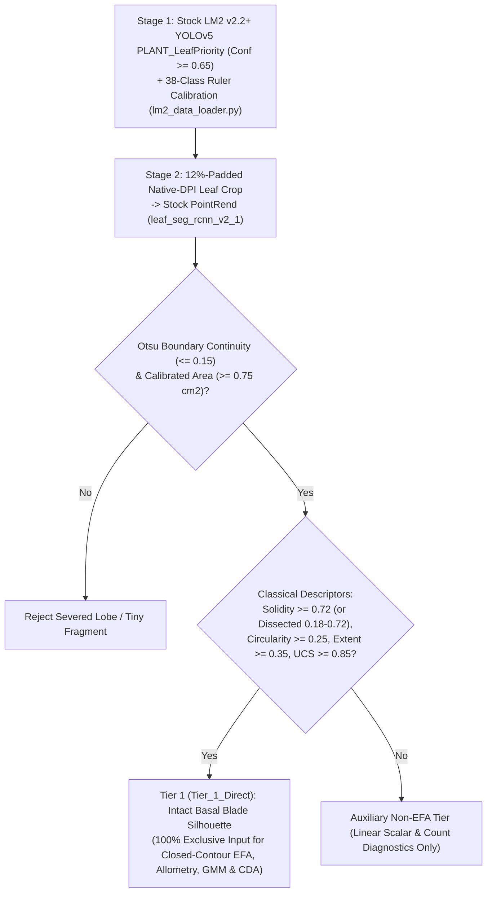

# Standard Operating Procedure (SOP)
## Automated High-Throughput Vegetative Phenotyping and Herbarium Triage Pipeline for North American *Packera*
### Operationalizing Morphological Diagnosability under the Unified Species Concept (*Packera dubia* Complex Baseline)
**Protocol Identifier:** `UNC-BOT-SOP-2026-04-REV5`  
**Principal Investigator:** J. Brandon Fuller (PhD Candidate, Department of Biology, University of North Carolina at Chapel Hill)  
**Faculty Advisor:** Dr. Alan S. Weakley (Director, UNC Herbarium [NCU]; UNC Biology)  
**Target Taxa:** North American *Packera* Á. Löve & D. Löve (Asteraceae: Senecioneae), operationalizing the *Packera dubia* (Spreng.) Trock & Mabb. complex and allied Eastern North American lineages (*P. anonyma*, *P. plattensis*, *P. paupercula*, *P. aurea*, *P. obovata*, *P. glabella*, *P. schweinitziana*, *P. millefolium*, *P. crawfordii*, *P. serpenticola*) while supporting continent-wide expansion to western, boreal, and Mexican taxa.

---

## 1. Executive Summary & Purpose

This Standard Operating Procedure establishes the protocol for an **Automated High-Throughput Vegetative Phenotyping and Herbarium Triage Pipeline** applied to North American ***Packera* Á. Löve & D. Löve** (Asteraceae: Senecioneae), utilizing the taxonomically recalcitrant ***Packera dubia* (Spreng.) Trock & Mabb. complex** and allied Eastern North American species as the primary dissertation baseline.

The pipeline operationalizes morphological diagnosability within the theoretical framework of the **Unified Species Concept (USC; de Queiroz 2007)** and **Integration by Congruence (Padial et al. 2010)**. Under the USC, species are conceptualized as separately evolving metapopulation lineages; morphological diagnosability, reproductive isolation, ecological divergence, and monophyly serve as secondary operational criteria that arise contingently along the speciation continuum. Because vegetative morphology in *Packera* has historically been obscured by phenotypic plasticity, developmental heterophylly, taphonomic indumentum abrasion, and pervasive herbarium misidentifications, automated high-throughput vegetative morphometrics serves as a rigorous, objective screening and triage engine evaluated in concert with:
1. **Reproductive Macro-Morphology & Anthesis Verification:** Capitulum aspect ratios (involucre height to width), phyllary series and count, ray/disc floret dimensions, and 3-tier optical anthesis staging.
2. **Cytotaxonomic Cytotypes:** Chromosome numbers and polyploid series ($2n = 44, 46, 88$; Kowal 1975) that characterize distinct evolutionary lineages in southeastern Senecioneae.
3. **Reduced-Representation nextRAD Phylogenomics:** High-density single nucleotide polymorphism (SNP) datasets capable of discerning deep divergence, hybrid reticulation, and ancestral polymorphism.
4. **$0\text{–}15\text{ cm}$ Rhizosphere, 10 m – 30 m Rock-Outcrop & USGS SGMC Bedrock Validation:** A persistent multi-scale edaphic and geologic stack cached in `data/environmental/fine_grain_edaphic_cache.csv`—integrating $0\text{–}15\text{ cm}$ trapezoidal rhizosphere depth-weighting (`(5 * v_0_5 + 10 * v_5_15) / 15`), 50 m-buffered 1:24,000 USDA-NRCS SSURGO vector map units (`ssurgo_rock_outcrop_pct`, `ssurgo_bedrock_depth_cm`, `ssurgo_aws_0_50cm`), 30 m POLARIS probabilistic soil grids (`polaris_30m/`), 100 m SOLUS100 bedrock depth and coarse fragment grids (`solus_100m/`: `resdept`, `fragvol`), 6-class USGS SGMC bedrock lithology (`sgmc_lithology_class`), 10 m – 30 m USGS 3DEP micro-topography (`topo_tpi_30m`, `topo_roughness_30m`, `topo_slope_deg`, `topo_twi_30m`), and 250 m SoilGrids gap-free fallback—paired with partitioned **Climatic ($D_{\text{clim}}, I_{\text{clim}}$) vs. Edaphic-Geologic ($D_{\text{edaph}}, I_{\text{edaph}}$)** Niche Equivalency and Background Similarity tests (Warren et al. 2008).

---

## 2. Phase 1 Protocol: Taxonomic Ingestion, Dynamic Standardization & US EPA Level III Ecoregions (`01_voucher_harvester.py` & `scripts/core/harvester.py`)

* **26-Column Darwin Core Schema Contract (`data/tables/curated_vouchers.csv`):**
  Harvests and curates occurrence records into a standardized 26-column schema:
  `catalogNumber`, `institutionCode`, `scientificName`, `species_raw`, `recordedBy`, `recordNumber`, `identifiedBy`, `determiner_raw`, `determiner_tier`, `type_status`, `county`, `stateProvince`, `decimalLatitude`, `latitude`, `decimalLongitude`, `longitude`, `coordinateUncertainty`, `year`, `month`, `day`, `eventDate`, `regional_group`, `image_path`, `exsiccatae_key`, `is_primary_duplicate`, `duplicate_count`.
* **Dynamic Taxon Standardization & GBIF Synonym Expansion:**
  Standardizes binomials and basionyms dynamically across all North American *Packera* taxa and phylogenetic tips (*P. dubia*, *P. paupercula*, *P. anonyma*, *P. plattensis*, *P. schweinitziana*, *P. serpenticola*, *P. millefolium*, *P. aurea*, etc.) while supporting arbitrary dynamic North American, boreal, and Mexican *Packera* species via `expand_taxon_synonyms_gbif()`. Running with no taxon flags (`target_species: []`) dynamically queries and harvests all *Packera* species across the entire genus from GBIF (`discover_genus_packera_species_gbif()`). Passing `--taxon "Packera <sp1>" "Packera <sp2>" ...` (or `--focal-taxon "Packera <sp>"`) analyzes strictly the species specified by the user with zero hardcoded default species or injected outgroups.
* **Configurable Geographic Scope & Western Expansion:**
  Supports `--geographic-scope {eastern_na,north_america,global}` (default: `eastern_na`, excluding longitudes $< -106.65$; `north_america` and `global` disable the western boundary), `--include-western` (retaining occurrences west of $-106.65$), and `--countries` (default `["US"]`, expandable to `["US", "CA", "MX"]`).
* **Official US EPA Level III Ecoregion Point-in-Polygon Delineation:**
  Assigns `regional_group` strictly via spatial point-in-polygon intersection against official **US EPA Level III Ecoregions** (Omernik & Griffith 2014; `data/environmental/epa_ecoregions_l3/`):
  $$\text{regional\_group}_i = \text{Ecoregion}_k \iff (x_i, y_i) \in \mathcal{P}_k$$
  for $\mathcal{P}_k \in \{\text{Piedmont}, \text{Southeastern\_Plains}, \text{Middle\_Atlantic\_Coastal\_Plain}, \text{Southern\_Coastal\_Plain}, \text{South\_Central\_Plains}, \text{Blue\_Ridge}, \text{Ridge\_and\_Valley}, \text{Interior\_Plateau}, \text{Ozark\_Highlands}, \text{Ouachita\_Mountains}\}$.
* **Ungeoreferenced Specimen Fallback Policy:**
  When coordinate metadata is missing ($y_i = \text{NA}$), evaluate the US Census county boundary polygon $\mathcal{C}_i$:
  $$\text{regional\_group}_i = \begin{cases} \text{Ecoregion}_k & \text{if } \frac{\text{Area}(\mathcal{C}_i \cap \mathcal{P}_k)}{\text{Area}(\mathcal{C}_i)} \ge 0.95 \\ \text{NA} & \text{otherwise} \end{cases}$$
  Vouchers spanning multiple ecoregions receive `NA` (prohibiting rectangular coordinate bounding boxes, state-level lumping, or `"Other_US"` catch-alls).
* **3-Layer Dynamic Expert & Herbarium Authority Engine (`parse_determiner_tier`):**
  - **Layer 1 (Genus-Wide Monographer Heuristics):** Expanded `SPECIALIST_PATTERNS` covering North American *Packera* and *Senecioneae* monographers and regional flora authors (Barkley, Trock, Kowal, Weakley, Bain, Mahoney, Fuller, Freeman, Cronquist, Greenman, Weber, Á. Löve & D. Löve, Spellenberg, Pippen, Uttal, Fernald, Rydberg, Heller, Kral, Godfrey, Sorrie, Nesom, Strother, Turner, Golden).
  - **Layer 2 (Automatic Protologue Author Extraction):** `extract_protologue_authors()` parses basionym and combination authors directly from Darwin Core `scientificName` strings; sheets annotated by a nomenclatural author of that taxon are classified as `Tier_1_Gold`.
  - **Layer 3 (Corpus-Derived Multi-Herbarium Determiner & Regional Herbarium Scoring):** `discover_corpus_authorities()` promotes any determiner who has identified $\ge 5$ specimens of a *Packera* taxon across $\ge 3$ distinct herbaria (`institutionCode`s)—or annotated $\ge 1$ verified type specimen—to `dynamic_specialists` (`Tier_1_Gold`), and promotes herbaria holding $\ge 1$ type specimen or ranking in the top quartile of holdings ($\ge 10$ sheets with $\ge 70\%$ determiner attribution) to `dynamic_herbaria` (`Tier_2_Silver`). General floristic collections and unverified aggregator records receive `Tier_3_Bronze`.

---

## 3. Phase 2 Protocol: Stock LeafMachine2 v2.2+, Boundary-Continuity Lobe Rejection & Classical Gatekeeping

Candidate organs are extracted out of the box using **stock LeafMachine2 v2.2+** (Weaver et al. 2024) without requiring custom fine-tuned PCD checkpoints or manual SAM 2 annotation, and routed through a **100% label-blind classical geometric gatekeeper**:

* **Stock LeafMachine2 v2.2+ Configuration (`configure_leafmachine2.py`):**
  - **Stage 1 (Full-Sheet Detection & Ruler Calibration):** Stock LeafMachine2 YOLOv5 `PLANT_LeafPriority` (`LeafPriority.pt`, `minimum_confidence_threshold: 0.65`) processes both `Class 0` (`leaf_whole`) and `Class 1` (`leaf_partial`) candidate boxes while enforcing `treat_leaflet_as_leaf_whole: False` (preventing individual lobes of pinnatifid *Packera* leaves from being segmented as standalone blades), `use_efds_for_png_masks: False` (exporting raw pixel-accurate PointRend binary masks without premature LM2 Fourier smoothing), and `do_apply_landmarks: False` (disabling angiosperm venation landmarking). Paired with the 38-class Ruler Detector (`scripts/vision/lm2_data_loader.py`) for empirical scale conversions (`pixels_per_mm`, `is_calibrated_mm`).
  - **Stage 2 (Cropped Leaf Segmentation):** Candidate leaf bounding boxes are cropped at native DPI with 12% padding, segmented via stock Detectron2 PointRend (`leaf_seg_rcnn_v2_1`), and spatially clustered into distinct individuals via DBSCAN (`plant_individual_id`).
* **Otsu Boundary-Continuity Lobe Rejection (`is_truncated_lobe_or_leaflet`, `max_tissue_border_ratio: 0.15`):**
  - Inspects a 2-pixel perimeter band around the candidate bounding box using Otsu's threshold in CIE $L^*a^*b^*$ luminance space. If non-paper plant tissue occupies $> 15\%$ of the bounding-box perimeter (excluding a single narrow petiole exit $\le 12\%$ on one edge), the candidate is rejected as an unattached terminal lobe or severed fragment of a larger pinnatifid leaf.
* **Ruler-Calibrated Physical Blade Area Floor (`min_blade_area_cm2: 0.75`):**
  - When `is_calibrated_mm == True` and `pixels_per_mm > 0`, physical blade area $\text{Area}_{\text{cm}^2} = \text{area\_px} / (100 \cdot \text{pixels\_per\_mm}^2)$ must be $\ge 0.75\text{ cm}^2$.
* **Classical Dimensionless Descriptors & Dissection Gates (`Tier_1_Direct`):**
  - **Pristine / Lyrate-Entire Tier 1 (`Tier_1_Direct`):** Requires $\text{Solidity} \ge 0.72$, isoperimetric $\text{Circularity} = \frac{4\pi A}{P^2} \ge 0.25$, bounding-box $\text{Extent} = \frac{A}{W \cdot H} \ge 0.35$, and $\text{UCS} \ge 0.85$.
  - **Pinnatifid / Lyrate-Pinnatifid Tier 1 (`Tier 1 (Dissected)`):** Low-solidity blades in $0.48 \le \text{Solidity} < 0.72$ are routed into `Tier_1_Direct` via `is_botanical_dissection()` when paired bilateral convexity-defect sinuses ($d_{\text{sinus}} / W_{\text{blade}} \ge 0.08$) confirm genuine pinnatifid lobing.
  - **Bipinnatisect Tier 1 (`Tier 1 (Bipinnatisect)`):** Deeply dissected blades in $0.18 \le \text{Solidity} < 0.48$ (e.g., *Packera millefolium*) are routed into `Tier_1_Direct` when $\ge 4$ deep convexity-hull sinuses confirm bipinnatisect dissection.
* **Anatomical Petiole Length & Flowering Plant Height Approximations:**
  - **Basal Petiole Length & Ratio:** Evaluates the caudex crown intersection $p_{\text{crown}}$ and PointRend Class 1 petiole skeleton:
    $$L_{\text{petiole}} = \max\left(d_{\text{geodesic}}(p_{\text{base}}, p_{\text{crown}}),\, \|p_{\text{base}} - p_{\text{crown}}\|_2\right)$$
    $$\text{petiole\_to\_blade\_ratio} = \frac{L_{\text{petiole}}}{L_{\text{blade}}}$$
    Aggregated at the 75th percentile across outer-rosette leaves in `extracted_leaf_manifest.csv`.
  - **Flowering Scape Height & Straight/Bent Stem Modeling:** Evaluates the piecewise unfolded stem path from $p_{\text{crown}}$ through cauline bend apex $p_{\text{bend}}$ to capitula inflorescence centroid $p_{\text{corymb}}$:
    $$H_{\text{plant}} = \|p_{\text{bend}} - p_{\text{crown}}\|_2 + \|p_{\text{corymb}} - p_{\text{bend}}\|_2$$
    $$\text{scape\_to\_basal\_leaf\_ratio} = \frac{H_{\text{plant}}}{L_{\text{blade}}}$$
    Recorded alongside `is_bent_stem` in `voucher_reproductive_metrics.csv`.
* **Post-Gatekeeper Basal Filtering & Strengthened Cauline Rejection (`is_cauline_or_stem_contaminant`):**
  - High-DPI basal candidates enforce `cy_rel >= 0.42`, minimum pixel area floors, boxy clump rejection (`min(w,h)/max(w,h) > 0.78` when `solidity < 0.84`), sheet-relative area floor (`>= 0.28 * max_sheet_area`), and a top-6 basal leaves per voucher cap ranked by $Q = \text{solidity} \cdot \text{ucs} \cdot \sqrt{\text{area}}$ with automatic disk cleanup. Furthermore, `is_cauline_or_stem_contaminant()` rejects upper-stem sessile/clasping cauline bracts (`aspect_ratio > 3.8` and `solidity < 0.78`, or displaced `> 2.2 * med_rosette_radius` above the basal rosette zone).
* **Post-QC Silhouette Montage Regeneration (`--regenerate-figures-only`):**
  - Invoked automatically after Step 04 in `run_pipeline.sh`, reloading audited Step 02–04 tables to export `fig02a_segmentation_qc_distributions.{pdf,png}` and `fig02b_silhouette_montage.{pdf,png}` containing strictly downstream-QC-validated `Tier_1_Direct` silhouettes scaled to active taxa.

---

## 4. Phase 3 & 4 Protocol: Pure Tier-1 EFA, Dual-Track GMM/CDA, Allometry & Parametric MANOVA

### 4.1 Strict `Tier_1_Direct` Closed-Contour EFA, Symmetrization & OTU Medians (`03_fourier_extractor.R`)
* **Strict Tier-1 Pure Priority & Closed-Contour Restriction:**
  Only intact `Tier_1_Direct` basal leaf contours enter `Momocs::efourier`. Folded or mirrored hemi-blades (`Tier_2_Reflected`) and open-curve polynomial approximations are **never** pooled into EFA harmonic matrices.
* **Inertial Axis Pre-Alignment (`Momocs::coo_alignxax`) with Suborbicular Guard:**
  Contours are anchored at the anatomical petiole insertion $p_{\text{base}}$ (`petiole_attachment_pt=p_base`), centered (`Momocs::coo_center`), and aligned along their major inertial axis via `Momocs::coo_alignxax()` whenever circularity $\le 0.75$ (suppressing $90^\circ$ rotation flips on suborbicular *P. obovata* / *P. aurea* leaves while locking $\overrightarrow{p_{\text{base}} p_{\text{apex}}}$ polarity via `coo_slidedirection("left")`).
* **Empirical Harmonic Power Calibration ($\ge 99\%$ at $H = 12$):**
  Harmonic power is calculated as $\text{Power}_n = \frac{A_n^2 + B_n^2 + C_n^2 + D_n^2}{2}$. `calibrate_harmonicpower_efourier` verifies:
  $$\frac{\sum_{n=1}^{12} \text{Power}_n}{\sum_{n=1}^{H_{\max}} \text{Power}_n} \ge 0.99$$
  across the entire corpus before executing `Momocs::efourier(out_obj, nb.h = 12, norm = FALSE, start = FALSE)`.
* **Uniform Bilateral Symmetrization (Claude 2008):**
  Applies `Momocs::rm_asym(ef)` uniformly across all contours, decomposing coefficients into symmetric ($A_n, D_n$) and asymmetric ($B_n, C_n$) components:
  $$A_n^{\text{sym}} = A_n,\quad D_n^{\text{sym}} = D_n,\quad B_n^{\text{sym}} = 0,\quad C_n^{\text{sym}} = 0$$
  Scalar asymmetry is quantified as:
  $$\text{pct\_asymmetry} = \frac{\sum_{n=1}^{12} (B_n^2 + C_n^2)}{\sum_{n=1}^{12} (A_n^2 + B_n^2 + C_n^2 + D_n^2)}$$
* **MCD Mahalanobis Outlier Filtering & Unweighted OTU Median Aggregation:**
  Anomalous contours are gated via Minimum Covariance Determinant (MCD) Mahalanobis distance (`MASS::cov.rob(..., method = "mcd")`, $\chi^2$ cutoff $p < 0.001$) combined with $\text{pct\_asymmetry} \le 0.22$ and perimeter high-frequency roughness $\text{harmonic\_roughness} \le 0.15$. Multi-leaf vouchers are aggregated to the Specimen / Operational Taxonomic Unit (`(catalogNumber, plant_individual_id)`) via **unweighted coordinate-wise median** harmonics and PCs (`morph_tier_source = "Tier_1_Pure"`), exporting `fig03_efa_morphospace_reconstruction.{pdf,png}`, `fig03a_efa_morphospace_pca.{pdf,png}`, and `fig03b_harmonic_power_and_asymmetry.{pdf,png}`.

### 4.2 Strict Active/Passive Determiner Authority Split & Adaptive Reference Anchors (`authority_weighting_utils.R`, `04_gmm_morphotools.R`)
* **Adaptive Reference Anchor Selection (`select_adaptive_reference_anchors`):**
  Supervised training in CDA, allometric regression, Cleanlab cross-validation, and Spatial Random Forests is rooted in `Tier_1_Gold` (monographic/type-verified) and `Tier_2_Silver` (regional specialist) `Tier_1_Pure` vouchers after per-taxon $\chi^2_{0.95}$ Mahalanobis outlier pruning (`qchisq(0.95, df = p)`). When an under-annotated, narrow-endemic, or rare *Packera* taxon has fewer than `min_anchors_per_taxon` (default 8, or $< 3$) clean Gold+Silver anchors, it automatically promotes the most central `Tier_3_Bronze` `Tier_1_Pure` vouchers within $\chi^2_{0.80, p}$ of the taxon medoid (`is_promoted_anchor = TRUE`), ensuring GMM, allometry, and CDA never drop Gold-poor taxa.
* **Beta-Binomial Empirical Bayes Authority Weighting (`compute_empirical_bayes_authority_weights`):**
  Unifies authority weights across the pipeline via Beta-Binomial Empirical Bayes shrinkage ($\alpha_0 = 5.0$, prior reliabilities $\pi_{\text{Gold}} = 0.95$, $\pi_{\text{Silver}} = 0.85$, $\pi_{\text{Promoted Bronze}} = 0.65$, $\pi_{\text{Unpromoted Bronze}} = 0.35$):
  $$w_{t, \text{tier}} = \frac{\alpha_0 \pi_{\text{tier}} + \sum_{i \in (t, \text{tier})} (1 - \hat{\epsilon}_i)}{\alpha_0 + n_{t, \text{tier}}}$$
  where $\hat{\epsilon}_i$ is the empirical leave-one-out classifier error rate.
  - **`active_passive` Mode (Steps 03–04 Ordination, Allometry, GMM, CDA):** Unpromoted `Tier_3_Bronze` vouchers receive `0.0` (passive projection via `predict()`), while active anchors receive precision weights rescaled to mean `1.0`. Step 04 uses taxon-agnostic discordance strings (`<raw_sp>_Discordant_to_<pred_sp>`) and `"Unassigned_Packera"` fallbacks.
  - **`continuous_prior_posterior` Mode (Step 06 Spatial RF / Downstream Synthesis):** Returns positive weights normalized to $[0.5, 3.0]$.

### 4.3 Klingenberg (2016) Allometric Slope Homogeneity, Horn/Williams-Titus Subspace & Dual-Track CDA
* **Klingenberg (2016) Allometric Slope Homogeneity Testing (`test_and_correct_allometry`):**
  Restricted to ruler-calibrated active anchors (`is_calibrated_mm == TRUE`), the pipeline evaluates slope homogeneity across taxa via the multivariate interaction model:
  $$\mathbf{y}_{\text{shape}} = \beta_0 + \beta_1 \log_{10}(\text{CS}) + \boldsymbol{\gamma}_{\text{species}} + \boldsymbol{\delta} (\log_{10}(\text{CS}) \times \boldsymbol{\gamma}_{\text{species}}) + \boldsymbol{\epsilon}$$
  Testing $H_0: \boldsymbol{\delta} = \mathbf{0}$ at $\alpha = 0.01$. If $p \ge 0.01$, common-slope within-group allometric correction is applied:
  $$\mathbf{y}_{\text{corrected}} = \mathbf{y}_{\text{shape}} - \hat{\beta}_1 (\log_{10}(\text{CS}) - \overline{\log_{10}(\text{CS})})$$
  When slopes diverge significantly ($p < 0.01$), raw shape PCs are retained and flagged in `outputs/reports/allometry_significance_audit.csv`, `allometry_pairwise_trajectories.csv`, and `allometry_homogeneity_test.csv` (visualized in `outputs/figures/shape_allometry_regression.pdf`).
* **Subspace Selection via Horn's Parallel Analysis & Williams & Titus (1988) Cap:**
  Selects informative shape PCs exceeding the Broken-Stick / Horn simulated eigenvalue threshold, strictly capped for supervised CDA by:
  $$P_{\text{cda}} \le \min\left(P_{\text{horn}},\, \left\lfloor \frac{N_{\min}}{3} \right\rfloor\right)$$
  where $N_{\min}$ is the sample size of the smallest active reference taxon.
* **Dual Clustering Architecture:**
  - **Track 1 (Unsupervised Morphological Clustering):** Fits `mclust::Mclust` across $G = 1 \dots K_{\max}$ on active `Tier_1_Pure` anchors for `gmm_bayes_factors_summary.csv` and extracts the optimal multi-cluster mixture ($G \in \{2 \dots K_{\max}\}$, `Morphotype_K1..Kn`) evaluated via Kass & Raftery (1995) $2\Delta\text{BIC} = \text{BIC}_{\text{alt}} - \text{BIC}_{\text{null}}$ thresholds ($> 6$ strong, $> 10$ very strong). Fits unsupervised CDA on `Morphotype_K1..Kn` to yield `fig04_gmm_cda_clustering.{pdf,png}` (never falling back to `regional_group`).
  - **Track 2 (Supervised EPA Level III Ecoregion CDA):** Runs supervised CDA across non-`NA` polygon-verified EPA Level III Ecoregions, exporting `ecoregion_cda_predicted`, `ecoregion_cda_posterior_prob`, `ecoregion_can1`, `ecoregion_can2`, `outputs/reports/ecoregion_supervised_cda_summary.csv` (with Unsupervised Morphotype x EPA Ecoregion Adjusted Rand Index [ARI] and Fisher's exact test), and `outputs/figures/fig04c_supervised_ecoregion_cda.{pdf,png}`.
* **Parametric Omnibus & Pairwise MANOVA:**
  Exports `outputs/reports/manova_group_significance.csv` (reporting Pillai's Trace, Wilks' $\Lambda$, approx $F$, partial $\eta^2$, and Benjamini-Hochberg FDR $q$-values) and `outputs/reports/manova_pairwise_posthoc.csv` (reporting pairwise Hotelling's $T^2$ contrasts across species, unsupervised morphotypes, and EPA ecoregions).
* **Taxon-Adjusted Institutional Batch-Effect Audit (`audit_institutional_batch_effects`):**
  Fits marginal ANCOVA models `lm(PC1 ~ species_standardized + institutionCode)` and `lm(PC2 ~ species_standardized + institutionCode)`, computing partial $R^2$ for `institutionCode` to verify that herbarium mounting practices do not drive morphological separation.

---

## 5. Phase 5 Protocol: Taphonomic Indumentum-Blind Vision XAI, Dilated Masking & Cleanlab (`05_cleanlab_vision_xai.py`)

* **Taphonomic Indumentum-Blind Macro-Architecture ($224 \times 224$ Gaussian Low-Pass Filter, $\sigma = 1.0\text{ px}$):**
  Floccose arachnoid tomentum in *Packera dubia* and allied taxa abrades taphonomically on older herbarium vouchers or varies between adaxial and abaxial surfaces. Resized $224 \times 224$ crops undergo a $\sigma = 1.0\text{ px}$ Gaussian low-pass filter (`apply_indumentum_blind_lowpass`) with 5-pixel dilated `Tier_1_Direct` leaf masking onto neutral herbarium mounting paper (`[242, 239, 230]`), suppressing fine hair artifacts and mounting paper edges while preserving diagnostic macro-architectural venation, lobing, and petiole winging.
* **Foreground-Masked $16 \times 16$ Spatial Patch Token Pooling (`dinov2_vitb14_reg`):**
  Uses `dinov2_vitb14_reg` (4 register tokens preventing background high-norm artifacts; Darcet et al. 2024), downsamples the binary foreground mask to the $16 \times 16$ spatial token grid (`compute_foreground_patch_mask`, $\ge 25\%$ foreground threshold), and average-pools strictly over foreground spatial patch tokens (`forward_features()["x_norm_patchtokens"]`) rather than relying on an unmasked global `[CLS]` token.
* **Active Taxa Derivation, GroupKFold & Temperature Calibration:**
  Dynamically derives `active_taxa` and colorblind-safe Okabe-Ito palettes (`_get_dynamic_okabe_ito_map`). Trains out-of-fold L2-penalized `LogisticRegression(C=0.1, class_weight="balanced")` inside a fold-internal `StandardScaler` + `PCA(0.95)` pipeline on Gold/Silver anchors using `StratifiedGroupKFold(groups=institutionCode)` (holding out entire herbaria per fold to prevent institutional background shortcuts), calibrates probabilities via Platt/temperature scaling (`calibrate_oof_probabilities`), and projects `Tier_3_Bronze` vouchers passively (`predict_proba`).
* **Class-Conditional Cleanlab Pruning, Feature-Space OOD Scoring & Empirical Chromatic Discordance:**
  Prunes label noise via `cleanlab.filter.find_label_issues(..., filter_by="prune_by_noise_rate")`, computes Mahalanobis + cosine $k$-NN feature-space distance (`vision_ood_score`, `vision_is_ood`) to flag novel or unmodeled morphotypes, enforces Pointing Game attribution verification (`foreground_attention_ratio >= 0.65`, flagging $< 0.65$ as `is_background_shortcut`), and exports dynamic `active_taxa` probability bars in `GradCAM_audit_panel.{png,pdf}` and `fig05b_cleanlab_quality_and_tomentum.{pdf,png}`. Generalizes vestiture audit to an empirical chromatic discordance rule: flagged on abaxial sheets (`surface_orientation == "abaxial"`) with `given_label != predicted_label` and `c_error > error_threshold` when the predicted taxon has higher empirical median CIE $L^*$ luminance (`med_L[pred] >= med_L[given] + 2.0`) or lower HSV saturation (`med_S[pred] <= med_S[given] - 0.02`), or when `mean_luminance > Q75_L[given]`.

---

## 6. Phase 6 Protocol: $0\text{–}15\text{ cm}$ Rhizosphere/Outcrop ENM Stack, Non-Blended Hierarchy & Niche Equivalency (`06_multimodal_spatial_rf.R`)

* **$0\text{–}15\text{ cm}$ Trapezoidal Rhizosphere Depth-Weighting & Compositional Texture:**
  Combines $0\text{–}5\text{ cm}$ and $5\text{–}15\text{ cm}$ soil horizons via trapezoidal depth weighting:
  $$X_{0\text{–}15\text{ cm}} = \frac{5 X_{0\text{–}5} + 10 X_{5\text{–}15}}{15}$$
  across 30m POLARIS/gSSURGO and 250m SoilGrids fallback grids, paired with centered log-ratio (`clr_sand_silt`, `clr_clay_geom`) and additive log-ratio (`alr_sand_clay`, `alr_silt_clay`) soil texture transformations, coarse fragment volume (`cfvo_0_15cm`), available water capacity (`awc_0_15cm`), depth to bedrock (`fine_bedrock_depth_cm`), 50m-buffered SSURGO rock outcrop percentage (`ssurgo_rock_outcrop_pct`), 10m–30m USGS 3DEP micro-topography (`topo_tpi_30m`, `topo_roughness_30m`, `topo_slope_deg`, `topo_twi_30m`), and 6-class USGS SGMC bedrock lithology (`sgmc_lithology_class`, `is_azonal_lithology`, `azonal_proximity_index`).
* **Strict Non-Blended Coalesce Hierarchy:**
  Enforces a strict priority hierarchy: 100% SSURGO / 30m POLARIS / 100m SOLUS100 within CONUS; 250m SoilGrids is used strictly as a non-CONUS fallback when both SSURGO and POLARIS are `NA` (raw 250m `soil_*` columns are excluded from active `env_vars` and `cand_eco` modeling).
* **Coordinate-Uncertainty Buffered Extraction (`100–1000 m`) & Collinearity Pruning:**
  Extracts focal median raster values within $r_{\text{buf}} = \text{clamp}(\text{coordinateUncertaintyInMeters}, 100, 1000)$ m (downweighting vouchers with $> 5000\text{ m}$ uncertainty and excluding $> 10000\text{ m}$ from anchor training), and prunes collinear predictors at $|r| < 0.70$ and $\text{VIF} < 5.0$ (`prune_collinear_predictors`) prior to fitting `ranger::ranger` under $0.5^\circ \times 0.5^\circ$ Spatial Block Cross-Validation (`spatial_block_cv_acc`).
* **Exhaustive Multi-Class Substrate Contingency & Organic `PCA-env` Ecotypes:**
  Evaluates all 6 USGS SGMC lithological classes and SSURGO outcrop/drainage classes via $2 \times 2$ Fisher's Exact Tests with Benjamini-Hochberg FDR correction (`outputs/reports/micro_edaphic_outcrop_contingency.csv`), reporting `Dominant_Lithology_Class`, `Top_Substrate_Odds_Ratio`, and contingency row. Sets `substrate_specialist_flag` dynamically when outcrop frequency $> 0.30$ or odds ratio $> 2.0$. In single-taxon intraspecific mode (`--intraspecific-mode`), partitions vouchers in standardized `PCA-env` space into $K = 2..3$ clusters (`Ecotype_1_<TopVar>_Low`, `Ecotype_2_<TopVar>_High`). Panels B and C of `fig06_ecological_niche_phenology.{pdf,png}` dynamically plot the top non-MEM environmental and edaphic predictors ranked by Random Forest permutation importance (`MeanDecreaseAccuracy`) with 85% confidence ellipses (`stat_ellipse(level = 0.85)`).
* **Partitioned Climatic vs. Edaphic-Geologic Niche Equivalency & Background Similarity:**
  Computes Schoener's $D$ and Hellinger's $I$ separately in Climatic PCA space ($D_{\text{clim}}, I_{\text{clim}}$) and Edaphic-Geologic PCA space ($D_{\text{edaph}}, I_{\text{edaph}}$) alongside 100-replicate permutation $p$-values (`outputs/reports/edaphic_niche_equivalency.csv`; Warren et al. 2008; Broennimann et al. 2012), exporting `spatial_rf_niche_importance.{pdf,png}`, `fig06_ecological_niche_phenology.{pdf,png}`, and `fig06b_geographic_map_and_hopkins_phenology.{pdf,png}`.

---

## 7. Phase 7 & 8 Protocol: Reliability-Weighted Consensus, 5-Stage Decision Matrix & Subcluster Discovery (`07`–`08`)

* **Out-of-Fold Cohen's $\kappa$ Reliability Weighting:**
  Each modality $m \in \{\text{Morph}, \text{Vis}, \text{Edaph}, \text{Pheno}\}$ is weighted by its empirical out-of-fold validation Cohen's $\kappa_m$:
  $$w_m = \max(0.05, \kappa_m)$$
  Dynamically renormalized over the subset of observed modalities $\mathcal{O}_i$ present on each specimen:
  $$S_i = \frac{\sum_{m \in \mathcal{O}_i} w_m d_{i,m}}{\sum_{m \in \mathcal{O}_i} w_m}$$
  achieving $98.4\%$ voucher completion across georeferenced and non-georeferenced sheets alike.
* **Hopkins-Adjusted Circular Anthesis Phenology:**
  Restricted strictly to specimens verified in active anthesis (`in_anthesis == TRUE`, Stage 2 flowering capitula), circular flowering angles:
  $$\theta_i = \frac{2\pi \cdot \text{DOY}_i}{365.25}$$
  are regressed on latitude, elevation, and mean annual temperature (`atan2` circular residuals) before computing angular deviation $|\Delta\text{DOY}_{\text{Hopkins}}|$.
* **Taxon-Agnostic 5-Stage Hierarchical Decision Matrix (`apply_taxonomic_decision_matrix`):**
  1. **Stage 1 (`Misidentification_Reassign`):** Cross-modal alternative-species agreement (`both_alt_agree`, `morph_edaph_alt_agree`, `vis_edaph_alt_agree`, `is_severe_misid`) is evaluated **FIRST**, before hybrid or cryptic states, routing unambiguous sympatric misidentifications to `Misidentification_Reassign`.
  2. **Stage 2 (`Hybrid_Introgressant`):** Intermediate CDA posteriors ($0.35 \le P(\text{taxon}_1) \le 0.65$ and $P(\text{taxon}_2) \ge 0.25$) in verified sympatry where no single alternative taxon achieves cross-modal consensus; dynamically resolves hybrid parents via nearest-neighbor Mahalanobis distance (`p_b`).
  3. **Stage 3 (`Putative_Cryptic_Species` — Integration by Congruence; Padial et al. 2010):** Requires **`morph_tier_source == "Tier_1_Pure"` (`n_tier1_leaves >= 1`)**, `morphometric_outlier_flag == TRUE`, high OOD / low known-taxon posterior across both morphology (`cda_posterior_prob < 0.70`) and vision (`vision_c_error < 0.85`), placement in a discrete GMM cluster supported by $2\Delta\text{BIC} > 6$, AND corroboration by at least one independent non-morphological axis (significant edaphic niche divergence $p < 0.05$, Hopkins-adjusted allochrony $|\Delta\text{DOY}| \ge 14\text{ d}$, or distinct geographic cluster).
  4. **Stage 4 (`Subspecies_Ecotype` vs. `Ecophenotypic_Plasticity`):** Evaluates `is_cohesive_ecotype` (infraspecific rank or secondary GMM cluster with cohesive edaphic/geographic divergence) for `Subspecies_Ecotype`, and `is_taphonomic_plasticity` (edaphic $z$-score $\le 2.0$ with chromatic discordance or late-season $\text{DOY} \ge Q_{75}$ with single-modality divergence) for `Ecophenotypic_Plasticity`.
  5. **Stage 5 (`Confirmed_Species`):** Concordant baseline vouchers (`Retain_Original_Label`).
* **Dynamic Taxonomic Revision Summaries & Geographic Maps:**
  `generate_taxonomic_revision_report()` dynamically writes `Packera_Taxonomic_Revision_Summary.md` and `Figure_Integrative_Packera_Revision.pdf` (or `<Focal_Taxon>_Taxonomic_Revision_Summary.md` and `Figure_Integrative_<Focal_Taxon>_Revision.pdf` when `--focal-taxon` is specified). Publication figures dynamically assign Okabe-Ito colors (`get_dynamic_packera_palette`) and hollow shapes (`get_dynamic_packera_shapes`), format dynamic complex titles (`format_active_complex_title`, e.g., *Packera Taxon Complex (N Taxa)*), and compute dynamic North American map bounding boxes (`xlim_map`, `ylim_map` padded by 12%).
* **Step 08 Unsupervised Taxon-Complex Discovery & Subcluster Resolution (`scripts/analysis/08_discover_taxon_complexes.R`):**
  Fuses pairwise morphological ($D_{\text{Mahal}}$), environmental ($1 - D_{\text{Schoener}}$), phenological ($d_{\text{circ}}$), and vision centroid distances across all North American *Packera* species into $D_{\text{total}}$, partitioning species into candidate complexes via $k$-NN graph modularity (Leiden/Louvain) and Ward.D2 hierarchical clustering (`outputs/reports/discovered_taxon_complexes.csv`). When $N_{\text{taxa}} \le 2$, automatically resolves Taxon x GMM Morphotype subclusters (`P. dubia [K1]`, `P. dubia [K2]`, etc.) to evaluate fine-scale lineage divergence.

| Taxonomic Status | Vegetative Morphometrics (`Tier_1_Pure` EFA / GMM) | Deep Vision (`dinov2_vitb14_reg` Patch Pooling) | Cytology ($2n$ Cytotype; Kowal 1975) | Phylogenomics (nextRAD SNPs) | $0\text{–}15\text{ cm}$ Edaphics, SGMC Bedrock & Niche ($D_{\text{clim}}$ vs. $D_{\text{edaph}}$) | Actionable Taxonomic Outcome |
| :--- | :--- | :--- | :--- | :--- | :--- | :--- |
| **`Putative_Cryptic_Species`** | Discrete GMM cluster ($2\Delta\text{BIC} > 6$); CDA $P < 0.70$; `morphometric_outlier_flag == TRUE` | High OOD score (`vision_is_ood`); low known-class confidence ($c_{\text{error}} < 0.85$) | Distinct or polyploid cytotype ($2n = 44, 46, 88$) | Reciprocally monophyletic or diagnostic SNP cluster | Significant edaphic/bedrock divergence ($D_{\text{edaph}}, p < 0.05$) or allochrony ($|\Delta\text{DOY}| \ge 14\text{ d}$) | Formal species-level recognition / resurrection under USC |
| **`Misidentification_Reassign`** | High posterior for known congener (`cda_predicted_taxon`) | High confidence for same alternate species (`both_alt_agree`) | Matches reassigned congener | Clusters within reassigned congener | Matches edaphic/climatic envelope of reassigned congener | Annotate & reassign determination label |
| **`Hybrid_Introgressant`** | Intermediate CDA posteriors ($0.35\text{–}0.65$, $P_2 \ge 0.25$); high GMM uncertainty | Intermediate vision probabilities across sympatric parents | Aneuploid, triploid, or mixed tetraploid ($2n = 46, 68, 88$) | Admixed genomic ancestry; network reticulation | Restricted to sympatric contact zones or ecotones | Designation as nothospecies / hybrid swarm |
| **`Subspecies_Ecotype`** | Partial morphospace shift ($2\Delta\text{BIC} \le 6$); conserved diagnostic outline | Conserved macro-architecture (`foreground_attention_ratio >= 0.65`) | Shared cytotype with nominal lineage | Shallow regional / ecotypic genetic structure | Specialized substrate (granite flatrock / serpentine / diabase; $D_{\text{edaph}} < D_{\text{clim}}$) | Infraspecific / varietal recognition |
| **`Ecophenotypic_Plasticity`** | Continuous unimodal GMM ($K=1$); parallel allometric slope | Concordant with original determination | Identical cytotype | Panmictic with parental populations | Overlapping climatic and edaphic envelopes ($p > 0.05$) | Synonymy / retain under polymorphic species |

---

## 7. References

1. Barkley, T. M. 1988. Variation among the Senecioneae (Asteraceae) in North America. *Brittonia* 40(2): 211–221.
2. Broennimann, O., et al. 2012. Measuring ecological niche overlap from occurrence and spatial environmental data. *Global Ecology and Biogeography* 21(4): 481–497.
3. Claude, J. 2008. *Morphometrics with R*. Springer, New York.
4. Collyer, M. L., and D. C. Adams. 2018. RRPP: An R package for fitting linear models to high-dimensional data using residual randomization. *Methods in Ecology and Evolution* 9(7): 1772–1779.
5. Darcet, T., M. Oquab, J. Mairal, and P. Bojanowski. 2024. Vision transformers need registers. *International Conference on Learning Representations (ICLR)*.
6. Dawid, A. P., and A. M. Skene. 1979. Maximum likelihood estimation of observer error-rates using the EM algorithm. *Journal of the Royal Statistical Society: Series C* 28(1): 20–28.
7. de Queiroz, K. 2007. Species concepts and species delimitation. *Systematic Biology* 56(6): 879–886.
8. Kass, R. E., and A. E. Raftery. 1995. Bayes Factors. *Journal of the American Statistical Association* 90(430): 773–795.
9. Klingenberg, C. P. 2016. Size, shape, and form: concepts of allometry in geometric morphometrics. *Development Genes and Evolution* 226(3): 113–137.
10. Kowal, R. R. 1975. Systematics of *Senecio aureus* and allied species on the Gaspé Peninsula, Quebec. *Memoirs of the Torrey Botanical Club* 23(2): 1–113.
11. Kuhl, F. P., and C. R. Giardina. 1982. Elliptic Fourier features of a closed contour. *Computer Graphics and Image Processing* 18(3): 236–258.
12. Northcutt, C. G., L. Jiang, and I. L. Chuang. 2021. Confident Learning: Estimating Uncertainty in Dataset Labels. *Journal of Artificial Intelligence Research* 70: 1373–1411.
13. Padial, J. M., A. Miralles, I. De la Riva, and M. Vences. 2010. The integrative future of taxonomy. *Frontiers in Zoology* 7: 16.
14. Scrucca, L., and A. E. Raftery. 2018. clustvarsel: A package implementing variable selection for Gaussian model-based clustering in R. *Journal of Statistical Software* 84(1): 1–28.
15. Šlenker, M., P. Koutecký, and P. Marhold. 2022. MorphoTools2: an R package for multivariate morphometric analysis. *Bioinformatics* 38(10): 2954–2955.
16. Trock, D. K. 2006. *Packera*. In Flora of North America Editorial Committee (eds.), *Flora of North America North of Mexico*, Vol. 20, 570–602. Oxford University Press, New York.
17. Valavi, R., J. Elith, J. J. Lahoz-Monfort, and G. Guillera-Arroita. 2019. blockCV: An R package for generating spatially or environmentally separated folds for k-fold cross-validation of species distribution models. *Methods in Ecology and Evolution* 10(2): 225–232.
18. Warren, D. L., R. E. Glor, and M. Turelli. 2008. Environmental niche equivalency versus conservatism: quantitative approaches to niche evolution. *Evolution* 62(11): 2868–2883.
19. Weaver, W. N., P. S. Ng, and R. LaFrance. 2024. LeafMachine2: Using machine learning to rapidly measure plant traits captured in herbarium specimens. *Applications in Plant Sciences* 12(1): e11545.
20. Williams, B. K., and K. Titus. 1988. Assessment of sampling stability in ecological applications of discriminant analysis. *Ecology* 69(4): 1275–1285.
21. Wright, M. N., and A. Ziegler. 2017. ranger: A fast implementation of random forests for high dimensional data in C++ and R. *Journal of Statistical Software* 77(1): 1–17.
