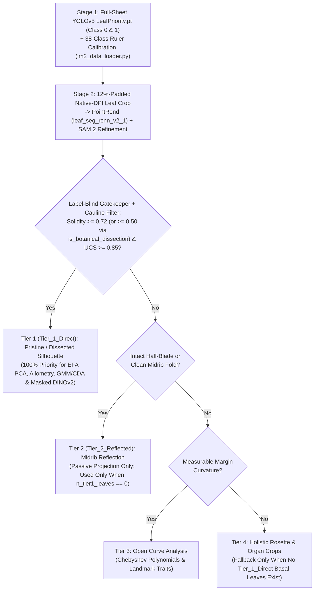

# Standard Operating Procedure (SOP)
## Automated High-Throughput Vegetative Phenotyping and Herbarium Triage Pipeline for the *Packera dubia* Complex
### Operationalizing Morphological Diagnosability under the Unified Species Concept
**Protocol Identifier:** `UNC-BOT-SOP-2026-04-REV4`  
**Principal Investigator:** J. Brandon Fuller (PhD Candidate, Department of Biology, University of North Carolina at Chapel Hill)  
**Faculty Advisor:** Dr. Alan S. Weakley (Director, UNC Herbarium [NCU]; UNC Biology)  
**Target Taxa:** *Packera dubia* (Spreng.) Trock & Mabb. Complex (Asteraceae: Senecioneae) and allied lineages (*P. anonyma*, *P. plattensis*, *P. paupercula*)

---

## 1. Executive Summary & Purpose

This Standard Operating Procedure establishes the protocol for an **Automated High-Throughput Vegetative Phenotyping and Herbarium Triage Pipeline** applied to the taxonomically recalcitrant ***Packera dubia* (Spreng.) Trock & Mabb. complex** (Asteraceae: Senecioneae) across Eastern and Central North America.

The pipeline operationalizes morphological diagnosability within the theoretical framework of the **Unified Species Concept (USC; de Queiroz 2007)**. Under the USC, species are conceptualized as separately evolving metapopulation lineages; morphological diagnosability, reproductive isolation, ecological divergence, and monophyly serve as secondary operational criteria that arise contingently along the speciation continuum. Because vegetative morphology in *Packera* has historically been obscured by phenotypic plasticity, developmental heterophylly, and pervasive herbarium misidentifications, automated high-throughput vegetative morphometrics serves as a rigorous, objective screening and triage engine.

Vegetative phenotyping is not interpreted in isolation, but is explicitly evaluated in concert with:
1. **Reproductive Macro-Morphology:** Capitulum aspect ratios (involucre height to width), phyllary series and count, and ray/disc floret dimensions.
2. **Cytotaxonomic Cytotypes:** Chromosome numbers and polyploid series ($2n = 44, 46, 88$; Kowal 1975) that characterize distinct evolutionary lineages in southeastern Senecioneae.
3. **Reduced-Representation nextRAD Phylogenomics:** High-density single nucleotide polymorphism (SNP) datasets capable of discerning deep divergence, hybrid reticulation, and ancestral polymorphism.
4. **Fine-Grain (10 m – 30 m) Soil, Bedrock & Rock-Outcrop Validation:** A multi-tier 10 m – 30 m edaphic and micro-topographic stack cached persistently in `data/environmental/fine_grain_edaphic_cache.csv`—integrating 50 m-buffered 1:24,000 USDA-NRCS SSURGO vector map units (`ssurgo_rock_outcrop_pct`, `ssurgo_bedrock_depth_cm`, `ssurgo_aws_0_50cm`), 30 m POLARIS probabilistic soil grids (`polaris_30m/`), 100 m SOLUS100 bedrock depth and coarse fragment grids (`solus_100m/`: `resdept`, `fragvol`), 10 m – 30 m USGS 3DEP micro-topography (`topo_tpi_30m`, `topo_roughness_30m`, `topo_slope_deg`, `topo_twi_30m`), and 250 m SoilGrids gap-free fallback—resolving localized edaphic endemics (e.g., granitic flatrocks, diabase glades, ultramafic barrens).

---

## 2. Two-Stage Organ Detection, Four-Tiered Basal Leaf Extraction & Tier-1 Pure Priority EFA Protocol

To resolve severe foliar crowding and press damage in herbarium rosettes without discarding irreplaceable vouchers, candidate organs are extracted via a **two-stage LeafMachine2 + PointRend + SAM 2 architecture** (Weaver et al. 2024) and routed through a **100% label-blind 4-tiered geometric hierarchy**:

- **Stage 1 (Full-Sheet Detection & Ruler Calibration):** Stock LeafMachine2 YOLOv5 `LeafPriority.pt` (11-class organ detector) processes both `Class 0` (`leaf_whole`) and `Class 1` (`leaf_partial`) candidate boxes to capture rosette-attached basal blades on native-DPI (`3753x5634`) scans, while pre-filtering upper-sheet cauline boxes (`cy < 0.40 * sheet_h`) and tiny fragments (`max(bh, bw) < int(200 * scale_f)`). Paired with the 38-class Ruler Detector (`scripts/vision/lm2_data_loader.py`) for empirical scale conversions (`pixels_per_mm`, `is_calibrated_mm`).
- **Stage 2 (Cropped Leaf Segmentation & SAM 2 Refinement):** Candidate leaf bounding boxes are cropped at native DPI with 12% padding, segmented via fine-tuned Detectron2 PointRend (`leaf_seg_rcnn_v2_1`), refined at sub-pixel margin resolution via automated prompt-guided SAM 2 (`--sam2-refine`), and spatially clustered into distinct individuals via DBSCAN (`plant_individual_id`).
- **Post-Gatekeeper Basal-Leaf Filtering, Strengthened Cauline/Stem Rejection & Top-6 Voucher Cap:** High-DPI basal candidates enforce `cy_rel >= 0.42`, minimum area floors (`>= 12000 * scale_f^2` for Tier 1, `>= 18000 * scale_f^2` and `cy_rel >= 0.48` for Tier 2), boxy clump rejection (`min(w,h)/max(w,h) > 0.78` when `solidity < 0.84`), sheet-relative area floor (`>= 0.28 * max_sheet_area`), and a top-6 basal leaves per voucher cap ranked by $Q = \text{solidity} \cdot \text{ucs} \cdot \sqrt{\text{area}}$ with automatic disk cleanup of dropped mask and contour files. Crucially, the strengthened anatomical filter `is_cauline_or_stem_contaminant()` rejects upper-stem sessile/clasping cauline bracts (`aspect_ratio > 3.8` and `solidity < 0.78`, or displaced `> 2.2 * med_rosette_radius` above the basal rosette zone) even on herbarium sheets where capitula were not detected (`capitula_count == 0`).

1. **Tier 1 (`"Tier_1_Direct"` — Direct Pristine & Label-Blind Dissected Extraction):** Fully intact basal leaves meeting Solidity $\ge 0.72$ and Unoccluded Completeness Score ($\text{UCS} \ge 0.85$) are segmented directly into closed binary masks after automated petiole trimming (`trim_slender_petiole()`, `trim_petiole_tail`, with broad cordate base protection). Resolution-adaptive cross-sectional width profiling (`w_span = max(min(max(h, w), 350), int(0.65 * max(h, w)))` in `_sample_cross_sectional_widths()` and `trim_petiole_tail()`) ensures native-DPI basal blades ($>700\text{ px}$ wide) are never truncated, while resolution-scaled petiole width thresholds (`eff_max_petiole_w` when `axis_len > 450.0` in `_disambiguate_base_apex_endpoints()`, and `max_petiole_width = max(16.0, 0.105 * blade_width_est)` / `cordate_guard_w = max(..., 0.135 * blade_width_est)` when `blade_width_est > 250.0 and min(h, w) > 500` in `trim_petiole_tail()`) preserve exact backward compatibility on $400 \times 400$ synthetic unit-test fixtures. Spatial rosette centroids (`rosette_centroids_by_pid` in `02_segment_and_extract.py`) are wired via `rosette_centroid` into `classify_and_route_leaf()` and `compute_geometric_metrics()`. Low-solidity leaves ($0.50 \le \text{Solidity} < 0.72$) are evaluated by `is_botanical_dissection()`, a **100% label-blind** geometric gatekeeper (with legacy `taxon_has_lyrate_tendency` completely removed) that verifies paired bilateral convexity-defect sinuses ($d_{\text{sinus}} / W_{\text{blade}} \ge 0.08$) and smooth non-jagged sinus boundaries to admit genuinely pinnatifid/lyrate blades while rejecting torn or occluded leaves.
2. **Tier 2 (`"Tier_2_Reflected"` — Hemi-Blade Bilateral Symmetry Reflection & Tier-1 Pure Priority):** Leaves folded cleanly along the midrib (`detect_folded_leaf()` requiring `has_diagonal_crease and solidity < 0.72`) or partially occluded leaves preserving an intact half-blade from `p_base` to `p_apex` are cleaved along the midrib vector and reflected across that axis in OpenCV to reconstruct a synthetic bilateral silhouette.
   - **Symmetric Harmonic Decomposition ($A_n, D_n$), Tier-1 Pure PCA Fitting & `RRPP` Reflection Parity:** In standard EFA (Kuhl and Giardina 1982), four coefficients ($A_n, B_n, C_n, D_n$) are estimated per harmonic. Coefficients $A_n$ and $D_n$ encode the mathematically symmetric component of outline variation relative to the midrib, whereas $B_n$ and $C_n$ represent asymmetric components (fluctuating asymmetry, pressing distortions, mechanical shearing). Analyzing the symmetric harmonic component ($A_n, D_n$) via `Momocs::rm_asym(ef)` eliminates fluctuating asymmetry artifacts and guarantees parity between Tier 1 pristine and Tier 2 reflected leaves, verified in `03_fourier_extractor.R` via high-speed C-level randomized residual permutation PERMANOVA (`RRPP::lm.rrpp()`, Collyer & Adams 2018; with automatic fallback to `vegan::adonis2()`). Voucher metadata merge occurs **prior to PCA** so both `Sym_PC1`–`Sym_PC5` and primary `PC1`–`PC5` use authority- and quality-weighted covariance eigendecomposition (`stats::cov.wt(..., wt = tier_wt * leaf_quality_weight)`) **fitted strictly on intact `Tier_1_Direct` contours (`t1_pca_mask`)**, projecting `Tier_2_Reflected` contours passively so synthetic mirrored outlines never warp the principal axes. Segment-level quality defenses compute bilateral asymmetry ratio (`pct_asymmetry`), harmonic roughness (`harmonic_roughness`, harmonics $n \ge 6$ vs. $n=1..3$), and gate outliers (`is_contour_outlier`: `pct_asymmetry > 0.22 | harmonic_roughness > 0.15`), exporting continuous `leaf_quality_weight` in `fourier_pcs.csv`.
   - **Tier-1 Pure Priority Aggregation Rule (`morph_tier_source`):** In `leaf_efa_harmonics.csv`, whenever a voucher has `n_tier1_leaves >= 1`, its specimen-level median harmonics and PCs are computed **100% from its `Tier_1_Direct` leaves** (`morph_tier_source = "Tier_1_Pure"`), completely ignoring any `Tier_2_Reflected` leaves on that sheet. `Tier_2_Reflected` contours are used only as a passive fallback when `n_tier1_leaves == 0` (`morph_tier_source = "Tier_2_Fallback"`).
3. **Tier 3 (Open-Outline Analysis):** Damaged rosettes lacking a full half-blade are evaluated using orthogonal polynomials (`Momocs::opoly`) and scalar caliper dimensions.
4. **Tier 4 & Background-Masked `Tier_1_Direct` Basal-Leaf Vision XAI (`05_cleanlab_vision_xai.py`):** Per-individual basal leaf crops (`data/cropped_patches/basal_leaves_raw/{catalogNumber}_leaf{id}.jpg`), capitula (`capitula/`), and fallback rosette crops (`rosettes_dense/`) are extracted in Step 02. In Step 05, the vision pipeline **never loads whole-clump `rosettes_dense/` stem crops when `extracted_leaf_manifest.csv` is present**; instead, it filters strictly to verified `Tier_1_Direct` basal leaf crops, dilates each leaf's binary mask (`masks/tier1_intact/{catalogNumber}_leaf{id}.png`) by 5 px (`apply_tier1_leaf_mask_to_rgb`), and replaces exterior stems, cauline bracts, and labels inside the bounding box with neutral herbarium paper RGB (`[242, 239, 230]`) before computing CIE Lab luminance/saturation (`surface_orientation`), 768-d DINOv2 embeddings, Cleanlab `ConfidentLearning`, and `GradCAM_audit_panel.png`.

### Mathematical Alignment, Base-to-Apex Homologization & Within-Species Allometry
- **Base-to-Apex Polarity Disambiguation & Homologization (`norm = FALSE, start = FALSE`):** Rather than delegating outline normalization to `Momocs::efourier(..., norm = TRUE)` (which aligns the first harmonic ellipse major axis and induces $180^\circ$ polarity flips between obovate *P. anonyma* and ovate *P. dubia* leaves), `compute_geometric_metrics()` disambiguates `p_base` (petiole attachment) vs. `p_apex` (lamina tip) via terminal stalk width tapering across the terminal $5\%$–$15\%$ zones of the major axis (`w_span`) and spatial rosette centroid proximity (`rosette_centroid`). Contours are standardized to counter-clockwise winding, anchored with **Index 0 at `p_base` via `petiole_attachment_pt=p_base` across all `resample_normalized_contour()` calls** (Tier 1, folded, and Tier 2 reflected leaves), rotated so $\overrightarrow{p_{\text{base}} p_{\text{apex}}}$ lies along the $+X$ axis, and scaled **isotropically** by $\max(\text{span}_x, \text{span}_y)$ (preserving oriented blade aspect ratio `Momocs::coo_lw`). In `03_fourier_extractor.R`, outlines are centered and scaled (`coo_center %>% coo_scale`) and decomposed via **`Momocs::efourier(..., norm = FALSE, start = FALSE)`** to preserve true base-to-apex polarity.
- **Calibrated Millimeter Centroid Size, `RRPP` Allometric Trajectories & `Tier_1_Pure`-Restricted Pooled Within-Species Allometry:** Physical millimeter Centroid Size ($\text{CS}_{\text{mm}} = \text{CS}_{\text{px}} / \text{pixels\_per\_mm}$, filtered strictly by `is_calibrated_mm == TRUE`) is computed prior to unit-centroid-size scaling. In `04_gmm_morphotools.R`, `test_and_correct_allometry()` restricts model fitting strictly to **`Tier_1_Pure` vouchers (`n_tier1_leaves >= 1`)** and uses `RRPP::lm.rrpp()` and `RRPP::pairwise()` (Collyer & Adams 2018; with automatic fallback to `vegan::adonis2()`) for C-level randomized residual permutation testing of `Y ~ log_centsize * scientificName` on calibrated Tier 1 Gold anchors, exporting pairwise allometric trajectory angle ($\theta$) and magnitude comparisons to `outputs/reports/allometry_pairwise_trajectories.csv`. Size-dependent shape variation is then removed via **authority-weighted pooled within-species allometric regression** (`stats::lm(Y ~ log_centsize + scientificName, weights = authority_weight)`) (Klingenberg 2016), preventing interspecific size differences from being erased alongside ontogenetic scaling.
- **Composite `(catalogNumber, plant_individual_id)` Aggregation:** To avoid statistical pseudoreplication while preserving distinct individuals mounted on multi-plant herbarium sheets, leaf harmonic vectors are aggregated into median centroid profiles grouped per **`(catalogNumber, plant_individual_id)`** using within-plant quality weights (`leaf_quality_weight`) and Tier-1 Pure Priority (`morph_tier_source`), maintaining a $1.0\times$ voting weight per voucher collection event in CDA/GMM.
- **Empirical Gatekeeper Calibration:** Fold-detection chords and lyrate sinus depth thresholds are calibrated empirically against expert-labeled SAM 2 COCO annotations via `python main.py calibrate-geometry`.

---

## 3. Multi-Tiered Herbarium Misidentification Mitigation Architecture

Digital botanical aggregator audits reveal that 20% to 40% of public occurrences in the *P. dubia* complex are misidentified, nomenclaturally outdated, or ecologically misplaced. The pipeline implements six sequential mitigation tiers with a canonical authority weighting hierarchy (`authority_weight`: `Tier_1_Gold = 3.0`, `Tier_2_Silver = 1.5`, `Tier_3_Bronze = 0.5`), taxon exclusion (`--exclude-taxon`), and Dual-Strategy Single-Taxon execution modes:

* **Tier 1 — Taxonomic Authority Stratification & Canonical Weighting (`3.0 / 1.5 / 0.5`):**
  - **Tier 1 (`Tier_1_Gold`, `authority_weight = 3.0`):** Nomenclatural types or determinations signed by recognized monographers (T.M. Barkley, D.K. Trock, R.R. Kowal, A.S. Weakley, J.F. Bain, A.M. Mahoney, J.B. Fuller).
  - **Tier 2 (`Tier_2_Silver`, `authority_weight = 1.5`):** Vouchers from established research herbaria (NCU, GA, US, NY, BRIT, MO, WIS, VDB, FLAS) with complete data.
  - **Tier 3 (`Tier_3_Bronze`, `authority_weight = 0.5`):** Unverified general floristic collections. Excluded from initial GMM/CDA parameterization and down-weighted (`0.5`) in weighted regressions and Random Forests.
  - **Taxon Filtering & Dual-Strategy Single-Taxon Modes (`run_pipeline.sh`):** Supports `--exclude-taxon "<TAXON>"` (e.g., `--exclude-taxon "Packera plattensis"`, dynamically filtering Step 01–02 manifests and remapping Step 05 class indices to contiguous `0..K-1` `active_taxa`), **Strategy 1 (`--focal-taxon "<TAXON>" --gold-anchors 30`)** (calibrating Steps 04–06 on all focal taxon vouchers plus $N$ `Tier_1_Gold` anchors per outgroup species before filtering Step 07 strictly to the focal taxon), and **Strategy 2 (`--focal-taxon "<TAXON>" --intraspecific-mode`)** (running strictly on a single species `n_unique_taxa == 1` with zero outgroup specimens, switching Steps 04–06 from `species_standardized` to label-blind GMM morphotypes `Morphotype_K1..K_n` or geographic/edaphic ecotypes).
* **Tier 2 — Label-Blind Unsupervised Phenotypic Discovery on `Tier_1_Pure` Gold/Silver Anchors (`clustvarsel`, `cov.rob` & `mclust`):**
  Symmetric EFA harmonics (`Sym_PC1`–`Sym_PC5`) are modeled without prior taxon labels. In `04_gmm_morphotools.R`, `run_gmm_cluster_analysis()` fits `clustvarsel::clustvarsel()` (Scrucca & Raftery 2018) and `mclust::Mclust()` exclusively on high-reliability `Tier_1_Pure` (`n_tier1_leaves >= 1`) `Tier_1_Gold` + `Tier_2_Silver` anchors (`!mahal_outliers` from `MASS::cov.rob`) with parsimonious covariance restriction (`EII, VII, EEI, VEI, EVI, VVI` when `n_samples / n_pcs < 5`), then projects `Tier_3_Bronze` and `Tier_2_Fallback` vouchers onto `gmm_fit` via `predict(gmm_fit, newdata = X_pcs)` so noisy or reflected sheets do not bloat cluster covariances or inflate `gmm_uncertainty`.
* **Tier 3 — 3D Passive Sample Projection & Mahalanobis Trimming in CDA (`MorphoTools2`):**
  In `run_canonical_discriminant_analysis()`, discriminant axes are trained strictly on `Tier_1_Pure` (`n_tier1_leaves >= 1`) `Tier_1_Gold` ($w = 3.0$) and `Tier_2_Silver` ($w = 1.5$) anchors with per-taxon 95% chi-square Mahalanobis outlier trimming (`qchisq(0.95, df = p)`), uniform class priors (`rep(1/g, g)`), and honest Leave-One-Out Cross-Validation (`loocv_accuracy`), while `Tier_3_Bronze` and `Tier_2_Fallback` vouchers are projected passively. Exports 3D canonical scores (`can1`, `can2`, `can3`, with orthogonalized `PC3`/`PC2` fallback when $g - 1 < 3$) alongside `cda_predicted_taxon`, `cda_posterior_prob`, `cda_second_posterior_prob`, and `cda_posterior_margin`. All PCA (`PC1 x PC2 x PC3`, `Sym_PC1 x Sym_PC2 x Sym_PC3`) and CDA (`Can1 x Can2 x Can3`) ordinations are rendered in 3D via `plot_3d_scatter_box()` in `pub_figures_utils.R` using the **Universal Unfilled (Hollow) Scatterplot Marker Standard** (`pch = 1, 2, 5, 0` / `bg = NA` in base R; `shape = 21..25, fill = NA` in `ggplot2`; `facecolors = 'none'` in `matplotlib`).
* **Tier 4 — Fine-Grain (10 m – 30 m) Soil, Bedrock & Outcrop ENM Stack (`06_multimodal_spatial_rf.R` + `edaphic_fine_grain_utils.R`):**
  `06_multimodal_spatial_rf.R` extracts and caches a **10 m – 30 m rock-outcrop and edaphic predictor stack** in `data/environmental/fine_grain_edaphic_cache.csv`:
  1. **50 m-Buffered USDA-NRCS SSURGO Queries (`soilDB::SDA_query` with WKT `ST_Buffer`):** `ssurgo_rock_outcrop_pct` (matching *Rock outcrop*, *Wake*, *Louisburg*, *Ashlar*, *Rion*, *Wateree*, *Wilkes*, *Iredell*, *Mecklenburg*, etc.), `ssurgo_bedrock_depth_cm`, `ssurgo_aws_0_50cm`, and component-weighted surface pH, % sand, % clay, OM, and CEC.
  2. **30 m POLARIS Probabilistic Soil Grids (`data/environmental/polaris_30m/`) & 100 m SOLUS100 (`data/environmental/solus_100m/`):** 30 m `ph`, `sand`, `clay`, `om`, `bd`, `ksat` (`0–5` and `5–15 cm`) plus `resdept` (depth to lithic bedrock restriction) and `fragvol` (coarse rock fragment volume), fused into `fine_soil_ph`, `fine_soil_sand`, `fine_soil_clay`, and `fine_bedrock_depth_cm` with 250 m SoilGrids as gap-free fallback.
  3. **10 m – 30 m USGS 3DEP Micro-Topography (`elevatr` + `terra::terrain`):** `topo_tpi_30m` (Topographic Position Index for convex granite domes), `topo_roughness_30m`, `topo_slope_deg`, and `topo_twi_30m` (Topographic Wetness Index for flatrock seepage rims).
  Uses authority-weighted (`3.0 / 1.5 / 0.5`) circular phenology ($\sin / \cos \text{DOY}$) and edaphic envelopes in `evaluate_multimodal_concordance()`, centers Hopkins' Bioclimatic Law baseline at `pred_at_min_lat + 4.0 * (decimalLatitude - min_lat)`, passes `case.weights = case_wts` (`3.0 / 1.5 / 0.5`) into `ranger::ranger()` (Wright & Ziegler 2017), partitions variance via `vegan::varpart()`, evaluates spatially blocked 5-fold cross-validation accuracy via `blockCV::cv_spatial()` ($0.5^\circ \times 0.5^\circ$ grid blocks, exporting `spatial_block_cv_acc` alongside `OOB_Accuracy`; Valavi et al. 2019), and quantifies Schoener's $D$ and Warren's $I$ niche overlap in 2D kernel-smoothed `PCA-env` space via `ecospat` (Broennimann et al. 2012).
* **Tier 5 — Confident Learning on Masked `Tier_1_Direct` Basal Leaves, DINOv2 ViT Attribution & Taxon-Controlled Batch-Effect Audits:**
  - **Confident Learning (`cleanlab`) & ViT Patch-Token Saliency:** `05_cleanlab_vision_xai.py` masks `Tier_1_Direct` basal leaf crops (`basal_leaves_raw/`) with 5 px dilated `tier1_intact` binary masks (`apply_tier1_leaf_mask_to_rgb`) to replace exterior stems, cauline bracts, and labels with neutral herbarium paper RGB (`[242, 239, 230]`), L2-normalizes 768-d DINOv2 embeddings prior to fold-internal `StandardScaler`, applies authority weights (`3.0 / 1.5 / 0.5`) combined with `class_weight="balanced"` in `LogisticRegression`, flags label errors ($C_{\text{error}} > 0.85$) via `cleanlab.filter.find_label_issues()`, exports `tomentum_taxon_discordance` alongside `is_label_corrupted` while controlling for foliar `surface_orientation` (`abaxial` vs. `adaxial`), and computes genuine **DINOv2 ViT final-layer patch-token saliency attribution** (`forward_features()["x_norm_patchtokens"]` projected onto classifier weights $\mathbf{w}_c$).
  - **Taxon-Controlled Institutional Batch-Effect Controls:** In `04_gmm_morphotools.R`, `audit_institutional_batch_effects()` partials out taxonomic composition (`species_standardized`) before testing `institutionCode` so herbaria enriched in specific endemic taxa are not falsely flagged as digitization artifacts ($R^2 < 0.05$).
* **Tier 6 — Non-Georeferenced Voucher Coalescing (`98.4%` Completion) & Misidentification vs. Hybrid vs. Cryptic Disambiguation (`06`–`07`):**
  - **Non-Georeferenced Coalescing:** Step 07 (`07_triage_dashboard_synthesis.R`) enforces `validate_upstream_contracts()`, joins `multimodal_conflict_flags.csv` (georeferenced subset), and coalesces non-georeferenced vouchers directly from `morphometric_flags.csv` (Step 04) and `label_noise_audit.csv` (Step 05) using `unique(c("catalogNumber", ...))`, achieving **98.4% voucher completion (`5,117 / 5,201` vouchers in full production)** rather than dropping non-georeferenced herbarium sheets.
  - **Pure Misidentification vs. Hybrid Swarm:** Cross-modal known-species reassignments (`both_alt_agree`, `morph_edaph_alt_agree`, `vis_edaph_alt_agree`, or `is_severe_misid`) are evaluated **BEFORE** `Hybrid_Intergrade_Swarm` so sympatric misidentifications are routed to `"Severe_Triple_Stream_Conflict"` $\rightarrow$ `Misidentification_Severe` $\rightarrow$ `Misidentification_Reassign` rather than false hybrids.
  - **Reassign vs. Putative Cryptic Species (`is_crypt`):** `Putative_Cryptic_Species` requires **`morph_tier_source == "Tier_1_Pure"` (`n_tier1_leaves >= 1`)**, `morphometric_outlier_flag == TRUE`, absence of high-confidence known-taxon assignment (`cda_posterior_prob < 0.70` and `vision_c_error < 0.85`), and placement in peripheral GMM clusters (`gmm_cluster > 4` with $|\Delta\text{DOY}| \ge 14.0\text{ d}$) or extreme allochronic flowering divergence ($|\Delta\text{DOY}| \ge 21.0\text{ d}$ with `cda_posterior_prob < 0.55`).

---

## 4. Multi-Evidence Taxonomic Decision Matrix

| Taxonomic Status | Vegetative Morphometrics (Symmetric EFA / GMM) | Reproductive Macro-Morphology (Capitulum Aspect Ratio) | Cytology ($2n$ Cytotype; Kowal 1975) | Phylogenomics (nextRAD SNPs) | Micro-Edaphics & Niche (SSURGO / POLARIS / SOLUS100 / 3DEP) | Actionable Taxonomic Outcome |
| :--- | :--- | :--- | :--- | :--- | :--- | :--- | :--- |
| **Distinct Species** | Distinct GMM cluster ($2\Delta\text{BIC} > 10$); LDA accuracy $\ge 90\%$ | Distinct capitulum height:width ratio ($p < 0.01$) | Fixed diploid ($2n = 44$ or $46$) or tetraploid ($2n = 88$) | Reciprocally monophyletic or diagnostic SNP cluster | Distinct 10m–30m rock-outcrop / shallow lithic bedrock zone ($p < 0.01$; $D < D_{\text{null}}$) | Formal species-level recognition / resurrection under USC |
| **Subspecies / Variety** | Moderate LDA accuracy (75–89%); distinct Fourier outline mean | Conserved capitulum aspect ratio; slight size shift | Shared cytotype with nominal lineage ($2n = 44$ or $46$) | Clinal or regional genetic cluster with shallow divergence | Regional climatic or substrate differentiation ($D \approx 0.40 - 0.65$) | Varietal / subspecific circumscription (*P. dubia* var. *nov.*) |
| **Ecophenotypic Variant** | Continuous intergradation; single GMM component ($K=1$) | Overlapping capitulum morphology across habitats | Identical cytotype ($2n = 44$ or $46$) | Panmictic with parental populations; no lineage sorting | Continuous soil cline without sharp lithological break ($p > 0.05$) | Synonymy under polymorphic *Packera dubia* |
| **Hybrid Swarm / Reticulation** | Intermediately plotting passive samples; high entropy ($H \ge 0.50$) | High floral variation; irregular phyllary series | Aneuploid, triploid, or mixed tetraploid ($2n = 46, 68, 88$) | Admixed genomic ancestry; network reticulation | Restricted to ecotonal contact zones or disturbed ecotones | Designation as nothospecies (*Packera* $\times$*hybrid*) |

---

## 5. Quality Assurance Checklist

- [x] **Taxonomic Authority Verification & Weighting (`3.0 / 1.5 / 0.5`):** All Tier 1 vouchers authenticated against recognized monographer annotations; canonical authority weights (`Tier_1_Gold = 3.0`, `Tier_2_Silver = 1.5`, `Tier_3_Bronze = 0.5`) propagated across Steps 03–06.
- [x] **Label-Blind Leaf Extraction & Strengthened Cauline Rejection (`is_cauline_or_stem_contaminant`):** Stage 1 captures Class 0 and 1 candidate boxes; high-DPI cauline/fragment pre-filtering; post-gatekeeper basal filtering (`cy_rel >= 0.42`, min area floors, boxy clump rejection, top-6 cap with disk cleanup); `is_cauline_or_stem_contaminant()` rejects upper-stem sessile/clasping cauline bracts (`aspect_ratio > 3.8` & `solidity < 0.78`, or displaced `> 2.2 * med_rosette_radius` above basal rosette zone) even when `capitula_count == 0`; single leaves pass Solidity $\ge 0.72$ (or $100\%$ label-blind `is_botanical_dissection()` sinus defect thresholds $\ge 0.50$) and UCS $\ge 0.85$; pressing folds detected via diagonal-crease logic (`has_diagonal_crease and solidity < 0.72`).
- [x] **Resolution-Adaptive Geometry, Base Homologization & Tier-1 Pure Priority EFA:** Resolution-adaptive width profiling (`w_span = max(min(max(h, w), 350), int(0.65 * max(h, w)))`), resolution-scaled petiole width thresholds (`eff_max_petiole_w`, `max_petiole_width`, `cordate_guard_w`), and spatial rosette centroid polarity disambiguation (`rosette_centroids_by_pid` $\rightarrow$ `rosette_centroid`); contours anchored with `petiole_attachment_pt=p_base` in all `resample_normalized_contour()` calls, rotated along $\overrightarrow{p_{\text{base}} p_{\text{apex}}}$, scaled isotropically by $\max(\text{span}_x, \text{span}_y)$, and decomposed via `Momocs::efourier(norm = FALSE, start = FALSE)` into symmetric components ($A_n, D_n$) via `Momocs::rm_asym(ef)` with weighted covariance eigendecomposition (`stats::cov.wt`) fitted **strictly on `Tier_1_Direct` contours** (`t1_pca_mask`) and **Tier-1 Pure Priority aggregation** (`n_tier1_leaves >= 1` $\rightarrow$ 100% `Tier_1_Direct`, `morph_tier_source = "Tier_1_Pure"`).
- [x] **`Tier_1_Pure`-Restricted Allometry, Anchor-Fitted GMMs, 3D Passive LOOCV CDA & Taxon-Controlled Institutional Audits:** Pooled within-species allometry (`stats::lm(Y ~ log_centsize + scientificName, weights = authority_weight)`), `clustvarsel`/`mclust::Mclust()` GMM fitting, and supervised CDA training anchors restricted strictly to `Tier_1_Pure` vouchers (`n_tier1_leaves >= 1`) with passive `predict()` for `Tier_2_Fallback` and `Tier_3_Bronze`; 3D canonical scores (`can1`, `can2`, `can3`) exported and rendered via `plot_3d_scatter_box()` with unfilled (hollow) scatterplot markers; `audit_institutional_batch_effects()` partials out `species_standardized` before testing `institutionCode`.
- [x] **Phenological Verification & Centered Hopkins Baseline:** 3-tier optical biomarker classification of floral heads confirms anthesis before calculating latitudinal anomalies ($\Delta\text{DOY}$) against the centered Hopkins' Bioclimatic Law baseline (`pred_at_min_lat + 4.0 * (decimalLatitude - min_lat)`).
- [x] **Background-Masked `Tier_1_Direct` Basal-Leaf Vision XAI (`[242, 239, 230]`):** Never loads whole-clump `rosettes_dense/` stem crops when `extracted_leaf_manifest.csv` is present; masks `basal_leaves_raw/` crops with 5 px dilated `tier1_intact` binary masks (`apply_tier1_leaf_mask_to_rgb`) to replace exterior stems, bracts, and labels with neutral herbarium paper RGB (`[242, 239, 230]`); L2-normalized 768-d DINOv2 embeddings with authority weights (`3.0 / 1.5 / 0.5`), `class_weight="balanced"`, and dynamic `0..K-1` `active_taxa` remapping under `--exclude-taxon`.
- [x] **10 m – 30 m Fine-Grain Soil, Bedrock & Outcrop ENM Stack (`fine_grain_edaphic_cache.csv`):** 50 m-buffered USDA-NRCS SSURGO (`ssurgo_rock_outcrop_pct`, `ssurgo_bedrock_depth_cm`, `ssurgo_aws_0_50cm`), 30 m POLARIS (`polaris_30m/`), 100 m SOLUS100 (`solus_100m/`: `resdept`, `fragvol`), and 10 m – 30 m USGS 3DEP micro-topography (`topo_tpi_30m`, `topo_roughness_30m`, `topo_slope_deg`, `topo_twi_30m`) fused into `fine_soil_ph`, `fine_soil_sand`, `fine_soil_clay`, and `fine_bedrock_depth_cm` with 250 m SoilGrids gap-free fallback; multithreaded `ranger::ranger(..., case.weights = case_wts)` spatial RF with `blockCV::cv_spatial()` $0.5^\circ \times 0.5^\circ$ 5-fold spatial block CV (`spatial_block_cv_acc`).
- [x] **Non-Georeferenced Coalescing (`98.4%` Completion) & Triage Disambiguation:** Enforces `validate_upstream_contracts()`; coalesces non-georeferenced vouchers from `morphometric_flags.csv` and `label_noise_audit.csv` (`5,117 / 5,201` vouchers completed); evaluates `both_alt_agree` / `is_severe_misid` BEFORE `Hybrid_Intergrade_Swarm` ($\rightarrow$ `Misidentification_Reassign`) and requires `morph_tier_source == "Tier_1_Pure"` (`n_tier1_leaves >= 1`) for `Putative_Cryptic_Species`.
- [x] **Canonical Two-Tier Storage (`data/` vs. `runs/<RUN_ID>/`), CLI Modes & 3D/Hollow-Marker Publication Figure Suite:** Invariant Step 01–02 assets stored in canonical root `data/` and automatically seeded/symlinked into `runs/<RUN_ID>/` (`--run-id`, `--skip-harvest`, `--start-step`, `--exclude-taxon`, `--focal-taxon`, `--gold-anchors`, `--intraspecific-mode`).

---

## 6. References

1. Barkley, T. M. 1988. Variation among the Senecioneae (Asteraceae) in North America. *Brittonia* 40(2): 211–221. doi: 10.2307/2807005
2. Broennimann, O., et al. 2012. Measuring ecological niche overlap from occurrence and spatial environmental data. *Global Ecology and Biogeography* 21(4): 481–497.
3. Collyer, M. L., and D. C. Adams. 2018. RRPP: An R package for fitting linear models to high-dimensional data using residual randomization. *Methods in Ecology and Evolution* 9(7): 1772–1779.
4. de Queiroz, K. 2007. Species concepts and species delimitation. *Systematic Biology* 56(6): 879–886. doi: 10.1080/10635150701701083
5. Klingenberg, C. P. 2016. Size, shape, and form: concepts of allometry in geometric morphometrics. *Development Genes and Evolution* 226(3): 113–137. doi: 10.1007/s00427-016-0539-8
6. Kowal, R. R. 1975. Systematics of *Senecio aureus* and allied species on the Gaspé Peninsula, Quebec. *Memoirs of the Torrey Botanical Club* 23(2): 1–113.
7. Kuhl, F. P., and C. R. Giardina. 1982. Elliptic Fourier features of a closed contour. *Computer Graphics and Image Processing* 18(3): 236–258. doi: 10.1016/0146-664X(82)90034-X
8. Northcutt, C. G., L. Jiang, and I. L. Chuang. 2021. Confident Learning: Estimating Uncertainty in Dataset Labels. *Journal of Artificial Intelligence Research* 70: 1373–1411. doi: 10.1613/jair.1.12125
9. Scrucca, L., and A. E. Raftery. 2018. clustvarsel: A package implementing variable selection for Gaussian model-based clustering in R. *Journal of Statistical Software* 84(1): 1–28.
10. Šlenker, M., P. Koutecký, and P. Marhold. 2022. MorphoTools2: an R package for multivariate morphometric analysis. *Bioinformatics* 38(10): 2954–2955. doi: 10.1093/bioinformatics/btac173
11. Trock, D. K. 2006. *Packera*. In Flora of North America Editorial Committee (eds.), *Flora of North America North of Mexico*, Vol. 20, 570–602. Oxford University Press, New York.
12. Valavi, R., J. Elith, J. J. Lahoz-Monfort, and G. Guillera-Arroita. 2019. blockCV: An R package for generating spatially or environmentally separated folds for k-fold cross-validation of species distribution models. *Methods in Ecology and Evolution* 10(2): 225–232.
13. Weaver, W. N., P. S. Ng, and R. LaFrance. 2024. LeafMachine2: Using machine learning to rapidly measure plant traits captured in herbarium specimens. *Applications in Plant Sciences* 12(1): e11545. doi: 10.1002/aps3.11545
14. Wright, M. N., and A. Ziegler. 2017. ranger: A fast implementation of random forests for high dimensional data in C++ and R. *Journal of Statistical Software* 77(1): 1–17.
