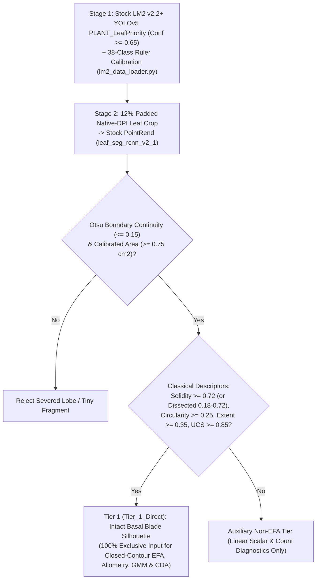

# Standard Operating Procedure (SOP)
## Automated High-Throughput Vegetative Phenotyping and Herbarium Triage Pipeline for the *Packera dubia* Complex
### Operationalizing Morphological Diagnosability under the Unified Species Concept
**Protocol Identifier:** `UNC-BOT-SOP-2026-04-REV5`  
**Principal Investigator:** J. Brandon Fuller (PhD Candidate, Department of Biology, University of North Carolina at Chapel Hill)  
**Faculty Advisor:** Dr. Alan S. Weakley (Director, UNC Herbarium [NCU]; UNC Biology)  
**Target Taxa:** *Packera dubia* (Spreng.) Trock & Mabb. Complex (Asteraceae: Senecioneae) and allied Eastern North American lineages (*P. anonyma*, *P. plattensis*, *P. paupercula*, *P. aurea*, *P. obovata*, *P. glabella*, *P. schweinitziana*, *P. millefolium*, *P. crawfordii*, *P. serpenticola*)

---

## 1. Executive Summary & Purpose

This Standard Operating Procedure establishes the protocol for an **Automated High-Throughput Vegetative Phenotyping and Herbarium Triage Pipeline** applied to the taxonomically recalcitrant ***Packera dubia* (Spreng.) Trock & Mabb. complex** (Asteraceae: Senecioneae) and allied Eastern North American species.

The pipeline operationalizes morphological diagnosability within the theoretical framework of the **Unified Species Concept (USC; de Queiroz 2007)** and **Integration by Congruence (Padial et al. 2010)**. Under the USC, species are conceptualized as separately evolving metapopulation lineages; morphological diagnosability, reproductive isolation, ecological divergence, and monophyly serve as secondary operational criteria that arise contingently along the speciation continuum. Because vegetative morphology in *Packera* has historically been obscured by phenotypic plasticity, developmental heterophylly, taphonomic indumentum abrasion, and pervasive herbarium misidentifications, automated high-throughput vegetative morphometrics serves as a rigorous, objective screening and triage engine evaluated in concert with:
1. **Reproductive Macro-Morphology & Anthesis Verification:** Capitulum aspect ratios (involucre height to width), phyllary series and count, ray/disc floret dimensions, and 3-tier optical anthesis staging.
2. **Cytotaxonomic Cytotypes:** Chromosome numbers and polyploid series ($2n = 44, 46, 88$; Kowal 1975) that characterize distinct evolutionary lineages in southeastern Senecioneae.
3. **Reduced-Representation nextRAD Phylogenomics:** High-density single nucleotide polymorphism (SNP) datasets capable of discerning deep divergence, hybrid reticulation, and ancestral polymorphism.
4. **$0\text{–}15\text{ cm}$ Rhizosphere, 10 m – 30 m Rock-Outcrop & USGS SGMC Bedrock Validation:** A persistent multi-scale edaphic and geologic stack cached in `data/environmental/fine_grain_edaphic_cache.csv`—integrating $0\text{–}15\text{ cm}$ trapezoidal rhizosphere depth-weighting (`(5 * v_0_5 + 10 * v_5_15) / 15`), 50 m-buffered 1:24,000 USDA-NRCS SSURGO vector map units (`ssurgo_rock_outcrop_pct`, `ssurgo_bedrock_depth_cm`, `ssurgo_aws_0_50cm`), 30 m POLARIS probabilistic soil grids (`polaris_30m/`), 100 m SOLUS100 bedrock depth and coarse fragment grids (`solus_100m/`: `resdept`, `fragvol`), 6-class USGS SGMC bedrock lithology (`sgmc_lithology_class`), 10 m – 30 m USGS 3DEP micro-topography (`topo_tpi_30m`, `topo_roughness_30m`, `topo_slope_deg`, `topo_twi_30m`), and 250 m SoilGrids gap-free fallback—paired with partitioned **Climatic ($D_{\text{clim}}, I_{\text{clim}}$) vs. Edaphic-Geologic ($D_{\text{edaph}}, I_{\text{edaph}}$)** Niche Equivalency and Background Similarity tests (Warren et al. 2008).

---

## 2. Phase 2 Protocol: Stock LeafMachine2 v2.2+, Boundary-Continuity Lobe Rejection & Classical Gatekeeping

Candidate organs are extracted out of the box using **stock LeafMachine2 v2.2+** (Weaver et al. 2024) without requiring custom fine-tuned PCD checkpoints or manual SAM 2 annotation, and routed through a **100% label-blind classical geometric gatekeeper**:

* **Stock LeafMachine2 v2.2+ Configuration (`configure_leafmachine2.py`):**
  - **Stage 1 (Full-Sheet Detection & Ruler Calibration):** Stock LeafMachine2 YOLOv5 `PLANT_LeafPriority` (`LeafPriority.pt`, `minimum_confidence_threshold: 0.65`) processes both `Class 0` (`leaf_whole`) and `Class 1` (`leaf_partial`) candidate boxes while enforcing `treat_leaflet_as_leaf_whole: False` (preventing individual lobes of pinnatifid *Packera* leaves from being segmented as standalone blades), `use_efds_for_png_masks: False` (exporting raw pixel-accurate PointRend binary masks without premature LM2 Fourier smoothing), and `do_apply_landmarks: False` (disabling angiosperm venation landmarking). Paired with the 38-class Ruler Detector (`scripts/vision/lm2_data_loader.py`) for empirical scale conversions (`pixels_per_mm`, `is_calibrated_mm`).
  - **Stage 2 (Cropped Leaf Segmentation):** Candidate leaf bounding boxes are cropped at native DPI with 12% padding, segmented via stock Detectron2 PointRend (`leaf_seg_rcnn_v2_1`), and spatially clustered into distinct individuals via DBSCAN (`plant_individual_id`).
* **Otsu Boundary-Continuity Lobe Rejection (`is_truncated_lobe_or_leaflet`, `max_tissue_border_ratio: 0.15`):**
  - Inspects a 2-pixel perimeter band around the candidate bounding box using Otsu's threshold in CIE $L^*a^*b^*$ luminance space. If non-paper plant tissue occupies $> 15\%$ of the bounding-box perimeter (excluding a single narrow petiole exit $\le 12\%$ on one edge), the candidate is rejected as an unattached terminal lobe or severed fragment of a larger pinnatifid leaf.
* **Ruler-Calibrated Physical Blade Area Floor (`min_blade_area_cm2: 0.75`):**
  - When `is_calibrated_mm == True` and `pixels_per_mm > 0`, physical blade area $\text{Area}_{\text{cm}^2} = \text{area\_px} / (100 \cdot \text{pixels\_per\_mm}^2)$ must be $\ge 0.75\text{ cm}^2$.
* **Classical Dimensionless Descriptors & Dissection Gates (`Tier_1_Direct`):**
  - **Pristine / Lyrate-Entire Tier 1 (`Tier_1_Direct`):** Requires $\text{Solidity} \ge 0.72$, isoperimetric $\text{Circularity} = \frac{4\pi A}{P^2} \ge 0.25$, bounding-box $\text{Extent} = \frac{A}{W \cdot H} \ge 0.35$, and $\text{UCS} \ge 0.85$.
  - **Pinnatifid / Lyrate-Pinnatifid Tier 1 (`Tier 1 (Dissected)`):** Low-solidity blades in $0.48 \le \text{Solidity} < 0.72$ are routed into `Tier_1_Direct` via `is_botanical_dissection()` when paired bilateral convexity-defect sinuses ($d_{\text{sinus}} / W_{\text{blade}} \ge 0.08$) confirm genuine pinnatifid lobing.
  - **Bipinnatisect Tier 1 (`Tier 1 (Bipinnatisect)`):** Deeply dissected blades in $0.18 \le \text{Solidity} < 0.48$ (e.g., *Packera millefolium*) are routed into `Tier_1_Direct` when $\ge 4$ deep convexity-hull sinuses confirm bipinnatisect dissection.
* **Post-Gatekeeper High-DPI Basal Filtering & Strengthened Cauline/Stem Rejection (`is_cauline_or_stem_contaminant`):**
  - High-DPI basal candidates enforce `cy_rel >= 0.42`, minimum pixel area floors, boxy clump rejection (`min(w,h)/max(w,h) > 0.78` when `solidity < 0.84`), sheet-relative area floor (`>= 0.28 * max_sheet_area`), and a top-6 basal leaves per voucher cap ranked by $Q = \text{solidity} \cdot \text{ucs} \cdot \sqrt{\text{area}}$ with automatic disk cleanup. Furthermore, `is_cauline_or_stem_contaminant()` rejects upper-stem sessile/clasping cauline bracts (`aspect_ratio > 3.8` and `solidity < 0.78`, or displaced `> 2.2 * med_rosette_radius` above the basal rosette zone).

---

## 3. Phase 3 & 4 Protocol: Strict Tier-1 Closed-Contour EFA, Active/Passive Authority Split, Allometry & GMM/CDA

### 3.1 Strict `Tier_1_Direct` Closed-Contour EFA, Inertial Alignment & Unweighted OTU Medians (`03_fourier_extractor.R`)
* **Strict Tier 1 Closed-Contour Restriction:** Only intact `Tier_1_Direct` basal leaf contours enter `Momocs::efourier`. Folded or mirrored hemi-blades (`Tier_2_Reflected`) and open-curve polynomial approximations are **never** pooled into EFA harmonic matrices.
* **Inertial Axis Pre-Alignment (`Momocs::coo_alignxax`) with Suborbicular Guard:** Contours are anchored at `p_base` (`petiole_attachment_pt=p_base`), centered (`Momocs::coo_center`), and aligned along their major inertial axis via `Momocs::coo_alignxax()` whenever blade circularity $\le 0.75$ (preventing $90^\circ$ axis flips on suborbicular *P. obovata* / *P. aurea* leaves while locking $\overrightarrow{p_{\text{base}} p_{\text{apex}}}$ orientation via `coo_slidedirection("left")`).
* **Empirical Harmonic Power Calibration (`>= 99%` at $H = 12$):** `Momocs::calibrate_harmonicpower_efourier` verifies that $H = 12$ harmonics capture $\ge 99\%$ of cumulative contour shape power across the corpus before executing `Momocs::efourier(out_obj, nb.h = 12, norm = FALSE, start = FALSE)`.
* **Uniform Bilateral Symmetrization (Claude 2008):** `Momocs::rm_asym(ef)` is applied uniformly across all intact contours so primary morphospace (`Sym_PC1`–`Sym_PC5`) ordinates intrinsic bilateral lamina geometry ($A_n, D_n$) purged of taphonomic pressing curvature ($B_n, C_n$ retained as scalar `pct_asymmetry` and `asym_var`).
* **MCD Mahalanobis Outlier Filtering & Unweighted OTU Median Aggregation:** Anomalous contours are gated via Minimum Covariance Determinant (MCD) Mahalanobis distance (`MASS::cov.rob(..., method = "mcd")`, $\chi^2$ cutoff $p < 0.001$ combined with `pct_asymmetry > 0.22 | harmonic_roughness > 0.15`). Multi-leaf vouchers are aggregated to the Specimen / Operational Taxonomic Unit (`(catalogNumber, plant_individual_id)`) via **unweighted coordinate-wise median** harmonics and PCs (`morph_tier_source = "Tier_1_Pure"`).

### 3.2 Strict Active/Passive Determiner Authority Split & Empirical Dawid-Skene Weighting (`04_gmm_morphotools.R`)
To prevent large numbers of unverified aggregator vouchers from swamping specialist determinations, the pipeline enforces a **strict active/passive authority split** (Šlenker et al. 2022; Dawid & Skene 1979):
* **Active Reference Anchor Set (`Tier_1_Gold` & `Tier_2_Silver`, `authority_weight = 1.0` or $w_k = 1 - \text{error\_rate}_k$):** Monographic/type-verified determinations (`Tier_1_Gold`) and curated regional specialist determinations (`Tier_2_Silver`) after per-taxon $\chi^2_{0.95}$ Mahalanobis outlier pruning (`qchisq(0.95, df = p)`) form the active training set. When empirical per-tier leave-one-out discordance rates are available, active tiers receive Dawid-Skene precision weights $w_k = 1 - \text{error\_rate}_k$ (`compute_empirical_tier_weights`, Dawid & Skene 1979); otherwise they receive uniform active weight `1.0`.
* **Passive Projection of Unverified Vouchers (`Tier_3_Bronze = 0.0`):** General floristic collections (`Tier_3_Bronze`) receive `authority_weight = 0.0` during model fitting and are projected passively (`predict()`) into the fitted PCA, CDA, and GMM spaces.

### 3.3 Klingenberg (2016) Allometric Slope Homogeneity, Horn/Williams-Titus Subspace & Kass-Raftery GMM (`04_gmm_morphotools.R`)
* **Klingenberg (2016) Allometric Slope Homogeneity Testing (`test_and_correct_allometry`):** Restricted to ruler-calibrated active anchors (`is_calibrated_mm == TRUE`), the pipeline first tests homogeneity of allometric slopes across taxa via `stats::lm(PC ~ log_centsize * species_standardized)` ($F$-test on `log_centsize:species_standardized` at $\alpha = 0.01$). Pooled within-group allometric subtraction (`stats::lm(PC ~ log_centsize + species_standardized)`) is applied **only** when slopes are parallel ($p \ge 0.01$); if slopes diverge significantly ($p < 0.01$), raw shape PCs are retained and flagged in `outputs/reports/allometry_homogeneity_test.csv`.
* **Subspace Dimensionality Selection (`select_informative_pcs`):** Selects informative PCs via Horn's Parallel Analysis / Broken-Stick eigenvalue threshold, capped for supervised CDA by the Williams & Titus (1988) sample-to-variable rule $P_{\text{cda}} \le \min(P_{\text{horn}}, \lfloor N_{\min} / 3 \rfloor)$.
* **Kass & Raftery (1995) GMM Cluster Selection (`run_gmm_cluster_analysis`):** Evaluates discrete morphotypes via twice-log-Bayes-Factor thresholds ($2\Delta\text{BIC} = \text{BIC}_{\text{alt}} - \text{BIC}_{\text{null}}$, requiring $2\Delta\text{BIC} > 6$ for strong evidence and $> 10$ for very strong evidence).
* **Uniform-Prior Passive CDA (`run_canonical_discriminant_analysis`) & Taxon-Adjusted Batch Audit (`audit_institutional_batch_effects`):** Trains CDA on active `Tier_1_Pure` anchors with uniform class priors (`rep(1/g, g)`) and honest Leave-One-Out Cross-Validation (`loocv_accuracy`), and audits institutional mounting effects via taxon-adjusted marginal models (`lm(PC1 ~ species_standardized + institutionCode)` and `lm(PC2 ~ species_standardized + institutionCode)`), reporting partial $R^2$ for `institutionCode`.

---

## 4. Phase 5 Protocol: Taphonomic Indumentum-Blind Vision XAI, Foreground Patch Pooling & OOD Scoring (`05_cleanlab_vision_xai.py`)

* **Taphonomic Indumentum-Blind Macro-Architecture ($224 \times 224$ Gaussian Low-Pass Filter, $\sigma = 1.0\text{ px}$):** Floccose arachnoid tomentum in *Packera dubia* and *P. plattensis* frequently abrades on older herbarium vouchers or varies between adaxial and abaxial leaf surfaces. Resized $224 \times 224$ crops undergo a $\sigma = 1.0\text{ px}$ Gaussian low-pass filter (`apply_indumentum_blind_lowpass`) that attenuates high-frequency trichome/hair textures while preserving macro-architectural venation, sinus geometry, and petiole winging.
* **Foreground-Masked $16 \times 16$ Spatial Patch Pooling (`dinov2_vitb14_reg`):** Uses `dinov2_vitb14_reg` (with 4 register tokens preventing background high-norm artifacts; Darcet et al. 2024), downsamples the binary foreground plant mask to the $16 \times 16$ spatial token grid (`compute_foreground_patch_mask`, $\ge 25\%$ foreground threshold), and average-pools strictly over foreground spatial patch tokens (`forward_features()["x_norm_patchtokens"]`) rather than relying on an unmasked global `[CLS]` token.
* **Strict Gold/Silver Anchor Training, `institutionCode` GroupKFold & Temperature Calibration:** Trains an out-of-fold L2-penalized `LogisticRegression(C=0.1, class_weight="balanced")` inside a fold-internal `StandardScaler` + `PCA(0.95)` pipeline strictly on `Tier_1_Gold` and `Tier_2_Silver` anchors using `StratifiedGroupKFold(groups=institutionCode)` (holding out entire herbaria per fold to prevent institutional background shortcuts), calibrates probabilities via Platt/temperature scaling (`calibrate_oof_probabilities`), and projects `Tier_3_Bronze` vouchers passively (`predict_proba`).
* **Class-Conditional Cleanlab Pruning, Feature-Space OOD Scoring & Pointing Game Verification:** Prunes label noise via `cleanlab.filter.find_label_issues(..., filter_by="prune_by_noise_rate")`, computes Mahalanobis + cosine $k$-NN feature-space distance (`vision_ood_score`, `vision_is_ood`) to flag novel/unmodeled morphotypes, and enforces Pointing Game attribution verification (`foreground_attention_ratio >= 0.65`, flagging `< 0.65` as `is_background_shortcut`).

---

## 5. Phase 6 Protocol: $0\text{–}15\text{ cm}$ Rhizosphere/Outcrop ENM Stack, Uncertainty Buffers & Partitioned Niche Equivalency (`06_multimodal_spatial_rf.R`)

* **$0\text{–}15\text{ cm}$ Trapezoidal Rhizosphere Depth-Weighting & Compositional Texture:** Combines $0\text{–}5\text{ cm}$ and $5\text{–}15\text{ cm}$ soil horizons via trapezoidal depth weighting $X_{0\text{–}15\text{ cm}} = \frac{5 X_{0\text{–}5} + 10 X_{5\text{–}15}}{15}$ across 30m POLARIS/gSSURGO and 250m SoilGrids fallback grids, paired with centered log-ratio (`clr_sand_silt`, `clr_clay_geom`) soil texture transformations, coarse fragment volume (`cfvo_0_15cm`), available water capacity (`awc_0_15cm`), depth to bedrock (`fine_bedrock_depth_cm`), 50m-buffered SSURGO rock outcrop percentage (`ssurgo_rock_outcrop_pct`), 30m 3DEP micro-topography (`topo_tpi_30m`, `topo_twi_30m`), and 6-class USGS SGMC bedrock lithology (`sgmc_lithology_class`).
* **Coordinate-Uncertainty Buffered Extraction (`100–1000 m`) & Collinearity Pruning:** Extracts focal median raster values within `r_buf = clamp(coordinateUncertaintyInMeters, 100, 1000)` m (downweighting sheets with $> 5000\text{ m}$ uncertainty and excluding $> 10000\text{ m}$ from anchor training), and prunes collinear predictors at $|r| < 0.70$ and $\text{VIF} < 5.0$ (`prune_collinear_predictors`) prior to fitting `ranger::ranger` under $0.5^\circ \times 0.5^\circ$ Spatial Block Cross-Validation (`spatial_block_cv_acc`).
* **Partitioned Climatic vs. Edaphic-Geologic Niche Equivalency & Background Similarity:** Computes Schoener's $D$ and Hellinger's $I$ separately in Climatic PCA space ($D_{\text{clim}}, I_{\text{clim}}$) and Edaphic-Geologic PCA space ($D_{\text{edaph}}, I_{\text{edaph}}$) alongside 100-replicate permutation $p$-values (`edaphic_niche_equivalency.csv`; Warren et al. 2008; Broennimann et al. 2012).

---

## 6. Phase 7 & 8 Protocol: Reliability-Weighted Consensus, 5-Stage Decision Matrix & Complex Discovery (`07`–`08`)

* **Out-of-Fold Cohen's $\kappa$ Reliability Weighting:** Each modality $m \in \{\text{Morph}, \text{Vis}, \text{Edaph}, \text{Pheno}\}$ is weighted by its empirical out-of-fold validation Cohen's $\kappa_m$ ($w_m = \max(0.05, \kappa_m)$), dynamically renormalized over the subset of observed modalities $\mathcal{O}_i$ on each specimen ($S_i = \frac{\sum_{m \in \mathcal{O}_i} w_m d_{i,m}}{\sum_{m \in \mathcal{O}_i} w_m}$) so non-georeferenced vouchers are evaluated without missing-data penalties (`98.4%` voucher completion).
* **Hopkins-Adjusted Circular Anthesis Phenology:** Restricted strictly to specimens verified in active anthesis (`in_anthesis == TRUE`, Stage 2 flowering capitula), circular flowering angles $(\sin\theta_i, \cos\theta_i)$ are regressed on latitude, elevation, and MAT (`atan2` circular residuals) before computing angular deviation $|\Delta\text{DOY}_{\text{Hopkins}}|$.
* **5-Stage Hierarchical Decision Matrix:**
  1. **Stage 1 (`Misidentification_Reassign`):** Cross-modal alternative-species agreement (`both_alt_agree`, `morph_edaph_alt_agree`, `vis_edaph_alt_agree`, `is_severe_misid`) is evaluated **FIRST**, before hybrid or cryptic states, so sympatric misidentifications are routed directly to `Misidentification_Reassign`.
  2. **Stage 2 (`Hybrid_Introgressant`):** Intermediate CDA posteriors ($0.35 \le P(\text{taxon}_1) \le 0.65$ and $P(\text{taxon}_2) \ge 0.25$) in verified sympatry where no single alternative taxon achieves cross-modal consensus.
  3. **Stage 3 (`Putative_Cryptic_Species` — Integration by Congruence; Padial et al. 2010):** Requires **`morph_tier_source == "Tier_1_Pure"` (`n_tier1_leaves >= 1`)**, `morphometric_outlier_flag == TRUE`, high OOD / low known-taxon posterior across both morphology (`cda_posterior_prob < 0.70`) and vision (`vision_c_error < 0.85`), placement in a discrete GMM cluster supported by $2\Delta\text{BIC} > 6$, AND corroboration by at least one independent non-morphological axis (significant edaphic niche divergence $p < 0.05$, Hopkins-adjusted allochrony $|\Delta\text{DOY}| \ge 14\text{ d}$, or distinct geographic cluster).
  4. **Stage 4 (`Subspecies_Ecotype` vs. `Ecophenotypic_Plasticity`):** Intraspecific morphs on specialized substrates with $2\Delta\text{BIC} \le 6$ route to `Subspecies_Ecotype`; continuous size/allometric variation with overlapping niches routes to `Ecophenotypic_Plasticity`.
  5. **Stage 5 (`Confirmed_Species`):** Concordant baseline vouchers (`Retain_Original_Label`).
* **Step 08 Unsupervised Taxon-Complex Discovery (`08_discover_taxon_complexes.R`):** Fuses pairwise morphological ($D_{\text{Mahal}}$), environmental ($1 - D_{\text{Schoener}}$), phenological ($d_{\text{circ}}$), and vision centroid distances across all Eastern North American *Packera* species into $D_{\text{total}}$, partitioning species into candidate complexes via $k$-NN graph modularity (Leiden/Louvain) and Ward.D2 hierarchical clustering (`discovered_taxon_complexes.csv`).

| Taxonomic Status | Vegetative Morphometrics (`Tier_1_Pure` EFA / GMM) | Deep Vision (`dinov2_vitb14_reg` Patch Pooling) | Cytology ($2n$ Cytotype; Kowal 1975) | Phylogenomics (nextRAD SNPs) | $0\text{–}15\text{ cm}$ Edaphics, SGMC Bedrock & Niche ($D_{\text{clim}}$ vs. $D_{\text{edaph}}$) | Actionable Taxonomic Outcome |
| :--- | :--- | :--- | :--- | :--- | :--- | :--- |
| **`Putative_Cryptic_Species`** | Discrete GMM cluster ($2\Delta\text{BIC} > 6$); CDA $P < 0.70$; `morphometric_outlier_flag == TRUE` | High OOD score (`vision_is_ood`); low known-class confidence ($c_{\text{error}} < 0.85$) | Distinct or polyploid cytotype ($2n = 44, 46, 88$) | Reciprocally monophyletic or diagnostic SNP cluster | Significant edaphic/bedrock divergence ($D_{\text{edaph}}, p < 0.05$) or allochrony ($|\Delta\text{DOY}| \ge 14\text{ d}$) | Formal species-level recognition / resurrection under USC |
| **`Misidentification_Reassign`** | High posterior for known congener (`cda_predicted_taxon`) | High confidence for same alternate species (`both_alt_agree`) | Matches reassigned congener | Clusters within reassigned congener | Matches edaphic/climatic envelope of reassigned congener | Annotate & reassign determination label |
| **`Hybrid_Introgressant`** | Intermediate CDA posteriors ($0.35\text{–}0.65$, $P_2 \ge 0.25$); high GMM uncertainty | Intermediate vision probabilities across sympatric parents | Aneuploid, triploid, or mixed tetraploid ($2n = 46, 68, 88$) | Admixed genomic ancestry; network reticulation | Restricted to sympatric contact zones or ecotones | Designation as nothospecies / hybrid swarm |
| **`Subspecies_Ecotype`** | Partial morphospace shift ($2\Delta\text{BIC} \le 6$); conserved diagnostic outline | Conserved macro-architecture (`foreground_attention_ratio >= 0.65`) | Shared cytotype with nominal lineage | Shallow regional / ecotypic genetic structure | Specialized substrate (granite flatrock / serpentine / diabase; $D_{\text{edaph}} < D_{\text{clim}}$) | Infraspecific / varietal recognition |
| **`Ecophenotypic_Plasticity`** | Continuous unimodal GMM ($K=1$); parallel allometric slope | Concordant with original determination | Identical cytotype | Panmictic with parental populations | Overlapping climatic and edaphic envelopes ($p > 0.05$) | Synonymy / retain under polymorphic species |

---

## 7. References

1. Barkley, T. M. 1988. Variation among the Senecioneae (Asteraceae) in North America. *Brittonia* 40(2): 211–221.
2. Broennimann, O., et al. 2012. Measuring ecological niche overlap from occurrence and spatial environmental data. *Global Ecology and Biogeography* 21(4): 481–497.
3. Claude, J. 2008. *Morphometrics with R*. Springer, New York.
4. Collyer, M. L., and D. C. Adams. 2018. RRPP: An R package for fitting linear models to high-dimensional data using residual randomization. *Methods in Ecology and Evolution* 9(7): 1772–1779.
5. Darcet, T., M. Oquab, J. Mairal, and P. Bojanowski. 2024. Vision transformers need registers. *International Conference on Learning Representations (ICLR)*.
6. Dawid, A. P., and A. M. Skene. 1979. Maximum likelihood estimation of observer error-rates using the EM algorithm. *Journal of the Royal Statistical Society: Series C* 28(1): 20–28.
7. de Queiroz, K. 2007. Species concepts and species delimitation. *Systematic Biology* 56(6): 879–886.
8. Kass, R. E., and A. E. Raftery. 1995. Bayes Factors. *Journal of the American Statistical Association* 90(430): 773–795.
9. Klingenberg, C. P. 2016. Size, shape, and form: concepts of allometry in geometric morphometrics. *Development Genes and Evolution* 226(3): 113–137.
10. Kowal, R. R. 1975. Systematics of *Senecio aureus* and allied species on the Gaspé Peninsula, Quebec. *Memoirs of the Torrey Botanical Club* 23(2): 1–113.
11. Kuhl, F. P., and C. R. Giardina. 1982. Elliptic Fourier features of a closed contour. *Computer Graphics and Image Processing* 18(3): 236–258.
12. Northcutt, C. G., L. Jiang, and I. L. Chuang. 2021. Confident Learning: Estimating Uncertainty in Dataset Labels. *Journal of Artificial Intelligence Research* 70: 1373–1411.
13. Padial, J. M., A. Miralles, I. De la Riva, and M. Vences. 2010. The integrative future of taxonomy. *Frontiers in Zoology* 7: 16.
14. Scrucca, L., and A. E. Raftery. 2018. clustvarsel: A package implementing variable selection for Gaussian model-based clustering in R. *Journal of Statistical Software* 84(1): 1–28.
15. Šlenker, M., P. Koutecký, and P. Marhold. 2022. MorphoTools2: an R package for multivariate morphometric analysis. *Bioinformatics* 38(10): 2954–2955.
16. Trock, D. K. 2006. *Packera*. In Flora of North America Editorial Committee (eds.), *Flora of North America North of Mexico*, Vol. 20, 570–602. Oxford University Press, New York.
17. Valavi, R., J. Elith, J. J. Lahoz-Monfort, and G. Guillera-Arroita. 2019. blockCV: An R package for generating spatially or environmentally separated folds for k-fold cross-validation of species distribution models. *Methods in Ecology and Evolution* 10(2): 225–232.
18. Warren, D. L., R. E. Glor, and M. Turelli. 2008. Environmental niche equivalency versus conservatism: quantitative approaches to niche evolution. *Evolution* 62(11): 2868–2883.
19. Weaver, W. N., P. S. Ng, and R. LaFrance. 2024. LeafMachine2: Using machine learning to rapidly measure plant traits captured in herbarium specimens. *Applications in Plant Sciences* 12(1): e11545.
20. Williams, B. K., and K. Titus. 1988. Assessment of sampling stability in ecological applications of discriminant analysis. *Ecology* 69(4): 1275–1285.
21. Wright, M. N., and A. Ziegler. 2017. ranger: A fast implementation of random forests for high dimensional data in C++ and R. *Journal of Statistical Software* 77(1): 1–17.
