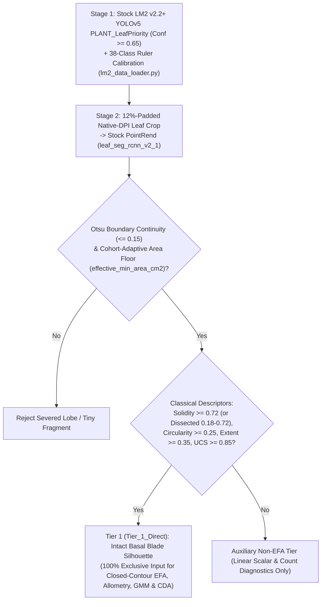

# Standard Operating Procedure (SOP)
## Automated High-Throughput Vegetative Phenotyping and Herbarium Triage Pipeline for North American *Packera*
### Operationalizing Morphological Diagnosability under the Unified Species Concept (*Packera dubia* Complex Baseline)
**Protocol Identifier:** `UNC-BOT-SOP-2026-04-REV5`  
**Principal Investigator:** J. Brandon Fuller (PhD Candidate, Department of Biology, University of North Carolina at Chapel Hill)  
**Faculty Advisor:** Dr. Alan S. Weakley (Director, UNC Herbarium [NCU]; UNC Biology)  
**Target Taxa:** North American *Packera* Á. Löve & D. Löve (Asteraceae: Senecioneae), operationalizing the *Packera dubia* (Spreng.) Trock & Mabb. complex and allied Eastern North American lineages (*P. anonyma*, *P. plattensis*, *P. paupercula*, *P. aurea*, *P. obovata*, *P. glabella*, *P. schweinitziana*, *P. millefolium*, *P. crawfordii*, *P. serpenticola*) while supporting continent-wide expansion to western, boreal, and Mexican taxa.

---

## 1. Executive Summary & Purpose

This Standard Operating Procedure establishes the protocol for an **Automated High-Throughput Vegetative Phenotyping and Herbarium Triage Pipeline** applied to North American ***Packera* Á. Löve & D. Löve** (Asteraceae: Senecioneae), utilizing the taxonomically recalcitrant ***Packera dubia* (Spreng.) Trock & Mabb. complex** and allied Eastern North American species as the primary dissertation baseline.

The pipeline operationalizes morphological diagnosability within the theoretical framework of the **Unified Species Concept (USC; de Queiroz 2007)** and **Integration by Congruence (Padial et al. 2010)**. Under the USC, species are conceptualized as separately evolving metapopulation lineages; morphological diagnosability, reproductive isolation, ecological divergence, and monophyly serve as secondary operational criteria that arise contingently along the speciation continuum. Because vegetative morphology in *Packera* has historically been obscured by phenotypic plasticity, developmental heterophylly, taphonomic indumentum abrasion, and pervasive herbarium misidentifications, automated high-throughput vegetative morphometrics serves as a rigorous, objective screening and triage engine evaluated in concert with:
1. **Reproductive Macro-Morphology & Anthesis Verification:** Capitulum aspect ratios (involucre height to width), phyllary series and count, ray/disc floret dimensions, and 3-tier optical anthesis staging.
2. **Cytotaxonomic Cytotypes:** Chromosome numbers and polyploid series ($2n = 44, 46, 88$; Kowal 1975) that characterize distinct evolutionary lineages in southeastern Senecioneae.
3. **Reduced-Representation nextRAD Phylogenomics:** High-density single nucleotide polymorphism (SNP) datasets capable of discerning deep divergence, hybrid reticulation, and ancestral polymorphism.
4. **$0\text{–}15\text{ cm}$ Rhizosphere, 10 m – 30 m Rock-Outcrop & USGS SGMC Bedrock Validation:** A persistent multi-scale edaphic and geologic stack cached relationally in `data/packera_pipeline.sqlite` (`environmental_cache` + `environmental_rtree`) and mirrored in `data/environmental/fine_grain_edaphic_cache.csv`—integrating $0\text{–}15\text{ cm}$ trapezoidal rhizosphere depth-weighting (`(5 * v_0_5 + 10 * v_5_15) / 15`), 50 m-buffered 1:24,000 USDA-NRCS SSURGO vector map units (`ssurgo_rock_outcrop_pct`, `ssurgo_bedrock_depth_cm`, `ssurgo_aws_0_50cm`), 30 m POLARIS probabilistic soil grids (`polaris_30m/`), 100 m SOLUS100 bedrock depth and coarse fragment grids (`solus_100m/`: `resdept`, `fragvol`), 6-class USGS SGMC bedrock lithology (`sgmc_lithology_class`), 10 m – 30 m USGS 3DEP micro-topography (`topo_tpi_30m`, `topo_roughness_30m`, `topo_slope_deg`, `topo_twi_30m`), and 250 m SoilGrids gap-free fallback—paired with partitioned **Climatic ($D_{\text{clim}}, I_{\text{clim}}$) vs. Edaphic-Geologic ($D_{\text{edaph}}, I_{\text{edaph}}$)** Niche Equivalency and Background Similarity tests (Warren et al. 2008).
5. **Central Transactional Relational Architecture (`data/packera_pipeline.sqlite`):** All pipeline stages transact against a centralized SQLite (WAL mode) database housing Tier A shared tables (`taxon_synonyms`, `vouchers`, `plant_individuals`, `extracted_leaves`, `voucher_reproductive_phenology`, `dinov2_feature_cache`, `environmental_cache` + `environmental_rtree`) and Tier B run-scoped tables (`pipeline_runs`, `run_active_cohort`, `leaf_efa_harmonics`, `otu_morphometrics`, `vision_xai_audit`, `spatial_rf_predictions`, `curation_triage`, plus pre-joined master view `v_integrative_triage_master`), while preserving synchronized atomic CSV snapshots for archival provenance and downstream interoperability.

---

## 2. Phase 1 Protocol: Taxonomic Ingestion, Dynamic Standardization & US EPA Level III Ecoregions (`01_voucher_harvester.py` & `scripts/core/harvester.py`)

* **26-Column Darwin Core Schema Contract & Relational UPSERT (`vouchers` & `data/tables/curated_vouchers.csv`):**
  Harvests and curates occurrence records into `data/packera_pipeline.sqlite` (`vouchers` table, PK: `catalogNumber`) via atomic SQL UPSERT while resolving synonyms through `taxon_synonyms`, exporting a synchronized 26-column CSV manifest `data/tables/curated_vouchers.csv`:
  `catalogNumber`, `institutionCode`, `scientificName`, `species_raw`, `recordedBy`, `recordNumber`, `identifiedBy`, `determiner_raw`, `determiner_tier`, `type_status`, `county`, `stateProvince`, `decimalLatitude`, `latitude`, `decimalLongitude`, `longitude`, `coordinateUncertainty`, `year`, `month`, `day`, `eventDate`, `regional_group`, `image_path`, `exsiccatae_key`, `is_primary_duplicate`, `duplicate_count`, `exsiccatae_taxonomic_conflict`, `exsiccatae_gold_taxon`.
* **Dynamic Taxon Standardization & GBIF Synonym Expansion:**
  Standardizes binomials and basionyms dynamically across all North American *Packera* taxa and phylogenetic tips (*P. dubia*, *P. paupercula*, *P. anonyma*, *P. plattensis*, *P. schweinitziana*, *P. serpenticola*, *P. millefolium*, *P. aurea*, etc.) while supporting arbitrary dynamic North American, boreal, and Mexican *Packera* species via `expand_taxon_synonyms_gbif()`. Running with no taxon flags (`target_species: []`) dynamically queries and harvests all *Packera* species across the entire genus from GBIF (`discover_genus_packera_species_gbif()`). Passing `--taxon "Packera <sp1>" "Packera <sp2>" ...` (or `--focal-taxon "Packera <sp>"`) analyzes strictly the species specified by the user with zero hardcoded default species or injected outgroups.
* **Configurable Geographic Scope & Western Expansion:**
  Supports `--geographic-scope {eastern_na,north_america,global}` (default: `eastern_na`, excluding longitudes $< -106.65$; `north_america` and `global` disable the western boundary), `--include-western` (retaining occurrences west of $-106.65$), and `--countries` (default `["US"]`, expandable to `["US", "CA", "MX"]`).
* **Official US EPA Level III Ecoregion Point-in-Polygon Delineation:**
  Assigns `regional_group` strictly via spatial point-in-polygon intersection against official **US EPA Level III Ecoregions** (Omernik & Griffith 2014; `data/environmental/epa_ecoregions_l3/`):
  $$\text{regional\_group}_i = \text{Ecoregion}_k \iff (x_i, y_i) \in \mathcal{P}_k$$
  for $\mathcal{P}_k \in \{\text{Piedmont}, \text{Southeastern\_Plains}, \text{Middle\_Atlantic\_Coastal\_Plain}, \text{Southern\_Coastal\_Plain}, \text{South\_Central\_Plains}, \text{Blue\_Ridge}, \text{Ridge\_and\_Valley}, \text{Interior\_Plateau}, \text{Ozark\_Highlands}, \text{Ouachita\_Mountains}\}$.
* **Ungeoreferenced Specimen Fallback Policy:**
  When coordinate metadata is missing ($y_i = \text{NA}$), evaluate the US Census county boundary polygon $\mathcal{C}_i$:
  $$\text{regional\_group}_i = \begin{cases} \text{Ecoregion}_k & \text{if } \frac{\text{Area}(\mathcal{C}_i \cap \mathcal{P}_k)}{\text{Area}(\mathcal{C}_i)} \ge 0.95 \\ \text{NA} & \text{otherwise} \end{cases}$$
  Vouchers spanning multiple ecoregions receive `NA` (prohibiting rectangular coordinate bounding boxes, state-level lumping, or `"Other_US"` catch-alls).
* **Nomenclatural Type Hierarchy, Ingestion Exemption, Deduplication & Spatial Thinning:**
  - **Type Status Classification (`classify_nomenclatural_type_rank`):**
    - `PRIMARY_TYPE_STATUSES = {"HOLOTYPE", "LECTOTYPE", "NEOTYPE", "EPITYPE", "ISOTYPE", "ISOLECTOTYPE", "ISONEOTYPE"}` (`Tier_0_Primary_Type`, rank `2`).
    - `SECONDARY_TYPE_STATUSES = {"SYNTYPE", "ISOSYNTYPE", "PARATYPE", "ISOPARATYPE", "TYPE", "COTYPE"}` (`Tier_0_Secondary_Type`, rank `1`).
    - `classify_nomenclatural_type_rank(type_status_raw)` parses raw Darwin Core strings, returning `(2, cleaned_label)` for primary types and isotypes, `(1, cleaned_label)` for secondary types, and `(0, "None")` for non-types.
  - **Historical Type Ingestion Exemption (`VoucherHarvester.harvest()`):**
    - Verified nomenclatural type specimens (`classify_nomenclatural_type_rank(rec.get("typeStatus"))[0] >= 1`) are exempted from the `coordinateUncertaintyInMeters > max_uncertainty_meters` drop filter and from the partial historical date (`year`-only / missing month-day) drop filter during GBIF ingestion so 18th/19th-century Holotypes, Lectotypes, Isotypes, and Syntypes with county-level retro-georeferences or incomplete collection dates are never discarded.
  - **3-Tier Type Priority in Exsiccatae Deduplication (`stratify_duplicates()`):**
    - Uses integer `type_rank` (`2` = `PRIMARY_TYPE_STATUSES`, `1` = `SECONDARY_TYPE_STATUSES`, `0` = non-type) as Priority 1 when scoring duplicate sheets within an `exsiccatae_key` group, ensuring a Holotype/Lectotype/Isotype (`type_rank = 2`) always outranks a Paratype/Syntype (`type_rank = 1`) or non-type (`0`) when designating `is_primary_duplicate` and `exsiccatae_gold_taxon`.
  - **Unconditional Type Retention in Spatial Thinning (`spatially_balance_and_thin_vouchers()`):**
    - Ranks candidates by `type_rank` (`2 > 1 > 0`) first in `priority_tuples` and unconditionally retains all nomenclatural type specimens (`is_type_flags`) during grid thinning (`--spatial-thin-km`) and state/ecoregion quota balancing (`--max-per-state`, `--max-per-region`), even when `preserve_all_gold=False`.
  - **Cascading Outgroup Priority (`select_cascading_outgroup_anchors`):**
    - In focal runs with outgroup anchors (`--gold-anchors <N>`), candidates are sorted by `by=["_type_rank", "_tier_rank", "_is_prim", "_has_local", "_img_res"]`, `ascending=[False, False, False, False, False]`. This ensures nomenclatural types are unconditionally selected as outgroup anchors and never displaced by higher-megapixel non-type `Tier_1_Gold` vouchers. Logs `Type_Specimens`, `Tier_0_Primary_Type`, and `Tier_0_Secondary_Type` counts in `outgroup_tier_breakdown`.
  - **SQLite Cohort & Dynamic Schema Propagation:**
    - `populate_run_active_cohort()` persists `type_status` (`TEXT`) and `is_type_specimen` (`INTEGER DEFAULT 0`) into `run_active_cohort`.
    - Dynamic migrations (`_migrate_dynamic_schema_columns()`) expose type-control fields across `otu_morphometrics`, `vision_xai_audit`, `spatial_rf_predictions`, and the pre-joined master view `v_integrative_triage_master`.
* **3-Layer Dynamic Expert & Herbarium Authority Engine (`parse_determiner_tier`):**
  - **Layer 1 (Genus-Wide Monographer Heuristics & Determiner Isolation):** Expanded `SPECIALIST_PATTERNS` covering North American *Packera* and *Senecioneae* monographers and regional flora authors (Barkley, Trock, Kowal, Weakley, Bain, Mahoney, Fuller, Freeman, Cronquist, Greenman, Weber, Á. Löve & D. Löve, Spellenberg, Pippen, Uttal, Fernald, Rydberg, Heller, Kral, Godfrey, Sorrie, Nesom, Strother, Turner, Golden). `parse_determiner_tier()` restricts `SPECIALIST_PATTERNS` matching strictly to `identifiedBy` and `identificationHistory` (only falling back to `recordedBy` when `identifiedBy` is unrecorded or indicates the collector via `_should_fallback_to_collector()`), preventing collector-as-determiner false Gold promotions.
  - **Layer 2 (Automatic Protologue Author Extraction):** `extract_protologue_authors()` parses basionym and combination authors directly from Darwin Core `scientificName` strings; sheets annotated by a nomenclatural author of that taxon are classified as `Tier_1_Gold`.
  - **Layer 3 (Corpus-Derived Multi-Herbarium Determiner & Regional Herbarium Scoring):** `discover_corpus_authorities()` promotes any determiner who has identified $\ge 5$ specimens of a *Packera* taxon across $\ge 3$ distinct herbaria (`institutionCode`s)—or annotated $\ge 1$ verified type specimen—to `dynamic_specialists` (`Tier_1_Gold`), and promotes herbaria holding $\ge 1$ type specimen or ranking in the top quartile of holdings ($\ge 10$ sheets with $\ge 70\%$ determiner attribution) to `dynamic_herbaria` (`Tier_2_Silver`). General floristic collections and unverified aggregator records receive `Tier_3_Bronze`.
* **Cross-Duplicate Exsiccatae Conflict Auditing & Concordance Guard:**
  - `stratify_duplicates()` groups multi-herbarium duplicate sheets via `exsiccatae_key` (`recordedBy` + `recordNumber` + `year`), auditing cross-duplicate taxonomic concordance. If duplicate sheets bear contradictory taxonomic binomials, `exsiccatae_taxonomic_conflict` is flagged `TRUE` and `exsiccatae_gold_taxon` resolves the gold-standard determination.
  - Layer 3 `discover_corpus_authorities()` enforces a cross-duplicate concordance guard, rejecting determiners with $> 25\%$ conflicting duplicate annotations (`det_conflicted_groups / det_dup_groups > 0.25`) to prevent institutional misidentifications from propagating into expert authority tiers.

---

## 3. Phase 2 Protocol: Stock LeafMachine2 v2.2+, Boundary-Continuity Lobe Rejection & Classical Gatekeeping

Candidate organs are extracted out of the box using **stock LeafMachine2 v2.2+** (Weaver et al. 2024) without requiring custom fine-tuned PCD checkpoints or manual SAM 2 annotation, and routed through a **100% label-blind classical geometric gatekeeper**:

* **Stock LeafMachine2 v2.2+ Configuration (`configure_leafmachine2.py`):**
  - **Stage 1 (Full-Sheet Detection & Ruler Calibration):** Stock LeafMachine2 YOLOv5 `PLANT_LeafPriority` (`LeafPriority.pt`, `minimum_confidence_threshold: 0.65`) processes both `Class 0` (`leaf_whole`) and `Class 1` (`leaf_partial`) candidate boxes while enforcing `treat_leaflet_as_leaf_whole: False` (preventing individual lobes of pinnatifid *Packera* leaves from being segmented as standalone blades), `use_efds_for_png_masks: False` (exporting raw pixel-accurate PointRend binary masks without premature LM2 Fourier smoothing), and `do_apply_landmarks: False` (disabling angiosperm venation landmarking). Paired with the 38-class Ruler Detector (`scripts/vision/lm2_data_loader.py`) for empirical scale conversions (`pixels_per_mm`, `is_calibrated_mm`).
  - **Stage 2 (Cropped Leaf Segmentation):** Candidate leaf bounding boxes are cropped at native DPI with 12% padding, segmented via stock Detectron2 PointRend (`leaf_seg_rcnn_v2_1`), and spatially clustered into distinct individuals via DBSCAN (`plant_individual_id`).
* **Otsu Boundary-Continuity Lobe Rejection (`is_truncated_lobe_or_leaflet`, `max_tissue_border_ratio: 0.15`):**
  - Inspects a 2-pixel perimeter band around the candidate bounding box using Otsu's threshold in CIE $L^*a^*b^*$ luminance space. If non-paper plant tissue occupies $> 15\%$ of the bounding-box perimeter (excluding a single narrow petiole exit $\le 12\%$ on one edge), the candidate is rejected as an unattached terminal lobe or severed fragment of a larger pinnatifid leaf.
* **Ruler-Calibrated Physical Blade Area Floor & Cohort-Adaptive Scaling (`compute_sheet_adaptive_min_blade_area_cm2`):**
  - Rather than enforcing a static area floor that discards miniature specimens, the minimum physical basal blade area floor scales dynamically to the sheet's calibrated leaf size distribution:
    $$\text{effective\_min\_area\_cm2} = \min(0.75, \max(0.15, 0.25 \times \text{median\_sheet\_leaf\_area\_cm2}))$$
    ensuring dwarf, alpine, or compact-rosette *Packera* taxa are never artificially excluded. Vertical rosette zone filtering automatically relaxes from sheet coordinates (`cy_rel >= 0.42` for Tier 1 or `0.48` for Tier 2) to plant bounding box coordinates (`cy_rel_p_m = (cy_sheet_m - ymin_plant) / plant_bbox_span >= 0.40`) whenever a specimen is mounted higher on the sheet.
* **Classical Dimensionless Descriptors & Dissection Gates (`Tier_1_Direct`):**
  - **Pristine / Lyrate-Entire Tier 1 (`Tier_1_Direct`):** Requires $\text{Solidity} \ge 0.72$, isoperimetric $\text{Circularity} = \frac{4\pi A}{P^2} \ge 0.25$, bounding-box $\text{Extent} = \frac{A}{W \cdot H} \ge 0.35$, and $\text{UCS} \ge 0.85$.
  - **Pinnatifid / Lyrate-Pinnatifid Tier 1 (`Tier 1 (Dissected)`):** Low-solidity blades in $0.48 \le \text{Solidity} < 0.72$ are routed into `Tier_1_Direct` via `is_botanical_dissection()` when paired bilateral convexity-defect sinuses ($d_{\text{sinus}} / W_{\text{blade}} \ge 0.08$) confirm genuine pinnatifid lobing.
  - **Bipinnatisect Tier 1 (`Tier 1 (Bipinnatisect)`):** Deeply dissected blades in $0.18 \le \text{Solidity} < 0.48$ (e.g., *Packera millefolium*) are routed into `Tier_1_Direct` when $\ge 4$ deep convexity-hull sinuses confirm bipinnatisect dissection.
* **Anatomical Petiole Length & Flowering Plant Height Approximations:**
  - **Basal Petiole Length & Ratio:** Evaluates the caudex crown intersection $p_{\text{crown}}$ and PointRend Class 1 petiole skeleton:
    $$L_{\text{petiole}} = \max\left(d_{\text{geodesic}}(p_{\text{base}}, p_{\text{crown}}),\, \|p_{\text{base}} - p_{\text{crown}}\|_2\right)$$
    $$\text{petiole\_to\_blade\_ratio} = \frac{L_{\text{petiole}}}{L_{\text{blade}}}$$
    Aggregated at the 75th percentile across outer-rosette leaves in `extracted_leaf_manifest.csv`.
  - **Flowering Scape Height & Straight/Bent Stem Modeling:** Evaluates the piecewise unfolded stem path from $p_{\text{crown}}$ through cauline bend apex $p_{\text{bend}}$ to capitula inflorescence centroid $p_{\text{corymb}}$:
    $$H_{\text{plant}} = \|p_{\text{bend}} - p_{\text{crown}}\|_2 + \|p_{\text{corymb}} - p_{\text{bend}}\|_2$$
    $$\text{scape\_to\_basal\_leaf\_ratio} = \frac{H_{\text{plant}}}{L_{\text{blade}}}$$
    Recorded alongside `is_bent_stem` in `voucher_reproductive_metrics.csv`.
* **Post-Gatekeeper Basal Filtering & Strengthened Cauline Rejection (`is_cauline_or_stem_contaminant`):**
  - High-DPI basal candidates enforce plant-relative vertical zone (`cy_rel_p_m >= 0.40`), minimum pixel area floors, boxy clump rejection (`min(w,h)/max(w,h) > 0.78` when `solidity < 0.84`), sheet-relative area floor (`>= 0.28 * max_sheet_area`), and a top-6 basal leaves per voucher cap ranked by $Q = \text{solidity} \cdot \text{ucs} \cdot \sqrt{\text{area}}$ with automatic disk cleanup. Furthermore, `is_cauline_or_stem_contaminant()` rejects upper-stem sessile/clasping cauline bracts (`aspect_ratio > 3.8` and `solidity < 0.78`, or displaced `> 2.2 * med_rosette_radius` above the basal rosette zone).
* **Post-QC Basal-Leaf-Only Masking (`crop_dense_rosette_tier4`):**
  - Executes after `is_cauline_or_stem_contaminant()` and the `Tier_1_Direct` gatekeeper, replacing non-basal-leaf tissue (roots, caudex, flowering stems, cauline leaves, rulers, labels, tape) outside the 5-pixel dilated union of verified basal leaf masks with neutral mounting paper RGB `[242, 239, 230]`, and saving companion binary masks (`<catalogNumber>_p<pid>_rosette_mask.png`) in `data/cropped_patches/rosettes_dense/`.
* **Atomic Relational Transactions & Synchronized CSV Snapshots (`plant_individuals`, `extracted_leaves`, `voucher_reproductive_phenology`):**
  Commits extracted organ traits in atomic per-voucher transactions to `data/packera_pipeline.sqlite`: `plant_individuals` (PK: `(catalogNumber, plant_individual_id)`), `extracted_leaves` (PK: `(catalogNumber, plant_individual_id, leaf_id)`, embedding the standardized 120-vertex normalized contour JSON `contour_xy_json` alongside classical dimensionless descriptors), and `voucher_reproductive_phenology` (PK: `(catalogNumber, plant_individual_id)`). Enables $O(1)$ SQL resumption checks (`qc_status IN ('PASS', 'FAILED_QC')`), while atomically exporting synchronized canonical CSV manifests (`data/tables/extracted_leaf_manifest.csv`, `failed_qc_vouchers.csv`, `voucher_reproductive_metrics.csv`, `voucher_phenological_states.csv`).
* **Post-QC Silhouette Montage Regeneration (`--regenerate-figures-only`):**
  - Invoked automatically after Step 04 in `run_pipeline.sh`, reloading audited Step 02–04 tables to export `fig02a_segmentation_qc_distributions.{pdf,png}` and `fig02b_silhouette_montage.{pdf,png}` containing strictly downstream-QC-validated `Tier_1_Direct` silhouettes scaled to active taxa.

---

## 4. Phase 3 & 4 Protocol: Pure Tier-1 EFA, Dual-Track GMM/CDA, Allometry & Parametric MANOVA

### 4.1 Strict `Tier_1_Direct` Closed-Contour EFA, Symmetrization & OTU Medians (`03_fourier_extractor.R`)
* **Strict Tier-1 Pure Priority & Closed-Contour Restriction:**
  Only intact `Tier_1_Direct` basal leaf contours enter `Momocs::efourier`. Folded or mirrored hemi-blades (`Tier_2_Reflected`) and open-curve polynomial approximations are **never** pooled into EFA harmonic matrices. Carries forward Step 02 linear petiole/blade traits and Step 01 DwC metadata.
* **Inertial Axis Pre-Alignment (`Momocs::coo_alignxax`) with Suborbicular Guard:**
  Contours are anchored at the anatomical petiole insertion $p_{\text{base}}$ (`petiole_attachment_pt=p_base`), centered (`Momocs::coo_center`), and aligned along their major inertial axis via `Momocs::coo_alignxax()` whenever circularity $\le 0.75$ (suppressing $90^\circ$ rotation flips on suborbicular *P. obovata* / *P. aurea* leaves while locking $\overrightarrow{p_{\text{base}} p_{\text{apex}}}$ polarity via `coo_slidedirection("left")`).
* **Dynamic Harmonic Power Calibration & Variance-Explained PC Export:**
  Harmonic power is calculated as $\text{Power}_n = \frac{A_n^2 + B_n^2 + C_n^2 + D_n^2}{2}$. Uses `Momocs::calibrate_harmonicpower_efourier()` to dynamically determine the minimum harmonic count $H_{\text{opt}} \in [6, 24]$ capturing $\ge 99\%$ cumulative harmonic power across the studied plant cohort:
  $$\frac{\sum_{n=1}^{H_{\text{opt}}} \text{Power}_n}{\sum_{n=1}^{H_{\max}} \text{Power}_n} \ge 0.99$$
  recording `efd_harmonic_opt` before executing `Momocs::efourier(out_obj, nb.h = H_opt, norm = FALSE, start = FALSE)`. Dynamically exports all principal components necessary to reach $\ge 95\%$ cumulative shape variance ($k_{\text{export}} = \max(5, k_{95})$, persisted in `efd_k95_pcs`).
* **Uniform Bilateral Symmetrization (Claude 2008):**
  Applies `Momocs::rm_asym(ef)` uniformly across all contours, decomposing coefficients into symmetric ($A_n, D_n$) and asymmetric ($B_n, C_n$) components:
  $$A_n^{\text{sym}} = A_n,\quad D_n^{\text{sym}} = D_n,\quad B_n^{\text{sym}} = 0,\quad C_n^{\text{sym}} = 0$$
  Scalar asymmetry is quantified as:
  $$\text{pct\_asymmetry} = \frac{\sum_{n=1}^{H_{\text{opt}}} (B_n^2 + C_n^2)}{\sum_{n=1}^{H_{\text{opt}}} (A_n^2 + B_n^2 + C_n^2 + D_n^2)}$$
* **Mahalanobis & Regime-MCD Outlier Immunity for Type Contours:**
  - `prune_within_taxon_mahalanobis()` delegates to `select_adaptive_reference_anchors()`, ensuring intact `Tier_1_Direct` contours from nomenclatural type specimens (`is_type_specimen == TRUE`) are never pruned during within-taxon 95% $\chi^2$ Mahalanobis screening (`anchor_tier_source = "Tier_0_Type_Anchor"`).
  - Physical contours of nomenclatural type specimens that pass basic boundary asymmetry/roughness checks (`pct_asymmetry <= 0.22` and `harmonic_roughness <= rough_ceil`) are unconditionally exempt from `screen_regime_stratified_mcd_outliers()` (`mcd_out[is_type_specimen] <- FALSE`) and retained in `otu_base_mask`, preventing historically and biologically significant type morphology from being discarded as statistical outliers.
* **Type-Weighted EFA Covariance PCA & Unweighted OTU Median Aggregation:**
  - `extract_symmetric_fourier_pcs()` and `run_fourier_extraction()` weight active type anchors with their $1.5\times$ Empirical Bayes precision multiplier ($\pi_{\text{Type}} = 0.999$, $\pi_{\text{SecType}} = 0.985$) via `compute_authority_precision_weights(..., active_mask = ...)` when fitting `stats::cov.wt()` for both leaf-level and OTU-level `PC1..PCk` and `Sym_PC1..Sym_PCk`.
  - Anomalous non-type contours are gated via Minimum Covariance Determinant (MCD) Mahalanobis distance (`MASS::cov.rob(..., method = "mcd")`, $\chi^2$ cutoff $p < 0.001$) combined with $\text{pct\_asymmetry} \le 0.22$ and perimeter high-frequency roughness $\text{harmonic\_roughness} \le 0.15$. Multi-leaf vouchers are aggregated to the Specimen / Operational Taxonomic Unit (`(catalogNumber, plant_individual_id)`) via **unweighted coordinate-wise median** harmonics and PCs (`morph_tier_source = "Tier_1_Pure"`), exporting `fig03_efa_morphospace_reconstruction.{pdf,png}`, `fig03a_efa_morphospace_pca.{pdf,png}`, and `fig03b_harmonic_power_and_asymmetry.{pdf,png}`.
  - `aggregate_step03_otu_medians_fast()` in `scripts/morphometrics/fourier_parallel_utils.R` carries `type_status`, `is_type_specimen`, and `anchor_tier_source` forward into `leaf_efa_harmonics` in SQLite alongside `data/tables/leaf_efa_harmonics.csv`, `data/tables/leaf_efa_harmonics_individual.csv`, and `outputs/reports/fourier_pcs.csv`.
* **Batch SQL Contour Ingestion & Harmonic Persistence (`extracted_leaves` & `leaf_efa_harmonics`):**
  Contour coordinates are loaded directly from `data/packera_pipeline.sqlite` (`extracted_leaves.contour_xy_json`) via a single optimized SQL query (eliminating 14,000+ individual CSV reads, with directory CSV fallback for unit tests). Unweighted OTU median harmonics and PCs are written to `leaf_efa_harmonics` in the pipeline database while synchronously exporting `data/tables/leaf_efa_harmonics.csv`, `outputs/reports/fourier_pcs.csv`, and `outputs/reports/symmetric_fourier_pcs.csv`.

### 4.2 Strict Active/Passive Determiner Authority Split, Nomenclatural Type Pinning & Adaptive Reference Anchors (`authority_weighting_utils.R`, `04_gmm_morphotools.R`)
* **Nomenclatural Type Identification (`.identify_type_specimen_vec`):**
  Classifies specimens into integer `type_rank` (`2L` for primary types/isotypes, `1L` for secondary types, `0L` otherwise) and boolean `is_type_specimen = (type_rank >= 1L)`.
* **Adaptive Reference Anchor Selection, FastMCD Immunity & Type-Medoid Shrinkage (`select_adaptive_reference_anchors`):**
  - Supervised training in CDA, allometric regression, Cleanlab cross-validation, and Spatial Random Forests is rooted in `Tier_1_Gold` (monographic/type-verified) and `Tier_2_Silver` (regional specialist) `Tier_1_Pure` vouchers after a single per-taxon $\chi^2_{0.95}$ FastMCD Mahalanobis outlier pruning step (`qchisq(0.95, df = p)`), deliberately avoiding double truncation of reference tails.
  - **Nomenclatural Type Pruning Immunity:** Intact `Tier_1_Pure` type specimens (`is_type_valid <- (type_rank >= 1L) & valid_pool`) are unconditionally exempt from FastMCD outlier exclusion (`drop_gs[gs_type_local] <- FALSE`).
  - **Type-Medoid Reference Shrinkage ($\gamma_k$):** When a taxon possesses $\ge 1$ valid type specimen, its reference centroid $\boldsymbol{\mu}_{\text{ref}, k}$ is shrunk toward the empirical type medoid $\boldsymbol{\mu}_{\text{type}, k}$:
    $$\boldsymbol{\mu}_{\text{ref}, k} \leftarrow (1 - \gamma_k) \boldsymbol{\mu}_{\text{ref}, k} + \gamma_k \boldsymbol{\mu}_{\text{type}, k},\quad \gamma_k = \min(0.35, 0.20 + 0.05\,n_{\text{type}, k})$$
    with a corresponding shift-variance adjustment applied to the reference covariance matrix $\mathbf{\Sigma}_{\text{ref}, k}$. Active type vouchers are assigned `anchor_tier_source = "Tier_0_Type_Anchor"`.
  - When an under-annotated, narrow-endemic, or rare *Packera* taxon has fewer than `min_anchors_per_taxon` (default 8, or $< 3$) clean Gold+Silver anchors, it automatically promotes the most central `Tier_3_Bronze` `Tier_1_Pure` vouchers within $\chi^2_{0.80, p}$ of the taxon medoid (`is_promoted_anchor = TRUE`), ensuring GMM, allometry, vision OOF/OOD, and CDA never drop Gold-poor taxa.
* **2-Step Dawid-Skene / Beta-Binomial Empirical Bayes Authority Weighting & Type Pinning (`compute_empirical_bayes_authority_weights`):**
  Unifies authority weights across the pipeline via a 2-step Dawid-Skene / Empirical Bayes shrinkage update ($\alpha_0 = 5.0$, prior reliabilities `"Tier_0_Primary_Type" = 0.999`, `"Tier_0_Secondary_Type" = 0.985`, $\pi_{\text{Gold}} = 0.95$, $\pi_{\text{Silver}} = 0.85$, $\pi_{\text{Promoted Bronze}} = 0.65$, $\pi_{\text{Unpromoted Bronze}} = 0.35$):
  - **Step 1 (Empirical Concordance):** Computes raw determiner concordance against active reference anchors across the corpus.
  - **Step 2 (Beta-Binomial Shrinkage & Type Exemption):**
    $$w_{t, \text{tier}} = \frac{\alpha_0 \pi_{\text{tier}} + \sum_{i \in (t, \text{tier})} (1 - \hat{\epsilon}_i)}{\alpha_0 + n_{t, \text{tier}}}$$
    where $\hat{\epsilon}_i$ is the empirical leave-one-out classifier error rate. Type specimens (`is_type_mask`) are exempt from downward Dawid-Skene shrinkage (`w_eb[is_type_mask] <- pi_vec[is_type_mask]`).
  - **`active_passive` Mode (Steps 03–04 Ordination, Allometry, GMM, CDA):** Unpromoted `Tier_3_Bronze` vouchers receive `0.0` (passive projection via `predict()`), while active type anchors receive a $1.5\times$ precision boost prior to rescaling active weights to mean `1.0`. Step 04 uses taxon-agnostic discordance strings (`<raw_sp>_Discordant_to_<pred_sp>`) and `"Unassigned_Packera"` fallbacks.
  - **`continuous_prior_posterior` Mode (Step 06 Spatial RF / Downstream Synthesis):** Returns positive weights normalized to $[0.5, 3.0]$, with primary types (`type_rank == 2L`) pinned to the `3.0` ceiling and secondary types (`type_rank == 1L`) pinned to $\ge 2.8$ across both `compute_empirical_bayes_authority_weights()` and the inline `resolve_step06_authority_weights()` fallback in `06_multimodal_spatial_rf.R`.

### 4.3 Klingenberg (2016) Allometric Slope Homogeneity, Horn/Williams-Titus Subspace, Type Morph Control & Dual-Track CDA
* **Type-Controlled Morphospace & Typical Morphotype Locking (`compute_type_specimen_morph_control`):**
  - Computes each taxon's type control centroid $\boldsymbol{\mu}_{\text{type}, k}$ across the selected morphometric subspace (falling back to the top-weighted `Tier_1_Gold` medoid when a taxon has 0 harvested types, recorded via `has_empirical_type_anchor`).
  - Measures the squared Mahalanobis distance of every specimen to its recorded taxon's type baseline:
    $$D^2_{\text{type}, i} = (\mathbf{x}_i - \boldsymbol{\mu}_{\text{type}, k})^T \mathbf{\Sigma}_{\text{type}, k}^{-1} (\mathbf{x}_i - \boldsymbol{\mu}_{\text{type}, k})$$
    exported as `type_morph_mahal_d2`, alongside `nearest_type_morph_taxon` (taxon with minimum type Mahalanobis distance) and `type_morph_concordance` ($\in [0, 1]$).
  - Evaluates boolean `is_typical_morphotype`: `TRUE` if the specimen's unsupervised `gmm_cluster` matches the cluster $c^*$ containing or closest to $\boldsymbol{\mu}_{\text{type}, k}$, locking the *sensu stricto* morphological core of the species.
  - **Misidentification Protection for Type Specimens:** In `audit_misidentifications()`, type specimens (`is_type_specimen == TRUE`) are protected from routine misidentification flags (`morphometric_outlier_flag <- FALSE`). If a primary type projects into another taxon's morphospace with $P(\text{alt}) \ge 0.85$, it is flagged for critical synonymy investigation (`discordance_reason = sprintf("Type_Specimen_Taxonomic_Overlap_with_%s", gsub(" ", "_", pred_sp))`, `triage_priority = "CRITICAL"`).
* **Klingenberg (2016) Allometric Slope Homogeneity Testing (`test_and_correct_allometry`):**
  Restricted to ruler-calibrated active anchors (`is_calibrated_mm == TRUE`), the pipeline evaluates slope homogeneity across taxa via the multivariate interaction model:
  $$\mathbf{y}_{\text{shape}} = \beta_0 + \beta_1 \log_{10}(\text{CS}) + \boldsymbol{\gamma}_{\text{species}} + \boldsymbol{\delta} (\log_{10}(\text{CS}) \times \boldsymbol{\gamma}_{\text{species}}) + \boldsymbol{\epsilon}$$
  Testing $H_0: \boldsymbol{\delta} = \mathbf{0}$ at $\alpha = 0.01$. If $p \ge 0.01$, common-slope within-group allometric correction is applied:
  $$\mathbf{y}_{\text{corrected}} = \mathbf{y}_{\text{shape}} - \hat{\beta}_1 (\log_{10}(\text{CS}) - \overline{\log_{10}(\text{CS})})$$
  When slopes diverge significantly ($p < 0.01$), raw shape PCs are retained and flagged in `outputs/reports/allometry_significance_audit.csv`, `allometry_pairwise_trajectories.csv`, and `allometry_homogeneity_test.csv` (visualized in `outputs/figures/shape_allometry_regression.pdf`).
* **Dynamic Subspace Selection via Horn's Parallel Analysis & Williams & Titus (1988) Ceiling:**
  Discovers all exported `PC*` and `Sym_PC*` columns dynamically and selects informative shape PCs exceeding the Broken-Stick / Horn simulated eigenvalue threshold, strictly capped for supervised CDA by:
  $$P_{\max} = \left\lfloor \frac{N_{\min,\text{anchor}} - 1}{3} \right\rfloor$$
  where $N_{\min,\text{anchor}}$ is the sample size of the smallest active reference anchor taxon (Williams & Titus 1988). Passes `selected_morph_features` forward to `audit_misidentifications()`, multi-PC institutional batch-effect ANCOVA (`audit_institutional_batch_effects()`), Step 07, and Step 08. CDA posterior probabilities (`cda_posterior_prob`, `cda_second_posterior_prob`, `cda_posterior_margin`) are evaluated across the full rank of canonical axes $\min(P, g - 1)$, while exporting `can1`, `can2`, `can3` for 2D and 3D ordinations. Aggregates manifest petiole traits by `(catalogNumber, plant_individual_id)` and exports `cda_second_taxon` (secondary morphological parent identity) alongside `cda_second_posterior_prob` and `cda_posterior_margin`.
* **Dual Clustering Architecture:**
  - **Track 1 (Unsupervised Morphological Clustering):** Fits `mclust::Mclust` across $G = 1 \dots K_{\max}$ on active `Tier_1_Pure` anchors for `gmm_bayes_factors_summary.csv` and extracts the optimal multi-cluster mixture ($G \in \{2 \dots K_{\max}\}$, `Morphotype_K1..Kn`) evaluated via Kass & Raftery (1995) $2\Delta\text{BIC} = \text{BIC}_{\text{alt}} - \text{BIC}_{\text{null}}$ thresholds ($> 6$ strong, $> 10$ very strong). Fits unsupervised CDA on `Morphotype_K1..Kn` to yield `fig04_gmm_cda_clustering.{pdf,png}` (never falling back to `regional_group`).
  - **Track 2 (Supervised EPA Level III Ecoregion CDA):** Runs supervised CDA across non-`NA` polygon-verified EPA Level III Ecoregions, exporting `ecoregion_cda_predicted`, `ecoregion_cda_posterior_prob`, `ecoregion_can1`, `ecoregion_can2`, `outputs/reports/ecoregion_supervised_cda_summary.csv` (with Unsupervised Morphotype x EPA Ecoregion Adjusted Rand Index [ARI] and Fisher's exact test), and `outputs/figures/fig04c_supervised_ecoregion_cda.{pdf,png}`.
* **Parametric Omnibus & Pairwise MANOVA:**
  Exports `outputs/reports/manova_group_significance.csv` (reporting Pillai's Trace, Wilks' $\Lambda$, approx $F$, partial $\eta^2$, and Benjamini-Hochberg FDR $q$-values) and `outputs/reports/manova_pairwise_posthoc.csv` (reporting pairwise Hotelling's $T^2$ contrasts across species, unsupervised morphotypes, and EPA ecoregions).
* **Relational Storage of Morphometrics & CDA Classifications (`otu_morphometrics`):**
  Exports all specimen-level OTU morphometrics, allometry metrics, and GMM/CDA classifications into `otu_morphometrics` in `data/packera_pipeline.sqlite` alongside `data/tables/morphometric_flags.csv`.
* **Multi-PC Taxon-Adjusted Institutional Batch-Effect Audit (`audit_institutional_batch_effects`):**
  Evaluates marginal ANCOVA models across all selected morphometric dimensions (`lm(PC_j ~ species_standardized + institutionCode)`) with Benjamini-Hochberg FDR correction, computing partial $R^2$ for `institutionCode` to verify that herbarium mounting practices do not drive morphometric separation (partial $R^2 < 0.05$ across all retained axes).

---

## 5. Phase 5 Protocol: Taphonomic Indumentum-Blind Vision XAI, Dilated Masking & Cleanlab (`05_cleanlab_vision_xai.py`)

* **`Tier_1_Direct` Basal Leaf Linking & Masking (`load_and_link_rosette_patches`):**
  Links each specimen `(catalogNumber, plant_individual_id)` to verified `Tier_1_Direct` basal leaf crops (`data/cropped_patches/basal_leaves_raw/`) and binary masks (`data/masks/tier1_intact/` via `--manifest-csv data/tables/extracted_leaf_manifest.csv`), falling back to masked `rosettes_dense` crops with companion masks (`<cat>_p<pid>_rosette_mask.png`).
* **Taphonomic Indumentum-Blind Macro-Architecture ($224 \times 224$ Gaussian Low-Pass Filter, $\sigma = 1.0\text{ px}$):**
  Floccose arachnoid tomentum in *Packera dubia* and allied taxa abrades taphonomically on older herbarium vouchers or varies between adaxial and abaxial surfaces. Resized $224 \times 224$ crops undergo a $\sigma = 1.0\text{ px}$ Gaussian low-pass filter (`apply_indumentum_blind_lowpass`) with non-leaf background composited onto neutral herbarium mounting paper (`[242, 239, 230]`), suppressing fine hair artifacts and mounting paper edges while preserving diagnostic macro-architectural venation, lobing, and petiole winging. Foliar surface orientation (`classify_foliar_surface_orientation()`), CIE $L^*$ luminance, and HSV saturation are computed strictly inside the verified leaf lamina mask.
* **Foreground-Masked $16 \times 16$ Spatial Patch Token Pooling (`dinov2_vitb14_reg`) & Attention Energy Ratio:**
  Uses `dinov2_vitb14_reg` (4 register tokens preventing background high-norm artifacts; Darcet et al. 2024), downsamples the binary foreground mask to the $16 \times 16$ spatial token grid (`compute_foreground_patch_mask`, $\ge 25\%$ foreground threshold), and average-pools strictly over foreground spatial patch tokens (`forward_features()["x_norm_patchtokens"]`) rather than relying on an unmasked global `[CLS]` token. Computes empirical `foreground_attention_ratio` for **every** specimen in `data/tables/label_noise_audit.csv` as the ratio of DINOv2 spatial patch token L2 energy inside the verified leaf mask (`fg_grid`) relative to total patch energy, flagging `foreground_attention_ratio < 0.65` as `is_artifact_driven = TRUE`.
* **Active Taxa Derivation, Anchor Parity, Nomenclatural Type Weighting & Temperature Calibration:**
  - Dynamically derives `active_taxa` and colorblind-safe Okabe-Ito palettes (`_get_dynamic_okabe_ito_map`).
  - **Type Anchor Priority & Sample Weighting:** Nomenclatural type specimens are unconditionally included in the reference training set (`anchor_mask[is_type_specimen] = True`) and receive an elevated sample weight of `4.5` (exceeding standard `Tier_1_Gold = 3.0` and `Tier_2_Silver = 2.0`). To maintain strict cross-stage anchor parity with Step 04, `compute_out_of_fold_probabilities()` and `compute_feature_space_ood_scores()` incorporate `is_promoted_bronze` anchors for Gold/Silver-poor taxa alongside Gold/Silver/Type anchors.
  - Trains out-of-fold L2-penalized `LogisticRegression(C=0.1, class_weight="balanced")` inside a fold-internal `StandardScaler` + `PCA(0.95)` pipeline using `StratifiedGroupKFold(groups=institutionCode)` (holding out entire herbaria per fold to prevent institutional background shortcuts), calibrates probabilities via Platt/temperature scaling (`calibrate_oof_probabilities`), and projects unpromoted `Tier_3_Bronze` vouchers passively (`predict_proba`).
* **768-d DINOv2 Type Cosine Control (`compute_type_visual_control`):**
  - Computes an L2-normalized class visual prototype $\mathbf{v}_{\text{type}, c}$ in 768-d `dinov2_vitb14_reg` embedding space for each active taxon, weighting primary types $2.0\times$ and secondary types $1.0\times$ (falling back to top-weighted `Tier_1_Gold` anchors if a taxon lacks harvested types).
  - For every specimen $\mathbf{v}_i$, evaluates cosine similarity to its recorded taxon's prototype:
    $$\text{vision\_type\_cosine\_sim}_i = \frac{\mathbf{v}_i \cdot \mathbf{v}_{\text{type}, c}}{\|\mathbf{v}_i\|_2 \|\mathbf{v}_{\text{type}, c}\|_2}$$
    and identifies `vision_nearest_type_taxon` along with `vision_type_margin`:
    $$\text{vision\_type\_margin}_i = \cos(\mathbf{v}_i, \mathbf{v}_{\text{type}, \text{nearest\_other}}) - \cos(\mathbf{v}_i, \mathbf{v}_{\text{type}, \text{given}})$$
    providing an indumentum-blind deep visual distance to nomenclatural type baselines.
* **Class-Conditional Cleanlab Pruning, Primary Type Immunity & OOD Scoring:**
  - Prunes label noise via `cleanlab.filter.find_label_issues(..., filter_by="prune_by_noise_rate")`.
  - **Cleanlab Immunity for Primary Types:** Primary nomenclatural type specimens (`type_rank == 2`) are strictly immune to label-corruption flagging. If Cleanlab flags a primary type or $c_{\text{error}} \ge \text{cleanlab\_threshold}$, `is_label_corrupted` is forced to `False` and `recommended_action = "Retain (Nomenclatural Type Control — Evaluate Synonymy)"`.
  - `filter_abaxial_artifacts()` in `run_confident_learning_audit()` conditionally suppresses abaxial label-noise flags when `tomentum_taxon_discordance == True` (or confidence $< 0.85$), preserving high-confidence structural misidentifications mounted abaxially ($\text{conf} \ge 0.85$, $c_{\text{error}} > 0.88$, $\text{FG} \ge 0.65$).
  - Computes Mahalanobis + cosine $k$-NN feature-space distance (`vision_ood_score`, boolean `vision_is_ood` at $\ge 0.65$), generates 3-panel `GradCAM_audit_panel.pdf` (masking non-leaf pixels to `[242, 239, 230]`, restricting attention overlay strictly to `fg_mask`, and plotting calibrated posteriors across active classes), and evaluates visual discriminability across unsupervised morphometric clusters (`Morphotype_K1..Kn`) in single-species / intraspecific mode (`--intraspecific-mode`). Exports `plant_individual_id`, `vision_ood_score`, `vision_is_ood`, `foreground_attention_ratio`, `is_artifact_driven`, `surface_orientation`, `mean_luminance`, `mean_saturation`, `vision_second_prob`, `vision_margin`, `vision_type_cosine_sim`, `vision_nearest_type_taxon`, `vision_type_margin`, and `tomentum_taxon_discordance`.
* **DINOv2 Feature Caching & Relational Audit Persistence (`dinov2_feature_cache` & `vision_xai_audit`):**
  Caches 768-d float32 foreground embeddings and `foreground_attention_ratio` in `dinov2_feature_cache` (PK: `(catalogNumber, plant_individual_id, model_name, sigma)`), eliminating redundant GPU forward passes across repeated runs. Persists vision audit metrics, OOD scores, and Cleanlab noise flags into `vision_xai_audit` in `data/packera_pipeline.sqlite` alongside `data/tables/label_noise_audit.csv`.

---

## 6. Phase 6 Protocol: $0\text{–}15\text{ cm}$ Rhizosphere/Outcrop ENM Stack, Non-Blended Hierarchy & Niche Equivalency (`06_multimodal_spatial_rf.R`)

* **Type Locality (*Locus Classicus*) Ecological Baseline (`compute_type_locality_ecological_control`):**
  - Establishes a *locus classicus* reference set for each taxon composed of its nomenclatural type vouchers augmented with `Tier_1_Gold` specialist vouchers collected within $150\text{ km}$ of a type locality or sharing its EPA Level III `regional_group` (falling back to all active `Tier_1_Gold` anchors if a taxon lacks localized type occurrences).
  - Derives robust predictor medians and anchor-restricted MAD dispersions across all selected primary edaphic and climatic dimensions.
  - Measures the physiological divergence of every specimen from its taxon's historical type locality baseline:
    $$z_{\text{type}, i} = \max_{j \in \text{Primary}} \frac{|x_{i, j} - \text{Median}_j(\text{TypeLoc}_k)|}{\max(\text{MAD}_j(\text{TypeLoc}_k),\, 10^{-4})}$$
    exported as `type_edaphic_z_score` (flagging physiological departures when $z_{\text{type}} > 2.5$), alongside `nearest_type_niche_taxon` (the taxon whose type locality profile minimizes standardized distance) and boolean `matches_type_lithology` (confirming congruence with the type's USGS SGMC bedrock substrate).
* **Full 19-Bioclimatic Extraction, $0\text{–}15\text{ cm}$ Rhizosphere Depth-Weighting & Compositional Texture:**
  Extracts all 19 WorldClim v2.1 bioclimatic variables (`bio1` through `bio19`) across the active cohort's geographic envelope. Combines $0\text{–}5\text{ cm}$ and $5\text{–}15\text{ cm}$ soil horizons via trapezoidal depth weighting:
  $$X_{0\text{–}15\text{ cm}} = \frac{5 X_{0\text{–}5} + 10 X_{5\text{–}15}}{15}$$
  across 30m POLARIS/gSSURGO and 250m SoilGrids fallback grids, paired with centered log-ratio (`clr_sand_silt`, `clr_clay_geom`) and additive log-ratio (`alr_sand_clay`, `alr_silt_clay`) soil texture transformations, coarse fragment volume (`cfvo_0_15cm`), available water capacity (`awc_0_15cm`), depth to bedrock (`fine_bedrock_depth_cm`), 50m-buffered SSURGO rock outcrop percentage (`ssurgo_rock_outcrop_pct`), 10m–30m USGS 3DEP micro-topography (`topo_tpi_30m`, `topo_roughness_30m`, `topo_slope_deg`, `topo_twi_30m`), and 6-class USGS SGMC bedrock lithology (`sgmc_lithology_class`, `is_azonal_lithology`, `azonal_proximity_index`).
* **Strict Non-Blended Coalesce Hierarchy & Non-Demo Coordinate Decoupling:**
  Enforces a strict priority hierarchy: 100% SSURGO / 30m POLARIS / 100m SOLUS100 within CONUS; 250m SoilGrids is used strictly as a non-CONUS fallback when both SSURGO and POLARIS are `NA` (raw 250m `soil_*` columns are excluded from active `env_vars` and `cand_eco` modeling). Non-demo production runs never use hardcoded Southeastern US lat/lon bounding boxes to guess SGMC lithology or SSURGO rock outcrops, relying strictly on genuine raster queries and SDA spatial intersection. Retains all Step 02 linear/reproductive/phenology traits, Step 04 morphometrics, and Step 05 vision XAI/OOD columns in `multimodal_conflict_flags.csv`.
* **Dynamic Primary Predictor Gating & Coordinate-Uncertainty Extraction:**
  Extracts focal median raster values within $r_{\text{buf}} = \text{clamp}(\text{coordinateUncertaintyInMeters}, 100, 1000)$ m (downweighting vouchers with $> 5000\text{ m}$ uncertainty and excluding $> 10000\text{ m}$ from anchor training). Implements a 3-stage Dynamic Primary Predictor Gating protocol:
  1. *Block-Stratified Collinearity & VIF Pruning*: Evaluates pairwise correlations ($|r| < 0.70$) and variance inflation factors ($\text{VIF} < 5.0$) separately across Climatic (`bio1`..`bio19`), Edaphic (`fine_*`, `ssurgo_*`, `soil_*`), and Topographic (`topo_*`) blocks. Within each block, collinear ties are resolved by ranking candidates by empirical ANOVA $F$ or Kruskal-Wallis discrimination statistics against active reference anchor taxa (zero hardcoded variable preference order).
  2. *Spatial RF Permutation Importance Screening*: Trains `ranger::ranger` under $0.5^\circ \times 0.5^\circ$ Spatial Block Cross-Validation (`compute_spatial_rf_mems()`, `spatial_block_cv_acc`) with continuous Empirical Bayes authority weights where `resolve_step06_authority_weights()` pins primary types (`type_rank == 2L`) to the `3.0` ceiling and secondary types (`type_rank == 1L`) to $\ge 2.8$ across both `compute_empirical_bayes_authority_weights(..., mode = "continuous_prior_posterior")` and the inline Beta-Binomial Empirical Bayes fallback (`alpha0 = 19.0, beta0 = 1.0` vs `8.0, 2.0`), isolating non-spatial predictors with positive permutation importance (`MeanDecreaseAccuracy > 0`) that account for the top 85% cumulative importance to yield run-specific `primary_env_predictors`, `primary_clim_predictors`, and `primary_edaph_predictors`.
  3. *Downstream Subspace Restricting*: Only these empirically discovered primary predictors (weighted by permutation importance) are forwarded into `resolve_analysis_group()`, `compute_edaphic_schoener_d()`, `compute_specimen_edaphic_z()`, and downstream consensus synthesis.
  `edaphic_best_fit_taxon` pools Spatial Block-CV out-of-fold Random Forest posteriors with `PCA-env` Mahalanobis likelihoods, while `edaphic_z_score` screens physiological envelope violations ($z > 3.0$) to prevent severe edaphic out-of-distribution assignments.
* **Exhaustive Multi-Class Substrate Contingency & Organic `PCA-env` Ecotypes:**
  Evaluates all 6 USGS SGMC lithological classes and SSURGO outcrop/drainage classes via $2 \times 2$ Fisher's Exact Tests with Benjamini-Hochberg FDR correction (`outputs/reports/micro_edaphic_outcrop_contingency.csv`), reporting `Dominant_Lithology_Class`, `Top_Substrate_Odds_Ratio`, and contingency row. Sets `substrate_specialist_flag` dynamically when outcrop frequency $> 0.30$ or odds ratio $> 2.0$. In single-taxon intraspecific mode (`--intraspecific-mode`), partitions vouchers in standardized `PCA-env` space into $K = 2..3$ clusters (`Ecotype_1_<TopVar>_Low`, `Ecotype_2_<TopVar>_High`). Panels B and C of `fig06_ecological_niche_phenology.{pdf,png}` dynamically plot the top non-MEM environmental and edaphic predictors ranked by Random Forest permutation importance (`MeanDecreaseAccuracy`) with 85% confidence ellipses (`stat_ellipse(level = 0.85)`).
* **Partitioned Climatic vs. Edaphic-Geologic Niche Equivalency & Background Similarity:**
  Computes Schoener's $D$ and Hellinger's $I$ separately in Climatic PCA space ($D_{\text{clim}}, I_{\text{clim}}$) and Edaphic-Geologic PCA space ($D_{\text{edaph}}, I_{\text{edaph}}$) alongside 100-replicate permutation $p$-values (`outputs/reports/edaphic_niche_equivalency.csv`; Warren et al. 2008; Broennimann et al. 2012), exporting `spatial_rf_niche_importance.{pdf,png}`, `fig06_ecological_niche_phenology.{pdf,png}`, and `fig06b_geographic_map_and_hopkins_phenology.{pdf,png}`.
* **Persistent Edaphic Caching & Prediction Storage (`environmental_cache` & `spatial_rf_predictions`):**
  Caches fine-scale pedological, lithological, and topographic extractions in `environmental_cache` (PK: `lat_lon_key`) with SQLite R*Tree spatial indexing (`environmental_rtree`), avoiding redundant raster extractions. Writes spatial random forest predictions to `spatial_rf_predictions` in `data/packera_pipeline.sqlite` alongside `data/tables/multimodal_conflict_flags.csv`.

---

## 7. Phase 7 & 8 Protocol: Reliability-Weighted Consensus, 5-Stage Decision Matrix & Subcluster Discovery (`07`–`08`)

* **Composite Specimen Key `(catalogNumber, plant_individual_id)` Invariant:**
  Every leaf- and specimen-level join across Steps 02–08 preserves `(catalogNumber, plant_individual_id)` to prevent collapsing multi-plant herbarium sheets.
* **Reliability-Weighted Consensus & Class-Conditional Precision Weighting:**
  `compute_probabilistic_consensus_scores()` combines global out-of-fold validation Cohen's $\kappa_m$ ($w_m = \max(0.05, \kappa_m)$) with class-conditional out-of-fold precision from the anchor confusion matrix $C^{(m)}_{k,j}$:
  $$w_{i,m} = w_m \cdot (0.5 + 0.5 \cdot \text{Precision}_m(\hat{y}_{i,m}))$$
  Dynamically renormalized over the subset of observed modalities $\mathcal{O}_i$ present on each specimen:
  $$S_i = \frac{\sum_{m \in \mathcal{O}_i} w_{i,m} d_{i,m}}{\sum_{m \in \mathcal{O}_i} w_{i,m}}$$
  achieving $98.4\%$ voucher completion across georeferenced and non-georeferenced sheets alike.
* **Pre-Joined Master View & Consensus Triage Storage (`v_integrative_triage_master` & `curation_triage`):**
  Consensus synthesis queries the pre-joined SQL master view `v_integrative_triage_master`, which left-joins all upstream modalities (`vouchers`, `plant_individuals`, `otu_morphometrics`, `vision_xai_audit`, `spatial_rf_predictions`) onto `run_active_cohort` and `plant_individuals`. Because non-georeferenced vouchers are never dropped from `plant_individuals`, this guarantees 100% specimen retention across modalities. Final consensus triage determinations are committed to `curation_triage` in `data/packera_pipeline.sqlite` alongside `data/tables/triage_queue.csv` and `data/tables/final_curation_triage.csv`.
* **Cohort-Adaptive Anthesis Envelopes & Hopkins-Adjusted Circular Phenology:**
  Restricted strictly to specimens verified in active anthesis (`in_anthesis == TRUE`, Stage 2 flowering capitula). `evaluate_circular_phenology()` derives calendar DOY coverage arcs ($\pm 21\text{ days}$ around the circular mean DOY) and latitude envelopes ($[\min(\text{lat})-3.0^\circ, \max(\text{lat})+3.0^\circ]$) dynamically from the active cohort's verified flowering distribution rather than imposing static regional ranges. Circular flowering angles:
  $$\theta_i = \frac{2\pi \cdot \text{DOY}_i}{365.25}$$
  are regressed on latitude, elevation, and mean annual temperature (`bio1_temp_mean`) via circular regression (`sin_doy, cos_doy ~ decimalLatitude + elevation + bio1_temp_mean`). The empirical regression adjustment is weighted by $\alpha = \min(1.0, \max(0.0, (N_{\text{anthesis}} - 5)/15))$, so cohorts with $\ge 20$ flowering anchors rely 100% on the studied plants' empirical phenological clines, yielding residual angular deviation $|\Delta\text{DOY}_{\text{Hopkins}}|$.
* **Taxon-Agnostic 5-Stage Hierarchical Decision Matrix with Nomenclatural Type Controls (`apply_taxonomic_decision_matrix`):**
  - **Stage 0 (Nomenclatural Type Override — Rule A):**
    Type specimens (`is_type_specimen == TRUE`) serve as the immutable nomenclatural anchor of their taxon and are **never** reassigned to another species (`recommended_determination = given_sp`), nor routed to `Misidentification_Reassign`, `Hybrid_Introgressant`, or `Putative_Cryptic_Species`.
    - *Concordant Types:* If the type falls within its taxon's morphological, visual, and ecological baseline, it is classified as `taxonomic_status_call = "Confirmed_Type_Control"`, `taxonomic_treatment_broad = "Confirmed Species"`, `taxonomic_treatment_subtype = "Confirmed_Species"`, and `synthesis_triage_priority = "RESOLVED"`.
    - *Divergent / Overlapping Types:* If a type exhibits strong cross-modal overlap with another congener ($P(\text{alt}) \ge 0.85$), it is flagged as `taxonomic_status_call = "Type_Synonymy_Candidate"` with `synthesis_triage_priority = "CRITICAL"`, initiating formal taxonomic synonymy evaluation under the ICN.
  - **Stage 1 (`Misidentification_Reassign` — Rule B Type-Control Reassignment):**
    Evaluates cross-modal alternative-species agreement (`both_alt_agree`, `morph_edaph_alt_agree`, `vis_edaph_alt_agree`, `is_severe_misid`) **FIRST**, before hybrid or cryptic states, routing unambiguous misidentifications to `Misidentification_Reassign`.
    - *Rule B (Type-Baseline Deviation):* A non-type specimen that significantly deviates from its recorded taxon's nomenclatural type baseline (`type_morph_mahal_d2 > qchisq(0.95, df = 3)` or `type_morph_concordance < 0.25`, combined with `vision_type_margin > 0.08` or `type_edaphic_z_score > 2.5`) with $\ge 2$ type streams agreeing on an alternative taxon $T_{\text{alt}} \ne \text{given\_sp}$ without primary classifier contradiction is reassigned to $T_{\text{alt}}$ (`recommended_determination = T_alt`).
    - Enforces **cross-modal non-contradiction** in `morph_or_vis_corrupt_reassign` (preventing a single-modality outlier or `Tier_2_Fallback` contour from overriding high-confidence agreement in the other primary modality). Gated on `!is_artifact_driven` (`foreground_attention_ratio >= 0.65`).
  - **Stage 2 (`Hybrid_Introgressant` / `Candidate_Taxonomic_Boundary_Zone`):** Intermediate CDA posteriors ($0.35 \le P(\text{taxon}_1) \le 0.65$ and $P(\text{taxon}_2) \ge 0.25$) in verified sympatry where no single alternative taxon achieves cross-modal consensus; dynamically resolves hybrid parents via `cda_second_taxon` and nearest-neighbor Mahalanobis distance (`p_b`).
  - **Stage 3 (`Putative_Cryptic_Species` — Integration by Congruence; Padial et al. 2010):**
    - *Rule C (Sensu Stricto Protection):* If a specimen represents the typical morphotype (`is_typical_morphotype == TRUE`), aligns with the type locality edaphic envelope (`type_edaphic_z_score <= 2.0`), and shows no deep visual divergence (`!vision_is_ood`), it is locked as *sensu stricto* `Confirmed_Species` (`is_sensu_stricto_type_locked = TRUE`) and protected from being split into a cryptic taxon.
    - Otherwise, requires **`morph_tier_source == "Tier_1_Pure"` (`n_tier1_leaves >= 1`)**, `morphometric_outlier_flag == TRUE`, high OOD / low known-taxon posterior across both morphology (`cda_posterior_prob < 0.70`) and vision (`vision_c_error < 0.85` or `vision_is_ood == TRUE` / `vision_ood_score >= 0.65`), placement in a discrete GMM cluster supported by $2\Delta\text{BIC} > 6$, AND corroboration by at least one independent non-morphological axis (significant edaphic niche divergence $p < 0.05$, Hopkins-adjusted allochrony $|\Delta\text{DOY}_{\text{Hopkins}}| \ge \tau_{\text{cryptic}} = \min(35, \max(14, 2.5\,\sigma_{\text{DOY}}))$, or distinct geographic cluster).
  - **Stage 4 (`Subspecies_Ecotype` vs. `Ecophenotypic_Plasticity`):** Evaluates `is_cohesive_ecotype` (infraspecific rank or secondary GMM cluster with cohesive edaphic/geographic divergence or allochrony $|\Delta\text{DOY}_{\text{Hopkins}}| \ge \tau_{\text{ecotype}} = \min(28, \max(10, 2.0\,\sigma_{\text{DOY}}))$) for `Subspecies_Ecotype` (subject to Rule C *sensu stricto* locking), and `is_taphonomic_plasticity` (edaphic $z$-score $\le 2.0$ with chromatic discordance or late-season $\text{DOY} \ge Q_{75}$ with single-modality divergence) for `Ecophenotypic_Plasticity`.
  - **Stage 5 (`Confirmed_Species`):** Concordant baseline vouchers (`Retain_Original_Label`).
* **Dynamic Taxonomic Revision Summaries & Geographic Maps:**
  `generate_taxonomic_revision_report()` dynamically writes `Packera_Taxonomic_Revision_Summary.md` and `Figure_Integrative_Packera_Revision.pdf` (or `<Focal_Taxon>_Taxonomic_Revision_Summary.md` and `Figure_Integrative_<Focal_Taxon>_Revision.pdf` when `--focal-taxon` is specified). Retains all linear, reproductive, phenological, morphometric, vision, and fine-scale edaphic columns in `final_curation_triage.csv`. Publication figures dynamically assign Okabe-Ito colors (`get_dynamic_packera_palette`) and hollow shapes (`get_dynamic_packera_shapes`), format dynamic complex titles (`format_active_complex_title`, e.g., *Packera Taxon Complex (N Taxa)*), and compute dynamic North American map bounding boxes (`xlim_map`, `ylim_map` padded by 12%).
* **Step 08 Unsupervised Taxon-Complex Discovery & Subcluster Resolution (`scripts/analysis/08_discover_taxon_complexes.R`):**
  - **Dynamic Input Merging & Ecological Type-Control Discovery:**
    Executed after Step 06 with `--multimodal "${RUN_DIR}/data/tables/multimodal_conflict_flags.csv"`. `.discover_step08_eco_cols()` and `load_and_merge_inputs()` discover and merge `type_edaphic_z_score`, `nearest_type_niche_taxon`, and `matches_type_lithology` from `v_integrative_triage_master` and `multimodal_conflict_flags.csv`.
  - **Unconditional Type Anchor Inclusion:**
    `select_taxon_anchors()` unconditionally includes verified nomenclatural type specimens (`is_type_specimen == TRUE`) in `anchor_mask` and exports `n_type_specimens` per taxon into `outputs/reports/empirical_taxon_complexes.csv`.
  - **Type-Shrunk Complex Centroids & Cross-Modal Affinities:**
    `compute_morphometric_affinity()` shrinks anchor centroids toward the type centroid $\boldsymbol{\mu}_{\text{type}, k}$ with weight $\gamma_k = \min(0.35, 0.20 + 0.05\,n_{\text{type}, k})$ and incorporates `nearest_type_morph_taxon` into $C_{\text{morph}}$, while `compute_visual_affinity()` incorporates `vision_nearest_type_taxon` and `vision_type_cosine_sim` ($\ge 0.85$) into $C_{\text{vis}}$.
  - **Hierarchical Delimitation Alignment with Step 07:**
    `evaluate_hierarchical_complex_delimitation()` aligns Step 08 with Step 07 consensus triage by enforcing:
    - **Rule A (Nomenclatural Type Immunity):** `!is_type_spec` guards Stages 1–4; type specimens are never reassigned or split, remaining locked to `Confirmed_Species`.
    - **Rule B (Type Concordance Gate):** Blocks single-modality `Misidentification_Reassign` when `type_concordant_block <- (type_morph_conc >= 0.70 & vis_type_sim >= 0.85)`.
    - **Rule C (*Locus Classicus* & Typical Morphotype Integration):** Requires `non_typical_morph <- (!is.na(is_typ_morph) & !is_typ_morph)` and `type_edaphic_z >= 2.5` (Stage 4) / `>= 3.0` (Stage 3) for evolutionary barriers, aligning Step 08 counts with Step 07.
  - **Modularity & Morphotype Subclusters:**
    Fuses pairwise morphological ($D_{\text{Mahal}}$), fine-scale edaphic ($D_{\text{edaph}}$ / `edaphic_schoener_d`), climatic ($1 - D_{\text{Schoener}}$), phenological ($d_{\text{circ}}$), and vision centroid distances into $D_{\text{total}}$, partitioning species into candidate complexes via $k$-NN graph modularity (Leiden/Louvain) and Ward.D2 hierarchical clustering (`outputs/reports/discovered_taxon_complexes.csv`). When $N_{\text{taxa}} \le 2$, automatically resolves Taxon x GMM Morphotype subclusters (`P. dubia [K1]`, `P. dubia [K2]`, etc.) to evaluate fine-scale lineage divergence.

| Taxonomic Status | Vegetative Morphometrics (`Tier_1_Pure` EFA / GMM) | Deep Vision (`dinov2_vitb14_reg` Patch Pooling) | Cytology ($2n$ Cytotype; Kowal 1975) | Phylogenomics (nextRAD SNPs) | $0\text{–}15\text{ cm}$ Edaphics, SGMC Bedrock & Niche ($D_{\text{clim}}$ vs. $D_{\text{edaph}}$) | Actionable Taxonomic Outcome |
| :--- | :--- | :--- | :--- | :--- | :--- | :--- |
| **`Confirmed_Type_Control`** | Conforms to taxon type centroid ($\boldsymbol{\mu}_{\text{type}}$); `is_typical_morphotype` | High cosine similarity to type prototype ($\mathbf{v}_{\text{type}}$) | Reference cytotype of taxon | Type/paratype genetic profile | High fidelity to *locus classicus* edaphic/lithologic profile | Immutable nomenclatural anchor; retain original determination (`RESOLVED`) |
| **`Type_Synonymy_Candidate`** | Nomenclatural type projecting into congener morphospace ($P \ge 0.85$) | High visual cosine similarity to congener prototype | Potential shared/intermediate cytotype | Clusters with congener lineages | Overlaps congener ecological/geographic envelope | Critical priority: evaluate formal taxonomic synonymy under ICN (`CRITICAL`) |
| **`Putative_Cryptic_Species`** | Discrete GMM cluster ($2\Delta\text{BIC} > 6$); CDA $P < 0.70$; `morphometric_outlier_flag == TRUE` | High OOD score (`vision_is_ood`); low known-class confidence ($c_{\text{error}} < 0.85$) | Distinct or polyploid cytotype ($2n = 44, 46, 88$) | Reciprocally monophyletic or diagnostic SNP cluster | Significant edaphic/bedrock divergence ($D_{\text{edaph}}, p < 0.05$) or allochrony ($|\Delta\text{DOY}_{\text{Hopkins}}| \ge \tau_{\text{cryptic}}$) | Formal species-level recognition / resurrection under USC |
| **`Misidentification_Reassign`** | High posterior for known congener (`cda_predicted_taxon`); Type Rule B deviation | High confidence for same alternate species (`both_alt_agree`); `!is_artifact_driven` | Matches reassigned congener | Clusters within reassigned congener | Matches edaphic/climatic envelope of reassigned congener | Annotate & reassign determination label |
| **`Hybrid_Introgressant`** | Intermediate CDA posteriors ($0.35\text{–}0.65$, $P_2 \ge 0.25$); `cda_second_taxon` | Intermediate vision probabilities across sympatric parents | Aneuploid, triploid, or mixed tetraploid ($2n = 46, 68, 88$) | Admixed genomic ancestry; network reticulation | Restricted to sympatric contact zones or ecotones | Designation as nothospecies / hybrid swarm |
| **`Subspecies_Ecotype`** | Partial morphospace shift ($2\Delta\text{BIC} \le 6$); conserved diagnostic outline | Conserved macro-architecture (`foreground_attention_ratio >= 0.65`) | Shared cytotype with nominal lineage | Shallow regional / ecotypic genetic structure | Specialized substrate (granite flatrock / serpentine / diabase; $D_{\text{edaph}} < D_{\text{clim}}$) | Infraspecific / varietal recognition |
| **`Ecophenotypic_Plasticity`** | Continuous unimodal GMM ($K=1$); parallel allometric slope | Concordant with original determination | Identical cytotype | Panmictic with parental populations | Overlapping climatic and edaphic envelopes ($p > 0.05$) | Synonymy / retain under polymorphic species |

---

## 8. References

1. Barkley, T. M. 1988. Variation among the Senecioneae (Asteraceae) in North America. *Brittonia* 40(2): 211–221.
2. Broennimann, O., et al. 2012. Measuring ecological niche overlap from occurrence and spatial environmental data. *Global Ecology and Biogeography* 21(4): 481–497.
3. Claude, J. 2008. *Morphometrics with R*. Springer, New York.
4. Collyer, M. L., and D. C. Adams. 2018. RRPP: An R package for fitting linear models to high-dimensional data using residual randomization. *Methods in Ecology and Evolution* 9(7): 1772–1779.
5. Darcet, T., M. Oquab, J. Mairal, and P. Bojanowski. 2024. Vision transformers need registers. *International Conference on Learning Representations (ICLR)*.
6. Dawid, A. P., and A. M. Skene. 1979. Maximum likelihood estimation of observer error-rates using the EM algorithm. *Journal of the Royal Statistical Society: Series C* 28(1): 20–28.
7. de Queiroz, K. 2007. Species concepts and species delimitation. *Systematic Biology* 56(6): 879–886.
8. Kass, R. E., and A. E. Raftery. 1995. Bayes Factors. *Journal of the American Statistical Association* 90(430): 773–795.
9. Klingenberg, C. P. 2016. Size, shape, and form: concepts of allometry in geometric morphometrics. *Development Genes and Evolution* 226(3): 113–137.
10. Kowal, R. R. 1975. Systematics of *Senecio aureus* and allied species on the Gaspé Peninsula, Quebec. *Memoirs of the Torrey Botanical Club* 23(2): 1–113.
11. Kuhl, F. P., and C. R. Giardina. 1982. Elliptic Fourier features of a closed contour. *Computer Graphics and Image Processing* 18(3): 236–258.
12. Northcutt, C. G., L. Jiang, and I. L. Chuang. 2021. Confident Learning: Estimating Uncertainty in Dataset Labels. *Journal of Artificial Intelligence Research* 70: 1373–1411.
13. Padial, J. M., A. Miralles, I. De la Riva, and M. Vences. 2010. The integrative future of taxonomy. *Frontiers in Zoology* 7: 16.
14. Scrucca, L., and A. E. Raftery. 2018. clustvarsel: A package implementing variable selection for Gaussian model-based clustering in R. *Journal of Statistical Software* 84(1): 1–28.
15. Šlenker, M., P. Koutecký, and P. Marhold. 2022. MorphoTools2: an R package for multivariate morphometric analysis. *Bioinformatics* 38(10): 2954–2955.
16. Trock, D. K. 2006. *Packera*. In Flora of North America Editorial Committee (eds.), *Flora of North America North of Mexico*, Vol. 20, 570–602. Oxford University Press, New York.
17. Valavi, R., J. Elith, J. J. Lahoz-Monfort, and G. Guillera-Arroita. 2019. blockCV: An R package for generating spatially or environmentally separated folds for k-fold cross-validation of species distribution models. *Methods in Ecology and Evolution* 10(2): 225–232.
18. Warren, D. L., R. E. Glor, and M. Turelli. 2008. Environmental niche equivalency versus conservatism: quantitative approaches to niche evolution. *Evolution* 62(11): 2868–2883.
19. Weaver, W. N., P. S. Ng, and R. LaFrance. 2024. LeafMachine2: Using machine learning to rapidly measure plant traits captured in herbarium specimens. *Applications in Plant Sciences* 12(1): e11545.
20. Williams, B. K., and K. Titus. 1988. Assessment of sampling stability in ecological applications of discriminant analysis. *Ecology* 69(4): 1275–1285.
21. Wright, M. N., and A. Ziegler. 2017. ranger: A fast implementation of random forests for high dimensional data in C++ and R. *Journal of Statistical Software* 77(1): 1–17.
