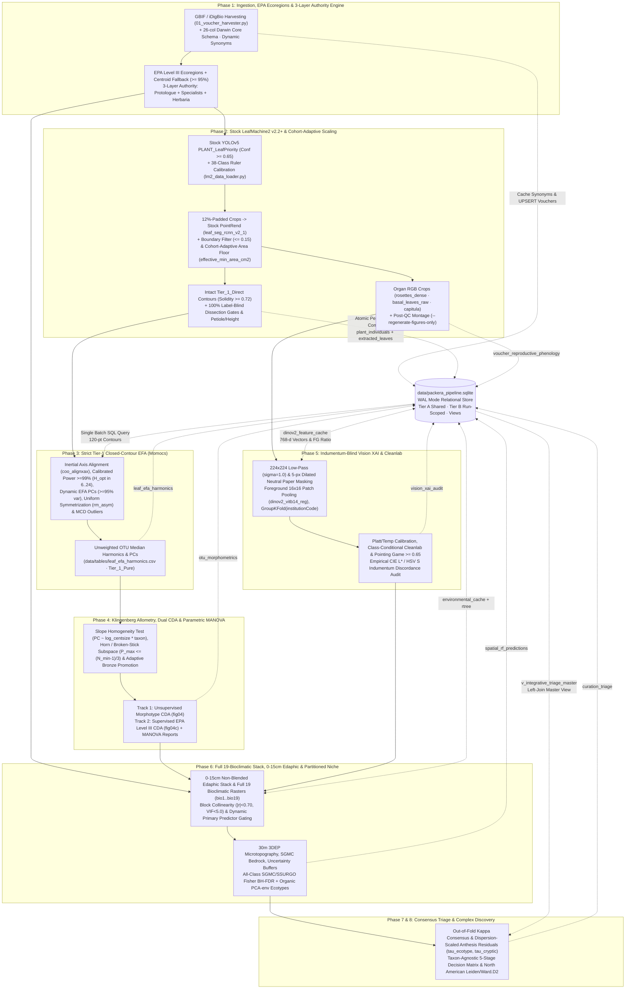

# Operational Workflow Guide: End-to-End Species Delimitation & Morphometrics Pipeline
### North American *Packera* Á. Löve & D. Löve (*P. dubia* Complex Baseline) (Asteraceae: Senecioneae)
**University of North Carolina at Chapel Hill Herbarium (NCU)**  
**Standard Operating Procedure:** `UNC-BOT-SOP-2026-04-REV5`  
**Author:** J. Brandon Fuller (PhD Candidate, UNC-CH Department of Biology)  
**Advisor:** Dr. Alan S. Weakley (Director, NCU Herbarium)

---

## 📋 Table of Contents

1. [Environment & Setup](#1-environment--setup)
   - [Windows / WSL 2 Setup Guide (`docs/WINDOWS_WSL2_SETUP.md`)](WINDOWS_WSL2_SETUP.md)
   - [A. Primary Python Pipeline Environment (`.venv`)](#a-primary-python-pipeline-environment-venv)
   - [B. LeafMachine2 Dedicated Virtual Environment (`.venv_LM2`)](#b-leafmachine2-dedicated-virtual-environment-venv_lm2)
   - [C. R Statistical Computing Environment](#c-r-statistical-computing-environment)
   - [⚡ Quick-Start Copy-Paste Terminal Cheat-Sheet](#-quick-start-copy-paste-terminal-cheat-sheet)
   - [Recommended Multi-Stage Execution Sequence](#recommended-multi-stage-execution-sequence)
2. [CLI Feature Flags & Execution Reference](#cli-feature-flags--execution-reference)
   - [Tier 1: Master Run-Scoped Shell Orchestrator (`./run_pipeline.sh`)](#tier-1-master-run-scoped-shell-orchestrator-run_pipelinesh)
   - [Tier 2: Unified Python CLI (`python main.py <subcommand>`)](#tier-2-unified-python-cli-python-mainpy-subcommand)
   - [Tier 3: Standalone Per-Step & Utility Script Flags](#tier-3-standalone-per-step--utility-script-flags)
3. [Eight-Phase Automated Pipeline Overview](#3-eight-phase-automated-pipeline-overview)
4. [Phase 1: Voucher Ingestion & Strict Active/Passive Authority Stratification](#phase-1-voucher-ingestion--strict-activepassive-authority-stratification)
5. [Phase 2: Stock LeafMachine2 v2.2+ Segmentation, Boundary-Continuity Lobe Rejection & Cohort-Adaptive Organ Scaling](#phase-2-stock-leafmachine2-v22-segmentation-boundary-continuity-lobe-rejection--cohort-adaptive-organ-scaling)
6. [Phase 3: Strict Tier-1 Closed-Contour EFA, Dynamic Harmonic Power Calibration, Symmetrization & OTU Medians](#phase-3-strict-tier-1-closed-contour-efa-dynamic-harmonic-power-calibration-symmetrization--otu-medians)
7. [Phase 4: Klingenberg Allometry, Dynamic Morphometric Subspace Selection, Dual CDA & Parametric MANOVA](#phase-4-klingenberg-allometry-dynamic-morphometric-subspace-selection-dual-cda--parametric-manova)
8. [Phase 5: Taphonomic Indumentum-Blind Vision XAI, Foreground Patch Pooling & OOD Scoring](#phase-5-taphonomic-indumentum-blind-vision-xai-foreground-patch-pooling--ood-scoring)
9. [Phase 6: Full 19-Bioclimatic Stack, 0–15 cm Rhizosphere ENM & Dynamic Primary Predictor Gating](#phase-6-full-19-bioclimatic-stack-015-cm-rhizosphere-enm--dynamic-primary-predictor-gating)
10. [Phase 7 & 8: Reliability-Weighted Consensus, Dispersion-Scaled Anthesis Envelopes, 5-Stage Decision Matrix & Complex Discovery](#phase-7--8-reliability-weighted-consensus-dispersion-scaled-anthesis-envelopes-5-stage-decision-matrix--complex-discovery)
11. [Automated Test Suite Verification](#11-automated-test-suite-verification)
12. [Key Literature & Citations](#12-key-literature--citations)

---

## 1. Environment & Setup

> [!TIP]
> **Windows Users (WSL 2 Setup Guide):**  
> If running on Windows, the recommended and supported execution environment is **Windows Subsystem for Linux (WSL 2 with Ubuntu)**. Please follow our step-by-step setup guide in [`docs/WINDOWS_WSL2_SETUP.md`](WINDOWS_WSL2_SETUP.md).

The pipeline operates across two dedicated Python environments and an R statistical environment:

### A. Primary Python Pipeline Environment (`.venv`)
Used for orchestration (`main.py`), voucher harvesting, `dinov2_vitb14_reg` foreground patch embeddings, Cleanlab XAI, and quality assurance tests:
```bash
source .venv/bin/activate
pip install -r requirements.txt
```

### B. LeafMachine2 Dedicated Virtual Environment (`.venv_LM2`)
Houses stock LeafMachine2 v2.2+, YOLOv5 (`PLANT_LeafPriority` / `LeafPriority.pt` and the 38-class Ruler Detector), and compiled Detectron2 PointRend (`leaf_seg_rcnn_v2_1`) with strict ABI pins (`numpy<2.0`, `opencv-contrib-python<=4.10.0.84`):
```bash
bash setup_leafmachine2.sh
```

> [!NOTE]
> **Zero Custom Retraining or Manual Annotation Required:**  
> The automated production pipeline uses stock LeafMachine2 v2.2+ `PLANT_LeafPriority` and `leaf_seg_rcnn_v2_1` weights out of the box. The standalone utilities in `scripts/annotation_and_training/` and `docs/SAM2_Precision_Botanical_Annotation_Guide.txt` are archived/optional tools not required by the automated pipeline.

### C. R Statistical Computing Environment
Requires R $\ge 4.3$ with database packages (`DBI`, `RSQLite`), CRAN statistical and spatial macroecological packages (`remotes`, `tidyverse`, `optparse`, `mclust`, `clustvarsel`, `MorphoTools2`, `RRPP`, `vegan`, `terra`, `sf`, `geodata`, `soilDB`, `spatialRF`, `ranger`, `adespatial`, `blockCV`, `ecospat`, `ENMTools`, `igraph`, `patchwork`, `viridis`) and `Momocs` (`remotes::install_github("MomX/Momocs")`):
```bash
Rscript -e 'install.packages(c("DBI", "RSQLite", "remotes", "tidyverse", "optparse", "mclust", "clustvarsel", "MorphoTools2", "RRPP", "vegan", "terra", "sf", "geodata", "soilDB", "spatialRF", "ranger", "adespatial", "blockCV", "ecospat", "ENMTools", "igraph", "patchwork", "viridis"), repos="https://cloud.r-project.org"); if (!requireNamespace("Momocs", quietly=TRUE)) remotes::install_github("MomX/Momocs")'
```

---

### ⚡ Quick-Start Copy-Paste Terminal Cheat-Sheet

#### A. Environment Activation & Preflight Verification
```bash
source .venv/bin/activate
python main.py check-env
```

#### B. End-to-End Automated Pipeline (`run_pipeline.sh` CLI & Dual-Strategy Single-Taxon Modes)
Every pipeline execution via `./run_pipeline.sh` or `python main.py` operates under the **Canonical Two-Tier Storage Architecture**: invariant Step 01–02 specimen/organ assets reside in canonical root `data/` and are automatically seeded/symlinked into `runs/<RUN_ID>/` (updating `runs/latest`), while all Step 03–08 statistical tables, reports, logs, and figures (`.pdf` + 300-DPI `.png`) are isolated inside `runs/<RUN_ID>/`:
```bash
source .venv/bin/activate

# 1. Default zero-flag genus-wide run (creates runs/run_<YYYYMMDD_HHMMSS>/ and updates runs/latest)
#    Running with NO taxon flags dynamically queries and harvests ALL Packera species across the entire
#    genus from GBIF (discover_genus_packera_species_gbif(), target_species: []):
./run_pipeline.sh

# 2. User-specified taxon subset mode (--taxon "Packera <sp1>" "Packera <sp2>" ...):
#    Analyzes strictly the species specified by the user with zero hardcoded default species or injected outgroups:
./run_pipeline.sh --run-id packera_subset --taxon "Packera dubia" "Packera anonyma" "Packera paupercula"

# 3. Launch a custom named run (--run-id <NAME>) reusing cached vouchers & local images (--skip-harvest)
./run_pipeline.sh --run-id packera_full_run --skip-harvest

# 4. Resume an existing run from any step (--start-step <1..7>, e.g., Step 03 EFA or Step 04 GMM/CDA onward)
./run_pipeline.sh --run-id packera_full_run --skip-harvest --start-step 3

# 5. Strategy 1: Focal Taxon + Outgroup Gold Reference Anchors (--focal-taxon "<TAXON>" --gold-anchors 30)
# (Cascades Gold -> Silver -> Bronze anchors when an outgroup taxon lacks Tier_1_Gold vouchers)
./run_pipeline.sh --run-id dubia_triage --skip-harvest --focal-taxon "Packera dubia" --gold-anchors 30

# 6. Strategy 2: Pure Intraspecific Delimitation Mode (--focal-taxon "<TAXON>" --intraspecific-mode)
./run_pipeline.sh --run-id dubia_cryptic --skip-harvest --focal-taxon "Packera dubia" --intraspecific-mode

# 7. Continent-wide North American expansion across US, Canada, and Mexico with dynamic synonym expansion
./run_pipeline.sh --run-id na_wide_run --geographic-scope north_america --include-western --countries "US,CA,MX" --expand-synonyms

# 8. Unsupervised North American taxon-complex discovery across harvested vouchers
./run_pipeline.sh --run-id eastern_complexes --discover-complexes --spatial-thin-km 5.0

# 9. Post-QC Step 02 montage regeneration (called automatically after Step 04)
python scripts/pipeline/02_segment_and_extract.py --regenerate-figures-only

# 10. Step 08: Standalone North American Taxon-Complex Discovery
Rscript scripts/analysis/08_discover_taxon_complexes.R \
    --harmonics data/tables/leaf_efa_harmonics.csv \
    --vouchers data/tables/curated_vouchers.csv \
    --multimodal data/tables/multimodal_conflict_flags.csv \
    --vision data/tables/label_noise_audit.csv \
    --output-dir outputs/reports
```

---

### Recommended Multi-Stage Execution Sequence

To execute a complete, rigorous systematic revision of *Packera dubia* and allied taxa while avoiding cold cache downloads, execute the following 5-stage protocol:

| Stage | Objective | Production Command |
| :--- | :--- | :--- |
| **Stage 1: Baseline Harmonization** | Full genus-wide (or user-specified `--taxon`) harvest, ruler calibration, LeafMachine2 segmentation, EFA, GMM/CDA, DINOv2 XAI, and multimodal random forests. | `./run_pipeline.sh --run-id stage1_baseline` |
| **Stage 2: Promote Manifests** | Step 01–02 manifests, 120-vertex contours, and edaphic/embedding caches are automatically persisted into `data/packera_pipeline.sqlite`. Optionally promote CSV tables into canonical `data/tables/` via `cp` or `export_table_or_view_to_csv_atomic()`. | `cp runs/stage1_baseline/data/tables/*.csv data/tables/` |
| **Stage 3: Pure Intraspecific Mode** | Delimit cryptic lineages and morphotypes within *P. dubia* strictly (`n_unique_taxa == 1`), gating Step 04–06 on GMM clusters and `PCA-env` ecotypes. | `./run_pipeline.sh --run-id stage3_dubia_cryptic --skip-harvest --focal-taxon "Packera dubia" --intraspecific-mode` |
| **Stage 4: Outgroup Gold Anchors** | Calibrate *P. dubia* against 30 reference anchors per outgroup species (cascading Gold -> Silver -> Bronze) for definitive curation triage. | `./run_pipeline.sh --run-id stage4_dubia_triage --skip-harvest --focal-taxon "Packera dubia" --gold-anchors 30` |
| **Stage 5: Full Tree Discovery** | Expand harvest across Eastern North America or continent-wide (`--geographic-scope north_america`) and perform unsupervised network community discovery. | `./run_pipeline.sh --run-id stage5_eastern_tree --discover-complexes` |

---

## CLI Feature Flags & Execution Reference

The pipeline provides three unified tiers of command-line execution:
1. **Tier 1 (`./run_pipeline.sh`)**: Master run-scoped shell orchestrator managing database isolation, directory symlinks, environment switching (`.venv` vs. `.venv_LM2`), preflight cohort filtering, and cross-stage execution.
2. **Tier 2 (`python main.py <subcommand>`)**: Unified Python CLI exposing modular phase-by-phase execution, environment preflight, model weight management, and diagnostic calibration.
3. **Tier 3 (Standalone Per-Step Scripts)**: Direct CLI invocation of individual Python (`01`, `02`, `05`, SAM 2) and R (`03`, `04`, `06`, `07`, `08`) statistical modules.

---

### Tier 1: Master Run-Scoped Shell Orchestrator (`./run_pipeline.sh`)

#### Run & Database Isolation Flags
| Flag | Arguments | Default | Description |
| :--- | :--- | :--- | :--- |
| `--run-id` | `<ID>` | `run_<YYYYMMDD_HHMMSS>` | Custom identifier for isolated run directory under `runs/<ID>/`; atomically updates the `runs/latest` symlink. |
| `--db` | `<PATH>` | `data/packera_pipeline.sqlite` | Override path to transactional WAL SQLite database (exports `PACKERA_DB_PATH` to all child processes). |
| `--demo` | *(none)* | `false` | Run in ephemeral test isolation mode (`PACKERA_DEMO_MODE=1`), writing to `runs/<ID>/data/demo_ephemeral.sqlite`. |
| `--start-step` | `<1..8>` | `1` | Start or resume execution at a specific phase (1=Harvest, 2=Segment, 3=EFA, 4=GMM/CDA, 5=Vision XAI, 6=Spatial RF, 7=Triage Synthesis, 8=Taxon Complex Discovery), automatically seeding upstream assets. |
| `--skip-harvest` | *(none)* | `false` | Reuse existing `curated_vouchers.csv` and local raw images without re-querying GBIF. |
| `--force`, `--overwrite` | *(none)* | `false` | Force re-execution and overwrite cached artifacts across phases. |
| `--resegment`, `--force-segment` | *(none)* | `false` | Force fresh Step 02 LeafMachine2 + PointRend segmentation even if contour files already exist. |
| `--limit` | `<N>` | `0` *(unlimited)* | Cap the maximum number of vouchers processed in Step 02 segmentation. |
| `--sam2-refine` | *(none)* | `false` | Enable automated LM2-guided SAM 2.1 sub-pixel boundary refinement on Stage 2 leaf crops. |
| `--regenerate-figures-only` | *(none)* | `false` | Re-render Step 02 diagnostic figures (`fig02a`, `fig02b`) using post-QC validated silhouettes without re-running segmentation. |

#### Taxonomic Scope & Complex Discovery Flags
| Flag | Arguments | Default | Description |
| :--- | :--- | :--- | :--- |
| `--focal-taxon` | `"<Binomial>"` | *(none)* | Target a focal *Packera* species (e.g., `"Packera anonyma"`) for targeted CDA, spatial niche modeling, and revision synthesis. |
| `--taxon`, `--taxa` | `"<Sp1>" "<Sp2>" ...` | *(all / genus-wide)* | Explicitly specify one or more target *Packera* binomials to harvest and analyze (omit to harvest the entire genus dynamically from GBIF). |
| `--exclude-taxon` | `"<Binomial>"` | *(none)* | Exclude one or more specified taxa from the active run (repeatable; e.g., `--exclude-taxon "Packera plattensis"`). |
| `--intraspecific-mode` | *(none)* | `false` | Run single-taxon intraspecific morphotype/ecotype delimitation mode across Steps 04–07 (`n_unique_taxa == 1`), gating on GMM morphotypes and `PCA-env` ecotypes. |
| `--expand-synonyms` / `--no-expand-synonyms` | *(none)* | `--expand-synonyms` | Toggle automatic expansion of *Packera* binomials to historical *Senecio* and *Cineraria* basionyms/synonyms via the GBIF Taxonomic Backbone. |
| `--discover-complexes` | *(none)* | `false` | Trigger Step 08 unsupervised Leiden/Louvain and Ward.D2 taxon-complex discovery (`scripts/analysis/08_discover_taxon_complexes.R`). |
| `--auto-neighbors` | *(none)* | `false` | Run Step 08 first to automatically discover high-affinity neighbor taxa ($W_{ij} \ge \text{min\_affinity}$) around `--focal-taxon` and scope downstream focal synthesis to that empirical complex. |
| `--min-affinity` | `<FLOAT>` | `0.03` | Minimum multi-modal affinity weight $W_{ij}$ threshold for connecting species nodes in the Step 08 complex graph. |

#### Authority Tiering, Reference Anchors & Misidentification Filtering Flags
| Flag | Arguments | Default | Description |
| :--- | :--- | :--- | :--- |
| `--gold-anchors` | `<N>` | `30` | Target number of Tier 1 Gold reference anchors per outgroup taxon in Strategy 1 focal runs (cascades Gold $\rightarrow$ Silver $\rightarrow$ Bronze). |
| `--gold-only` | *(none)* | `false` | Restrict cohort strictly to `Tier_1_Gold` monograph-authority vouchers prior to model fitting. |
| `--determiner-tier` | `<TIER>` | *(all)* | Filter vouchers strictly to a specified determiner authority tier (e.g., `Tier_1_Gold`, `Tier_2_Silver`, `Tier_3_Bronze`). |
| `--exclude-misidentified` | *(none)* | `false` | Prune vouchers flagged as misidentified (`Misidentification_Reassign`) in prior runs before fitting downstream models. |
| `--triage-source` | `<SOURCE>` | `ALL` | Source of triage reports for misidentification pruning (`ALL` existing runs, or comma-separated run IDs). |

#### Geographic Scope & Spatial Sampling Flags
| Flag | Arguments | Default | Description |
| :--- | :--- | :--- | :--- |
| `--geographic-scope` | `{eastern_na,north_america,global}` | `eastern_na` | Set GBIF harvesting and longitudinal filtering envelope (`eastern_na` enforces $\ge -106.65^\circ\text{W}$; `north_america` and `global` disable the western cutoff). |
| `--include-western`, `--no-exclude-western` | *(none)* | `false` | Retain occurrences west of $-106.65^\circ\text{W}$ across western US, Canada, and Mexico. |
| `--countries` | `"<ISO2 ...>"` | `US` | Space-separated ISO-2 country codes for GBIF harvesting (e.g., `--countries "US CA MX"`). |
| `--spatial-thin-km` | `<FLOAT>` | `0.0` *(disabled)* | Minimum spatial grid thinning distance in km per species to attenuate herbarium collection clustering. |
| `--max-per-state` | `<INT>` | *(unlimited)* | Cap maximum vouchers retained per `(species, stateProvince)`. |
| `--max-per-region` | `<INT>` | *(unlimited)* | Cap maximum vouchers retained per EPA Level III Ecoregion. |
| `--no-spatial-weights` | *(none)* | `false` | Disable inverse spatial-density weighting during reference model fitting. |

---

### Tier 2: Unified Python CLI (`python main.py <subcommand>`)

#### Global Flags
All `python main.py` subcommands accept the following global options:
- `-c`, `--config <PATH>`: Path to YAML pipeline configuration file (default: `config/config.yaml`).
- `-v`, `--verbose`: Enable detailed debug logging.
- `--run-id <ID>`: Specify an explicit run identifier under `runs/<ID>/`.
- `--db <PATH>`: Path to SQLite WAL relational database (default: `data/packera_pipeline.sqlite`).

#### Subcommands Reference
| Subcommand | Syntax & Primary Options | Operational Scope |
| :--- | :--- | :--- |
| **`check-env`** | `python main.py check-env [--strict]` | Verifies Python $\ge 3.10$, PyTorch CUDA acceleration, R installation, core packages, and LeafMachine2 submodule. |
| **`download-weights`** | `python main.py download-weights [--force]` | Verifies or downloads YOLOv5 (`LeafPriority.pt`), PointRend (`leaf_seg_rcnn_v2_1`), and SAM 2 model checkpoints with SHA-256 integrity checks. |
| **`harvest`** | `python main.py harvest [--run-id ID] [--db PATH] [--taxa ...] [--out-dir DIR] [--output-csv PATH] [--max-records N] [--max-uncertainty M] [--min-megapixels MP] [--min-file-size-kb KB] [--concurrency N] [--download-images] [--force]` | Queries GBIF/iDigBio, standardizes taxon synonyms, assigns EPA Level III Ecoregions, stratifies 3-layer determiner authority, and downloads voucher imagery. |
| **`segment`** | `python main.py segment [--run-id ID] [--db PATH] [--vouchers PATH] [--weights PATH] [--output-dir DIR] [--device cuda\|cpu] [--min-solidity FLOAT] [--min-ucs FLOAT] [--score-thresh FLOAT] [--limit N] [--sam2-refine] [--sam2-checkpoint PATH] [--sam2-config PATH] [--force]` | Runs two-stage LeafMachine2 v2.2+ detection and PointRend segmentation with cohort-adaptive organ scaling, dimensionless gatekeeping, and per-voucher SQLite transactions. |
| **`morphometrics`** | `python main.py morphometrics [--run-id ID] [--db PATH] [--input DIR] [--manifest PATH] [--contours-dir DIR] [--vouchers PATH] [--reproductive PATH] [--harmonics-out PATH] [--flags-out PATH] [--plot-out PATH] [--report-out PATH] [--allometry-report PATH] [--allometry-pairwise PATH] [--allometry-plot PATH] [--output-batch-audit PATH] [--harmonics K] [--num-pcs P] [--max-k K] [--focal-taxon TAXON] [--intraspecific-mode]` | Executes Step 03 EFA with dynamic harmonic power calibration ($H_{\text{opt}} \in [6, 24]$) and Step 04 Klingenberg allometry, Kass-Raftery GMM, and dual-track CDA. |
| **`synthesis`** *(alias: `analyze`)* | `python main.py synthesis [--run-id ID] [--db PATH] [--vouchers PATH] [--manifest-csv PATH] [--rosette-dir DIR] [--morphometrics-csv PATH] [--pheno-states PATH] [--vision-audit PATH] [--cleanlab-threshold FLOAT] [--export-figures / --no-export-figures] [--env-dir DIR] [--ssurgo-table PATH] [--contingency-table PATH] [--pheno-anomalies PATH] [--pheno-summary PATH] [--pheno-plot PATH] [--conflict-flags PATH] [--spatial-plot PATH] [--spatial-summary PATH] [--permutations N] [--n-trees N] [--gmm-summary PATH] [--output-queue PATH] [--synthesis-plot PATH] [--synthesis-report PATH] [--xai-plot PATH] [--focal-taxon TAXON] [--intraspecific-mode]` | Orchestrates Step 05 DINOv2 foreground patch XAI, Step 06 19-bioclimatic edaphic spatial RF with dynamic primary predictor gating, and Step 07 consensus triage synthesis. |
| **`run-all`** | `python main.py run-all [all combined flags from harvest, segment, morphometrics, synthesis]` | Full end-to-end automated pipeline execution from GBIF harvest through final 5-stage taxonomic revision synthesis. |
| **`calibrate-geometry`** | `python main.py calibrate-geometry [--annotations PATH] [--output-plot PATH] [--config-path PATH] [--min-area FLOAT] [--category-id INT]` | Optimizes classical dimensionless gatekeeper thresholds on ground-truth annotations via ROC curves and Youden's $J$ statistic. |

---

### Tier 3: Standalone Per-Step & Utility Script Flags

For advanced experimentation or isolated execution, individual scripts can be invoked directly:

- **Step 01 (`scripts/data_prep/01_voucher_harvester.py`)**:
  `--taxon/--taxa <NAMES>`, `--expand-synonyms/--no-expand-synonyms`, `--geographic-scope <eastern_na|north_america|global>`, `--include-western`, `--exclude-western/--no-exclude-western`, `--countries <CODES>`, `--home-herbarium <CODE>`, `--max-records <N>`, `--max-uncertainty <METERS>`, `--download-images`, `--concurrency <N>`, `--min-megapixels <MP>`, `--min-file-size-kb <KB>`, `--check-sharpness`, `--min-sharpness <FLOAT>`, `--spatial-thin-km <KM>`, `--max-per-state <N>`, `--max-per-region <N>`, `--force`, `--db <PATH>`, `-v/--verbose`.
- **Step 02 (`scripts/pipeline/02_segment_and_extract.py`)**:
  `--vouchers <PATH>`, `--model-weights <PATH>`, `--output-dir <DIR>`, `--device <cuda|cpu>`, `--min-solidity <FLOAT>`, `--min-ucs <FLOAT>`, `--score-thresh <FLOAT>`, `--sam2-refine`, `--sam2-checkpoint <PATH>`, `--sam2-config <PATH>`, `--force`, `--limit <N>`, `--db <PATH>`, `--regenerate-figures-only`.
- **Step 03 (`scripts/morphometrics/03_fourier_extractor.R`)**:
  `-i/--input <DIR>`, `-c/--contours-dir <DIR>`, `-f/--manifest <PATH>`, `-m/--masks-dir <DIR>`, `-v/--vouchers <PATH>`, `-o/--output <PATH>`, `--output-individual <PATH>`, `-k/--harmonics <N>`, `-p/--num-pcs <N>`, `-r/--report-out <PATH>`, `-g/--plot-out <PATH>`, `--figures-dir <DIR>`, `--symmetrize-efa-harmonics`, `--permutations <N>`, `--seed <INT>`.
- **Step 04 (`scripts/morphometrics/04_gmm_morphotools.R`)**:
  `-v/--vouchers <PATH>`, `-e/--harmonics <PATH>`, `-m/--reproductive <PATH>`, `--outline-only`, `--correct-allometry <auto|true|false>`, `--allometry-report <PATH>`, `--allometry-pairwise <PATH>`, `--allometry-plot <PATH>`, `--use-clustvarsel`, `-f/--output-flags <PATH>`, `-p/--output-plot <PATH>`, `-r/--output-report <PATH>`, `-b/--output-batch-audit <PATH>`, `-k/--max-k <INT>`, `-d/--num-pcs <INT>`, `--permutations <N>`, `--seed <INT>`, `--intraspecific-mode`, `--focal-taxon <NAME>`.
- **Step 05 (`scripts/analysis/05_cleanlab_vision_xai.py`)**:
  `--rosette-dir <DIR>`, `--vouchers-csv <PATH>`, `--output-csv <PATH>`, `--output-figure <PATH>`, `--cleanlab-threshold <FLOAT>`, `--neutralize-background/--no-neutralize-background`, `--export-figures/--no-export-figures`, `--filter-abaxial-artifacts/--no-filter-abaxial-artifacts`, `--stratify-by-orientation`, `--intraspecific-mode`, `--morphometrics-csv <PATH>`, `--manifest-csv <PATH>`, `--focal-taxon <NAME>`, `--demo`, `--db <PATH>`.
- **Step 06 (`scripts/analysis/06_multimodal_spatial_rf.R`)**:
  `-v/--vouchers <PATH>`, `-m/--morphometrics <PATH>`, `-n/--vision-audit <PATH>`, `--pheno-states <PATH>`, `-e/--env-dir <DIR>`, `-f/--output-flags <PATH>`, `-p/--output-plot <PATH>`, `-s/--output-summary <PATH>`, `--pheno-anomalies <PATH>`, `--pheno-summary <PATH>`, `--pheno-plot <PATH>`, `--ssurgo-cache <DIR>`, `--ssurgo-table <PATH>`, `--contingency-table <PATH>`, `--batch-size <INT>`, `-k/--permutations <N>`, `-t/--n-trees <INT>`, `--intraspecific-mode`, `--focal-taxon <NAME>`, `--demo`.
- **Step 07 (`scripts/analysis/07_triage_dashboard_synthesis.R`)**:
  `-v/--vouchers <PATH>`, `-m/--morphometrics <PATH>`, `--linear-traits <PATH>`, `-n/--vision-audit <PATH>`, `-c/--multimodal-flags <PATH>`, `--spatial-flags <PATH>`, `-g/--gmm-summary <PATH>`, `--gmm-bic <PATH>`, `--cda-summary <PATH>`, `-s/--niche-summary <PATH>`, `-q/--output-queue <PATH>`, `--output-triage <PATH>`, `-p/--output-plot <PATH>`, `--output-figure <PATH>`, `-r/--output-report <PATH>`, `--output-html <PATH>`, `--focal-taxon <NAME>`, `--intraspecific-mode`, `--demo`.
- **Step 08 (`scripts/analysis/08_discover_taxon_complexes.R`)**:
  `-m/--morphometrics <PATH>`, `-e/--harmonics <PATH>`, `-n/--vision-audit <PATH>`, `-v/--vouchers <PATH>`, `-c/--multimodal <PATH>`, `--focal-taxon <NAME>`, `--min-affinity <FLOAT>`, `--output-complexes <PATH>`, `--output-affinity <PATH>`, `--output-neighbors <PATH>`, `--output-figure <PATH>`.
- **SAM 2 Interactive Annotator & PointRend Fine-Tuning**:
  - `annotate_with_sam2.py`: `--images-dir <DIR>`, `--output-dir <DIR>`, `--output-coco <PATH>`, `--single-image <PATH>`, `--checkpoint <PATH>`, `--config <PATH>`, `--export-coco`, `--masks-dir <DIR>`, `--crops-dir <DIR>`, `--full-sheet`, `--val-split <FLOAT>`, `--resume-last`, `--resume-unannotated`, `--voucher <NAME>`, `--index <INT>`, `--tier <1|2|3|all>`, `--vouchers-csv <PATH>`.
  - `finetune_lm2_pcd.py`: `--iterations <N>`, `--lr <FLOAT>`, `--batch-size <N>`, `--freeze-stages <INT>`, `--device <cuda|cpu>`, `--dry-run`.

---

## 3. Eight-Phase Automated Pipeline Overview



---

## Phase 1: Voucher Ingestion & Strict Active/Passive Authority Stratification

- **Scripts:** [`scripts/data_prep/01_voucher_harvester.py`](../scripts/data_prep/01_voucher_harvester.py), [`scripts/core/harvester.py`](../scripts/core/harvester.py), [`scripts/core/config.py`](../scripts/core/config.py)
- **Relational DB & Manifest Contracts:**
  - **SQLite Tables Read / Written:** Reads & writes `taxon_synonyms` (cached synonyms); writes `vouchers` (PK: `catalogNumber`, atomic UPSERT) in `data/packera_pipeline.sqlite`.
  - **Synchronized CSV Outputs:** Canonical Darwin Core manifest `data/tables/curated_vouchers.csv` (26 canonical columns).
- **Empirical Protocol:**
  1. **Dynamic Taxon Standardization & GBIF Synonym Expansion (`standardize_packera_taxon`):** Harmonizes binomials and basionyms across all North American *Packera* taxa (e.g., *Senecio pauperculus*, *Senecio smallii*, *Senecio plattensis*, *Senecio anonymous*, *Senecio obovatus*, *Senecio aureus*, etc.) into valid accepted binomials while handling arbitrary dynamic North American, boreal, and Mexican *Packera* species via `expand_taxon_synonyms_gbif()`. Running with no taxon flags dynamically queries and harvests all *Packera* species across the entire genus (`discover_genus_packera_species_gbif()`, `target_species: []`), whereas `--taxon "<sp1>" "<sp2>" ...` (or `--focal-taxon "<sp>"`) analyzes strictly the species specified by the user with zero hardcoded default species or injected outgroups. Configurable geographic filtering via `--geographic-scope {eastern_na,north_america,global}` (default: `eastern_na`, excluding longitudes $< -106.65$; `north_america` and `global` disable the western longitude boundary), `--include-western` (retaining occurrences west of $-106.65$), and `--countries` (default `["US"]`, expandable to `["US", "CA", "MX"]`).
  2. **Canonical 26 Darwin Core Columns:** Exports `data/tables/curated_vouchers.csv` with exactly: `catalogNumber`, `institutionCode`, `scientificName`, `species_raw`, `recordedBy`, `recordNumber`, `identifiedBy`, `determiner_raw`, `determiner_tier`, `type_status`, `county`, `stateProvince`, `decimalLatitude`, `latitude`, `decimalLongitude`, `longitude`, `coordinateUncertainty`, `year`, `month`, `day`, `eventDate`, `regional_group`, `image_path`, `exsiccatae_key`, `is_primary_duplicate`, `duplicate_count`.
  3. **Official US EPA Level III Ecoregion Attribution (`regional_group`):** Points are evaluated against official Level III polygons (`data/environmental/epa_ecoregions_l3/`, Omernik & Griffith 2014). For ungeoreferenced sheets with valid county metadata, the county polygon is checked for containment: if $\ge 95\%$ of county area resides in a single Level III ecoregion, that ecoregion is assigned; otherwise `NA`.
  4. **3-Layer Dynamic Expert & Herbarium Authority Engine (`parse_determiner_tier`):**
     - **Collector vs. Determiner Isolation:** `parse_determiner_tier()` restricts `SPECIALIST_PATTERNS` matching strictly to `identifiedBy` and `identificationHistory` (only falling back to `recordedBy` when `identifiedBy` is unrecorded or explicitly references the collector via `_should_fallback_to_collector()`), preventing collector-as-determiner false Gold promotions.
     - **Layer 1 (Genus-Wide Monographer Heuristics):** Expanded `SPECIALIST_PATTERNS` covering North American *Packera* and *Senecioneae* monographers and flora authors (Barkley, Trock, Kowal, Weakley, Bain, Mahoney, Fuller, Freeman, Cronquist, Greenman, Weber, Á. Löve & D. Löve, Spellenberg, Pippen, Uttal, Fernald, Rydberg, Heller, Kral, Godfrey, Sorrie, Nesom, Strother, Turner, Golden).
     - **Layer 2 (Automatic Protologue Author Extraction):** `extract_protologue_authors()` parses basionym and combination authors directly from Darwin Core `scientificName` strings; sheets annotated by a nomenclatural author of that taxon are classified as `Tier_1_Gold`.
     - **Layer 3 (Corpus-Derived Multi-Herbarium Determiner & Regional Herbarium Scoring):** `discover_corpus_authorities()` promotes determiners identifying $\ge 5$ specimens of a *Packera* taxon across $\ge 3$ distinct herbaria (`institutionCode`s)—or annotating $\ge 1$ verified type specimen—to `dynamic_specialists` (`Tier_1_Gold`), guarded by a cross-duplicate concordance check that discards candidates with $> 25\%$ conflicting duplicate determinations (`det_conflicted_groups / det_dup_groups > 0.25`). Promotes herbaria holding $\ge 1$ type specimen or ranking in the top quartile of holdings ($\ge 10$ sheets with $\ge 70\%$ determiner attribution) to `dynamic_herbaria` (`Tier_2_Silver`). General floristic collections and unverified aggregator records receive `Tier_3_Bronze`.
     - **Cross-Duplicate Exsiccatae Conflict Auditing:** `stratify_duplicates()` audits distributed exsiccatae series, identifying conflicting taxon determinations across duplicate sheets (`exsiccatae_taxonomic_conflict`) and elevating conflicting Bronze primary duplicates to Gold when verified by a specialist on duplicate sets (`exsiccatae_gold_taxon`).

---

## Phase 2: Stock LeafMachine2 v2.2+ Segmentation, Boundary-Continuity Lobe Rejection & Cohort-Adaptive Organ Scaling

- **Scripts:** [`scripts/pipeline/02_segment_and_extract.py`](../scripts/pipeline/02_segment_and_extract.py), [`scripts/vision/configure_leafmachine2.py`](../scripts/vision/configure_leafmachine2.py), [`scripts/vision/lm2_geometry_utils.py`](../scripts/vision/lm2_geometry_utils.py)
- **Relational DB & Manifest Contracts:**
  - **SQLite Tables Read / Written:** Reads `vouchers`; writes `plant_individuals` (PK: `(catalogNumber, plant_individual_id)`), `extracted_leaves` (PK: `(catalogNumber, plant_individual_id, leaf_id)`, storing 120-vertex `contour_xy_json` alongside dimensionless descriptors), and `voucher_reproductive_phenology` (PK: `(catalogNumber, plant_individual_id)`) inside per-voucher atomic SQLite transactions with $O(1)$ SQL resumption checks (`qc_status IN ('PASS', 'FAILED_QC')`).
  - **Synchronized CSV Outputs:** `data/tables/extracted_leaf_manifest.csv`, `data/tables/failed_qc_vouchers.csv`, `data/tables/voucher_reproductive_metrics.csv`, `data/tables/voucher_phenological_states.csv`.
- **Empirical Protocol:**
  1. **Stock LeafMachine2 v2.2+ Configuration (`configure_leafmachine2.py`):** Uses stock `PLANT_LeafPriority` (`minimum_confidence_threshold: 0.65`) and compiled Detectron2 PointRend (`leaf_seg_rcnn_v2_1`) weights with `treat_leaflet_as_leaf_whole: False`, `use_efds_for_png_masks: False`, and `do_apply_landmarks: False`.
  2. **Otsu Boundary-Continuity Lobe Rejection (`is_truncated_lobe_or_leaflet`):** Rejects severed lobes or unattached leaf fragments where non-paper plant tissue occupies $> 15\%$ of the bounding-box perimeter (`max_tissue_border_ratio: 0.15`).
  3. **Ruler-Calibrated Physical Area Floor & Cohort-Adaptive Scaling (`compute_sheet_adaptive_min_blade_area_cm2`):** Rather than enforcing a static area cutoff that discards miniature specimens, the minimum physical basal blade area floor scales dynamically to the sheet's calibrated leaf size distribution:
     $$\text{effective\_min\_area\_cm2} = \min(0.75, \max(0.15, 0.25 \times \text{median\_sheet\_leaf\_area\_cm2}))$$
     ensuring dwarf, alpine, or compact-rosette *Packera* taxa (e.g., high-elevation ecotypes) are never artificially excluded. Vertical rosette zone filtering automatically relaxes from sheet coordinates (`cy_rel >= 0.42` for Tier 1 or `0.48` for Tier 2) to plant bounding box coordinates (`cy_rel_p_m = (cy_sheet_m - ymin_plant) / plant_bbox_span >= 0.40`) whenever a specimen is mounted higher on the sheet.
  4. **Classical Dimensionless Descriptors & 100% Label-Blind Botanical Dissection Gates (`classify_and_route_leaf`):** Routes intact basal blades into `Tier_1_Direct` when $\text{Solidity} \ge 0.72$, $\text{Circularity} \ge 0.25$, $\text{Extent} \ge 0.35$, and $\text{UCS} \ge 0.85$. Dissected blades are evaluated via `is_botanical_dissection()` ($0.48 \le \text{Solidity} < 0.72$ pinnatifid; $0.18 \le \text{Solidity} < 0.48$ with $\ge 4$ deep sinuses bipinnatisect) in a 100% label-blind manner. Diagnostic figures utilize dynamic species sets (`present_sp`), empirical per-taxon median aspect ratios, and dynamic complex titles (`format_active_complex_title`).
  5. **Resolution-Adaptive Width Profiling & Cauline Contaminant Rejection:** Profiles cross-sectional widths via $w_{\text{span}} = \max(\min(\max(h, w), 350), \lfloor 0.65 \max(h, w) \rfloor)$ and scales petiole thresholds when $\text{axis\_len} > 450\text{ px}$. Rejects upper-stem sessile/clasping cauline bracts (`aspect_ratio > 3.8` and `solidity < 0.78` or displaced $> 2.2 \times$ median rosette radius).
  6. **Post-QC Basal-Leaf-Only Masking (`crop_dense_rosette_tier4`):** Executes after `is_cauline_or_stem_contaminant()` and the `Tier_1_Direct` gatekeeper, replacing non-basal-leaf tissue (roots, caudex, flowering stems, cauline leaves, rulers, labels, tape) outside the 5-pixel dilated union of verified basal leaf masks with neutral mounting paper RGB `[242, 239, 230]`, and saving crops alongside companion binary masks (`<catalogNumber>_p<pid>_rosette_mask.png`) in `data/cropped_patches/rosettes_dense/`.
  7. **Crown Point & Petiole Length Estimation:** Estimates rosette crown point $p_{\text{crown}}$ from inward basal midrib ray intersections and Class 9 root clumps. Per-leaf petiole length is $L_{\text{petiole}} = \max(d_{\text{geodesic}}(p_{\text{base}}, p_{\text{crown}}), \|p_{\text{base}} - p_{\text{crown}}\|_2)$. Outer-rosette petiole length is aggregated at the 75th percentile ($P_{75}$).
  8. **Scape Height & Stem Posture:** Computes straight vs. bent scape height: $H_{\text{plant}} = \|p_{\text{bend}} - p_{\text{crown}}\|_2 + \|p_{\text{corymb}} - p_{\text{bend}}\|_2$.
  9. **Post-QC Step 02 Montage Regeneration:** Automatically regenerated after Step 04 outlier pruning via `python scripts/pipeline/02_segment_and_extract.py --regenerate-figures-only`.

---

## Phase 3: Strict Tier-1 Closed-Contour EFA, Dynamic Harmonic Power Calibration, Symmetrization & OTU Medians

- **Script:** [`scripts/morphometrics/03_fourier_extractor.R`](../scripts/morphometrics/03_fourier_extractor.R)
- **Relational DB & Manifest Contracts:**
  - **SQLite Tables Read / Written:** Reads `extracted_leaves` (single-query batch SQL contour ingestion of 120-point coordinates, eliminating 14,000+ CSV reads, with directory CSV fallback for unit tests), `vouchers`, and `plant_individuals`; writes `leaf_efa_harmonics` (run-scoped).
  - **Synchronized CSV Outputs:** `data/tables/leaf_efa_harmonics.csv`, `outputs/reports/fourier_pcs.csv`, `outputs/reports/symmetric_fourier_pcs.csv`.
- **Empirical Protocol:**
  1. **Strict `Tier_1_Direct` Closed-Contour Scope:** Only intact `Tier_1_Direct` basal leaf contours enter `Momocs::efourier` (mirrored hemi-blades or open-curve approximations are strictly excluded).
  2. **Inertial Axis Pre-Alignment (`Momocs::coo_alignxax`) with Suborbicular Guard:** Aligns contours along their major inertial axis when blade circularity $\le 0.75$, protecting suborbicular blades ($>0.75$) from $90^\circ$ rotation artifacts while locking base-to-apex polarity.
  3. **$\ge 99\%$ Cumulative Harmonic Power Calibration (`calibrate_harmonicpower_efourier`):** Uses `Momocs::calibrate_harmonicpower_efourier()` to dynamically determine the minimum harmonic count $H_{\text{opt}} \in [6, 24]$ capturing $\ge 99\%$ cumulative harmonic power across the studied plant cohort before running `Momocs::efourier(..., nb.h = H_opt, norm = FALSE, start = FALSE)`. Records `efd_harmonic_opt` in run metadata and reports.
  4. **Uniform Bilateral Symmetrization (`Momocs::rm_asym`, Claude 2008):** Isolates symmetric harmonic coefficients ($A_n, D_n$) uniformly across all intact contours to remove taphonomic pressing curvature.
  5. **MCD Mahalanobis Outlier Filtering & Unweighted OTU Medians:** Removes contour extraction anomalies via Minimum Covariance Determinant Mahalanobis distance (`MASS::cov.rob`, $p < 0.001$) and `pct_asymmetry > 0.22 | harmonic_roughness > 0.15`, carrying forward Step 02 linear petiole/blade traits and Step 01 DwC metadata.
  6. **Dynamic Variance-Explained PC Export:** Dynamically exports all principal components necessary to achieve $\ge 95\%$ cumulative variance ($k_{\text{export}} = \max(5, k_{95})$, persisted in `efd_k95_pcs`), then aggregates multi-leaf vouchers to the Specimen / Operational Taxonomic Unit (`(catalogNumber, plant_individual_id)`) via **unweighted coordinate-wise median** harmonics (`data/tables/leaf_efa_harmonics.csv`) and PCs (`fourier_pcs.csv`, `symmetric_fourier_pcs.csv`) with `morph_tier_source = "Tier_1_Pure"`.

---

## Phase 4: Klingenberg Allometry, Dynamic Morphometric Subspace Selection, Dual CDA & Parametric MANOVA

- **Scripts:** [`scripts/morphometrics/04_gmm_morphotools.R`](../scripts/morphometrics/04_gmm_morphotools.R), [`scripts/morphometrics/authority_weighting_utils.R`](../scripts/morphometrics/authority_weighting_utils.R)
- **Relational DB & Manifest Contracts:**
  - **SQLite Tables Read / Written:** Reads `vouchers`, `plant_individuals`, and `leaf_efa_harmonics`; writes `otu_morphometrics` (run-scoped).
  - **Synchronized CSV Outputs:** `data/tables/morphometric_flags.csv`, `outputs/reports/allometry_homogeneity_test.csv`, `outputs/reports/gmm_bayes_factors_summary.csv`, `outputs/reports/institutional_batch_effect_audit.csv`, `outputs/reports/ecoregion_supervised_cda_summary.csv`, `outputs/reports/manova_group_significance.csv`, `outputs/reports/manova_pairwise_posthoc.csv`.
- **Empirical Protocol:**
  1. **Empirical Bayes Weighting & Adaptive Reference Anchor Selection (`authority_weighting_utils.R`):**
     - **`select_adaptive_reference_anchors()`:** Initializes reference anchors with `Tier_1_Gold` and `Tier_2_Silver` `Tier_1_Pure` vouchers pruned once at Mahalanobis $\chi^2_{0.95, p}$ (avoiding double truncation of reference tails in downstream steps). When an under-annotated or rare *Packera* taxon has fewer than `min_anchors_per_taxon` (default 8, or $< 3$) clean Gold+Silver anchors, it automatically promotes the most central `Tier_3_Bronze` `Tier_1_Pure` vouchers within $\chi^2_{0.80, p}$ of the taxon medoid (`is_promoted_anchor = TRUE`), ensuring GMM and CDA never drop Gold-poor taxa.
     - **`compute_empirical_bayes_authority_weights()`:** Computes unified 2-step Dawid-Skene / Beta-Binomial Empirical Bayes shrinkage weights ($\alpha_0 = 5.0$, prior reliabilities $\pi_{\text{Gold}} = 0.95$, $\pi_{\text{Silver}} = 0.85$, $\pi_{\text{Promoted Bronze}} = 0.65$, $\pi_{\text{Unpromoted Bronze}} = 0.35$):
       $$\theta^{(c)}_t = \frac{\alpha_0 \pi_t + s_c}{\alpha_0 + n_c},\quad \theta^{(d)} = \frac{\alpha_0 \bar{\pi}_d + s_d}{\alpha_0 + n_d}$$
       blending cell-level tier shrinkage with individual determiner logit offsets. In `"active_passive"` mode: unpromoted `Tier_3_Bronze` vouchers receive `0.0` (passive projection), while active anchors receive precision weights rescaled to mean `1.0`. Step 04 uses taxon-agnostic discordance strings (`<raw_sp>_Discordant_to_<pred_sp>`) and `"Unassigned_Packera"` fallbacks.
  2. **Klingenberg (2016) Allometric Slope Homogeneity Testing (`test_and_correct_allometry`):** Tests `PC ~ log_centsize * species_standardized` ($\alpha = 0.01$) on ruler-calibrated (`is_calibrated_mm == TRUE`) active anchors (`outputs/reports/allometry_homogeneity_test.csv`, `outputs/figures/shape_allometry_regression.{pdf,png}`). Applies common-slope within-group size correction only when slopes are homogeneous ($p \ge 0.01$).
  3. **Dynamic Morphometric Subspace Selection & Williams-Titus Ceiling (`select_morphometric_subspace`):** Discovers all exported `PC*` and `Sym_PC*` columns dynamically and selects the optimal morphometric subspace via Horn's Parallel Analysis / Broken-Stick stopping rule subject to the Williams & Titus (1988) ceiling:
     $$P_{\max} = \left\lfloor \frac{N_{\min,\text{anchor}} - 1}{3} \right\rfloor$$
     passing `selected_morph_features` forward to `audit_misidentifications()`, multi-PC BH-corrected institutional batch-effect ANCOVA (`audit_institutional_batch_effects()`), Step 07, and Step 08.
  4. **Kass & Raftery (1995) GMM (`run_gmm_cluster_analysis`):** Evaluates discrete morphotypes via $2\Delta\text{BIC}$ thresholds ($> 6$ strong, $> 10$ very strong; `outputs/reports/gmm_bayes_factors_summary.csv`).
  5. **Full-Rank CDA & Dual Clustering Architecture:** Evaluates CDA posterior probabilities (`cda_posterior_prob`, `cda_second_posterior_prob`, `cda_posterior_margin`) across all $k_{\text{full}} = \min(P, g - 1)$ canonical axes, while exporting `can1`, `can2`, and `can3` for 3D visualization.
     - **Track 1: Unsupervised GMM Morphotype CDA:** Fits CDA on Kass-Raftery morphotype clusters (`Morphotype_K1..Kn`) with uniform class priors (`rep(1/g, g)`) and Leave-One-Out Cross-Validation, generating `outputs/figures/fig04_gmm_cda_clustering.{pdf,png}`. Exports `cda_second_taxon` (secondary morphological parent identity) alongside `cda_second_posterior_prob` and `cda_posterior_margin`, aggregating petiole traits by `(catalogNumber, plant_individual_id)`.
     - **Track 2: Supervised EPA Level III Ecoregion CDA:** Fits CDA on ecoregional ecotypes, exporting `outputs/reports/ecoregion_supervised_cda_summary.csv` and `outputs/figures/fig04c_supervised_ecoregion_cda.{pdf,png}`.
  6. **Parametric Omnibus & Pairwise MANOVA:** Runs Pillai's trace and Wilks' lambda omnibus tests and pairwise Hotelling's $T^2$ contrasts with Benjamini-Hochberg FDR correction (`outputs/reports/manova_group_significance.csv`, `outputs/reports/manova_pairwise_posthoc.csv`).
  7. **Multi-PC Taxon-Adjusted Institutional Batch-Effect Audit (`audit_institutional_batch_effects`):** Evaluates institutional batch effects across all selected morphometric dimensions (`lm(PC_j ~ species_standardized + institutionCode)`) with Benjamini-Hochberg FDR correction, confirming institutional batch effect partial $R^2 < 0.05$ across all retained axes (`outputs/reports/institutional_batch_effect_audit.csv`).

---

## Phase 5: Taphonomic Indumentum-Blind Vision XAI, Foreground Patch Pooling & OOD Scoring

- **Script:** [`scripts/analysis/05_cleanlab_vision_xai.py`](../scripts/analysis/05_cleanlab_vision_xai.py)
- **Relational DB & Manifest Contracts:**
  - **SQLite Tables Read / Written:** Reads `vouchers`, `plant_individuals`, and `dinov2_feature_cache` (PK: `(catalogNumber, plant_individual_id, model_name, sigma)`, caching 768-d float32 embeddings and `foreground_attention_ratio` to avoid redundant GPU forward passes); writes new entries into `dinov2_feature_cache` and `vision_xai_audit` (run-scoped).
  - **Synchronized CSV Outputs:** `data/tables/label_noise_audit.csv`.
- **Empirical Protocol:**
  1. **`Tier_1_Direct` Basal Leaf Linking & Masking (`load_and_link_rosette_patches`):** Links each specimen `(catalogNumber, plant_individual_id)` to verified `Tier_1_Direct` basal leaf crops (`data/cropped_patches/basal_leaves_raw/`) and binary masks (`data/masks/tier1_intact/` via `--manifest-csv data/tables/extracted_leaf_manifest.csv`), falling back to masked `rosettes_dense` crops with companion masks (`<cat>_p<pid>_rosette_mask.png`).
  2. **Indumentum-Blind Gaussian Low-Pass Filter ($\sigma = 1.0\text{ px}$ at $224 \times 224$):** `apply_indumentum_blind_lowpass()` attenuates taphonomically abraded trichome/tomentum textures on $224 \times 224$ whole-rosette and basal-leaf crops while preserving macro-architectural venation and lobing. Non-leaf pixels are composited onto neutral herbarium paper RGB `[242, 239, 230]`. Foliar surface orientation (`classify_foliar_surface_orientation()`), CIE $L^*$ luminance, and HSV saturation are computed strictly within the verified leaf lamina mask.
  3. **Foreground Patch Energy Ratio & DINOv2 Pooling (`extract_dinov2_embeddings`):** Downsamples the verified binary leaf mask to the $16 \times 16$ patch grid (`compute_foreground_patch_mask`). Computes an empirical `foreground_attention_ratio` for **every** specimen in `data/tables/label_noise_audit.csv` as the ratio of DINOv2 spatial patch token L2 energy inside the verified leaf mask (`fg_grid`) relative to total patch energy, flagging `foreground_attention_ratio < 0.65` as `is_artifact_driven = TRUE`. Average-pools foreground tokens into 768-d L2-normalized feature vectors.
  4. **Active Taxa Derivation & Cross-Stage Anchor Parity:** Dynamically extracts `active_taxa` from curated vouchers and maps colorblind-safe Okabe-Ito palettes (`_get_dynamic_okabe_ito_map`). Incorporates `is_promoted_bronze` anchors for Gold/Silver-poor taxa (< 8 anchors) into `compute_out_of_fold_probabilities()` and `compute_feature_space_ood_scores()` to maintain cross-stage parity with Step 04. Fits out-of-fold `LogisticRegression(C=0.1, class_weight="balanced")` inside a fold-internal `StandardScaler` + `PCA(0.95)` pipeline on Gold/Silver/promoted anchors using `StratifiedGroupKFold(groups=institutionCode)`, calibrates probabilities via Platt/temperature scaling (`calibrate_oof_probabilities`), and projects `Tier_3_Bronze` passively.
  5. **Conditional Abaxial Gating & Class-Conditional Cleanlab Noise Pruning:** Prunes label issues via `filter_by="prune_by_noise_rate"`. `filter_abaxial_artifacts` conditionally suppresses abaxial label-noise flags when `tomentum_taxon_discordance == True` (or confidence $< 0.85$), preventing false noise flags caused by arachnoid tomentum while preserving high-confidence structural misidentifications mounted abaxially ($\text{confidence} \ge 0.85$, $c_{\text{error}} > 0.88$, $\text{FG} \ge 0.65$). Computes Mahalanobis + cosine $k$-NN feature-space distance (`vision_ood_score`, boolean `vision_is_ood` at $\ge 0.65$), generates 3-panel `GradCAM_audit_panel.pdf` (masking non-leaf pixels to `[242, 239, 230]`, restricting attention overlay strictly to `fg_mask`, and plotting calibrated posteriors across active classes), and evaluates visual discriminability across unsupervised morphometric clusters (`Morphotype_K1..Kn`) in single-species / intraspecific mode (`--intraspecific-mode`). Exports `plant_individual_id`, `vision_ood_score`, `vision_is_ood`, `foreground_attention_ratio`, `is_artifact_driven`, `surface_orientation`, `mean_luminance`, `mean_saturation`, `vision_second_prob`, `vision_margin`, and `tomentum_taxon_discordance`.

---

## Phase 6: Full 19-Bioclimatic Stack, 0–15 cm Rhizosphere ENM & Dynamic Primary Predictor Gating

- **Scripts:** [`scripts/analysis/06_multimodal_spatial_rf.R`](../scripts/analysis/06_multimodal_spatial_rf.R), [`scripts/analysis/edaphic_fine_grain_utils.R`](../scripts/analysis/edaphic_fine_grain_utils.R)
- **Relational DB & Manifest Contracts:**
  - **SQLite Tables Read / Written:** Reads `vouchers`, `plant_individuals`, `otu_morphometrics`, and `vision_xai_audit`; queries & populates `environmental_cache` (PK: `lat_lon_key`) and `environmental_rtree` spatial index; writes `spatial_rf_predictions` (run-scoped).
  - **Synchronized CSV Outputs:** `data/tables/multimodal_conflict_flags.csv`, `outputs/reports/multimodal_spatial_rf_summary.csv`, `outputs/reports/edaphic_niche_equivalency.csv`, `outputs/reports/micro_edaphic_outcrop_contingency.csv`.
- **Empirical Protocol:**
  1. **Full 19-Bioclimatic Extraction:** Extracts **all 19 WorldClim v2.1 bioclimatic variables (`bio1` through `bio19`)** at 30-arc-second (~1 km) resolution, eliminating hardcoded subsets and capturing complete seasonal temperature/precipitation extremes.
  2. **$0\text{–}15\text{ cm}$ Trapezoidal Rhizosphere Depth-Weighting:** Integrates $(5 \cdot v_{0\text{–}5} + 10 \cdot v_{5\text{–}15}) / 15$ depth-weighted pedological horizons across fine-scale USDA SSURGO, 30m POLARIS, and 100m SOLUS100 data. CONUS occurrences prioritize SSURGO/POLARIS/SOLUS100; 250m SoilGrids is restricted strictly to non-CONUS vouchers where fine-scale data are unavailable.
  3. **Fine-Scale Pedological & Lithological Predictors:** Integrates `clr_sand_silt` / `clr_clay_geom` compositional texture, `cfvo_0_15cm`, `awc_0_15cm`, `fine_bedrock_depth_cm`, 50m-buffered SSURGO rock outcrop queries (`ssurgo_rock_outcrop_pct`), 30m 3DEP micro-topography (`topo_tpi_30m`, `topo_twi_30m`), and 6-class USGS SGMC bedrock lithology (`sgmc_lithology_class`). Non-demo runs are strictly coordinate-decoupled, querying actual spatial rasters and USDA SDA endpoints without hardcoded regional coordinates.
  4. **Coordinate-Uncertainty Buffered Extraction (`100–1000 m`):** Extracts focal median raster values within circular spatial buffers of $\text{clamp}(\text{coordinateUncertaintyInMeters}, 100, 1000)\text{ m}$.
  5. **Dynamic Primary Predictor Gating:**
     - *Block-Stratified Collinearity & VIF Pruning:* Partitions predictors into Climatic (`bio1..bio19`), Edaphic (`fine_*`, `ssurgo_*`, `soil_*`), and Topographic (`topo_*`) blocks, pruning collinear variables at $|r| < 0.70$ and $\text{VIF} < 5.0$. Within each block, ties are broken objectively by ranking variables according to their empirical ANOVA $F$ or Kruskal-Wallis statistic on the active reference anchor taxa (zero hardcoded variable preference).
     - *Spatial RF Permutation Importance Gating:* A spatial random forest under $0.5^\circ \times 0.5^\circ$ spatial block cross-validation evaluates out-of-bag permutation importance (`MeanDecreaseAccuracy > 0`), isolating variables that constitute the top 85% cumulative positive importance as run-specific `primary_env_predictors`, `primary_clim_predictors`, and `primary_edaph_predictors`.
     - *Weighted Downstream Handoff:* Only these empirically validated primary predictors (weighted by their RF permutation importance) are passed into `resolve_analysis_group()`, `compute_edaphic_schoener_d()`, `compute_specimen_edaphic_z()`, and downstream consensus synthesis.
  6. **Spatial RF Posterior Pooling & Substrate Contingency (`synthesize_multiscale_edaphics`):** Evaluates all 6 USGS SGMC lithological classes and SSURGO outcrop/drainage classes via $2 \times 2$ Fisher's Exact Tests with Benjamini-Hochberg FDR correction (`outputs/reports/micro_edaphic_outcrop_contingency.csv`), reporting `Dominant_Lithology_Class` and setting `substrate_specialist_flag` dynamically when outcrop frequency $> 0.30$ or odds ratio $> 2.0$. `edaphic_best_fit_taxon` pools Spatial Block-CV out-of-fold Random Forest posteriors ($w_{\text{rf\_pool}} \cdot \log(p_{\text{rf}}) + (1 - w_{\text{rf\_pool}}) \cdot \log(p_{\text{maha}})$) alongside `PCA-env` Mahalanobis likelihoods, while `edaphic_z_score` screens physiological envelope violations ($z > 3.0$). Retains all Step 02 linear/reproductive/phenology traits, Step 04 morphometrics, and Step 05 vision XAI/OOD columns in `multimodal_conflict_flags.csv`.
  7. **Organic `PCA-env` Intraspecific Ecotypes & Dynamic Top-Importance Plotting:** In single-taxon intraspecific mode (`--intraspecific-mode`), partitions vouchers in standardized `PCA-env` space into $K = 2..3$ clusters (`Ecotype_1_<TopVar>_Low`, `Ecotype_2_<TopVar>_High`). Panels B and C of `fig06_ecological_niche_phenology.{pdf,png}` dynamically plot the top non-MEM environmental and edaphic predictors ranked by Random Forest permutation importance (`MeanDecreaseAccuracy`) with 85% confidence ellipses (`stat_ellipse(level = 0.85)`).
  8. **Partitioned Climatic vs. Edaphic-Geologic Niche Equivalency:** Computes Schoener's $D$ and Hellinger's $I$ separately in Climatic PCA space ($D_{\text{clim}}, I_{\text{clim}}$) and Edaphic-Geologic PCA space ($D_{\text{edaph}}, I_{\text{edaph}}$) (`outputs/reports/edaphic_niche_equivalency.csv`).

---

## Phase 7 & 8: Reliability-Weighted Consensus, Dispersion-Scaled Anthesis Envelopes, 5-Stage Decision Matrix & Complex Discovery

- **Scripts:** [`scripts/analysis/07_triage_dashboard_synthesis.R`](../scripts/analysis/07_triage_dashboard_synthesis.R), [`scripts/analysis/08_discover_taxon_complexes.R`](../scripts/analysis/08_discover_taxon_complexes.R), [`scripts/morphometrics/pub_figures_utils.R`](../scripts/morphometrics/pub_figures_utils.R)
- **Relational DB & Manifest Contracts:**
  - **SQLite Tables Read / Written:** Queries pre-joined master SQL view `v_integrative_triage_master` (left-joining all modalities onto `plant_individuals` ensuring non-georeferenced sheets are 100% retained); writes consensus calls into `curation_triage` (run-scoped). Step 08 reads `multimodal_conflict_flags.csv` / `v_integrative_triage_master` to discover taxon complexes.
  - **Synchronized CSV Outputs:** `data/tables/triage_queue.csv`, `data/tables/final_curation_triage.csv`, `outputs/reports/Packera_Taxonomic_Revision_Summary.md`, publication figures (`Figure_Integrative_Packera_Revision.pdf`), and `outputs/reports/discovered_taxon_complexes.csv` (Step 08).
- **Empirical Protocol:**
  1. **Composite Specimen Key `(catalogNumber, plant_individual_id)` Invariant:** All cross-stage joins and aggregations strictly preserve `(catalogNumber, plant_individual_id)` so multi-plant herbarium sheets are never collapsed.
  2. **Out-of-Fold Cohen's $\kappa$ & Class-Conditional Precision Weighting:** Weights each modality by out-of-fold validation Cohen's $\kappa_m$ combined with class-conditional precision from the anchor confusion matrix $C^{(m)}_{k,j}$ ($w_{i,m} = w_m \cdot (0.5 + 0.5 \cdot \text{Precision}_m(\hat{y}_{i,m}))$), dynamically renormalized over observed modalities $\mathcal{O}_i$ on each specimen (`98.4%` voucher completion across georeferenced and non-georeferenced sheets).
  3. **Cohort-Adaptive Anthesis Envelopes & Empirical Bayes Hopkins Phenology (`evaluate_circular_phenology`):** Restricted to specimens in verified anthesis (`in_anthesis == TRUE`). `evaluate_circular_phenology()` derives calendar DOY coverage arcs ($\pm 21\text{ days}$ around circular mean DOY) and latitude gates ($[\min(\text{lat})-3.0^\circ, \max(\text{lat})+3.0^\circ]$) dynamically from the active cohort's verified optical/DwC anthesis distribution rather than static regional assumptions. Circular Hopkins phenological adjustments weight the empirical circular regression ($\sin\theta_i, \cos\theta_i \sim \text{latitude} + \text{elevation} + \text{bio1}$) by:
     $$\alpha = \min\left(1.0, \max\left(0.0, \frac{N_{\text{anthesis}} - 5}{15}\right)\right)$$
     reaching 100% empirical cline reliance when $N_{\text{anthesis}} \ge 20$.
  4. **Taxon-Adjusted Institutional ANCOVA:** Audits institutional batch effects with Benjamini-Hochberg FDR correction.
  5. **Taxon-Agnostic 5-Stage Hierarchical Decision Matrix (`apply_taxonomic_decision_matrix`):**
     - **Stage 1 (`Misidentification_Reassign`):** Evaluated **before** `Hybrid_Introgressant` so sympatric misidentifications are never misclassified as hybrids. Enforces cross-modal non-contradiction in `morph_or_vis_corrupt_reassign` (preventing a single-modality outlier or `Tier_2_Fallback` contour from overriding high-confidence agreement in the other primary modality), and is gated on `!is_artifact_driven` (`foreground_attention_ratio >= 0.65`).
     - **Stage 2 (`Hybrid_Introgressant` / `Candidate_Taxonomic_Boundary_Zone`):** Morphological intermediate with bi-parental geographic/edaphic sympatry; resolves hybrid parents dynamically via `cda_second_taxon` and nearest-neighbor Mahalanobis distance (`p_b`).
     - **Stage 3 (`Putative_Cryptic_Species`):** Requires multi-modal **Integration by Congruence** (Padial et al. 2010), incorporating `vision_is_ood` / `vision_ood_score >= 0.65` as corroborating deep visual divergence, scaled by dispersion-derived barrier threshold $\tau_{\text{cryptic}} = \min(35, \max(14, 2.5\,\sigma_{\text{DOY}}))$.
     - **Stage 4 (`Subspecies_Ecotype`):** Evaluates `is_cohesive_ecotype` (infraspecific rank or secondary GMM cluster with cohesive edaphic/geographic divergence), scaled by dispersion-derived threshold $\tau_{\text{ecotype}} = \min(28, \max(10, 2.0\,\sigma_{\text{DOY}}))$.
     - **Stage 5 (`Ecophenotypic_Plasticity`):** Evaluates `is_taphonomic_plasticity` (edaphic $z$-score $\le 2.0$ with chromatic discordance or late-season $\text{DOY} \ge Q_{75}$ with single-modality divergence).
  6. **Dynamic Taxonomic Revision Summaries & Publication Figures:** Generates empirical treatments for every taxon in `active_taxa`, exporting `Packera_Taxonomic_Revision_Summary.md` and `Figure_Integrative_Packera_Revision.pdf` (or `<Focal_Taxon>_Taxonomic_Revision_Summary.md` and `Figure_Integrative_<Focal_Taxon>_Revision.pdf` when `--focal-taxon` is specified). Retains all linear, reproductive, phenological, morphometric, vision, and edaphic columns in `final_curation_triage.csv`. Publication figures dynamically assign Okabe-Ito colors (`get_dynamic_packera_palette`) and hollow shapes (`get_dynamic_packera_shapes`), format dynamic complex titles (`format_active_complex_title`, e.g., *Packera Taxon Complex (N Taxa)*), and compute dynamic North American map bounding boxes (`xlim_map`, `ylim_map` padded by 12%).
  7. **Step 08 Unsupervised North American Taxon-Complex Discovery (`scripts/analysis/08_discover_taxon_complexes.R`):** Executed after Step 06 with `--multimodal "${RUN_DIR}/data/tables/multimodal_conflict_flags.csv"`, fusing pairwise morphological ($D_{\text{Mahal}}$), fine-scale edaphic ($D_{\text{edaph}}$ / `edaphic_schoener_d`), climatic ($1 - D_{\text{Schoener}}$), phenological ($d_{\text{circ}}$), and vision centroid distances across all regional *Packera* species and partitioning them via $k$-NN graph modularity (Leiden/Louvain) and Ward.D2 clustering (`outputs/reports/discovered_taxon_complexes.csv`).
  8. **Taxon x GMM Morphotype Subcluster Network:** When $\le 2$ species are analyzed, Step 08 automatically constructs a Taxon x GMM Morphotype subcluster network, resolving cryptic within-taxon structure (`outputs/figures/fig_empirical_taxon_complex_network.{pdf,png}`).

---

## 10. Automated Test Suite Verification

Run the complete unit test suite from the repository root:
```bash
python3 -m unittest discover -s scripts/tests -p "test_*.py" -v
```

---

## 11. Key Literature & Citations

1. Barkley, T. M. 1988. Variation among the Senecioneae (Asteraceae) in North America. *Brittonia* 40(2): 211–221.
2. Broennimann, O., et al. 2012. Measuring ecological niche overlap from occurrence and spatial environmental data. *Global Ecology and Biogeography* 21(4): 481–497.
3. Claude, J. 2008. *Morphometrics with R*. Springer, New York.
4. Collyer, M. L., and D. C. Adams. 2018. RRPP: An R package for fitting linear models to high-dimensional data using residual randomization. *Methods in Ecology and Evolution* 9(7): 1772–1779.
5. Darcet, T., M. Oquab, J. Mairal, and P. Bojanowski. 2024. Vision transformers need registers. *International Conference on Learning Representations (ICLR)*.
6. Dawid, A. P., and A. M. Skene. 1979. Maximum likelihood estimation of observer error-rates using the EM algorithm. *Journal of the Royal Statistical Society: Series C* 28(1): 20–28.
7. de Queiroz, K. 2007. Species concepts and species delimitation. *Systematic Biology* 56(6): 879–886.
8. Kass, R. E., and A. E. Raftery. 1995. Bayes Factors. *Journal of the American Statistical Association* 90(430): 773–795.
9. Klingenberg, C. P. 2016. Size, shape, and form: concepts of allometry in geometric morphometrics. *Development Genes and Evolution* 226(3): 113–137.
10. Kowal, R. R. 1975. Systematics of *Senecio aureus* and allied species on the Gaspé Peninsula, Quebec. *Memoirs of the Torrey Botanical Club* 23(2): 1–113.
11. Kuhl, F. P., and C. R. Giardina. 1982. Elliptic Fourier features of a closed contour. *Computer Graphics and Image Processing* 18(3): 236–258.
12. Northcutt, C. G., L. Jiang, and I. L. Chuang. 2021. Confident Learning: Estimating Uncertainty in Dataset Labels. *Journal of Artificial Intelligence Research* 70: 1373–1411.
13. Padial, J. M., A. Miralles, I. De la Riva, and M. Vences. 2010. The integrative future of taxonomy. *Frontiers in Zoology* 7: 16.
14. Scrucca, L., and A. E. Raftery. 2018. clustvarsel: A package implementing variable selection for Gaussian model-based clustering in R. *Journal of Statistical Software* 84(1): 1–28.
15. Šlenker, M., P. Koutecký, and P. Marhold. 2022. MorphoTools2: an R package for multivariate morphometric analysis. *Bioinformatics* 38(10): 2954–2955.
16. Trock, D. K. 2006. *Packera*. In Flora of North America Editorial Committee (eds.), *Flora of North America North of Mexico*, Vol. 20, 570–602. Oxford University Press, New York.
17. Valavi, R., J. Elith, J. J. Lahoz-Monfort, and G. Guillera-Arroita. 2019. blockCV: An R package for generating spatially or environmentally separated folds for k-fold cross-validation of species distribution models. *Methods in Ecology and Evolution* 10(2): 225–232.
18. Warren, D. L., R. E. Glor, and M. Turelli. 2008. Environmental niche equivalency versus conservatism: quantitative approaches to niche evolution. *Evolution* 62(11): 2868–2883.
19. Weaver, W. N., P. S. Ng, and R. LaFrance. 2024. LeafMachine2: Using machine learning to rapidly measure plant traits captured in herbarium specimens. *Applications in Plant Sciences* 12(1): e11545.
20. Williams, B. K., and K. Titus. 1988. Assessment of sampling stability in ecological applications of discriminant analysis. *Ecology* 69(4): 1275–1285.
21. Wright, M. N., and A. Ziegler. 2017. ranger: A fast implementation of random forests for high dimensional data in C++ and R. *Journal of Statistical Software* 77(1): 1–17.
