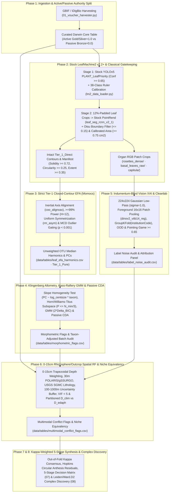

# Operational Workflow Guide: End-to-End Species Delimitation & Morphometrics Pipeline
### *Packera dubia* (Spreng.) Trock & Mabb. Complex (Asteraceae: Senecioneae)
**University of North Carolina at Chapel Hill Herbarium (NCU)**  
**Standard Operating Procedure:** `UNC-BOT-SOP-2026-04-REV5`  
**Author:** J. Brandon Fuller (PhD Candidate, UNC-CH Department of Biology)  
**Advisor:** Dr. Alan S. Weakley (Director, NCU Herbarium)

---

## 📋 Table of Contents

1. [Environment & Setup](#1-environment--setup)
   - [Windows / WSL 2 Setup Guide (`docs/WINDOWS_WSL2_SETUP.md`)](WINDOWS_WSL2_SETUP.md)
   - [A. Primary Python Pipeline Environment (`.venv`)](#a-primary-python-pipeline-environment-venv)
   - [B. LeafMachine2 Dedicated Virtual Environment (`.venv_LM2`)](#b-leafmachine2-dedicated-virtual-environment-venv_lm2)
   - [C. R Statistical Computing Environment](#c-r-statistical-computing-environment)
   - [⚡ Quick-Start Copy-Paste Terminal Cheat-Sheet](#-quick-start-copy-paste-terminal-cheat-sheet)
2. [Eight-Phase Automated Pipeline Overview](#2-eight-phase-automated-pipeline-overview)
3. [Phase 1: Voucher Ingestion & Strict Active/Passive Authority Stratification](#phase-1-voucher-ingestion--strict-activepassive-authority-stratification)
4. [Phase 2: Stock LeafMachine2 v2.2+ Segmentation, Boundary-Continuity Lobe Rejection & Classical Gatekeeping](#phase-2-stock-leafmachine2-v22-segmentation-boundary-continuity-lobe-rejection--classical-gatekeeping)
5. [Phase 3: Strict Tier-1 Closed-Contour EFA, Inertial Alignment, Symmetrization & OTU Medians](#phase-3-strict-tier-1-closed-contour-efa-inertial-alignment-symmetrization--otu-medians)
6. [Phase 4: Klingenberg Allometry, Horn/Williams-Titus Subspace, Kass-Raftery GMM & Passive CDA](#phase-4-klingenberg-allometry-hornwilliams-titus-subspace-kass-raftery-gmm--passive-cda)
7. [Phase 5: Taphonomic Indumentum-Blind Vision XAI, Foreground Patch Pooling & OOD Scoring](#phase-5-taphonomic-indumentum-blind-vision-xai-foreground-patch-pooling--ood-scoring)
8. [Phase 6: 0–15 cm Rhizosphere/Outcrop ENM Stack, Uncertainty Buffers & Partitioned Niche Equivalency](#phase-6-015-cm-rhizosphereoutcrop-enm-stack-uncertainty-buffers--partitioned-niche-equivalency)
9. [Phase 7 & 8: Reliability-Weighted Consensus, 5-Stage Decision Matrix & Complex Discovery](#phase-7--8-reliability-weighted-consensus-5-stage-decision-matrix--complex-discovery)
10. [Automated Test Suite Verification](#10-automated-test-suite-verification)
11. [Key Literature & Citations](#11-key-literature--citations)

---

## 1. Environment & Setup

> [!TIP]
> **Windows Users (WSL 2 Setup Guide):**  
> If running on Windows, the recommended and supported execution environment is **Windows Subsystem for Linux (WSL 2 with Ubuntu)**. Please follow our step-by-step setup guide in [`docs/WINDOWS_WSL2_SETUP.md`](WINDOWS_WSL2_SETUP.md).

The pipeline operates across two dedicated Python environments and an R statistical environment:

### A. Primary Python Pipeline Environment (`.venv`)
Used for orchestration (`main.py`), voucher harvesting, `dinov2_vitb14_reg` foreground patch embeddings, Cleanlab XAI, and quality assurance tests:
```bash
source .venv/bin/activate
pip install -r requirements.txt
```

### B. LeafMachine2 Dedicated Virtual Environment (`.venv_LM2`)
Houses stock LeafMachine2 v2.2+, YOLOv5 (`PLANT_LeafPriority` / `LeafPriority.pt` and the 38-class Ruler Detector), and compiled Detectron2 PointRend (`leaf_seg_rcnn_v2_1`) with strict ABI pins (`numpy<2.0`, `opencv-contrib-python<=4.10.0.84`):
```bash
bash setup_leafmachine2.sh
```

> [!NOTE]
> **Zero Custom Retraining or Manual Annotation Required:**  
> The automated production pipeline uses stock LeafMachine2 v2.2+ `PLANT_LeafPriority` and `leaf_seg_rcnn_v2_1` weights out of the box. The standalone utilities in `scripts/annotation_and_training/` and `docs/SAM2_Precision_Botanical_Annotation_Guide.txt` are archived/optional tools not required by the automated pipeline.

### C. R Statistical Computing Environment
Requires R $\ge 4.3$ with CRAN statistical and spatial macroecological packages (`remotes`, `tidyverse`, `optparse`, `mclust`, `clustvarsel`, `MorphoTools2`, `RRPP`, `vegan`, `terra`, `sf`, `geodata`, `soilDB`, `spatialRF`, `ranger`, `adespatial`, `blockCV`, `ecospat`, `ENMTools`, `igraph`, `patchwork`, `viridis`) and `Momocs` (`remotes::install_github("MomX/Momocs")`):
```bash
Rscript -e 'install.packages(c("remotes", "tidyverse", "optparse", "mclust", "clustvarsel", "MorphoTools2", "RRPP", "vegan", "terra", "sf", "geodata", "soilDB", "spatialRF", "ranger", "adespatial", "blockCV", "ecospat", "ENMTools", "igraph", "patchwork", "viridis"), repos="https://cloud.r-project.org"); if (!requireNamespace("Momocs", quietly=TRUE)) remotes::install_github("MomX/Momocs")'
```

---

### ⚡ Quick-Start Copy-Paste Terminal Cheat-Sheet

#### A. Environment Activation & Preflight Verification
```bash
source .venv/bin/activate
python main.py check-env
```

#### B. End-to-End Automated Pipeline (`run_pipeline.sh` CLI & Dual-Strategy Single-Taxon Modes)
Every pipeline execution via `./run_pipeline.sh` or `python main.py` operates under the **Canonical Two-Tier Storage Architecture**: invariant Step 01–02 specimen/organ assets reside in canonical root `data/` and are automatically seeded/symlinked into `runs/<RUN_ID>/` (updating `runs/latest`), while all Step 03–08 statistical tables, reports, logs, and figures (`.pdf` + 300-DPI `.png`) are isolated inside `runs/<RUN_ID>/`:
```bash
source .venv/bin/activate

# 1. Launch a new timestamped full-complex run (creates runs/run_<YYYYMMDD_HHMMSS>/ and updates runs/latest)
./run_pipeline.sh

# 2. Launch a custom named run (--run-id <NAME>) reusing cached vouchers & local images (--skip-harvest)
./run_pipeline.sh --run-id packera_full_run --skip-harvest

# 3. Resume an existing run from any step (--start-step <1..7>, e.g., Step 03 EFA or Step 04 GMM/CDA onward)
./run_pipeline.sh --run-id packera_full_run --skip-harvest --start-step 3

# 4. Strategy 1: Focal Taxon + Outgroup Gold Reference Anchors (--focal-taxon "<TAXON>" --gold-anchors 30)
./run_pipeline.sh --run-id dubia_triage --skip-harvest --focal-taxon "Packera dubia" --gold-anchors 30

# 5. Strategy 2: Pure Intraspecific Delimitation Mode (--focal-taxon "<TAXON>" --intraspecific-mode)
./run_pipeline.sh --run-id dubia_cryptic --skip-harvest --focal-taxon "Packera dubia" --intraspecific-mode

# 6. Step 08: Unsupervised Eastern North American Taxon-Complex Discovery
Rscript scripts/morphometrics/08_discover_taxon_complexes.R \
    --harmonics data/tables/leaf_efa_harmonics.csv \
    --vouchers data/tables/curated_vouchers.csv \
    --multimodal data/tables/multimodal_conflict_flags.csv \
    --vision data/tables/label_noise_audit.csv \
    --output-dir outputs/reports
```

---

## 2. Eight-Phase Automated Pipeline Overview



---

## Phase 1: Voucher Ingestion & Strict Active/Passive Authority Stratification

- **Script:** [`scripts/data_prep/01_voucher_harvester.py`](../scripts/data_prep/01_voucher_harvester.py)
- **Purpose:** Harvests digital occurrences from GBIF/iDigBio across Eastern and Central North America, standardizes synonymy, calculates circular flowering phenology ($\sin / \cos \text{DOY}$), and stratifies Determiner Authority into an active reference anchor set vs. passively projected set:
  - **Active Reference Anchors (`Tier_1_Gold` & `Tier_2_Silver`, `authority_weight = 1.0` or empirical Dawid-Skene precision $w_k = 1 - \text{error\_rate}_k$ after $\chi^2_{0.95}$ Mahalanobis pruning):** Monographic/type-verified determinations and regional specialist determinations.
  - **Passively Projected Vouchers (`Tier_3_Bronze`, `authority_weight = 0.0`):** General floristic collections and unverified aggregator records, projected passively (`predict()` / `predict_proba()`) without influencing supervised training axes.

---

## Phase 2: Stock LeafMachine2 v2.2+ Segmentation, Boundary-Continuity Lobe Rejection & Classical Gatekeeping

- **Scripts:** [`scripts/pipeline/02_segment_and_extract.py`](../scripts/pipeline/02_segment_and_extract.py), [`scripts/vision/configure_leafmachine2.py`](../scripts/vision/configure_leafmachine2.py), [`scripts/vision/lm2_geometry_utils.py`](../scripts/vision/lm2_geometry_utils.py)
- **Empirical Protocol:**
  1. **Stock LeafMachine2 v2.2+ Configuration (`configure_leafmachine2.py`):** Uses stock `PLANT_LeafPriority` (`minimum_confidence_threshold: 0.65`) and `leaf_seg_rcnn_v2_1` PointRend weights with `treat_leaflet_as_leaf_whole: False`, `use_efds_for_png_masks: False`, and `do_apply_landmarks: False`.
  2. **Otsu Boundary-Continuity Lobe Rejection (`is_truncated_lobe_or_leaflet`):** Rejects severed lobes or unattached leaf fragments where non-paper plant tissue occupies $> 15\%$ of the bounding-box perimeter (`max_tissue_border_ratio: 0.15`).
  3. **Ruler-Calibrated Physical Area Floor (`min_blade_area_cm2: 0.75`):** Rejects calibrated fragments below $0.75\text{ cm}^2$.
  4. **Classical Dimensionless Descriptors (`classify_and_route_leaf`):** Routes intact basal blades into `Tier_1_Direct` when $\text{Solidity} \ge 0.72$, $\text{Circularity} \ge 0.25$, $\text{Extent} \ge 0.35$, and $\text{UCS} \ge 0.85$ (plus label-blind bilateral sinus dissection gates for pinnatifid $0.48\text{–}0.72$ and bipinnatisect $0.18\text{–}0.48$ blades with $\ge 4$ deep sinuses via `is_botanical_dissection()`).
  5. **Strengthened Cauline/Stem Rejection (`is_cauline_or_stem_contaminant`) & Base Homologization (`petiole_attachment_pt=p_base`):** Rejects upper-stem sessile/clasping cauline bracts, trims fibrous petiole tails using resolution-adaptive width spans (`w_span`), disambiguates `p_base` vs. `p_apex` using `rosette_centroid`, and anchors all contours at `p_base`.

---

## Phase 3: Strict Tier-1 Closed-Contour EFA, Inertial Alignment, Symmetrization & OTU Medians

- **Script:** [`scripts/morphometrics/03_fourier_extractor.R`](../scripts/morphometrics/03_fourier_extractor.R)
- **Empirical Protocol:**
  1. **Strict `Tier_1_Direct` Closed-Contour Scope:** Only intact `Tier_1_Direct` basal leaf contours enter `Momocs::efourier` (folded/mirrored `Tier_2_Reflected` leaves and open-curve approximations are never pooled into EFA).
  2. **Inertial Axis Pre-Alignment (`Momocs::coo_alignxax`) with Suborbicular Guard:** Aligns contours along their major inertial axis when blade circularity $\le 0.75$, preventing $90^\circ$ rotation artifacts on suborbicular blades while locking base-to-apex polarity.
  3. **$\ge 99\%$ Cumulative Harmonic Power Verification (`calibrate_harmonicpower_efourier`):** Verifies that $H = 12$ harmonics capture $\ge 99\%$ cumulative harmonic power across the corpus before running `Momocs::efourier(..., nb.h = 12, norm = FALSE, start = FALSE)`.
  4. **Uniform Bilateral Symmetrization (`Momocs::rm_asym`, Claude 2008):** Isolates symmetric harmonic coefficients ($A_n, D_n$) uniformly across all intact contours to remove taphonomic pressing curvature.
  5. **MCD Mahalanobis Outlier Filtering & Unweighted OTU Medians:** Removes contour extraction anomalies via Minimum Covariance Determinant Mahalanobis distance (`MASS::cov.rob`, $p < 0.001$) and `pct_asymmetry > 0.22 | harmonic_roughness > 0.15`, then aggregates multi-leaf vouchers to the Specimen / Operational Taxonomic Unit (`(catalogNumber, plant_individual_id)`) via **unweighted coordinate-wise median** harmonics and PCs (`morph_tier_source = "Tier_1_Pure"`).

---

## Phase 4: Klingenberg Allometry, Horn/Williams-Titus Subspace, Kass-Raftery GMM & Passive CDA

- **Script:** [`scripts/morphometrics/04_gmm_morphotools.R`](../scripts/morphometrics/04_gmm_morphotools.R)
- **Empirical Protocol:**
  1. **Strict Active/Passive Authority Split (`Tier_3_Bronze = 0.0`):** Fits allometric models, GMMs, and CDA strictly on `Tier_1_Gold` and `Tier_2_Silver` `Tier_1_Pure` anchors after $\chi^2_{0.95}$ Mahalanobis outlier pruning (Šlenker et al. 2022), weighting by uniform active weights (`1.0`) or empirical Dawid-Skene precision $w_k = 1 - \text{error\_rate}_k$ (Dawid & Skene 1979) while projecting `Tier_3_Bronze` passively via `predict()`.
  2. **Klingenberg (2016) Allometric Slope Homogeneity Testing (`test_and_correct_allometry`):** Tests `PC ~ log_centsize * species_standardized` ($\alpha = 0.01$) on ruler-calibrated (`is_calibrated_mm == TRUE`) active anchors, applying common-slope within-group size correction only when slopes are homogeneous ($p \ge 0.01$; exported to `outputs/reports/allometry_homogeneity_test.csv`).
  3. **Horn's Parallel Analysis & Williams-Titus Cap (`select_informative_pcs`):** Retains informative PCs exceeding the Broken-Stick / Horn threshold, capped for CDA at $P \le \lfloor N_{\min} / 3 \rfloor$ (Williams & Titus 1988).
  4. **Kass & Raftery (1995) GMM (`run_gmm_cluster_analysis`) & Uniform-Prior Passive CDA (`run_canonical_discriminant_analysis`):** Evaluates discrete morphotypes via $2\Delta\text{BIC}$ thresholds ($> 6$ strong, $> 10$ very strong) and trains passive CDA with uniform class priors (`rep(1/g, g)`) and honest Leave-One-Out Cross-Validation (`loocv_accuracy`).
  5. **Taxon-Adjusted Institutional Batch-Effect Audit (`audit_institutional_batch_effects`):** Fits `lm(PC1 ~ species_standardized + institutionCode)` and `lm(PC2 ~ species_standardized + institutionCode)` when $\ge 2$ taxa are present, reporting partial $R^2$ for `institutionCode` (`outputs/reports/institutional_batch_effect_audit.csv`).

---

## Phase 5: Taphonomic Indumentum-Blind Vision XAI, Foreground Patch Pooling & OOD Scoring

- **Script:** [`scripts/analysis/05_cleanlab_vision_xai.py`](../scripts/analysis/05_cleanlab_vision_xai.py)
- **Empirical Protocol:**
  1. **Indumentum-Blind Gaussian Low-Pass Filter ($\sigma = 1.0\text{ px}$ at $224 \times 224$):** `apply_indumentum_blind_lowpass()` attenuates taphonomically abraded trichome/tomentum textures on $224 \times 224$ whole-rosette and basal-leaf crops while preserving macro-architectural venation and lobing.
  2. **Foreground-Masked $16 \times 16$ Spatial Patch Pooling (`dinov2_vitb14_reg`):** Downsamples the binary foreground plant mask to the $16 \times 16$ patch grid (`compute_foreground_patch_mask`) and average-pools `dinov2_vitb14_reg` spatial patch tokens strictly over plant tissue.
  3. **Gold/Silver Anchor Training, `institutionCode` GroupKFold & Temperature Calibration:** Fits out-of-fold `LogisticRegression(C=0.1, class_weight="balanced")` inside a fold-internal `StandardScaler` + `PCA(0.95)` pipeline strictly on Gold/Silver anchors using `StratifiedGroupKFold(groups=institutionCode)`, calibrates probabilities via Platt/temperature scaling (`calibrate_oof_probabilities`), and projects `Tier_3_Bronze` passively.
  4. **Class-Conditional Cleanlab Noise Pruning, OOD Scoring & Pointing Game Verification:** Prunes label issues via `filter_by="prune_by_noise_rate"`, computes Mahalanobis + cosine $k$-NN feature-space distance (`vision_ood_score`, `vision_is_ood`), and enforces Pointing Game `foreground_attention_ratio >= 0.65`.

---

## Phase 6: 0–15 cm Rhizosphere/Outcrop ENM Stack, Uncertainty Buffers & Partitioned Niche Equivalency

- **Scripts:** [`scripts/analysis/06_multimodal_spatial_rf.R`](../scripts/analysis/06_multimodal_spatial_rf.R), [`scripts/analysis/edaphic_fine_grain_utils.R`](../scripts/analysis/edaphic_fine_grain_utils.R)
- **Empirical Protocol:**
  1. **$0\text{–}15\text{ cm}$ Trapezoidal Rhizosphere Depth-Weighting & USGS SGMC Lithology:** Combines $0\text{–}5\text{ cm}$ and $5\text{–}15\text{ cm}$ horizons via `(5 * v_0_5 + 10 * v_5_15) / 15` across 30m POLARIS/gSSURGO and 250m SoilGrids fallback grids, paired with `clr_sand_silt` / `clr_clay_geom` compositional texture, `cfvo_0_15cm`, `awc_0_15cm`, `fine_bedrock_depth_cm`, 50m-buffered SSURGO outcrop queries, 30m 3DEP micro-topography, and 6-class USGS SGMC bedrock lithology (`sgmc_lithology_class`).
  2. **Coordinate-Uncertainty Buffered Extraction (`100–1000 m`) & Collinearity Pruning:** Extracts focal median raster values within `clamp(coordinateUncertaintyInMeters, 100, 1000)` m and prunes predictors at $|r| < 0.70$ and $\text{VIF} < 5.0$ (`prune_collinear_predictors`) prior to `ranger::ranger` Spatial Block CV (`spatial_block_cv_acc`).
  3. **Partitioned Climatic vs. Edaphic-Geologic Niche Equivalency & Background Similarity:** Computes Schoener's $D$ and Hellinger's $I$ separately in Climatic PCA space ($D_{\text{clim}}, I_{\text{clim}}$) and Edaphic-Geologic PCA space ($D_{\text{edaph}}, I_{\text{edaph}}$) (`outputs/reports/edaphic_niche_equivalency.csv`).

---

## Phase 7 & 8: Reliability-Weighted Consensus, 5-Stage Decision Matrix & Complex Discovery

- **Scripts:** [`scripts/analysis/07_triage_dashboard_synthesis.R`](../scripts/analysis/07_triage_dashboard_synthesis.R), [`scripts/morphometrics/08_discover_taxon_complexes.R`](../scripts/morphometrics/08_discover_taxon_complexes.R)
- **Empirical Protocol:**
  1. **Out-of-Fold Cohen's $\kappa$ Reliability Weighting:** Weights each modality by out-of-fold validation Cohen's $\kappa_m$ ($w_m = \max(0.05, \kappa_m)$), dynamically renormalized over the observed modalities $\mathcal{O}_i$ on each specimen (`98.4%` voucher completion across georeferenced and non-georeferenced sheets).
  2. **Hopkins-Adjusted Circular Anthesis Phenology:** Restricted to specimens in active anthesis (`in_anthesis == TRUE`), regresses circular flowering angle $(\sin\theta_i, \cos\theta_i)$ on latitude, elevation, and MAT (`atan2` circular residuals) before computing $|\Delta\text{DOY}_{\text{Hopkins}}|$.
  3. **Taxon-Adjusted Institutional ANCOVA & 5-Stage Hierarchical Decision Matrix:** Evaluates `Misidentification_Reassign` **before** `Hybrid_Introgressant` so sympatric misidentifications are never misclassified as hybrids, and requires multi-modal **Integration by Congruence** (Padial et al. 2010) for `Putative_Cryptic_Species`.
  4. **Step 08 Unsupervised Eastern North American Taxon-Complex Discovery (`08_discover_taxon_complexes.R`):** Fuses pairwise morphological ($D_{\text{Mahal}}$), environmental ($1 - D_{\text{Schoener}}$), phenological ($d_{\text{circ}}$), and vision centroid distances across all regional *Packera* species and partitions them via $k$-NN graph modularity (Leiden/Louvain) and Ward.D2 clustering (`outputs/reports/discovered_taxon_complexes.csv`).

---

## 10. Automated Test Suite Verification

Run the complete unit test suite from the repository root:
```bash
python3 -m unittest discover -s scripts/tests -p "test_*.py" -v
```

---

## 11. Key Literature & Citations

1. Barkley, T. M. 1988. Variation among the Senecioneae (Asteraceae) in North America. *Brittonia* 40(2): 211–221.
2. Broennimann, O., et al. 2012. Measuring ecological niche overlap from occurrence and spatial environmental data. *Global Ecology and Biogeography* 21(4): 481–497.
3. Claude, J. 2008. *Morphometrics with R*. Springer, New York.
4. Collyer, M. L., and D. C. Adams. 2018. RRPP: An R package for fitting linear models to high-dimensional data using residual randomization. *Methods in Ecology and Evolution* 9(7): 1772–1779.
5. Darcet, T., M. Oquab, J. Mairal, and P. Bojanowski. 2024. Vision transformers need registers. *International Conference on Learning Representations (ICLR)*.
6. Dawid, A. P., and A. M. Skene. 1979. Maximum likelihood estimation of observer error-rates using the EM algorithm. *Journal of the Royal Statistical Society: Series C* 28(1): 20–28.
7. de Queiroz, K. 2007. Species concepts and species delimitation. *Systematic Biology* 56(6): 879–886.
8. Kass, R. E., and A. E. Raftery. 1995. Bayes Factors. *Journal of the American Statistical Association* 90(430): 773–795.
9. Klingenberg, C. P. 2016. Size, shape, and form: concepts of allometry in geometric morphometrics. *Development Genes and Evolution* 226(3): 113–137.
10. Kowal, R. R. 1975. Systematics of *Senecio aureus* and allied species on the Gaspé Peninsula, Quebec. *Memoirs of the Torrey Botanical Club* 23(2): 1–113.
11. Kuhl, F. P., and C. R. Giardina. 1982. Elliptic Fourier features of a closed contour. *Computer Graphics and Image Processing* 18(3): 236–258.
12. Northcutt, C. G., L. Jiang, and I. L. Chuang. 2021. Confident Learning: Estimating Uncertainty in Dataset Labels. *Journal of Artificial Intelligence Research* 70: 1373–1411.
13. Padial, J. M., A. Miralles, I. De la Riva, and M. Vences. 2010. The integrative future of taxonomy. *Frontiers in Zoology* 7: 16.
14. Scrucca, L., and A. E. Raftery. 2018. clustvarsel: A package implementing variable selection for Gaussian model-based clustering in R. *Journal of Statistical Software* 84(1): 1–28.
15. Šlenker, M., P. Koutecký, and P. Marhold. 2022. MorphoTools2: an R package for multivariate morphometric analysis. *Bioinformatics* 38(10): 2954–2955.
16. Trock, D. K. 2006. *Packera*. In Flora of North America Editorial Committee (eds.), *Flora of North America North of Mexico*, Vol. 20, 570–602. Oxford University Press, New York.
17. Valavi, R., J. Elith, J. J. Lahoz-Monfort, and G. Guillera-Arroita. 2019. blockCV: An R package for generating spatially or environmentally separated folds for k-fold cross-validation of species distribution models. *Methods in Ecology and Evolution* 10(2): 225–232.
18. Warren, D. L., R. E. Glor, and M. Turelli. 2008. Environmental niche equivalency versus conservatism: quantitative approaches to niche evolution. *Evolution* 62(11): 2868–2883.
19. Weaver, W. N., P. S. Ng, and R. LaFrance. 2024. LeafMachine2: Using machine learning to rapidly measure plant traits captured in herbarium specimens. *Applications in Plant Sciences* 12(1): e11545.
20. Williams, B. K., and K. Titus. 1988. Assessment of sampling stability in ecological applications of discriminant analysis. *Ecology* 69(4): 1275–1285.
21. Wright, M. N., and A. Ziegler. 2017. ranger: A fast implementation of random forests for high dimensional data in C++ and R. *Journal of Statistical Software* 77(1): 1–17.
