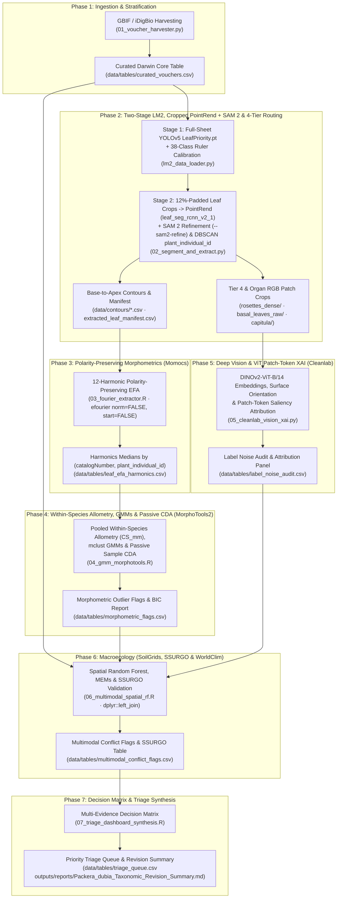

# Operational Workflow Guide: End-to-End Species Delimitation & Morphometrics Pipeline
### *Packera dubia* (Spreng.) Trock & Mabb. Complex (Asteraceae: Senecioneae)
**University of North Carolina at Chapel Hill Herbarium (NCU)**  
**Standard Operating Procedure:** `UNC-BOT-SOP-2026-04-REV4`  
**Author:** J. Brandon Fuller (PhD Candidate, UNC-CH Department of Biology)  
**Advisor:** Dr. Alan S. Weakley (Director, NCU Herbarium)

---

## 📋 Table of Contents

1. [Environment & Setup](#1-environment--setup)
   - [Windows / WSL 2 Setup Guide (`docs/WINDOWS_WSL2_SETUP.md`)](WINDOWS_WSL2_SETUP.md)
   - [A. Primary Python Pipeline Environment (`.venv`)](#a-primary-python-pipeline-environment-venv)
   - [B. LeafMachine2 Dedicated Virtual Environment (`.venv_LM2`)](#b-leafmachine2-dedicated-virtual-environment-venv_lm2)
   - [C. R Statistical Computing Environment](#c-r-statistical-computing-environment)
   - [D. Large File & Storage Architecture](#d-large-file--storage-architecture)
   - [⚡ Quick-Start Copy-Paste Terminal Cheat-Sheet](#-quick-start-copy-paste-terminal-cheat-sheet)
2. [Seven-Phase Pipeline Overview](#2-seven-phase-pipeline-overview)
3. [Phase 1: Voucher Ingestion & Authority Stratification](#phase-1-voucher-ingestion--authority-stratification)
4. [Phase 2: Two-Stage LeafMachine2 Detection, Cropped PointRend + SAM 2 Refinement & Geometric Routing](#phase-2-two-stage-leafmachine2-detection-cropped-pointrend--sam-2-refinement--geometric-routing)
   - [2.0 Track A: SAM 2 Assisted Botanical Annotation & Stage 2 PointRend Fine-Tuning](#20-track-a-sam-2-assisted-botanical-annotation--stage-2-pointrend-fine-tuning)
   - [2.1 LM2 Configuration & Empirical Geometry Calibration](#21-lm2-configuration--empirical-geometry-calibration)
   - [2.2 Execute Phase 2: Two-Stage Segmentation, 4-Tier Geometric Routing & Contour Extraction](#22-execute-phase-2-two-stage-segmentation-4-tier-geometric-routing--contour-extraction)
5. [Phase 3: Label-Blind Polarity-Preserving Elliptic Fourier Analysis (EFA)](#phase-3-label-blind-polarity-preserving-elliptic-fourier-analysis-efa)
   - [3.1 Symmetric Elliptic Fourier Analysis ($A_n, D_n$) & Reflection Parity](#31-symmetric-elliptic-fourier-analysis-a_n-d_n--reflection-parity)
   - [3.2 Base-to-Apex Contour Homologization, Polarity-Preserving EFA & Multi-Plant Aggregation](#32-base-to-apex-contour-homologization-polarity-preserving-efa--multi-plant-aggregation)
6. [Phase 4: Pooled Within-Species Allometry, GMM Clustering & MorphoTools2 Passive Sample CDA](#phase-4-pooled-within-species-allometry-gmm-clustering--morphotools2-passive-sample-cda)
7. [Phase 5: DINOv2 Deep Vision Embeddings, ViT Patch-Token Attribution & Cleanlab XAI](#phase-5-dinov2-deep-vision-embeddings-vit-patch-token-attribution--cleanlab-xai)
   - [5.1 Deep Vision Batch-Effect Controls, Mounting Paper Neutralization & ViT Patch-Token Saliency](#51-deep-vision-batch-effect-controls-mounting-paper-neutralization--vit-patch-token-saliency)
8. [Phase 6: Multi-Modal Spatial Random Forests & Niche Modeling](#phase-6-multi-modal-spatial-random-forests--niche-modeling)
   - [6.1 Multi-Scale Micro-Edaphic Validation: Regional SoilGrids (250m) vs. USDA SSURGO (1:24,000)](#61-multi-scale-micro-edaphic-validation-regional-soilgrids-250m-vs-usda-ssurgo-124000)
   - [6.2 Automated Capitulum Phenology & 3-Tier Anthesis Verification](#62-automated-capitulum-phenology--3-tier-anthesis-verification)
9. [Phase 7: Multi-Evidence Synthesis & Digital Triage Queue](#phase-7-multi-evidence-synthesis--digital-triage-queue)
10. [Methodological Highlights](#-methodological-highlights)
11. [Automated Test Suite Verification](#11-automated-test-suite-verification)
12. [Troubleshooting & Quality Control Checklist](#12-troubleshooting--quality-control-checklist)
13. [Key Literature & Citations](#13-key-literature--citations)

---

## 1. Environment & Setup

> [!TIP]
> **Windows Users (WSL 2 Setup Guide):**  
> If running on Windows, the recommended and supported execution environment is **Windows Subsystem for Linux (WSL 2 with Ubuntu)**. WSL 2 provides full NVIDIA CUDA acceleration, native WSLg GUI support for interactive annotation (`annotate_with_sam2.py`), and high-performance ext4 disk I/O. Please follow our step-by-step setup guide in [`docs/WINDOWS_WSL2_SETUP.md`](WINDOWS_WSL2_SETUP.md).

The pipeline operates across two dedicated Python environments and an R statistical environment:

### A. Primary Python Pipeline Environment (`.venv`)
Used for orchestration (`main.py`), voucher harvesting, SAM 2 interactive/automated boundary refinement, DINOv2 embeddings, Cleanlab XAI, and quality assurance tests:
```bash
# Activate existing primary venv
source .venv/bin/activate

# Or install dependencies from requirements.txt
pip install -r requirements.txt
```

### B. LeafMachine2 Dedicated Virtual Environment (`.venv_LM2`)
Houses LeafMachine2, YOLOv5 (`LeafPriority.pt` and the 38-class Ruler Detector), and compiled Detectron2 PointRend (`leaf_seg_rcnn_v2_1`) with strict ABI pins (`numpy<2.0`, `opencv-contrib-python<=4.10.0.84`). Use the provided installation script:
```bash
bash setup_leafmachine2.sh
```

> [!TIP]
> **Automated Multi-Environment Orchestration:**
> You do **not** need to manually switch or activate `.venv_LM2` in your shell when executing Phase 2. The unified runner `main.py` includes an automatic Python interpreter resolver (`get_lm2_python_executable()`) that checks for `.venv_LM2/bin/python` (Linux/macOS) or `.venv_LM2/Scripts/python.exe` (Windows). When invoking `python main.py segment` or `python main.py run-all` from your primary `.venv`, `main.py` automatically routes execution to the dedicated `.venv_LM2` interpreter, streams diagnostics to the console and logger, and catches non-zero exit codes to halt subsequent phases on failure.

### C. R Statistical Computing Environment
Requires R $\ge 4.3.0$ with CRAN statistical and spatial macroecological packages (`remotes`, `tidyverse`, `optparse`, `mclust`, `clustvarsel`, `MorphoTools2`, `RRPP`, `vegan`, `terra`, `sf`, `geodata`, `soilDB`, `spatialRF`, `ranger`, `adespatial`, `blockCV`, `ecospat`, `ENMTools`, `patchwork`, `viridis`) and `Momocs` (installed via `remotes::install_github("MomX/Momocs")` following its March 2026 CRAN archival):
```bash
Rscript -e 'install.packages(c("remotes", "tidyverse", "optparse", "mclust", "clustvarsel", "MorphoTools2", "RRPP", "vegan", "terra", "sf", "geodata", "soilDB", "spatialRF", "ranger", "adespatial", "blockCV", "ecospat", "ENMTools", "patchwork", "viridis"), repos="https://cloud.r-project.org"); if (!requireNamespace("Momocs", quietly=TRUE)) remotes::install_github("MomX/Momocs")'
```

### D. Large File & Storage Architecture

To maintain a lean, reproducible codebase and comply with Git repository storage best practices, bulky binary checkpoints and heavy raster/specimen data are excluded from version control via `.gitignore`:
- **Model Checkpoints (`models/*.pth`, `models/*.pt`, `models/*.bin`):** Deep learning weights (such as `lm2_packera_pcd_finetuned.pth` / `lm2_packera_pointrend_finetuned.pth`, ~425 MB) are excluded to prevent repository bloat. Checkpoints are automatically retrieved and integrity-verified on demand via [`scripts/core/artifact_manager.py`](../scripts/core/artifact_manager.py).
- **Raw Specimen Imagery (`data/raw_vouchers/*.jpg`):** The production dataset comprises high-resolution voucher sheets (>25 GB). Specimen images are downloaded directly to local storage during Phase 1 (`python main.py harvest --download-images`).

#### Reproducing Dissertation Analyses: Downloading Rasters & Model Weights
Researchers reproducing the dissertation results without re-harvesting large image repositories or re-training detector models can retrieve all upstream assets from open scientific repositories:

1. **Fine-Tuned Model Weights:**
   Automatically acquired upon running `python main.py segment` or manually pre-cached via:
   ```bash
   python main.py download-weights
   ```
   Checkpoints are archived on GitHub Releases (`v1.0-weights`) and Zenodo (DOI: `10.5281/zenodo.xxxxxx`), with integrity validated via SHA256 hashing.

2. **Automated & Pre-Computed Environmental Rasters (`data/environmental/`):**
   Phase 6 (Macroecological Niche Modeling) utilizes 30-arcsecond WorldClim 2.1 bioclimatic rasters and SoilGrids 250m pedological layers (pH in $\text{H}_2\text{O}$, CEC, sand/clay percentages, bulk density). When local `.tif` files are not pre-staged in `data/environmental/`, `06_multimodal_spatial_rf.R` automatically fetches and caches WorldClim v2.1 bioclimatic rasters (`geodata::worldclim_global`) and SoilGrids 250m pedological rasters (`geodata::soil_world`) directly into `data/environmental/`. Alternatively, a pre-clipped GeoTIFF raster package covering the southeastern and midwestern United States study region can be unpacked from Zenodo:
   ```bash
   # Create target environmental directory
   mkdir -p data/environmental

   # (Optional) Download and unpack the Zenodo environmental raster archive
   tar -xzvf packera_environmental_rasters.tar.gz -C data/environmental/
   ```

3. **Pre-Extracted Contour Coordinate Matrices:**
   To reproduce the morphological analyses (Phases 3–4) directly without running deep segmentation on raw sheets, standardized 2D contour coordinate matrices (`data/contours/`), leaf manifests (`data/tables/extracted_leaf_manifest.csv`), and curated Darwin Core voucher tables (`data/tables/curated_vouchers.csv`) can be unpacked directly from Zenodo.

#### Academic Data Availability Statement
For dissertation methods sections and peer-reviewed publication reproduction:
> *"Model weights, extracted 2D contour coordinate matrices, and environmental rasters are persistently deposited on Zenodo under DOI: 10.5281/zenodo.xxxxxx."*

---

### ⚡ Quick-Start Copy-Paste Terminal Cheat-Sheet

#### A. Environment Activation & Preflight Verification
```bash
source .venv/bin/activate
python main.py check-env
python main.py download-weights
```

#### B. End-to-End Automated Pipeline (Single Copy-Paste Command)
```bash
source .venv/bin/activate
python main.py run-all --download-images
```

#### C. Phase-by-Phase Execution via Unified `main.py` CLI
```bash
source .venv/bin/activate

# Phase 1: Harvest GBIF/iDigBio vouchers & stratify determiner authority tiers
python main.py harvest --max-records 5000 --download-images

# Phase 2: Two-stage LeafMachine2 (LeafPriority.pt + Ruler) -> Cropped PointRend + Automated SAM 2 Refinement
python main.py segment --weights models/lm2_packera_pcd_finetuned.pth --sam2-refine

# Phase 3 & 4: 12-Harmonic Polarity-Preserving EFA (Momocs), Within-Species Allometry, GMM & Passive CDA
python main.py morphometrics --harmonics 12

# Phase 5, 6 & 7: DINOv2 + Cleanlab XAI, Spatial Random Forests (SoilGrids/SSURGO/WorldClim), & Triage Queue
python main.py synthesis
```

#### D. Standalone Phase-by-Phase Script Execution (Verified Flags)
```bash
source .venv/bin/activate

# Track A.1: Interactive SAM 2 annotation with automated LM2 + SAM 2 pre-labeling
python scripts/annotation_and_training/annotate_with_sam2.py \
    --images-dir data/raw_vouchers \
    --output-dir data/raw_annotations \
    --output-coco data/annotations/packera_train_coco.json \
    --prelabel-with-lm2

# Track A.1b: Headless compilation of Stage 2 single-leaf cropped COCO dataset
python scripts/annotation_and_training/annotate_with_sam2.py \
    --export-coco \
    --masks-dir data/raw_annotations/masks \
    --images-dir data/raw_vouchers \
    --crops-dir data/annotations/lm2_leaf_crops \
    --output-coco data/annotations/packera_train_coco.json \
    --val-split 0.15

# Track A.2: Fine-tune Stage 2 Detectron2 PointRend (leaf_seg_rcnn_v2_1) on single-leaf crops
python scripts/annotation_and_training/finetune_lm2_pcd.py \
    --coco-json data/annotations/packera_train_coco.json \
    --images-dir data/annotations/lm2_leaf_crops \
    --iterations 1000 \
    --output-weights models/lm2_packera_pcd_finetuned.pth

# Phase 1: Standalone GBIF/iDigBio voucher harvester
python scripts/data_prep/01_voucher_harvester.py \
    --taxa "Packera dubia" "Packera tomentosa" "Senecio tomentosus" "Packera anonyma" "Packera plattensis" "Packera paupercula" \
    --max-uncertainty 5000 \
    --max-records-per-taxon 5000 \
    --exclude-western \
    --download-images \
    --concurrency 15 \
    --output-csv data/tables/curated_vouchers.csv \
    --log-file outputs/reports/voucher_ingestion_summary.log

# Phase 2: Standalone two-stage LM2 + Cropped PointRend + SAM 2 boundary refinement
python scripts/pipeline/02_segment_and_extract.py \
    --model-weights models/lm2_packera_pcd_finetuned.pth \
    --vouchers data/tables/curated_vouchers.csv \
    --output-dir data \
    --sam2-refine

# Phase 3: Standalone 12-harmonic polarity-preserving EFA in R (Momocs)
Rscript scripts/morphometrics/03_fourier_extractor.R \
    --contours-dir data/contours \
    --manifest data/tables/extracted_leaf_manifest.csv \
    --vouchers data/tables/curated_vouchers.csv \
    --harmonics 12 \
    --output data/tables/leaf_efa_harmonics.csv \
    --output-individual data/tables/individual_leaf_harmonics.csv

# Phase 4: Standalone within-species allometry, GMM clustering & passive CDA in R
Rscript scripts/morphometrics/04_gmm_morphotools.R \
    --vouchers data/tables/curated_vouchers.csv \
    --harmonics data/tables/leaf_efa_harmonics.csv \
    --output-flags data/tables/morphometric_flags.csv \
    --output-plot outputs/figures/cda_passive_projection.pdf \
    --output-report outputs/reports/gmm_bayes_factors_summary.csv

# Phase 5: Standalone DINOv2 embeddings, Cleanlab audit & ViT patch-token attribution (append --demo for offline testing)
python scripts/analysis/05_cleanlab_vision_xai.py \
    --rosette-dir data/cropped_patches/rosettes_dense \
    --vouchers-csv data/tables/curated_vouchers.csv \
    --output-csv data/tables/label_noise_audit.csv \
    --output-figure outputs/figures/GradCAM_audit_panel.png \
    --cleanlab-threshold 0.85

# Phase 6: Standalone Multimodal Spatial Random Forests in R (append --demo for offline testing)
Rscript scripts/analysis/06_multimodal_spatial_rf.R \
    --vouchers data/tables/curated_vouchers.csv \
    --morphometrics data/tables/morphometric_flags.csv \
    --vision-audit data/tables/label_noise_audit.csv \
    --env-dir data/environmental/ \
    --output-flags data/tables/multimodal_conflict_flags.csv \
    --output-plot outputs/figures/spatial_rf_niche_importance.pdf \
    --output-summary outputs/reports/multimodal_spatial_rf_summary.csv

# Phase 7: Standalone Multi-Evidence Decision Matrix & Triage Synthesis in R (append --demo for offline testing)
Rscript scripts/analysis/07_triage_dashboard_synthesis.R \
    --vouchers data/tables/curated_vouchers.csv \
    --morphometrics data/tables/morphometric_flags.csv \
    --vision-audit data/tables/label_noise_audit.csv \
    --multimodal-flags data/tables/multimodal_conflict_flags.csv \
    --gmm-summary outputs/reports/gmm_bayes_factors_summary.csv \
    --niche-summary outputs/reports/multimodal_spatial_rf_summary.csv \
    --output-queue data/tables/triage_queue.csv \
    --output-plot outputs/figures/Figure_Integrative_Packera_dubia_Revision.pdf \
    --output-report outputs/reports/Packera_dubia_Taxonomic_Revision_Summary.md
```

#### E. Automated QA & Test Suite Commands
```bash
source .venv/bin/activate
python scripts/tests/run_audit.py
pytest scripts/tests/ -v
```

---

## 2. Seven-Phase Pipeline Overview



---

## Phase 1: Voucher Ingestion & Authority Stratification

- **Script:** [`scripts/data_prep/01_voucher_harvester.py`](../scripts/data_prep/01_voucher_harvester.py)
- **Environment:** `.venv`
- **Purpose:** Harvests digital occurrences from GBIF/iDigBio, enforces geographic bounding filters (excluding states west of Texas/Oklahoma), calculates circular flowering phenology ($\sin / \cos \text{DOY}$), scores Determiner Authority into Tiers 1–3, and downloads high-resolution specimen images.

```bash
source .venv/bin/activate
python scripts/data_prep/01_voucher_harvester.py \
    --taxa "Packera dubia" "Packera tomentosa" "Senecio tomentosus" "Packera anonyma" "Packera plattensis" "Packera paupercula" \
    --max-uncertainty 5000 \
    --max-records-per-taxon 5000 \
    --exclude-western \
    --download-images \
    --concurrency 15 \
    --output-csv data/tables/curated_vouchers.csv \
    --log-file outputs/reports/voucher_ingestion_summary.log
```

**Key Outputs:**
- `data/raw_vouchers/*.jpg`: High-resolution herbarium sheet imagery.
- `data/tables/curated_vouchers.csv`: Darwin Core metadata with `determiner_tier` and `phenology_radians`.

---

## Phase 2: Two-Stage LeafMachine2 Detection, Cropped PointRend + SAM 2 Refinement & Geometric Routing

> [!NOTE]
> Physical image staging via `prepare_lm2_dataset.py` has been decommissioned to `scripts/_archive/` (never imported or referenced by active code). The production pipeline script [`scripts/pipeline/02_segment_and_extract.py`](../scripts/pipeline/02_segment_and_extract.py) reads directly from `data/raw_vouchers/` via paths defined in `data/tables/curated_vouchers.csv`, eliminating redundant symlink copying and disk overhead.

### 2.0 Track A: SAM 2 Assisted Botanical Annotation & Stage 2 PointRend Fine-Tuning
- **Script:** [`scripts/annotation_and_training/annotate_with_sam2.py`](../scripts/annotation_and_training/annotate_with_sam2.py)
- **Environment:** `.venv` (with CUDA and Segment Anything 2 installed)
- **Reference Manual:** [`docs/SAM2_Precision_Botanical_Annotation_Guide.txt`](SAM2_Precision_Botanical_Annotation_Guide.txt)
- **Purpose:** Produces millimeter-accurate instance segmentation masks of intact (`basal_leaf_whole`, Class `0`) and partially occluded (`basal_leaf_partial`, Class `1`) basal leaves across dried herbarium specimens. Supports `--prelabel-with-lm2` to automatically pre-populate basal leaf masks using the two-stage LM2 + SAM 2 pipeline before interactive refinement, and exports native-DPI 12%-padded single-leaf crops (`data/annotations/lm2_leaf_crops/`) for Stage 2 PointRend fine-tuning.

```bash
# Launch interactive SAM 2 botanical annotator GUI (with automated LM2 + SAM 2 pre-labeling)
source .venv/bin/activate
python scripts/annotation_and_training/annotate_with_sam2.py \
    --images-dir data/raw_vouchers \
    --output-dir data/raw_annotations \
    --output-coco data/annotations/packera_train_coco.json \
    --prelabel-with-lm2

# Resume annotator from last saved voucher sheet:
python scripts/annotation_and_training/annotate_with_sam2.py --resume-last

# Resume annotator from the first unannotated voucher sheet:
python scripts/annotation_and_training/annotate_with_sam2.py --resume-unannotated

# (Optional) Recompile standardized Stage 2 cropped single-leaf COCO JSON from masks in headless mode:
python scripts/annotation_and_training/annotate_with_sam2.py \
    --export-coco \
    --masks-dir data/raw_annotations/masks \
    --images-dir data/raw_vouchers \
    --crops-dir data/annotations/lm2_leaf_crops \
    --output-coco data/annotations/packera_train_coco.json \
    --val-split 0.15
```

#### Command-Line Arguments:
| Argument | Type | Default | Description |
| :--- | :--- | :--- | :--- |
| `--images-dir` | Path | `data/raw_vouchers` | Directory of high-resolution voucher scans. |
| `--output-dir` | Path | `data/raw_annotations` | Target directory for polygon text files and PNG masks. |
| `--output-coco` | Path | `data/annotations/annotations_packera_train.json` | Incremental/compiled standardized COCO JSON output. |
| `--crops-dir` | Path | `data/annotations/lm2_leaf_crops` | Directory for native-DPI 12%-padded cropped leaf patches. |
| `--full-sheet` | Flag | `False` | Export full-sheet COCO annotations instead of Stage 2 single-leaf crops. |
| `--prelabel-with-lm2` | Flag | `False` | Pre-populate `saved_instances` on each sheet using automated LM2 + SAM 2 basal leaf segmentation. |
| `--lm2-weights` | Path | `models/lm2_packera_pcd_finetuned.pth` | Stage 2 PointRend weights checkpoint for `--prelabel-with-lm2`. |
| `--stage1-weights` | Path | `None` | Optional Stage 1 YOLOv5 `LeafPriority.pt` weights path for `--prelabel-with-lm2`. |
| `--single-image` | Path | `None` | Target a single voucher image file for focused editing. |
| `--tier` | Choice (`1`, `2`, `3`, `all`) | `1` | Filter vouchers by determiner authority tier (`1`: Tier 1 Gold monograph authorities, `all`: all vouchers). |
| `--vouchers-csv` | Path | `data/tables/curated_vouchers.csv` | Curated voucher dataset containing determinations and metadata. |
| `--voucher` | String | `None` | Jump directly to a specific voucher ID or filename (e.g. `--voucher 1048`). |
| `--index` | Integer | `None` | Jump directly to a 1-based voucher sheet number (e.g. `--index 5`). |
| `--resume-last` | Flag | `False` | Automatically resume from the most recently annotated voucher sheet. |
| `--resume-unannotated` | Flag | `False` | Automatically jump to the first unannotated voucher sheet in sequence. |
| `--checkpoint` | Path | `models/checkpoints/sam2_hiera_large.pt` | SAM 2 model weights checkpoint. |
| `--config` | String | `sam2_hiera_l.yaml` | Model configuration YAML file. |
| `--export-coco` | Flag | `False` | Compile COCO annotations directly from existing mask directory without GUI. |
| `--masks-dir` | Path | `data/raw_annotations/masks` | Source masks folder for `--export-coco`. |
| `--val-split` | Float | `0.0` | Validation partition fraction for train/val COCO split. |

#### Hotkey Reference & Control Matrix:
| Category | Control / Key | Action & Botanical Context |
| :--- | :--- | :--- |
| **Navigation** | **Mouse Wheel** | Smooth cursor-centered zoom in / out ($1.0\times$ to $16.0\times$). |
| | **Middle-Click Drag** | Pan viewport across high-resolution voucher sheet. |
| | **`Space` + Left-Drag** | Alternative viewport pan. |
| | **`f`** | Fit full herbarium voucher to window ($1.0\times$). |
| | **`[< Prev (b)]` / `b` / `Left Arrow`** | Navigate to previous voucher sheet **without** saving or changing annotations. |
| | **`[Next > (n)]` / `n` / `Right Arrow`** | Navigate to next voucher sheet **without** saving or changing annotations. |
| **Segmentation** | **Left-Click** | Place positive prompt point (green marker). |
| | **Right-Click** | Place negative exclusion point (red marker). |
| | **`[Undo Pt (Ctrl+Z)]` / `Ctrl+Z` / `z` / `NumPad .`** | Remove last prompt point / constraint and re-run SAM 2 in real time. |
| | **Shift + Left-Drag** | Bounding box prompt constraint. |
| | **`Tab` / `NumPad /`** | Cycle 3 SAM 2 candidate granularities (sub-lobe vs. blade vs. clump). |
| | **`k`** | Two-click knife tool to sever petiole bases from caudex tissue (works on both candidate and pre-labeled masks). |
| | **`+` / `-` / `NumPad +/-`** | 1-pixel binary dilation / erosion for tomentum margin tuning. |
| | **`p`** | Toggle polygon lasso mode (Left-Click points, Enter to finalize). |
| **Inspection** | **`o` / `NumPad *`** | Toggle mask fill vs. 1-px boundary contour line (inspect crenations). |
| | **Hold `v`** | Hold-to-peek: Temporarily hide overlays to view bare pixels. |
| | **`[` / `]`** | Adjust mask overlay alpha transparency ($0.10$ to $0.90$). |
| | **Auto Pre-population** | Prior or `--prelabel-with-lm2` annotations automatically render with distinct category colors and counts. |
| **Commit & Session**| **`0`–`1` / `NumPad 0–1`** | Instant basal leaf class commit (`0`: `basal_leaf_whole`, `1`: `basal_leaf_partial`; works NumLock ON/OFF). |
| | **`u`** | Undo last committed instance on current sheet. |
| | **`c`** | Clear active candidate prompts and bounding box. |
| | **`[Save (s)]` / `s` / `Enter` / `NumPad Enter`** | Save current voucher sheet annotations (fast sub-10ms save to YOLO txt and PNG masks). |
| | **`q` / `Esc` / Window `X`** | Save modified sheet annotations and quit safely (syncs COCO JSON on exit). |

#### Downstream Stage 2 PointRend Fine-Tuning:
Once 50–100 vouchers are annotated, fine-tune LeafMachine2's Stage 2 Detectron2 PointRend Leaf Segmenter (`leaf_seg_rcnn_v2_1`) on the native-DPI cropped leaf patches:
```bash
python scripts/annotation_and_training/finetune_lm2_pcd.py \
    --coco-json data/annotations/packera_train_coco.json \
    --images-dir data/annotations/lm2_leaf_crops \
    --iterations 1000 \
    --output-weights models/lm2_packera_pcd_finetuned.pth
```

---

### 2.1 LM2 Configuration & Empirical Geometry Calibration
- **LM2 Builder:** [`scripts/vision/configure_leafmachine2.py`](../scripts/vision/configure_leafmachine2.py)
- **Geometry Calibrator:** [`scripts/vision/tune_geometry_parameters.py`](../scripts/vision/tune_geometry_parameters.py)
- **Environment:** `.venv`

```bash
# 1. Generate high-performance LM2 configuration (Batch 50, 8 CUDA workers)
python scripts/vision/configure_leafmachine2.py --update-main-config

# 2. Calibrate empirical fold-detection and lyrate dissection thresholds from SAM 2 COCO ground truth
python main.py calibrate-geometry \
    --annotations data/annotations/packera_train_coco.json \
    --output-plot outputs/figures/geometry_parameter_distributions.pdf \
    --update-config
```

### 2.2 Execute Phase 2: Two-Stage Segmentation, 4-Tier Geometric Routing & Contour Extraction
- **Unified Pipeline Runner:** `python main.py segment` (automatically resolves `.venv_LM2` and executes segmentation)
- **Script (Direct):** [`scripts/pipeline/02_segment_and_extract.py`](../scripts/pipeline/02_segment_and_extract.py)
- **Stage 1 Data Loader:** [`scripts/vision/lm2_data_loader.py`](../scripts/vision/lm2_data_loader.py)
- **Environment:** Automatically routed to `.venv_LM2` via `main.py`

In the production pipeline, two-stage organ detection, SAM 2 boundary refinement, DBSCAN multi-plant spatial clustering, label-blind geometric gatekeeping, post-gatekeeper basal-leaf filtering, midrib bilateral symmetry reconstruction, and contour export are unified in [`02_segment_and_extract.py`](../scripts/pipeline/02_segment_and_extract.py):
1. **Stage 1 Full-Sheet Detection & Ruler Calibration:** Runs stock LeafMachine2 YOLOv5 `LeafPriority.pt` (11-class organ detector) processing both `Class 0` (`leaf_whole`) and `Class 1` (`leaf_partial`) candidate boxes to capture rosette-attached blades on native-DPI (`3753x5634`) scans, while pre-filtering upper-sheet cauline boxes (`cy < 0.40 * sheet_h`), tiny fragments (`max(bh, bw) < int(200 * scale_f)`), and square partial fragments above mid-sheet (`s1_cls == 1 and bh == bw and cy < 0.60 * sheet_h`) on high-DPI scans (`max(sheet_h, sheet_w) > 1000`). Loads 38-class Ruler Detector calibrations (`pixels_per_mm`, `is_calibrated_mm`) via [`lm2_data_loader.py`](../scripts/vision/lm2_data_loader.py) (with Hough tick detection as fallback).
2. **Stage 2 Cropped PointRend Segmentation & SAM 2 Refinement:** Crops each candidate leaf bounding box at native DPI with 12% padding, segments the lamina via fine-tuned Detectron2 PointRend (`leaf_seg_rcnn_v2_1` / `models/lm2_packera_pcd_finetuned.pth`), and refines sub-pixel teeth/sinuses via automated prompt-guided SAM 2 (`--sam2-refine`) before reprojecting to full-sheet coordinates.
3. **DBSCAN Multi-Plant Spatial Clustering:** Groups leaf centroids on multi-plant herbarium sheets into distinct individuals (`plant_individual_id`) so multiple plants mounted on a single sheet are never conflated.
4. **Label-Blind Deterministic Geometric Gatekeeping:** Evaluates petiole trimming (`trim_slender_petiole()`, `trim_petiole_tail`), solidity, unoccluded completeness score (UCS), aspect ratios, chord deviation (fold detection requiring `has_diagonal_crease and solidity < 0.72`), resolution-adaptive cross-sectional width sampling (`w_span`), rosette centroid polarity disambiguation (`_disambiguate_base_apex_endpoints`), and 100% label-blind bilateral sinus dissection (`is_botanical_dissection()`).
5. **Post-Gatekeeper Basal-Leaf Filtering & Top-6 Voucher Cap:** On high-DPI scans, candidate leaves must satisfy strict vertical position (`cy_rel >= 0.42`), minimum area floors (`>= 12000 * scale_f^2` for Tier 1, `>= 18000 * scale_f^2` and `cy_rel >= 0.48` for Tier 2), boxy clump rejection (`min(w,h)/max(w,h) > 0.78` when `solidity < 0.84`), sheet-relative area floor (`>= 0.28 * max_sheet_area`), and a top-6 basal leaves per voucher cap ranked by $Q = \text{solidity} \cdot \text{ucs} \cdot \sqrt{\text{area}}$, with immediate disk cleanup of dropped mask, contour, and patch files.
6. **Midrib Bilateral Symmetry Reconstruction (Tier 2):** Cleaves folded or partially occluded leaves along the midrib vector (`p_base` to `p_apex`) and reflects the pristine half across that axis in OpenCV.
7. **Base-to-Apex Contour Export & Contextual Patch Staging:** Exports binary masks (`data/masks/`), base-to-apex homologized 2D contour coordinate matrices (`data/contours/`), contextual RGB crops (`data/cropped_patches/rosettes_dense/`, `basal_leaves_raw/`, `capitula/`), and atomic manifests (`data/tables/extracted_leaf_manifest.csv`, `voucher_reproductive_metrics.csv`, `voucher_phenological_states.csv`).

```bash
# Recommended: Orchestrated directly from primary .venv
python main.py segment --weights models/lm2_packera_pcd_finetuned.pth --sam2-refine

# Manual fallback (standalone inside .venv_LM2 or .venv):
python scripts/pipeline/02_segment_and_extract.py \
    --model-weights models/lm2_packera_pcd_finetuned.pth \
    --vouchers data/tables/curated_vouchers.csv \
    --output-dir data \
    --sam2-refine
```

**Key Outputs:**
- `data/masks/*.png`: Standardized binary leaf silhouette masks (`tier1_pristine/` and `tier2_reflected/`).
- `data/contours/*.csv`: Base-to-apex homologized, isotropically scaled 2D $(x, y)$ perimeter coordinate matrices.
- `data/cropped_patches/rosettes_dense/`, `basal_leaves_raw/`, `capitula/`: Contextual RGB organ crops for DINOv2 and optical phenology.
- `data/tables/extracted_leaf_manifest.csv`: Canonical leaf routing manifest with `catalogNumber`, `plant_individual_id`, `assigned_tier`, `pixels_per_mm`, and `is_calibrated_mm`.
- `data/tables/voucher_reproductive_metrics.csv` & `data/tables/voucher_phenological_states.csv`: Capitulum dimensions and 3-tier optical phenology states.

---

## Phase 3: Label-Blind Polarity-Preserving Elliptic Fourier Analysis (EFA)

- **Script:** [`scripts/morphometrics/03_fourier_extractor.R`](../scripts/morphometrics/03_fourier_extractor.R)
- **Environment:** R 4.3+
- **Purpose:** Ingests pre-homologized 2D contour coordinates from `data/contours/` and calibration metadata from `data/tables/extracted_leaf_manifest.csv`, computes calibrated physical millimeter Centroid Size ($\text{CS}_{\text{mm}}$) and oriented aspect ratio (`Momocs::coo_lw`), centers and scales outlines (`coo_center %>% coo_scale`), fits 12 harmonics of polarity-preserving Elliptic Fourier Analysis via `Momocs::efourier(..., norm = FALSE, start = FALSE)`, isolates the symmetric harmonic component ($A_n, D_n$), aggregates medians by `(catalogNumber, plant_individual_id)`, and validates Tier 1 vs. Tier 2 reflection parity via `RRPP::lm.rrpp()` randomized residual permutation PERMANOVA (Collyer & Adams 2018; with automatic fallback to `vegan::adonis2()`).

```bash
Rscript scripts/morphometrics/03_fourier_extractor.R \
    --contours-dir data/contours \
    --manifest data/tables/extracted_leaf_manifest.csv \
    --vouchers data/tables/curated_vouchers.csv \
    --harmonics 12 \
    --output data/tables/leaf_efa_harmonics.csv \
    --output-individual data/tables/individual_leaf_harmonics.csv
```

**Key Outputs:**
- `data/tables/fourier_pcs.csv`: Specimen-level symmetric PCs (`Sym_PC1`–`Sym_PC5`), high-frequency harmonic roughness (`harmonic_roughness`), contour outlier status (`is_contour_outlier`), and quality weights (`leaf_quality_weight`).
- `data/tables/leaf_efa_harmonics.csv`: Specimen-level median harmonic coefficients ($A_1\text{--}D_{12}$), PCA scores (`PC1`–`PC5`), and calibration columns grouped by `(catalogNumber, plant_individual_id)`.
- `data/tables/leaf_efa_harmonics_individual.csv`: Individual leaf-level harmonic table preserving `leaf_id`, `centroid_size`, `log_centsize`, `pixels_per_mm`, `harmonic_roughness`, `is_contour_outlier`, `leaf_quality_weight`, and `is_calibrated_mm`.
- `outputs/reports/tier_symmetry_validation.csv`: Tier 1 vs. Tier 2 reflection parity PERMANOVA validation report (`RRPP::lm.rrpp` / `vegan::adonis2`).

### 3.1 Symmetric Elliptic Fourier Analysis ($A_n, D_n$) & Reflection Parity
Closed outline contours parameterized via Elliptic Fourier Analysis (EFA; Kuhl and Giardina 1982) represent perimeter coordinates as two periodic functions $x(t)$ and $y(t)$ decomposed into $N$ harmonic components:
$$x(t) = a_0 + \sum_{n=1}^N \left( A_n \cos \frac{2n\pi t}{T} + B_n \sin \frac{2n\pi t}{T} \right)$$
$$y(t) = c_0 + \sum_{n=1}^N \left( C_n \cos \frac{2n\pi t}{T} + D_n \sin \frac{2n\pi t}{T} \right)$$

When leaf contours are oriented along their longitudinal midrib vector ($\overrightarrow{p_{\text{base}} p_{\text{apex}}}$ aligned with the $+X$ axis), the four harmonic coefficients capture distinct geometric symmetry modes:
- **Symmetric Harmonic Coefficients ($A_n, D_n$):** Capture variations that are mathematically symmetric with respect to the midrib reflection axis.
- **Asymmetric Harmonic Coefficients ($B_n, C_n$):** Capture asymmetric outline distortions, including biological fluctuating asymmetry (FA), developmental left-right skew, pressing shear, and petiole insertion curvature.

**Methodological Mitigation, Segment-Level Defenses & `RRPP` Permutation Validation:**
In Tier 2 geometric routing, unoccluded hemi-blades are reflected across the midrib axis in OpenCV, creating a synthetically bilateral outline where $B_n \approx 0$ and $C_n \approx 0$. By isolating and analyzing exclusively the **symmetric harmonic component** ($A_n, D_n$) for PCA/CDA ordinations via `Momocs::rm_asym(ef)`, and testing `sym_harmonics ~ scientificName + determiner_tier + reconstruction_tier` via high-speed C-level randomized residual permutation (`RRPP::lm.rrpp()`, Collyer & Adams 2018; with automatic fallback to `vegan::adonis2()`), the pipeline:
1. Eliminates fluctuating asymmetry artifacts and press shear.
2. Implements segment-level quality defenses: computes bilateral asymmetry ratio ($\text{pct\_asymmetry} = \text{asym\_var} / (\text{sym\_var} + \text{asym\_var})$), high-frequency harmonic roughness ($\text{harmonic\_roughness}$, harmonics $n \ge 6$ vs. $n=1..3$), and gates contour outliers (`is_contour_outlier`: $\text{pct\_asymmetry} > 0.22 \mid \text{harmonic\_roughness} > 0.15$) from PCA fitting (`clean_pca_mask`).
3. Exports a continuous leaf quality weight $W = \max(0.05, \text{solidity} \cdot \text{ucs} \cdot (1 - \text{pct\_asymmetry})^2 \cdot (0.10 \text{ if outlier else } 1.0))$ in `fourier_pcs.csv` to weight specimen medoid aggregation in Phase 4.
4. Enforces and empirically verifies mathematical parity between `"Tier_1_Direct"` intact leaves and `"Tier_2_Reflected"` leaves ($R^2_{\text{tier}} < 0.01, p > 0.05$).
5. Preserves full diagnostic outline discriminatory power across taxonomic lineages.

### 3.2 Base-to-Apex Contour Homologization, Polarity-Preserving EFA & Multi-Plant Aggregation
- **Base-to-Apex Polarity Disambiguation (`p_base` vs. `p_apex`):** In [`scripts/vision/lm2_geometry_utils.py`](../scripts/vision/lm2_geometry_utils.py), `compute_geometric_metrics()` disambiguates the true petiole attachment (`p_base`) from the lamina tip (`p_apex`) by measuring cross-sectional blade width across the terminal $5\%$–$15\%$ zones of the major axis (`p_base` is the narrower stalk attachment).
- **Isotropic Scaling & Polarity-Preserving EFA (`norm = FALSE, start = FALSE`):** Contours are standardized to counter-clockwise winding, circularly shifted so **Index 0 is anchored at `p_base`**, rotated by $-\theta_{\text{midrib}}$ so $\overrightarrow{p_{\text{base}} p_{\text{apex}}}$ lies along the $+X$ axis, and scaled **isotropically** by $\max(\text{span}_x, \text{span}_y)$ (preserving true aspect ratio `Momocs::coo_lw`). In [`03_fourier_extractor.R`](../scripts/morphometrics/03_fourier_extractor.R), outlines are centered and scaled (`coo_center %>% coo_scale`) and decomposed via **`Momocs::efourier(..., norm = FALSE, start = FALSE)`**, preventing $180^\circ$ first-harmonic ellipse flips between obovate (*P. anonyma*) and ovate (*P. dubia*) leaves.
- **Composite `(catalogNumber, plant_individual_id)` Median Aggregation:** To avoid statistical pseudoreplication while preserving distinct plants mounted on multi-plant herbarium sheets, leaf harmonic vectors are aggregated to medians grouped by **`(catalogNumber, plant_individual_id)`** (never collapsing multi-plant sheets to `plant_individual_id = 0`).

---

## Phase 4: Pooled Within-Species Allometry, GMM Clustering & MorphoTools2 Passive Sample CDA

- **Script:** [`scripts/morphometrics/04_gmm_morphotools.R`](../scripts/morphometrics/04_gmm_morphotools.R)
- **Environment:** R 4.3+
- **Purpose:** Aggregates leaf-level Fourier harmonics to `(catalogNumber, plant_individual_id)` using within-plant quality-weighted (`leaf_quality_weight`) medoid filtering. Performs high-speed C-level randomized residual permutation testing (`RRPP::lm.rrpp()` and `RRPP::pairwise()`; Collyer & Adams 2018; fallback `vegan::adonis2()`) of `Y ~ log_centsize * scientificName` on ruler-calibrated (`is_calibrated_mm == TRUE`) Tier 1 Gold anchors, exports pairwise allometric trajectory angle ($\theta$) and magnitude comparisons to `outputs/reports/allometry_pairwise_trajectories.csv`, fits a pooled within-species allometric regression (`lm(Y ~ log_centsize + scientificName)`), performs robust Mahalanobis core fitting (`MASS::cov.rob`) for outlier detection, performs wrapper variable selection via `clustvarsel::clustvarsel()` (Scrucca & Raftery 2018) to isolate the subset of EFA principal components carrying genuine clustering signal, restricts covariance structures to parsimonious families (`EII, VII, EEI, VEI, EVI, VVI` when $N/P < 5$) prior to fitting unsupervised Gaussian Mixture Models (`mclust::Mclust()`) to compute Bayes Factors ($2\Delta \text{BIC}$), and projects unverified Tier 3 specimens passively into Canonical Discriminant Analysis space via `MorphoTools2` with honest Leave-One-Out Cross-Validation accuracy (`loocv_accuracy`) while enforcing a $1.0\times$ voucher-level voting weight per collection event.

```bash
Rscript scripts/morphometrics/04_gmm_morphotools.R \
    --vouchers data/tables/curated_vouchers.csv \
    --harmonics data/tables/leaf_efa_harmonics.csv \
    --output-flags data/tables/morphometric_flags.csv \
    --output-plot outputs/figures/cda_passive_projection.pdf \
    --output-report outputs/reports/gmm_bayes_factors_summary.csv
```

**Key Outputs:**
- `data/tables/morphometric_flags.csv` (and backward-compatible alias `data/tables/morphometrics_misidentification_flags.csv`): CDA predicted taxa (`cda_predicted_taxon`), posterior probabilities (`cda_posterior_prob`), GMM clusters (`gmm_cluster`), outlier flags (`morphometric_outlier_flag`), and cross-validation accuracy (`loocv_accuracy`).
- `outputs/figures/cda_passive_projection.pdf` & `outputs/figures/shape_allometry_regression.pdf`: Publication-grade CDA biplot and allometric regression diagnostics.
- `outputs/reports/gmm_bayes_factors_summary.csv`: Model selection table across $K=1 \dots 8$ components following `clustvarsel::clustvarsel()` PC subset selection.
- `outputs/reports/allometry_significance_audit.csv` & `outputs/reports/allometry_pairwise_trajectories.csv`: Multivariate `RRPP::lm.rrpp()` / `vegan::adonis2()` ANOVA allometry audit and `RRPP::pairwise()` allometric trajectory angle ($\theta$) and magnitude comparisons.

---

## Phase 5: DINOv2 Deep Vision Embeddings, ViT Patch-Token Attribution & Cleanlab XAI

- **Script:** [`scripts/analysis/05_cleanlab_vision_xai.py`](../scripts/analysis/05_cleanlab_vision_xai.py)
- **Environment:** `.venv`
- **Purpose:** Neutralizes mounting paper backgrounds to `RGB(128, 128, 128)`, classifies foliar surface orientation (`abaxial` vs. `adaxial`), extracts self-supervised 768-dimensional visual feature vectors via DINOv2-ViT-B/14 from dense rosette crops, performs L2 cosine normalization of embeddings prior to fold-internal `StandardScaler`, fits balanced classifiers (`class_weight="balanced"`), computes confident learning label noise audits via `cleanlab.filter.find_label_issues()`, isolates misidentifications driven by vestiture discordance via the `tomentum_taxon_discordance` flag, and renders genuine **DINOv2 ViT final-layer patch-token saliency attribution** heatmaps. Pass `--demo` explicitly for offline/CI verification without local DINOv2 weights or cropped patches (synthetic `--demo` runs never overwrite canonical CSVs on disk).

```bash
source .venv/bin/activate
python scripts/analysis/05_cleanlab_vision_xai.py \
    --rosette-dir data/cropped_patches/rosettes_dense \
    --vouchers-csv data/tables/curated_vouchers.csv \
    --output-csv data/tables/label_noise_audit.csv \
    --output-figure outputs/figures/GradCAM_audit_panel.png \
    --cleanlab-threshold 0.85

# Optional offline demonstration mode (never persists synthetic records to disk):
python scripts/analysis/05_cleanlab_vision_xai.py --demo
```

**Key Outputs:**
- `data/tables/label_noise_audit.csv`: Cleanlab label error probabilities (`c_error`), `is_label_corrupted`, `surface_orientation`, `tomentum_taxon_discordance`, and predicted labels (`predicted_label`).
- `outputs/figures/GradCAM_audit_panel.png`: Multi-panel visual explanation figure displaying background-neutralized rosette crops and genuine DINOv2 ViT patch-token attribution heatmaps.

### 5.1 Deep Vision Batch-Effect Controls, Mounting Paper Neutralization & ViT Patch-Token Saliency
Herbarium collections represent specimens collected across more than a century and accessioned across dozens of independent institutional repositories. Mounting sheets vary substantially in paper substrate, fiber composition, natural oxidation/yellowing, optical brighteners, and institutional digitization rigs.

To prevent non-biological batch effects from confounding taxonomic delimitation, the pipeline incorporates three defense mechanisms:
1. **Background Paper Neutralization & Surface Orientation Control:**
   Before passing rosette patches into DINOv2-ViT-B/14, an Otsu thresholding and contour-masking routine (`neutralize_mounting_paper()`) isolates the botanical plant foreground and neutralizes all mounting paper pixels to uniform neutral gray (`RGB(128, 128, 128)`). In addition, `classify_foliar_surface_orientation()` distinguishes bright arachnoid-woolly `abaxial` undersides from darker `adaxial` surfaces so inverted leaves are never falsely flagged as taxonomic misidentifications. Embeddings undergo L2 cosine normalization prior to fold-internal scaling, and candidates whose DINOv2 predictions diverge due to foliar vestiture are isolated via `tomentum_taxon_discordance`.
2. **Genuine DINOv2 ViT Patch-Token Saliency Attribution (`compute_vit_patch_saliency()`):**
   Rather than generating synthetic Gaussian blobs, Phase 5 extracts final-layer DINOv2 ViT patch tokens $\mathbf{F} \in \mathbb{R}^{H_p \times W_p \times 768}$ via `model.forward_features(img_tensor)["x_norm_patchtokens"]`, computes the dot product of each spatial patch token with the fitted `LogisticRegression` weight vector $\mathbf{w}_c$ for the predicted taxon, applies $\text{ReLU}$, and upsamples via bicubic interpolation to $(H, W)$. This confirms that vision classifications localize on genuine botanical indumentum and margin crenations.
3. **Institutional ANOVA / MANOVA Audits:**
   Automated institutional audits evaluate whether between-institution variance (`institutionCode`) exceeds expected within-taxon variance ($R^2 < 0.05$ verified across `PC1` and `PC2`).

---

## Phase 6: Multi-Modal Spatial Random Forests & Niche Modeling

- **Script:** [`scripts/analysis/06_multimodal_spatial_rf.R`](../scripts/analysis/06_multimodal_spatial_rf.R)
- **Environment:** R 4.3+ (or orchestrate headlessly via `python main.py synthesis`)
- **Purpose:** Merges voucher metadata, morphometric flags (`morphometric_flags.csv`), vision audits (`label_noise_audit.csv`), and optional phenological states (`voucher_phenological_states.csv`) via **`dplyr::left_join`** (preserving vegetative-only vouchers). Automatically fetches and caches WorldClim v2.1 bioclimatic rasters (`geodata::worldclim_global`) and SoilGrids 250m pedological rasters (`geodata::soil_world`) into `data/environmental/` when local `.tif` files are not pre-staged, complements them with resilient batched 1:24,000 USDA NRCS SSURGO vector map units (`soilDB::SDA_spatialQuery()` chunked with `dplyr::bind_rows` and SoilGrids 250m fallback so HTML/HTTP error frames never crash), computes positive-autocorrelation distance-based Moran's Eigenvector Maps via `adespatial::dbmem()`, fits multithreaded C++ Random Forests via `ranger::ranger()` (Wright & Ziegler 2017), partitions variance via `vegan::varpart()`, and evaluates spatially blocked 5-fold cross-validation accuracy via `blockCV::cv_spatial()` ($0.5^\circ \times 0.5^\circ$ grid blocks, exporting `spatial_block_cv_acc` alongside `OOB_Accuracy`; Valavi et al. 2019). Quantifies Schoener's $D$ and Warren's $I$ niche overlap and permutation equivalency tests in 2D kernel-smoothed environmental PCA space (`PCA-env`) corrected for background climate availability via `ecospat::ecospat.grid.clim.dyn()`, `ecospat::ecospat.niche.overlap()`, and `ecospat::ecospat.niche.equivalency.test()` (Broennimann et al. 2012). Pass `--demo` explicitly for offline synthetic testing (never cached to disk).

```bash
# Recommended: Orchestrated end-to-end via unified CLI
python main.py synthesis

# Standalone R execution (append --demo for offline testing):
Rscript scripts/analysis/06_multimodal_spatial_rf.R \
    --vouchers data/tables/curated_vouchers.csv \
    --morphometrics data/tables/morphometric_flags.csv \
    --vision-audit data/tables/label_noise_audit.csv \
    --env-dir data/environmental/ \
    --output-flags data/tables/multimodal_conflict_flags.csv \
    --output-plot outputs/figures/spatial_rf_niche_importance.pdf \
    --output-summary outputs/reports/multimodal_spatial_rf_summary.csv
```

**Key Outputs:**
- `data/tables/multimodal_conflict_flags.csv`: Cross-modal consensus classifications (`edaphic_best_fit_taxon`, `multimodal_concordance`, `triage_category`).
- `data/tables/ssurgo_edaphic_validation.csv`: Fine-scale 1:24,000 USDA NRCS SSURGO map unit and rock outcrop validation.
- `outputs/figures/spatial_rf_niche_importance.pdf`: Variable importance, dbMEMs, and `ecospat` niche equivalency plots.
- `outputs/reports/multimodal_spatial_rf_summary.csv`: Pairwise `ecospat` `PCA-env` Schoener's $D$ and Warren's $I$ niche equivalency statistics alongside `ranger` `OOB_Accuracy` and `blockCV` `spatial_block_cv_acc`.

### 6.1 Multi-Scale Micro-Edaphic Validation: Regional SoilGrids (250m) vs. USDA SSURGO (1:24,000)
While regional macroecological modeling relies on 30-arcsecond WorldClim 2.1 bioclimatic rasters and 250m SoilGrids pedological rasters (pH in $\text{H}_2\text{O}$, cation exchange capacity [CEC], sand/clay fractions, bulk density), regional grids are insufficient to characterize localized edaphic endemics.

**The Scale-Resolution Challenge:**
Several taxa in the *Packera dubia* complex are specialized lithological or rock outcrop endemics. Most notably, *Packera anonyma* is predominantly restricted to granitic flatrocks, amphibolite plutons, and ultramafic / serpentine glades across the Piedmont. These edaphic islands frequently span linear dimensions of only 50 to 100 meters, which are smoothed out in 250m average raster grids.

**USDA NRCS SSURGO Integration & Resilient Batching:**
To overcome this spatial mismatch, the pipeline complements regional SoilGrids layers with fine-scale **1:24,000 USDA NRCS Soil Survey Geographic Database (SSURGO)** vector map units:
- **Map Unit Identification:** Point coordinates of georeferenced vouchers are spatially queried against USDA Soil Data Access (SDA) / SSURGO polygon coverages in resilient batches using `soilDB::SDA_spatialQuery()` chunked with per-batch schema normalization via `dplyr::bind_rows` and automatic SoilGrids 250m fallback, preventing HTML/HTTP gateway errors from terminating execution. Retrieves precise soil map unit symbols (`musym`) and soil series names (`muname`).
- **Component Bedrock Properties:** Extracts depth to restrictive lithic bedrock (`lithic_depth_cm`), surface rock outcrop flags (`is_rock_outcrop`), and local drainage class.
- **Zero Silent Synthetic Caching:** If SDA network queries or rasters are unavailable and `--demo` is not passed, records are marked `NA` rather than fabricated; even under `--demo`, synthetic records are never cached into `data/environmental/ssurgo_cache/`.

### 6.2 Automated Capitulum Phenology & 3-Tier Anthesis Verification
- **Vision Classifier:** [`scripts/vision/capitulum_phenology_classifier.py`](../scripts/vision/capitulum_phenology_classifier.py)
- **Canonical Phenological Modeling:** [`scripts/analysis/06_multimodal_spatial_rf.R`](../scripts/analysis/06_multimodal_spatial_rf.R) (`compute_phenological_anomalies()`)
- **Environment:** `.venv` (Vision Classifier) & R (`06_multimodal_spatial_rf.R`)

In asteraceous herbarium specimens, collection dates represent phenological snapshots spanning dormant buds, full anthesis, and post-fruiting dispersal. Establishing Hopkins' Bioclimatic Law clines requires verifying genuine anthesis:
1. **Biomarker Extraction:** Extracts crop-level optical biomarkers:
   - **Pappus Plumes:** High luminance ($L \ge 75$), low saturation ($S \le 0.18$) fibrous pappus clusters.
   - **Fresh Corollas:** High yellow saturation ($S \ge 0.32$, yellow hue band) ray and disc florets.
   - **Involucre Geometry:** Height-to-width ratio ($H/W \approx 0.8 - 1.5$) and phyllary posture.
2. **3-Tier Anthesis Stratification:** Categorizes vouchers into `anthesis`, `bud`, or `fruit`/`sterile` (applying the botanical determinate cyme rule where $\ge 1$ anthesis head qualifies the voucher as `anthesis`).
3. **Latitudinal Anomaly Modeling ($\Delta\text{DOY}$):** Fits linear regressions ($\text{DOY} = \beta_0 + \beta_1 \cdot \text{Latitude}$) exclusively on confirmed anthesis vouchers via `compute_phenological_anomalies()` in `06_multimodal_spatial_rf.R`, exporting `data/tables/phenological_anomalies.csv` and diagnostic regression plates to `outputs/figures/phenological_latitudinal_anomaly.pdf`.

---

## Phase 7: Multi-Evidence Synthesis & Digital Triage Queue

- **Scripts:** [`scripts/analysis/07_triage_dashboard_synthesis.R`](../scripts/analysis/07_triage_dashboard_synthesis.R) / `python main.py synthesis`
- **Purpose:** Enforces strict upstream schema verification via `validate_upstream_contracts()`, synthesizes morphology, vision, pedology, phenology, and geographic evidence streams through the Multi-Evidence Taxonomic Decision Matrix, seamlessly resolves `morphometric_outlier_flag` $\leftrightarrow$ `misidentification_flag`, dynamically computes CDA axis variance percentages and GMM $2\Delta\text{BIC}$ evidence metrics from input summaries, generates a ranked herbarium triage queue, and atomically writes publication synthesis plates and taxonomic revision reports.

```bash
# Recommended: Orchestrated end-to-end via main.py CLI
python main.py synthesis

# Standalone R execution (append --demo for offline testing):
Rscript scripts/analysis/07_triage_dashboard_synthesis.R \
    --vouchers data/tables/curated_vouchers.csv \
    --morphometrics data/tables/morphometric_flags.csv \
    --vision-audit data/tables/label_noise_audit.csv \
    --multimodal-flags data/tables/multimodal_conflict_flags.csv \
    --gmm-summary outputs/reports/gmm_bayes_factors_summary.csv \
    --niche-summary outputs/reports/multimodal_spatial_rf_summary.csv \
    --output-queue data/tables/triage_queue.csv \
    --output-plot outputs/figures/Figure_Integrative_Packera_dubia_Revision.pdf \
    --output-report outputs/reports/Packera_dubia_Taxonomic_Revision_Summary.md
```

**Key Outputs:**
- `data/tables/triage_queue.csv`: Ranked digital triage queue with `taxonomic_status_call`, `recommended_determination`, and `synthesis_triage_priority`.
- `outputs/figures/Figure_Integrative_Packera_dubia_Revision.pdf` / `.png`: Comprehensive 6-panel synthesis plate with dynamic CDA and GMM $2\Delta\text{BIC}$ labels.
- `outputs/reports/Packera_dubia_Taxonomic_Revision_Summary.md`: Formal taxonomic treatment and dichotomous key.

---

## 🔬 Methodological Highlights

### Calibrated Millimeter Centroid Size, `RRPP` Allometry, `clustvarsel` GMMs & Pooled Within-Species Regression
To prevent plant stature, environmental vigor, or developmental stage from confounding taxonomic clusters while preserving true evolutionary size differences among species, Phase 3 computes calibrated physical millimeter Centroid Size ($\text{CS}_{\text{mm}} = \text{CS}_{\text{px}} / \text{pixels\_per\_mm}$) using LeafMachine2's 38-class Ruler Detector (`is_calibrated_mm == TRUE`). In Phase 4 (`04_gmm_morphotools.R`), rather than fitting a naive global regression across all taxa (which erases interspecific size differences via Simpson's paradox), `test_and_correct_allometry()` uses `RRPP::lm.rrpp()` and `RRPP::pairwise()` (Collyer & Adams 2018; with automatic fallback to `vegan::adonis2()`) to test slope homogeneity (`Y ~ log_centsize * scientificName`) on calibrated Tier 1 Gold anchors and export pairwise allometric trajectory angle ($\theta$) and magnitude comparisons to `outputs/reports/allometry_pairwise_trajectories.csv`. It then fits a **pooled within-species allometric regression** (`lm(Y ~ log_centsize + scientificName)`), extracting allometry-free residuals across all Tier 1 and Tier 2 specimens using the common within-group slope $\hat{\beta}_{\text{within}}$ (Klingenberg 2016). Prior to unsupervised Gaussian Mixture Modeling (`mclust::Mclust()`), `clustvarsel::clustvarsel()` (Scrucca & Raftery 2018) selects the subset of EFA principal components carrying genuine clustering signal so uninformative higher-order PCs do not over-penalize `VVV` covariance structures or dilute Bayes Factor ($2\Delta\text{BIC}$) species discovery.

### Latitude-Adjusted Flowering Anomalies
Testing temporal reproductive isolation independent of continental geographic latitudinal clines. Phenological flowering dates advance poleward across eastern North America at approximately 4.0 days per degree of latitude northward, consistent with Hopkins' Bioclimatic Law. By fitting an empirical baseline cline across verified blooming herbarium vouchers ($\text{DOY} = \beta_0 + \beta_1 \cdot \text{Latitude}$), the pipeline computes standardized phenological anomalies ($\Delta\text{DOY} = \text{DOY}_{\text{obs}} - \text{DOY}_{\text{expected}}$). This eliminates latitudinal confounding and enables rigorous ANOVA and Tukey HSD testing of temporal prezygotic reproductive isolation (allochronic divergence) among sympatric and parapatric taxa (Davis et al. 2015).

### Base-to-Apex Contour Homologization, Polarity-Preserving EFA & Multi-Plant Aggregation
In `compute_geometric_metrics()`, anatomical polarity (`p_base` petiole attachment vs. `p_apex` lamina tip) is disambiguated via cross-sectional stalk width tapering across the terminal $5\%$–$15\%$ zones of the major axis. Contours are standardized to counter-clockwise winding, circularly shifted so **Index 0 is anchored at `p_base`**, rotated so $\overrightarrow{p_{\text{base}} p_{\text{apex}}}$ lies along the $+X$ axis, and scaled **isotropically** by $\max(\text{span}_x, \text{span}_y)$ (preserving oriented blade aspect ratio `Momocs::coo_lw`). In `03_fourier_extractor.R`, outlines are centered and scaled in `Momocs` (`coo_center %>% coo_scale`) and decomposed via **`Momocs::efourier(..., norm = FALSE, start = FALSE)`**, preventing $180^\circ$ first-harmonic ellipse flips between obovate (*P. anonyma*) and ovate (*P. dubia*) leaves. Furthermore, multiple leaves on a voucher sheet are clustered via DBSCAN (`plant_individual_id`) and aggregated into specimen-level median centroid profiles grouped by **`(catalogNumber, plant_individual_id)`**.

### Automated Capitulum Optical Biomarkers & Anthesis Verification
To ensure that flowering phenology models and Hopkins' Law latitudinal regressions reflect genuine anthesis dates, computer vision biomarker routines (`scripts/vision/capitulum_phenology_classifier.py`) quantify pappus plume luminance and floret yellow saturation from reproductive heads. Vouchers are filtered through a 3-tier anthesis verification filter (`anthesis`, `bud`, `fruit`/`sterile`), removing vegetative or post-fruiting records that would otherwise corrupt macroecological cline estimations.

### Label-Blind Dissection Gatekeeping, Empirical Threshold Calibration & DINOv2 Patch-Token Attribution
Low-solidity ($0.50 \le \text{Solidity} < 0.72$) routing for lyrately pinnatifid basal leaves is **100% label-blind**: `is_botanical_dissection()` evaluates paired bilateral convexity-defect sinuses purely from contour geometry (with legacy `taxon_has_lyrate_tendency` removed). Optimal chord deviation ratios for fold detection and lyrate sinus depth thresholds are derived empirically from expert-annotated SAM 2 ground truth via `python main.py calibrate-geometry`. In Phase 5, `05_cleanlab_vision_xai.py` computes genuine **DINOv2 ViT final-layer patch-token saliency attribution** (`forward_features()["x_norm_patchtokens"]` dot-product with classifier weights $\mathbf{w}_c$) to verify that vision models attend to botanical leaf traits rather than mounting artefacts.

---

## 11. Automated Test Suite Verification

Run the centralized QA audit runner (`run_audit.py`) or `pytest` across all 20 test modules (253 unit and integration tests):
```bash
source .venv/bin/activate
python scripts/tests/run_audit.py
pytest scripts/tests/ -v

# Or execute individual focused test suites:
pytest scripts/tests/test_code_hygiene.py
pytest scripts/tests/test_pipeline_config.py
pytest scripts/tests/test_geometry_edge_cases.py
pytest scripts/tests/test_capitulum_phenology.py
pytest scripts/tests/test_allometry_and_phenology.py
```

**Core Test Modules:**
1. [`run_audit.py`](../scripts/tests/run_audit.py): Centralized QA audit runner executing all 253 unit and integration tests and asserting a 100% pass rate.
2. [`test_code_hygiene.py`](../scripts/tests/test_code_hygiene.py): Enforces strict `_archive` isolation across all active `.py` and `.R` files via grep and AST inspection.
3. [`test_audit_all_modules.py`](../scripts/tests/test_audit_all_modules.py): Verifies that all active Python pipeline modules import cleanly and adhere to `PipelineConfig` contracts.
4. [`test_voucher_harvester.py`](../scripts/tests/test_voucher_harvester.py): GBIF ingestion, Darwin Core parsing, coordinate cleaning, and Western US boundary filtering.
5. [`test_segment_and_extract.py`](../scripts/tests/test_segment_and_extract.py): Two-stage LM2 + PointRend inference, SAM 2 boundary refinement, DBSCAN multi-plant clustering, midrib reflection, and contour extraction.
6. [`test_finetune_lm2_pcd.py`](../scripts/tests/test_finetune_lm2_pcd.py): Stage 2 Detectron2 PointRend (`leaf_seg_rcnn_v2_1`) single-leaf crop configuration, weight resolution, and atomic checkpoint saving.
7. [`test_geometry_edge_cases.py`](../scripts/tests/test_geometry_edge_cases.py): Robustness testing on petiole trimming, cordate base protection, severe foliar overlap, and pressing fold geometries.
8. [`test_geometry_gatekeeper_enhancements.py`](../scripts/tests/test_geometry_gatekeeper_enhancements.py): Label-blind botanical dissection detection, fold detection gatekeeping, and chord deviation ratios.
9. [`test_geometry_tuning.py`](../scripts/tests/test_geometry_tuning.py): Isotropic contour scaling, 45-degree midrib reflection IoU, and empirical threshold calibration against COCO annotations.
10. [`test_capitulum_phenology.py`](../scripts/tests/test_capitulum_phenology.py): Optical biomarker extraction (pappus plumes, corolla yellow saturation, involucre posture, and determinate cyme rules).
11. [`test_anthesis_ingestion.py`](../scripts/tests/test_anthesis_ingestion.py): 3-tier anthesis verification filter and flowering date ingestion contracts.
12. [`test_allometry_and_phenology.py`](../scripts/tests/test_allometry_and_phenology.py): Centroid Size linear scaling, EFA harmonics invariance, and Hopkins' Law phenological anomalies ($\Delta\text{DOY}$).
13. [`test_fourier_extractor.py`](../scripts/tests/test_fourier_extractor.py): Polarity-preserving `Momocs::efourier(norm = FALSE, start = FALSE)`, physical millimeter $\text{CS}_{\text{mm}}$, oriented `coo_lw` aspect ratio, and zero dropped Tier 1/2 specimens.
14. [`test_symmetric_fourier_validation.py`](../scripts/tests/test_symmetric_fourier_validation.py): Base-to-apex contour homologization and symmetric harmonic coefficient decomposition ($A_n, D_n$).
15. [`test_gmm_morphotools.py`](../scripts/tests/test_gmm_morphotools.py): Pooled within-species allometric regression, GMM cluster modeling (`mclust`), voucher-level $1.0\times$ voting weights, and `MorphoTools2` passive CDA.
16. [`test_cleanlab_vision_xai.py`](../scripts/tests/test_cleanlab_vision_xai.py): DINOv2 768-d feature extraction, mounting paper neutralization, surface orientation filtering, Cleanlab noise auditing, and ViT patch-token saliency attribution.
17. [`test_multimodal_spatial_rf.py`](../scripts/tests/test_multimodal_spatial_rf.py): SoilGrids 250m, USDA SSURGO vector units, WorldClim rasters, `dplyr::left_join` preservation of vegetative vouchers, and spatial random forest discordance flags.
18. [`test_triage_dashboard_synthesis.py`](../scripts/tests/test_triage_dashboard_synthesis.py): Multi-evidence decision matrix, dynamic CDA/GMM reporting, synthesis plate generation, and priority triage queue export.
19. [`test_pipeline_config.py`](../scripts/tests/test_pipeline_config.py): Validates YAML configuration schema, path resolution, and parameter types.
20. [`test_main_pipeline_cli.py`](../scripts/tests/test_main_pipeline_cli.py), [`test_annotate_with_sam2.py`](../scripts/tests/test_annotate_with_sam2.py), [`test_configure_leafmachine2.py`](../scripts/tests/test_configure_leafmachine2.py), and [`test_phase2_phase3_handshake.py`](../scripts/tests/test_phase2_phase3_handshake.py): End-to-end CLI subcommand validation, SAM 2 `--prelabel-with-lm2` / GUI tests, LM2 config builder tests, and Phase 2 $\leftrightarrow$ Phase 3 schema handshakes.

---

## 12. Troubleshooting & Quality Control Checklist

| Symptom | Cause | Resolution |
|:---|:---|:---|
| `ModuleNotFoundError: No module named 'pandas'` | Inactive virtual environment | Activate `.venv`: `source .venv/bin/activate` |
| `CUDA out of memory` during LM2 | Batch size too high for GPU VRAM | Run `python scripts/vision/configure_leafmachine2.py --batch-size 25` |
| Low leaf segmentation quality on dissected blades | Stock PointRend weights missing fine sinus detail | Pass `--sam2-refine` to `python main.py segment` to enable prompt-guided SAM 2 refinement |
| Missing edaphic values or offline environment | Rasters / SDA network unavailable | Pass `--demo` explicitly for synthetic verification runs (never cached to disk) |
| Inconsistent species synonymy | Historical basionym in aggregator record | All scripts use centralized standardizer `standardize_packera_taxon()` |

---

## 13. Key Literature & Citations

1. Barkley, T. M. 1988. Variation among the Senecioneae (Asteraceae) in North America. *Brittonia* 40(2): 211–221. doi: 10.2307/2807005
2. Broennimann, O., et al. 2012. Measuring ecological niche overlap from occurrence and spatial environmental data. *Global Ecology and Biogeography* 21(4): 481–497.
3. Collyer, M. L., and D. C. Adams. 2018. RRPP: An R package for fitting linear models to high-dimensional data using residual randomization. *Methods in Ecology and Evolution* 9(7): 1772–1779.
4. Davis, C. C., C. G. Willis, B. Connolly, C. Kelly, and A. M. Ellison. 2015. Herbarium records are a viable alternative to traditional phenological data for testing responses to climate change. *Journal of Ecology* 103(5): 1126–1134. doi: 10.1111/1365-2745.12457
5. de Queiroz, K. 2007. Species concepts and species delimitation. *Systematic Biology* 56(6): 879–886. doi: 10.1080/10635150701701083
6. Klingenberg, C. P. 2016. Size, shape, and form: concepts of allometry in geometric morphometrics. *Development Genes and Evolution* 226(3): 113–137. doi: 10.1007/s00427-016-0539-8
7. Kowal, R. R. 1975. Systematics of *Senecio aureus* and allied species on the Gaspé Peninsula, Quebec. *Memoirs of the Torrey Botanical Club* 23(2): 1–113.
8. Kuhl, F. P., and C. R. Giardina. 1982. Elliptic Fourier features of a closed contour. *Computer Graphics and Image Processing* 18(3): 236–258. doi: 10.1016/0146-664X(82)90034-X
9. Mabberley, D. J., D. K. Trock, and A. S. Weakley. 2020. The nomenclature of *Packera dubia* (Asteraceae: Senecioneae). *Taxon* 69(6): 1334–1337. doi: 10.1002/tax.12351
10. Northcutt, C. G., L. Jiang, and I. L. Chuang. 2021. Confident Learning: Estimating Uncertainty in Dataset Labels. *Journal of Artificial Intelligence Research* 70: 1373–1411. doi: 10.1613/jair.1.12125
11. Scrucca, L., and A. E. Raftery. 2018. clustvarsel: A package implementing variable selection for Gaussian model-based clustering in R. *Journal of Statistical Software* 84(1): 1–28.
12. Šlenker, M., P. Koutecký, and P. Marhold. 2022. MorphoTools2: an R package for multivariate morphometric analysis. *Bioinformatics* 38(10): 2954–2955. doi: 10.1093/bioinformatics/btac173
13. Trock, D. K. 2006. *Packera*. In Flora of North America Editorial Committee (eds.), *Flora of North America North of Mexico*, Vol. 20, 570–602. Oxford University Press, New York.
14. Valavi, R., J. Elith, J. J. Lahoz-Monfort, and G. Guillera-Arroita. 2019. blockCV: An R package for generating spatially or environmentally separated folds for k-fold cross-validation of species distribution models. *Methods in Ecology and Evolution* 10(2): 225–232.
15. Weakley, A. S. 2026. *Flora of the Southeastern United States*. University of North Carolina Herbarium (NCU), North Carolina Botanical Garden, Chapel Hill.
16. Weaver, W. N., P. S. Ng, and R. LaFrance. 2024. LeafMachine2: Using machine learning to rapidly measure plant traits captured in herbarium specimens. *Applications in Plant Sciences* 12(1): e11545. doi: 10.1002/aps3.11545
17. Wright, M. N., and A. Ziegler. 2017. ranger: A fast implementation of random forests for high dimensional data in C++ and R. *Journal of Statistical Software* 77(1): 1–17.
